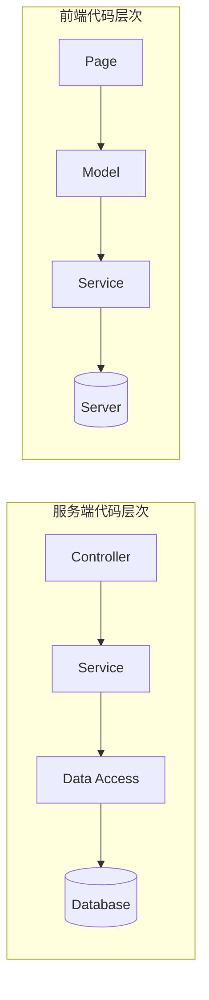
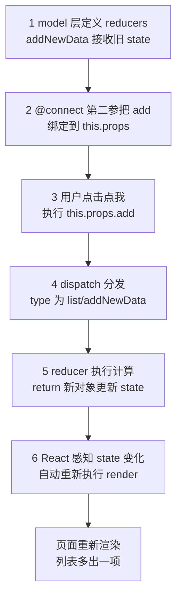
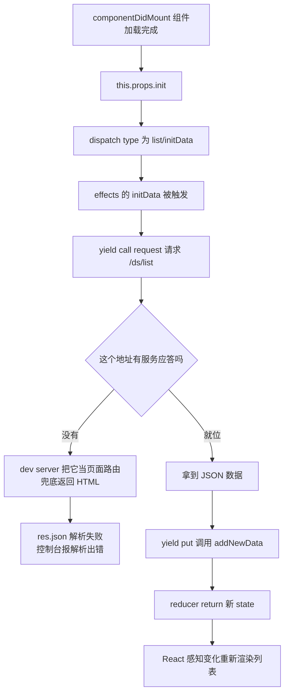
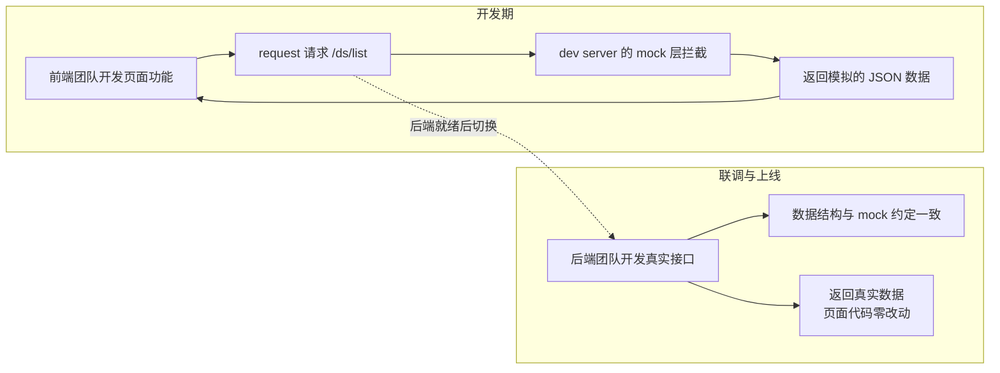

# ReactJS 入门之 Model 分层与数据流：dva、effects 与 mock 数据

## 先给结论

- 后端工程师对三层架构熟到肌肉记忆，前端这几年把同一套思想搬了过来：Page 侧重展示与交互，Model 负责业务逻辑与状态读写暂存，Service 专职与服务端对接。
- Model 层的核心词是状态：state 一变，Page 的 render 重新执行，页面随之更新，这是 Model 层格外重要的原因。
- dva 是 Model 层的落地方案，基于 Redux、redux-saga、react-router 的轻量封装，UmiJS 工程里把插件配置里的 dva 设为 true 即开启。
- 约定优于配置：src/models 目录下的文件自动注册为 model，namespace 是它在全局 state 里的唯一名字，dispatch 的 type 固定为「命名空间/方法名」。
- connect 两个函数各管一半：mapStateToProps 把 model 数据映射进 props，mapDispatchToProps 把自定义方法绑进 props 并在方法里 dispatch 调 reducers；reducers 用 return 返回新对象完成更新，全程不需要 setState。
- 写死的数据要退休：model 新增 effects 配置项承载异步，方法名带星号是 Generator 函数，call(request, url) 发请求，put 调本 model 的 reducer，触发时机挂在 componentDidMount。
- 接口没就位时请求会被 dev server 当页面路由返回 HTML，JSON 解析报错；mock 补上这块：根目录建 mock 目录，任意 js 文件注册成模拟服务，新增修改必须重启 dev server 才生效。
- 前后端的契约只有数据结构：后端就绪后地址不变、mock 下线，页面代码零改动，前后端并行开发从口号变成现实。

## 第1部分：ReactJS入门之Model分层的概念

后端工程师对三层架构熟到肌肉记忆：Controller 收请求，Service 写逻辑，DAO 碰数据库。前端这几年把同一套思想搬了过来，却常常被忽略。回头看 day01 的 List 页面：列表数据 `[1, 2, 3]` 写在组件的 `constructor` 里，页面自己管数据、自己管渲染。单页面看不出问题，可一旦多个组件要共享这份数据、或者数据要来自后台接口，「数据放哪」就必须有一个正式答案。这一课给出答案的骨架：前端分三层，重点讲中间那层 Model。

### 一、服务端的老朋友：快速过一遍三层

课件左半张图画的是服务端代码层次：用户请求先到 Controller，它负责接收请求、决定转发给谁、调用 Service 完成功能；Service 是业务逻辑所在，业务代码都写在这里；最下面的 Data Access 负责与数据库交互。

有一个细节值得展开：Data Access 不等于「只能连数据库」。如果应用没有数据库，而是要调用第三方接口或者自己的其他服务，这层同样承担「数据访问」的角色，只是数据源从数据库换成了远程接口。分层看的是职责边界，不是具体连了什么。

### 二、前端的三层：同样的思想，不同的名字

右半张图画的前端代码层次与后端一一对应，只是名字换了一套：



对照表把每层的职责钉死：

| 前端层 | 职责 | 关键约束 |
|---|---|---|
| Page | 页面渲染、接收用户输入操作 | 侧重展示型、交互性逻辑 |
| Model | 业务逻辑，状态的读写、变化、暂存 | state 变化驱动 render 重新执行 |
| Service | 与服务端对接（HTTP 协议） | 纯粹的数据读写，不做任何处理 |

数据流的走向也和后端一样是「去程找数据、回程逐层给」：用户在 Page 上操作，Page 把数据需求交给 Model，Model 需要后台数据时调用 Service，Service 通过 HTTP 与服务端交互拿回数据。Service 的任务到这一步就完成了，它把数据原样交给 Model，Model 做完封装再给 Page 渲染。整条链路上没有一层越权：Service 不改数据，Page 不关心数据从哪来。

### 三、Model 层的核心词：状态

**第一，状态是 Model 与 Page 之间的契约。** day01 讲组件状态时验证过：state 一变，React 自动调用 render 重新渲染页面。把状态集中到 Model 层之后，这条规律继续生效，只是 state 的主人从组件变成了 Model。Model 层负责状态的读写与暂存，Page 负责把状态画出来，两层靠 state 连接。

**第二，把数据写在组件里的痛点，正是 Model 要解决的。** List 页面就是现成的反例：数据初始化在 `constructor` 里，更新靠 `this.setState`：

```js
class List extends React.Component {
  constructor(props) {
    super(props);
    this.state = { // 数据住在 Page 层，别的组件够不着
      dataList: [1, 2, 3],
      maxNum: 3
    };
  }
}
```

问题有三处：兄弟组件要用这份数据，只能通过 props 一层层传；后台接口返回的列表，也得先落进某个组件的 state 才能渲染；组件销毁，数据随之丢失。把数据挪到 Model 层集中管理，这三个尴尬同时消失，Page 回归「只管展示与交互」的本分。

### 四、dva 把 Model 层落地

课件给这一节起的标题就是「使用 DVA 进行数据分层管理」。dva 提供了一份 model 的组织约定，一份 model 文件大致长这样（本课无配套源码，示例为按本课写法补全，下一课开始逐项实战）：

```js
export default {
  namespace: 'list', // 命名空间，全局 state 里区分不同 model
  state: {           // 状态：数据集中住在这里
    data: [1, 2, 3],
    maxNum: 3
  },
  reducers: {        // 同步更新 state 的函数
    addNewData(state) {
      return { data: [...state.data, state.maxNum + 1], maxNum: state.maxNum + 1 };
    }
  },
  effects: {         // 异步逻辑：调用 Service 拿后台数据
    // *queryData(action, { call, put }) {}
  },
  subscriptions: {   // 订阅：页面加载时自动触发
    // setup({ dispatch, history }) {}
  }
};
```

四个配置项各管一段：`state` 是数据本体，`reducers` 同步改状态，`effects` 处理异步（对接 Service 层），`subscriptions` 订阅时机。Page 与 Model 的连接靠 dva 的 `connect`，这是下一课的实战内容。

## 第2部分：ReactJS入门之dva的使用

上一课确立了 Model 分层，List 页面却还是老样子：`dataList` 与 `maxNum` 初始化在组件的 `constructor` 里，点击按钮靠 `this.setState` 更新。数据搬进 model 之后，一个立竿见影的副作用会出现：`setState` 改不动页面了。这一课把整条链路打通：开启 dva、定义 model、`connect` 取数展示、点击事件通过 `dispatch` 触发 reducer 更新状态，一次点击从按钮到渲染的全过程全程可见。

### 一、dva 是什么，怎么在 UmiJS 工程里打开

dva 官网（dvajs.com）的定位一句话就能读懂：基于 React 和 redux 之上的轻量级应用框架，采用 elm 风格，易学易用、仅有六个 API。它不是凭空造的新框架，而是对 Redux 的封装：引入 reducers、effects、subscriptions 来组织 model，简化 Redux 的使用，另有插件机制扩展功能。对开发者的要求很低：把它用起来，为业务服务，不必深究底层实现。

更省心的是 UmiJS 已替工程做了整合。day01 建工程时在 `config.js` 里引入过 umi-plugin-react 插件但没开功能，现在只需把 `dva` 打开：

```js
export default {
  plugins: [
    ['umi-plugin-react', {
      dva: true // 开启 dva 插件，model 数据层由它托管
    }]
  ]
};
```

一个布尔值，dva 就进了项目。接下来用 List 页面做完整改造：把它初始化在组件里的数据迁出去，搬到 model 层。

### 二、给数据安家：创建 ListData model

UmiJS 的约定是：`src/models` 目录下的文件都会被自动当作 model 加载。按约定建目录、创建 `ListData.js`：

```js
export default {
  namespace: 'list',   // 命名空间：这个 model 在全局 state 里的名字
  state: {             // 把 List 组件 constructor 里的数据原样搬过来
    data: [1, 2, 3],
    maxNum: 3
  }
};
```

`namespace` 必须认真取。一个项目里 model 会有很多个，全局 state 是所有 model 数据的集合，靠命名空间区分谁是谁；后面 `dispatch` 指定函数时同样要带命名空间前缀，防止两个 model 里的同名函数互相误伤。

注意一个细节：model 里的数据键叫 `data`，不再叫组件时代的 `dataList`，改名的事放到映射时去做。

### 三、connect 上半场：把 model 数据映射进 this.props

组件要用 model 的数据，得通过 dva 提供的连接器 `connect`。改造后的 List 组件（先看取数部分）：

```js
import React from 'react';
import { connect } from 'dva'; // connect 是具名导出，必须用大括号接

const namespace = 'list'; // 与 model 的 namespace 保持一致

// 第一个回调函数：将 page 与 model 连接，返回 model 中的数据，
// 并将返回的数据绑定到 this.props 上
@connect((state) => {
  return {
    dataList: state[namespace].data,
    maxNum: state[namespace].maxNum
  };
})
class List extends React.Component {
  constructor(props) {
    super(props);
    // 原来初始化 state 的代码整段注释掉，数据已交给 model
  }
  render() {
    return (
      <div>
        <ul>
          {this.props.dataList.map((value, index) => {
            return <li key={index}>{value}</li>;
          })}
        </ul>
        <button>点我</button>
      </div>
    );
  }
}

export default List;
```

几处要点钉牢：

**第一，`import { connect } from 'dva'` 的大括号不能省。** dva 导出的是具名成员，不像 React 有默认导出，漏了大括号拿到的就是 `undefined`。

**第二，`@connect` 是 ES6 修饰器语法。** day01 讲修饰器时提过它类似 Java 的注解，`connect` 本身是个方法，加修饰器后直接作用于类。讲义里把这个回调函数命名为 `mapStateToProps`，意思是把 state 映射到 props。

**第三，回调里的 `state` 是整个项目级别的全局 state。** 里面装着所有 model 的数据，所以先用 `state[namespace]` 按命名空间定位到本 model，再 `.data` 取出数据，最后 `return` 一个对象，它会被绑定到 `this.props` 上，`render` 里于是改用 `this.props.dataList` 遍历。

保存刷新，页面照常显示 1、2、3，但数据来源已经变成外部 model。此刻点「点我」没有任何反应，更新逻辑还停留在已注释掉的 `setState` 上。

### 四、setState 为什么救不了 model 的数据

直觉方案是「把 render 里的 `this.state` 改成 `this.props` 不就行了」，实际不行。数据现在不在当前页面组件里，而在外部的 model 中；`this.setState` 只能改组件自己的状态，对外部 model 毫无作用。要让数据变，就得由 Page 层触发事件，调用 Model 层定义的方法去更新，这正是 Model 分层的本意：改数据的权力收归 Model，Page 只负责发起请求。

### 五、model 层加 reducers：用 return 更新状态

给 ListData model 增加一个 `reducers` 配置项。它下面定义的是一组函数，函数名随意，这里取名 `addNewData`：

```js
export default {
  namespace: 'list',
  state: {
    data: [1, 2, 3],
    maxNum: 3
  },
  reducers: {
    addNewData: function (state) { // state 指的是更新之前的原始数据
      let maxNum = state.maxNum + 1;
      let newArr = [...state.data, maxNum]; // 展开旧数组再追加新值
      return {          // 用 return 返回更新后的数据，不能在这里 setState
        data: newArr,
        maxNum: maxNum
      };
    }
  }
};
```

这段逻辑和 day01 点击按钮时的算法一字不差，只是数据来源从 `this.state` 换成了函数参数 `state`。最要紧的一句：**reducer 收到的 `state` 是更新之前的旧值，更新全靠 `return` 返回新对象。** 旧值算新值、返回新对象，Redux 系的更新纪律在 dva 里原样保留。

### 六、connect 下半场：mapDispatchToProps 与 dispatch

reducers 定义好了，Page 层怎么调用它？还是靠 `connect`，这次用它的第二个参数。`connect` 接收第二个函数，它有两个作用：把定义的函数绑定到 `this.props`；同时提供 `dispatch` 去调用 model 层定义的函数。补全后的连接器与点击事件：

```js
const namespace = 'list';

@connect((state) => {           // 第一参：数据映射到 this.props
  return {
    dataList: state[namespace].data,
    maxNum: state[namespace].maxNum
  };
}, (dispatch) => {              // 第二参：方法映射到 this.props
  return {
    add: function () {
      dispatch({                // 通过 dispatch 调用 model 中定义的函数
        type: namespace + '/addNewData' // type 格式：命名空间/方法名
      });
    }
  };
})
class List extends React.Component {
  render() {
    return (
      <div>
        <ul>
          {this.props.dataList.map((value, index) => {
            return <li key={index}>{value}</li>;
          })}
        </ul>
        <button onClick={() => {
          this.props.add();     // 调用被绑定进 props 的方法
        }}>点我</button>
      </div>
    );
  }
}
```

第二参的回调收到一个内置函数 `dispatch`，它的职责是分发：按 `type` 找到目标函数去执行。`type` 必须写成「命名空间/方法名」，全局有多个 model 时，命名空间是路由到正确函数的唯一凭据。讲义里把这个函数称为 `mapDispatchToProps`，即把方法映射到 props。

一个容易犯迷糊的点：props 上绑定的方法叫 `add`，model 里的函数叫 `addNewData`，名字对不上。这是刻意的区分，两者不是同一个函数：`add` 只是 Page 层的壳，真正干活的是 `dispatch` 按 `type` 找到的那个 reducer。点击按钮，列表每点一次追加一个新数字，Page 与 Model 的分离就此完成。

### 七、一次点击的完整链路



链路里开发者亲手写的只有三处：model 里的 reducer、connect 的两个映射函数、按钮的 `onClick`。从 dispatch 到 render 的后半程全部由框架完成，改数据的动作发出后，页面自己跟上。本课只用到同步的 reducers；当数据需要从后台接口取，model 里就要写 effects 去对接 Service 层，那是后面课程的主题。

## 第3部分：ReactJS入门之Model中请求数据

上一课把数据搬进了 model，页面能取数也能改数，但 model 里那份 `data: [1, 2, 3]` 依旧是写死的：点多少次按钮都会往上加，可一刷新就回到这三个数。真实项目里，初始数据几乎都来自后台服务的接口，前端要做的是异步加载。这一课把「model 层发请求」这条路打通：页面加载完成触发 effects，effects 里 call 接口拿数据，put 调 reducer 把数据灌回 state，页面随 state 自动刷新。

### 一、写死的数据该退休了

**第一，问题不在页面在数据源。** Page 层与 Model 层分离之后，结构上清爽了，可 model 里初始化的 `data` 依然是硬编码。实际开发中，初始数据要靠后台服务加载，也就是 ajax 异步获取；model 这一层得有能力在合适的时机发请求、拿结果、更新 state，页面才有活数据。

**第二，先备好发请求的工具。** 在 `src` 下建一个 `util` 目录，里面放一个 `request.js`。课程现场这个文件是从资料包直接拷贝的，内容不必逐行研究，职责一句话能说清：收下一个 url，发出请求，把响应解析成 JSON 返回。等价实现大致长这样：

```js
// src/util/request.js
// 课程中的文件由资料包直接拷贝提供，这里给出行为等价的精简示例
export default function request(url) {
  return fetch(url).then((res) => res.json()); // 发 GET 请求，把响应体解析成 JSON
}
```

工程里也可以换成 umi-request 这类请求库，只要 `request(url)` 最终吐出解析好的数据，model 层感知不到任何差别。

### 二、effects：model 里的异步车间

model 里此前只有 `state` 和 `reducers` 两块，两者都不适合发请求：state 只是数据，reducer 必须是纯函数，不允许有副作用。dva 为此准备了第三个配置项 `effects`，专门承载异步操作：

```js
import request from '../util/request.js'; // 引入请求工具，下面 call 会用到

export default {
  namespace: 'list',
  state: {
    data: [1, 2, 3],
    maxNum: 3
  },
  reducers: { // 定义的一些函数
    addNewData: function (state) { // state 指的是更新之前的状态数据
      let maxNum = state.maxNum + 1;
      let newArr = [...state.data, maxNum];
      return { // return 返回更新后的数据
        data: newArr,
        maxNum: maxNum
      };
    }
  },
  effects: { // 新增 effects 配置，用于异步加载数据
    *initData(params, sagaEffects) { // 定义异步方法，函数名前的 * 不能丢
      const {call, put} = sagaEffects; // 拿到 call、put 两个工具函数
      const url = '/ds/list'; // 请求地址，ds 即 Data Source
      let data = yield call(request, url); // 发请求，yield 等结果落地再往下走
      yield put({ // 调用 reducers 中的方法
        type: 'addNewData',
        data: data // 把请求到的数据作为载荷传过去
      });
    }
  }
};
```

几个关键位置钉牢：

**第一，`*` 与 `yield` 是一对。** effects 里的方法必须是 Generator 函数，`*initData` 的星号就是声明；`yield call(request, url)` 表示把 call 派发的这个请求执行完，等结果回来再往下走。写法上同步，执行上异步，一层层的回调被压平成从上到下的一列。

**第二，两个参数各司其职。** 第一个参数 `params` 是 dispatch 派发动作时携带的参数对象，当前用不到可以先放着；第二个参数 `sagaEffects` 是 dva 注入的工具箱，解构出来的 `call` 负责调度异步任务，它的第一个参数是函数，后面是给这个函数的实参，`call(request, url)` 等价于「调用 request 并把 url 传给它」。

**第三，`put` 是 effects 通往 reducer 的唯一桥。** 数据到手还没完，state 不更新页面就不会变。`put({type: 'addNewData', data: data})` 按方法名调用 reducer，把请求结果作为载荷捎过去。注意这里的 type 没带命名空间前缀：在 model 内部 put 本 model 的方法，dva 会自动补前缀；而在组件里用 dispatch 时必须写全「命名空间/方法名」。

### 三、reducer 开出初始化的口子

原来 `addNewData` 的使命是点按钮新增一项，现在 `initData` 拿到接口数据后也要请它更新 state，等于同一个函数要伺候两种场景。本课先在函数开头加一个判断，给初始化留个口子：

```js
reducers: {
  addNewData: function (state) {
    if (state.data) { // state 中已存在 data 就直接返回，作为初始化的收尾
      return state.data;
    }
    let maxNum = state.maxNum + 1;
    let newArr = [...state.data, maxNum];
    return { // return 返回更新后的数据
      data: newArr,
      maxNum: maxNum
    };
  }
}
```

这里埋一个伏笔：put 传来的数据并不在 state 里，而在 dispatch 的载荷参数中，所以这个判断目前只是占位，接口真正返回数据之后要改成从载荷取数，mock 那一课会顺手把它修严谨。眼下更急的是另一件事：请求还没打通，页面却已经依赖 `dataList` 做 map 遍历，state 里的 `data` 暂时保留一份兜底值（比如 `data: [1]`），保证首屏渲染不报错。

### 四、谁在什么时候按门铃

effects 定义好了，可它不会自己跑。什么时候触发？答案藏在 React 的生命周期里：组件加载完成之后做初始化，正是 `componentDidMount` 的职责。但 Page 层不能直接调用 model 里的方法，唯一的通道还是 `dispatch`，而 dispatch 要靠 connect 的第二个参数绑定进来：

```jsx
const namespace = 'list';

@connect((state) => { // 第一参：把 model 数据映射到 this.props
  return {
    dataList: state[namespace].data,
    maxNum: state[namespace].maxNum
  };
}, (dispatch) => { // 第二参：把方法映射到 this.props
  return {
    add: function () {
      dispatch({ type: namespace + '/addNewData' }); // 点按钮的新增
    },
    init: function () {
      dispatch({ type: namespace + '/initData' }); // 触发 effects 里的异步初始化
    }
  };
})
class List extends React.Component {
  componentDidMount() { // 组件加载完成后触发异步初始化
    this.props.init();
  }
  render() {
    return (
      <div>
        <ul>
          {this.props.dataList.map((value, index) => {
            return <li key={index}>{value}</li>;
          })}
        </ul>
        <button onClick={() => { this.props.add(); }}>点我</button>
      </div>
    );
  }
}

export default List;
```

链路的发起端就此闭合：组件挂载完成，`this.props.init()` 被调用，dispatch 按 `list/initData` 找到 effects 里的异步方法，请求、put、reducer、state、重渲染一气呵成。dispatch 本身不区分同步异步，type 指向谁就触发谁：指向 reducers 里定义的函数就是同步更新，指向 effects 里定义的方法就进入异步流程。

### 五、链路跑通一半：回来的却是 HTML

把整条链路画出来：



刷新页面后，控制台的报错恰好卡在 F 到 H 这一段：`/ds/list` 这个地址眼下并不存在任何服务，dev server 找不到对应资源，按单页应用的规则把 `index.html` 兜底返回了，浏览器拿到的响应体是一张网页而不是 JSON，`res.json()` 自然解析失败。请求确实发出去了，effects 的写法也没有问题，缺的只是一个能应答这个地址的服务。把它补上的手段就是 mock，下一课的主角。

## 第4部分：ReactJS入门之mock数据

上一课把请求发了出去，链路卡在 `/ds/list` 没有服务应答这一步。前后端分离的开发模式里，这种等待本不该发生：后端接口没写完，前端可以自己模拟一份。这一课用 UmiJS 内置的 mock 能力补上这块拼图，让请求链路真正跑通，也让前后端并行开发从口号变成现实。

### 一、前后端分离，谁也不该等谁

**第一，先把场景立起来。** 前端团队与后端团队并行开发，前端系统要请求后台系统拿数据，可开发期后端接口往往还没写好，数据返回不了。前端不能因此停工，做法就是自己模拟：把接口地址和返回数据先假造出来，基于这份模拟数据把页面功能全部开发完，等后端就绪再对接真实地址。这套操作就叫 mock，是前后端并行开发的标配。



图里两条支线的交汇点只有一个：`/ds/list` 这个地址背后的数据结构。mock 阶段它由前端自己定义，联调阶段由后端兑现，页面代码从头到尾不变。UmiJS 对这套机制做了开箱即用的支持，用起来只要三步：建目录、写文件、重启。

### 二、根目录建 mock 目录，写模拟服务

**第一，位置是约定好的。** 在项目根目录（与 `src`、`config` 平级）建一个 `mock` 目录，下面创建 `MockListData.js`：

```js
// mock/MockListData.js
export default {
  'get /ds/list': function (req, res) { // 模拟 GET /ds/list 请求，返回数据
    res.json({
      data: [1, 2, 3, 4], // 为了与此前写死的数据区分，初始给 4 个值
      maxNum: 4
    });
  }
};
```

三处细节值得说明：

**第一，键名即路由。** `'get /ds/list'` 由「请求方法 + 空格 + 路径」拼成，与 effects 里 `const url = '/ds/list'` 正好对上。上一课的 request 默认发 GET 请求，mock 这里也就模拟 GET；方法名写错或漏写，请求就对不上号。

**第二，req 与 res 眼熟吗。** 这两个参数与 Node 服务端框架里的请求、响应对象同款，`res.json(...)` 直接把对象序列化成 JSON 写回响应。需要模拟 POST、读取请求参数、延迟返回时，mock 文件里都有对应的写法，原理一致。

**第三，返回结构要贴合 state。** `data` 与 `maxNum` 正好是 model 里 state 的两个键，mock 返回什么形状，reducer 就能原样吃进什么形状，这份形状就是前后端要约定的东西。

### 三、重启才生效，这个坑必踩一次

mock 文件写完，保存、刷新，数据纹丝不动。这不是写错了，而是 mock 的生效时机：dev server 启动时才扫描 mock 目录并注册路由，运行中新增的文件不会被感知。`Ctrl + C` 停掉服务重新启动，编译通过后再刷新，Network 面板里 `/ds/list` 已经能返回刚才那份 JSON，effects 里的 `call` 如愿拿到数据。

### 四、reducer 的最后一块拼图：result 参数

数据回来了，页面却报 `Cannot read property 'map' of undefined`。排查下来，问题出在 reducer：上一课占位的写法 `if (state.data) return state.data` 会把数组当成整个 state 返回，state 的对象结构被打散，`state[namespace].data` 自然取不到。正确的认识是：**put 传来的数据在 reducer 的第二个参数里，不在 state 里。** 把签名补上第二个参数，初始化改用载荷：

```js
export default {
  namespace: 'list',
  state: {
    data: [1], // 首屏兜底数据，接口数据落地后会被整体替换
    maxNum: 3
  },
  reducers: {
    addNewData: function (state, result) { // result 是 dispatch 传来的 action
      if (result.data) { // 带着请求结果来的，走初始化
        return result.data; // mock 返回的 data 与 maxNum 结构和 state 完全一致
      }
      let maxNum = state.maxNum + 1; // 没带结果，是点击按钮触发的新增
      let newArr = [...state.data, maxNum];
      return { // return 返回更新后的数据
        data: newArr,
        maxNum: maxNum
      };
    }
  }
};
```

`result.data` 就是 mock 返回的 `{data: [1, 2, 3, 4], maxNum: 4}`，结构与 state 完全一致，直接 return 即完成初始化；点击按钮时 dispatch 不携带 data，走下方的新增逻辑。改完刷新，列表显示 1 到 4；再到 mock 文件里追加一个值、把数据扩成 5 个，重启刷新后列表变 1 到 5，点击按钮依次追加 6、7、8、9、10。模拟服务返回的数据，已经像真实接口一样驱动着整个页面。

### 五、从 mock 切到真实接口

等后端把服务开发好，切换的动作小得出乎意料：请求地址不变（或按环境配置指向真实域名），mock 目录下线，页面一行代码都不用动。前提只有一个：**前后端在开工前就把数据结构约定死。** mock 返回什么字段、什么层级、什么类型，真实接口就返回什么字段、什么层级、什么类型，这份契约为前端的模拟数据兜底，也为后端的接口设计立规矩。约定变了，mock 同步跟着改，两边永远一致，联调才不会变成事故现场。

## 常见误区

- **把 Model 层当成数据库缓存。** Model 暂存的是页面状态，生命周期跟随前端应用；持久化仍由后台的 Data Access 层负责，两层不要混。
- **让 Service 层顺手加工数据。** Service 只做 HTTP 读写，数据格式转换、组装都归 Model；职责越界的 Service 会变成谁都不敢动的泥球。
- **把 Page 写成业务逻辑的家。** Page 里塞满请求、计算与状态拼装，展示逻辑和数据逻辑搅在一起；正确姿势是 Page 只调 Model 给的方法。
- **以为 model 文件随便放哪都行。** dva 依赖目录约定（如 `src/models`）自动注册 model，文件放错位置框架就看不见它。
- **数据搬进 model 后继续用 `setState` 更新。** `setState` 只管组件自己的状态，对 model 无效；更新必须走 dispatch 触发 reducers。
- **reducer 里忘记 `return`。** reducer 靠返回值更新状态，只计算不返回等于没更新。
- **`type` 只写方法名不带命名空间。** 全局多个 model 存在同名函数时无法定位，必须写成「命名空间/方法名」。
- **`import { connect } from 'dva'` 漏掉大括号。** connect 是具名导出，漏了大括号拿到 undefined，`@connect` 直接报错。
- **把 reducer 收到的 `state` 当成最新值。** 它是更新之前的旧数据，所有计算基于旧值展开，再 return 一个全新对象。
- **effects 方法名前丢掉 `*`。** 没有 `*` 就不是 Generator 函数，里面的 `yield` 直接语法报错，dva 也无法把它当作 saga 任务调度。
- **把 `call` 写成直接调用。** `call` 的第一个参数是函数，后面才是实参，`call(request, url)` 是标准姿势；自己直接执行 `request(url)` 就绕开了 saga 的调度，拿不到「等结果再往下走」的语义。
- **在 reducer 里发请求。** reducer 必须是纯函数，同样的输入必须得到同样的输出；请求是副作用，只能放进 effects。
- **组件里 dispatch 不带命名空间。** effects 内部 put 本 model 的方法可以省前缀，但组件里的 dispatch 必须写成 `namespace + '/initData'`，否则找不到目标。
- **state 清空后首屏必崩。** 接口没接通就把 state 的初始 data 删掉，render 里的 `dataList.map` 会报 `Cannot read property 'map' of undefined`，先留一份兜底值。
- **改了 mock 不重启就刷新等结果。** mock 路由在 dev server 启动时注册，新增文件与修改路由都要重启，刷新一万次也没用。
- **mock 方法与请求方法不匹配。** effects 里的 request 默认发 GET，mock 键写成 `post /ds/list` 就永远匹配不上，请求会落到页面路由返回 HTML。
- **mock 目录放错层级。** 必须放在项目根目录与 `src` 平级，挪进 `src` 里 UmiJS 就找不到，模拟服务形同虚设。
- **初始化分支拿 state 硬算。** 请求结果在 reducer 的第二个参数里，用 `state.data` 拼初始化数据会丢字段、破结构，页面渲染直接报 map 错误。
- **mock 数据结构与后端约定不一致。** 单独看 mock 一切正常，联调时页面全崩；字段名、层级、类型都要在开工前对齐并文档化。

## 面试可能被问到的问题

1. 面试官追问：「前端 Page、Model、Service 三层各自的职责是什么？」
   答：Page 负责页面渲染与用户交互，侧重展示型和交互性逻辑；Model 负责业务逻辑，为 Page 做状态的读写、变化与暂存，state 变化驱动 render 重新执行；Service 专职与服务端做 HTTP 接口对接，纯粹读写数据、不做任何加工。

2. 面试官追问：「前端分层和服务端分层是怎么对应的？」
   答：前端 Page 对应后端 Controller，都是直接面向请求方的一层；Model 对应后端 Service，承载业务逻辑与数据状态；前端 Service 对应后端 Data Access，都是最底层的数据访问，只是数据源从数据库换成了远程接口。

3. 面试官追问：「为什么说 Model 层的状态是关键？」
   答：React 的渲染机制建立在 state 变化触发 render 上。Model 层集中托管状态后，状态在哪、谁来改、改完谁渲染都有了唯一答案：Model 持有 state，reducers 负责改，框架自动重渲染 Page。状态管理清晰，页面才可预测。

4. 面试官追问：「dva 的 model 由哪几部分组成？」
   答：主要由 namespace（在全局 state 中唯一标识该 model）、state（初始状态）、reducers（同步更新状态）、effects（处理异步副作用）、subscriptions（订阅时机自动 dispatch）组成。日常业务里最常写的是 state、reducers 与 effects。
5. 面试官追问：「dva 是什么，和 Redux 是什么关系？」
   答：dva 是基于 Redux、redux-saga 与 react-router 实现的轻量级前端框架，采用 elm 风格，仅有六个 API。它不是替代 Redux，而是在 Redux 之上做了封装，用 model 组织 state、reducers 与 effects，省去手写 action 与样板代码的成本。

6. 面试官追问：「dva model 里的 namespace 有什么作用？」
   答：namespace 是 model 在全局 state 中的唯一标识。全局 state 汇集所有 model 的数据，组件取数时用 state[namespace] 定位，dispatch 时用「命名空间/方法名」指定目标 reducer，避免多 model 同名函数冲突。

7. 面试官追问：「connect 的两个参数分别做什么？」
   答：第一个参数是 mapStateToProps，把全局 state 中该 model 的数据映射成组件的 props；第二个参数是 mapDispatchToProps，把自定义方法映射进 props，方法内部通过 dispatch 按 type 调用 model 里的 reducers，是组件发起状态变更的入口。

8. 面试官追问：「dva 里为什么不能用 setState 更新 model 的数据？」
   答：setState 只作用于组件自身的 state，而数据已托管给外部的 model，两者不是同一份数据。修改 model 必须通过 dispatch 派发 action，由 reducer 返回新状态，state 更新后框架自动重渲染组件。

9. 面试官追问：「reducer 函数的 state 参数是更新前还是更新后的值？」
   答：更新之前的原始数据。reducer 是纯函数，基于旧 state 计算出新 state 并 return 返回，不能在其中直接改参数或调 setState；返回的新对象成为该 model 的最新状态。

10. 面试官追问：「在 UmiJS 工程里如何启用 dva，model 文件放哪？」
   答：UmiJS 通过 umi-plugin-react 插件整合 dva，在 config 配置文件里把 dva 设为 true 即可启用；src/models 目录下的文件会按约定自动注册为 model，页面级 model 也可放在 pages 对应目录的 models 子目录里。
11. 面试官追问：「dva 为什么要设计 effects，直接在 reducer 里发请求不行吗？」
   答：reducer 是纯函数，负责用旧 state 和动作算出新 state，必须无副作用、可重放；请求属于异步副作用，结果不可预测。dva 把副作用从 reducer 剥离到 effects，由 redux-saga 风格的 Generator 函数承载，reducer 只做最后一步同步的状态更新，职责边界清晰。

12. 面试官追问：「effects 里的 call 和 put 分别做什么？」
   答：call 负责调度异步任务，第一个参数是函数，其后是实参，配合 yield 等待结果返回；put 负责在 model 内部派发 action，通常用来调用本 model 的 reducer，把异步结果写进 state。一取一存，构成 effects 的标准组合。

13. 面试官追问：「effects 里的方法为什么用 Generator 而不是普通函数加 Promise？」
   答：Generator 配合 yield 能把异步流程写成同步顺序的形态，每一步都由 saga 中间件接管调度，便于实现等待、取消、并发控制与统一错误处理；相比裸写 Promise 链，逻辑更线性，也更容易测试。

14. 面试官追问：「页面初次加载时如何自动触发 model 里的异步初始化？」
   答：常见做法是在组件的 componentDidMount 生命周期里，通过 connect 第二个参数绑定的方法执行 dispatch，type 写成「命名空间/方法名」指向 effects。dva 也支持在 model 的 subscriptions 里监听路由变化触发，适合与组件解耦的初始化。

15. 面试官追问：「put 的 type 什么时候要带命名空间前缀？」
   答：在 model 内部的 effects 里 put 本 model 的方法可以省略前缀，dva 会自动补上当前命名空间；在组件里通过 dispatch 触发时必须写全「命名空间/方法名」，全局 state 汇集了所有 model 的数据，前缀是路由到正确函数的唯一凭据。

16. 面试官追问：「请求返回的是 HTML 而不是 JSON，控制台报解析错误，怎么排查？」
   答：先开 Network 面板确认请求的 url 与响应体：若返回的是 index.html，说明该地址没有对应的服务或代理，开发服务器兜底返回了页面。对照后端确认接口路径与端口，开发期可在 mock 里临时补一条同路径的路由，或配置 proxy 转发到真实服务。
17. 面试官追问：「mock 数据是什么，解决什么问题？」
   答：mock 即在真实接口就位前，前端按约定自行模拟接口的地址与返回数据。它解耦了前后端的开发进度：前端不等后端，基于模拟数据完成全部功能开发，后端完成后仅切换数据来源即可联调，缩短整体交付周期。

18. 面试官追问：「UmiJS 的 mock 有哪些约定？」
   答：项目根目录建 mock 目录，其下任意 js 文件都会被注册为模拟服务；文件默认导出一个对象，键名为「请求方法 + 空格 + 路径」，值是处理函数，参数为请求与响应对象，用 res.json 返回数据。dev server 启动时加载，改动需重启生效。

19. 面试官追问：「为什么 mock 修改后必须重启 dev server？」
   答：mock 路由是开发服务器在启动阶段扫描 mock 目录并注册的中间件，运行期不再重新扫描。新增文件或修改路由表都不会被感知，必须重启让注册流程重跑一遍。

20. 面试官追问：「dva 中 reducer 的第二个参数是什么？异步数据怎么进 state？」
   答：第二个参数是 dispatch 派发的 action 对象，effects 里 put 携带的载荷都在其中。异步数据进入 state 的路径是：effects 用 call 拿到结果，put 携带结果调用 reducer，reducer 从第二个参数里取出数据并 return 新 state。

21. 面试官追问：「前后端分离项目如何保证 mock 与真实接口平滑切换？」
   答：开工前双方约定接口路径与数据结构并形成文档；前端 mock 严格按契约实现，切换时只改请求的 baseURL 或下线 mock，不改页面逻辑。契约有变更时同步更新 mock，保持两边始终一致。

## 配套资料

- 本教学日资料包暂无配套源码（`materials/code/03/day02-Ant Design以及Ant Design Pro入门/` 解压后为空），List 反例取自 day01 组件状态一课的课堂代码，dva model 骨架为按本课写法补全的示例，完整实战见下一课 dva 的使用
- 本教学日资料包暂无配套源码（`materials/code/03/day02-Ant Design以及Ant Design Pro入门/` 解压后为空），本课代码为按本课演示画面与讲义术语（mapStateToProps、mapDispatchToProps）整理补全的示例：讲义伪代码中的 `state['namespace']` 按课堂实际写法改为 `state[namespace]` 变量取值，List 组件与 ListData model 可放入 UmiJS 工程对应目录直接运行验证
- 本教学日资料包暂无配套源码（`materials/code/03/day02-Ant Design以及Ant Design Pro入门/` 解压后为空，仅含提取记录），文中代码为按本课演示画面与讲义术语整理补全的示例：`request.js` 为资料包拷贝文件的等价精简实现，ListData model 与 List 组件可放入 UmiJS 工程的 `src/models`、`src/pages` 对应位置直接运行验证
- 本教学日资料包暂无配套源码（`materials/code/03/day02-Ant Design以及Ant Design Pro入门/` 解压后为空，仅含提取记录），文中代码为按本课演示画面整理补全的示例：`mock/MockListData.js` 与调整后的 ListData model 可放入 UmiJS 工程对应位置，配合上一课的 request 工具直接运行验证
