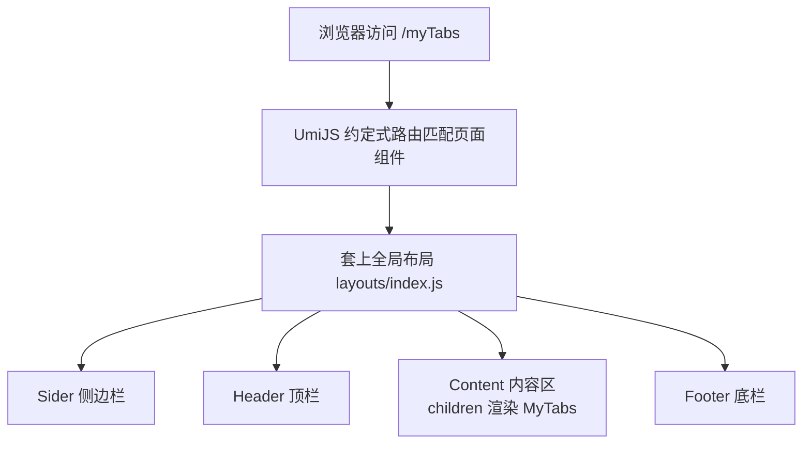
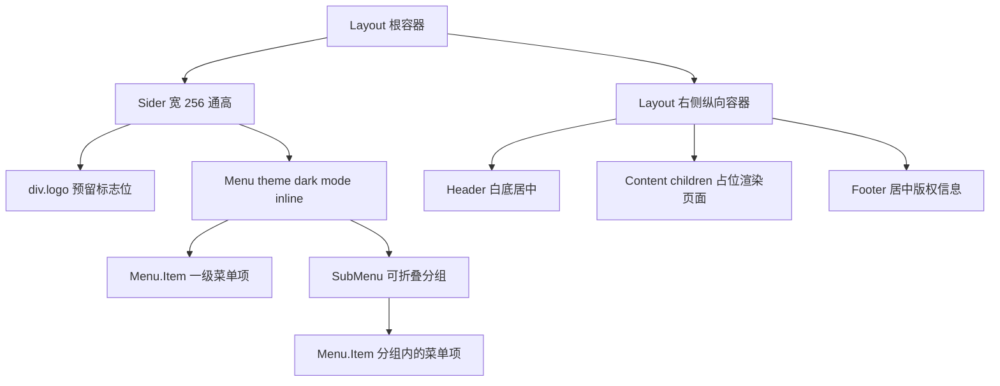
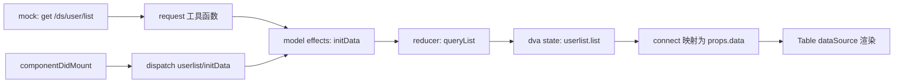
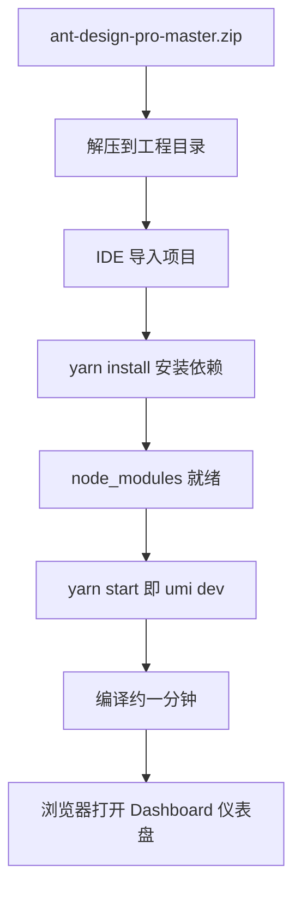
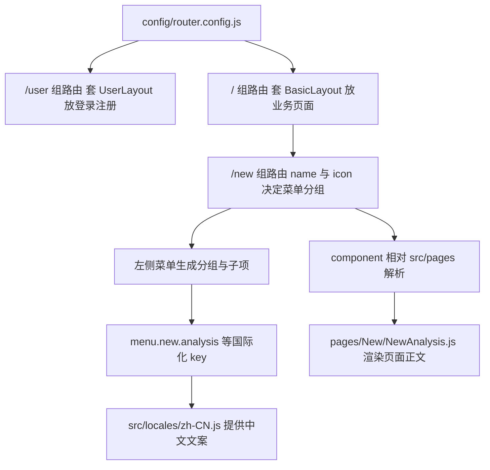
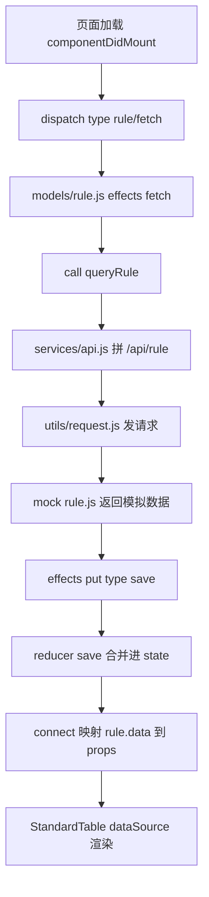

# Ant Design 全景：从组件库到 Pro 脚手架的中后台进阶路线

## 先给结论

- Ant Design 是蚂蚁金服体验技术部基于 React 打造的企业级 UI 组件库，主打中后台系统；Ant Design Pro 是站在它肩膀上的开箱即用中后台脚手架，组件库给零件，Pro 给整车。
- 引入组件库两条路：普通 React 工程 `npm install antd --save` 后手动引组件与样式；UmiJS 工程在 umi-plugin-react 插件配置里把 `antd: true` 打开即完成整合。
- 用组件的三步套路通用：import 导入、按官方示例搭 JSX、子组件从父组件上取，`Tabs.TabPane` 与 `Menu.SubMenu` 都是同一个路数。
- 布局四件套 Header、Sider、Content、Footer 只能放在 Layout 里；经典后台骨架 = 深色 Sider 装 Menu 导航条，右侧纵向排 Header、Content、Footer。
- Table 三要素 `columns` 定列、`dataSource` 定数据、每行要有唯一 key；`dataIndex` 对齐字段名，格式化显示交给 `render`，分页是内置 `pagination`。
- 数据分层的规矩不变：页面只管渲染，数据进 model，接口由 mock 拦截；页面经 `@connect` 取 state，`dispatch` 触发 effects 调 services。
- Pro 的菜单由路由配置生成：`config/router.config.js` 里每项的 name、icon、routes 层级直接决定左侧菜单；文案走国际化 key，key 缺失时菜单直接显示 key 本身。
- model 执行链路一句话：dispatch 到 effects、call 调 service 发请求、put 交 reducer 进 state、connect 送回页面渲染；上手 Pro 先读目录再跟链路。

## 第1部分：Ant Design 入门：企业级 React 组件库，从引组件到搭全局布局

ReactJS 部分到这里告一段落：组件、生命周期、dva 数据流都通了，可页面还是原生 `button` 加 `ul`，离一个像样的中后台差得远。React 官方只提供逻辑与渲染的骨架，从没给过任何 UI 组件，按钮、表单、表格、布局全得自己造。这块缺口由 Ant Design 来补，本课从它的定位讲到引入方式，再用 Tabs 组件练手，最后用 Layout 把后台系统的全局骨架立起来。

### 一、React 缺的那块拼图

**第一，定位要一句话说清。** Ant Design 是蚂蚁金服基于 React 开发的 UI 组件库，主要用于中后台系统。React 官方并没有提供 UI 组件，这个空档由 Ant Design 填上，而且无论设计还是完成度都相当成熟，GitHub 上 star 数以万计，是这一领域事实上的主流选择。它的 logo 也说明了出身：React 的标志加上一个加号，站在 React 之上的组件方案。

**第二，设计价值观可以咂摸一下。** 官网给它的描述是「服务于企业级产品的设计体系，基于确定和自然的设计价值观」。确定与自然这两个词偏理念，不必急着抠定义，落到体感上就是：组件的交互与视觉高度一致，拿来即用，设计者与开发者都能专注于用户体验本身。它的几项官方特性也印证了这一定位：提炼自企业级中后台产品的交互语言与视觉风格、开箱即用的高质量组件、使用 TypeScript 构建、提供覆盖开发全链路的设计与开发工具体系。

**第三，组件覆盖面够广。** 打开官网的组件总览，几十个组件按用途分区：布局类的 Layout 与栅格；导航类的 Menu、面包屑、Tabs；数据录入类的按钮、日期选择框、评分、选择器、上传；反馈类的对话框 Modal、全局提示、进度条；还有走马灯、回到顶部这类周边组件。开发一个后台系统，这些基本够用，遇到没见过的再去文档里翻。

### 二、把 antd 引进工程的两种方式

**第一种是通用工程的手动安装。** 任何 React 工程都可以按官方文档来，npm 或 yarn 二选一：

```bash
npm install antd --save
# 或者
yarn add antd
```

装完在代码里按需导入组件，样式文件也要引入一次。官方文档的示例是这么写的：

```js
import { Button } from 'antd'; // 按需导入组件
import 'antd/dist/antd.css';   // 引入样式文件，less 版本同理
ReactDOM.render(
  <Button>Hello World</Button>,
  document.getElementById('root')
);
```

**第二种是 UmiJS 工程的插件开关。** 本课程的工程用 UmiJS 构建，引入 antd 连安装都不用：umi-plugin-react 插件已经集成了对 antd 的支持，在配置里把开关打开即可。打开 `config/config.js`，在已开启的 dva 旁边加一项，注意逗号分隔：

```js
export default {
  plugins: [
    ['umi-plugin-react', {
      dva: true,  // 开启 dva 功能
      antd: true  // 开启 Ant Design 功能
    }]
  ]
};
```

一个布尔值，antd 就进了工程，按需加载与样式引入由插件处理，比手动安装省心得多。

### 三、小试牛刀：以 Tabs 标签页为例

组件怎么用？最好的文档不是讲义而是官网。每个组件页下方有可交互的演示，点 show code 就能看到实现同样效果的代码，照着抄、按需改，是使用 antd 的标准姿势。以 Tabs 为例，在 `src/pages` 下新建 `MyTabs.js`：

```jsx
import React from 'react';
import { Tabs } from 'antd'; // 第一步，导入需要使用的组件

function callback(key) {
  console.log(key); // 切换标签时打印当前项的 key
}

class MyTabs extends React.Component {
  render() {
    return (
      <Tabs defaultActiveKey="1" onChange={callback}>
        <TabPane tab="Tab 1" key="1">Content of Tab Pane 1</TabPane>
        <TabPane tab="Tab 2" key="2">Content of Tab Pane 2</TabPane>
        <TabPane tab="Tab 3" key="3">Content of Tab Pane 3</TabPane>
      </Tabs>
    )
  }
}

export default MyTabs;
```

照官网示例抄完，页面直接报 `TabPane is not defined`。原因在于 TabPane 没有被导入：它是 Tabs 的子组件，不从包里单独导出，而是挂在 Tabs 对象上，必须在文件里显式取出来：

```js
const TabPane = Tabs.TabPane; // 子组件从父组件上取
```

补上这一行，标签页正常渲染，每个面板的文案按需改写即可。点击某个标签时 onChange 触发 callback，打印出该项的 key，key 就是每个标签的唯一标识。不想单独声明也可以直接在 JSX 里写 `<Tabs.TabPane>`，效果一致；面板多了以后统一声明一次更清爽。

这套「导入组件、参考示例、子组件从父组件取」的流程是通用的：需要上传组件就去上传组件页看示例，看中图片预览的效果就去看它的源码，一个组件会用了，其余组件举一反三。

### 四、Layout：把后台骨架立起来

**第一，先看后台的经典版式。** 后台系统通常拆成三块：左侧菜单栏、顶部标题栏、中间内容区，不少系统再加一条底部栏放版权与版本信息。antd 的 Layout 组件就是为这种版式准备的容器体系，官网示例里的侧边布局与目标最接近：左边 Sider 独占一列，右边一整列纵向排 Header、Content、Footer。

**第二，全局布局靠约定目录。** 在 `src` 下创建 `layouts` 目录，这是 UmiJS 约定的布局目录；再在里面建 `index.js`，这个文件将被作为整个项目的全局布局，所有页面都套进它渲染。参考官方示例写一个 BasicLayout：

```jsx
import React from 'react';
import { Layout } from 'antd';
const { Header, Footer, Sider, Content } = Layout; // 四个子容器从 Layout 上解构

class BasicLayout extends React.Component {
  render() {
    return (
      <Layout>
        <Sider>Sider</Sider>
        <Layout>
          <Header>Header</Header>
          <Content>Content</Content>
          <Footer>Footer</Footer>
        </Layout>
      </Layout>
    )
  }
}

export default BasicLayout;
```

外层 Layout 横向分左右，左边是 Sider，右边再嵌一层 Layout 纵向排三件。四个子容器的官方描述一致：自带默认样式、其下可嵌套任何元素、只能放在 Layout 中。新建布局文件后如果页面没有变化，重启一次 dev server 即可，布局文件在启动时被 UmiJS 扫描注册。重启后访问 `/myTabs`，页面上出现 Sider、Header、Content、Footer 的骨架；换 `/list` 也一样。这验证了全局布局的约定：无论访问哪个页面，外层永远是 layouts 下的 index.js。

**第三，内容区不能写死。** 眼下每个页面都被套进同一个骨架，但 Content 里只有「Content」三个字，页面本体丢了。内容区是动态的：访问 myTabs 时它该显示 MyTabs，访问 list 时该显示 List。改法是把 Content 写成占位：

```jsx
<Content style={{ background: '#fff' }}>
  {this.props.children} {/* 当前页面组件由框架塞进这里 */}
</Content>
```

`this.props.children` 拿到的正是路由匹配到的页面组件，UmiJS 负责把页面装进布局的 Content 里，组装过程全部由框架完成。此后要做的只是开发不同的页面组件，外层骨架自动生效。

**第四，手动配置路由属于可选项。** 如果不想用约定式路由，可以在 config.js 里加 `routes` 数组显式声明：

```js
export default {
  plugins: [
    ['umi-plugin-react', {
      dva: true,  // 开启 dva 功能
      antd: true  // 开启 Ant Design 功能
    }]
  ],
  routes: [ // 手动配置路由，非必须
    {
      path: '/',
      component: '../layouts', // 根路径指向全局布局
      routes: [
        { path: '/myTabs', component: './myTabs' }
      ]
    }
  ]
};
```

根路径指向 layouts，子路由指向各页面，效果与约定式等价。要特别留意的是：一旦配置了 routes，就不再走 UmiJS 默认的约定式路由，两套机制二选一，没有特殊需求保持默认即可。

整棵渲染树长这样：



关键一环是 C 到 F：布局在最外层包住所有页面，children 是内容区唯一的开口，页面组件从这里注入，骨架与页面由此解耦。

## 第2部分：给后台骨架上妆：Sider 导航条与布局美化

骨架有了，页面还是一排灰底灰字的占位文字，谈不上后台系统的气质。这一课做两件事：给 Layout 四件套配上像样的样式，再把 Menu 导航条装进左侧 Sider，让全局布局第一次有了「后台」的样子。

### 一、给四件套上样式

上一课的 BasicLayout 只有结构没有样式，现在把尺寸与配色补进去：

```jsx
import React from 'react';
import { Layout } from 'antd';
const { Header, Footer, Sider, Content } = Layout;

class BasicLayout extends React.Component {
  render() {
    return (
      <Layout>
        <Sider width={256} style={{ minHeight: '100vh', color: 'white' }}>
        </Sider>
        <Layout>
          <Header style={{ background: '#fff', textAlign: 'center', padding: 0 }}>
          </Header>
          <Content style={{ margin: '24px 16px 0', background: '#fff', minHeight: 360 }}>
            {this.props.children}
          </Content>
          <Footer style={{ textAlign: 'center' }}>后台系统 ©2018</Footer>
        </Layout>
      </Layout>
    );
  }
}

export default BasicLayout;
```

几处样式逐个看：

**第一，Sider 的 100vh。** Sider 指定宽度 256 像素，`minHeight: '100vh'` 保证它最少占满一整个可视窗口的高度。vh 是 CSS 里的视口单位，100vh 就是可视界面高度的百分之百，浏览器窗口多高，侧边栏就多高，与内容多少无关。

**第二，Header 去默认色。** Header 自带的默认底色是深色，`background: '#fff'` 换成白底，`textAlign: 'center'` 让标题文字居中，`padding: 0` 清掉内边距，顶栏成了一条干净的白色横条。

**第三，Content 留呼吸感。** 外边距 `24px 16px 0` 让内容区与四周留白，白底加 `minHeight: 360` 保证内容区有基础高度，后续所有页面组件都渲染在这里。

**第四，Footer 放身份信息。** 文本居中即可，版权与版本号按项目实际情况填写。

刷新后效果立现：左侧通高的深色竖条、顶部白底横条、中间白底内容区、底部版权行，后台系统的版式一眼可辨。访问 list 页面同样成立，所有后续页面都会长在这个骨架里。

### 二、Menu 导航条装进 Sider

**第一，去官网选型。** Menu 组件在导航类分区下，提供横向与纵向多种形态，其中深色纵向（dark 主题、inline 模式）的示例与我们的 Sider 最匹配，官网演示与代码可直接参考。

**第二，导入与准备。** 在布局文件里追加 Menu 与 Icon 两个导入，把子组件 SubMenu 定义出来；折叠交互需要状态支撑，constructor 里备好初始值：

```jsx
import React from 'react';
import { Layout, Menu, Icon } from 'antd';
const { Header, Footer, Sider, Content } = Layout;
const SubMenu = Menu.SubMenu; // 子菜单同样从 Menu 上取

class BasicLayout extends React.Component {
  constructor(props) {
    super(props);
    this.state = {
      collapsed: false // 侧边栏折叠状态，初始为展开
    };
  }
  render() {
    return (
      <Layout>
        <Sider width={256} style={{ minHeight: '100vh', color: 'white' }}>
          <div className="logo" /> {/* 预留放系统标志的位置 */}
          <Menu theme="dark" mode="inline"
                defaultSelectedKeys={['1']} defaultOpenKeys={['sub1']}>
            <Menu.Item key="1">
              <Icon type="desktop" />
              <span>工作台</span>
            </Menu.Item>
            <SubMenu key="sub1" title={<span><Icon type="team" /><span>房源管理</span></span>}>
              <Menu.Item key="2">房源列表</Menu.Item>
              <Menu.Item key="3">新增房源</Menu.Item>
            </SubMenu>
          </Menu>
        </Sider>
        <Layout>
          <Header style={{ background: '#fff', textAlign: 'center', padding: 0 }}>
          </Header>
          <Content style={{ margin: '24px 16px 0', background: '#fff', minHeight: 360 }}>
            {this.props.children}
          </Content>
          <Footer style={{ textAlign: 'center' }}>后台系统 ©2018</Footer>
        </Layout>
      </Layout>
    );
  }
}

export default BasicLayout;
```

说明一句：上面 Sider 内部的菜单结构与业务名，是按官网 Menu 深色示例与本课写法补全的示例，课程现场拷贝的是讲义里的同款结构。

**第三，菜单的组织层次。** Sider 里先放一个 `div.logo` 预留标志位，下面才是 Menu。Menu 上的几个属性各管一件事：`theme="dark"` 深色主题，与 Sider 的底色融为一体；`mode="inline"` 纵向展开；`defaultSelectedKeys` 指定默认选中项；`defaultOpenKeys` 指定默认展开的分组。菜单项分两种：`Menu.Item` 是叶子项，直接点击；`SubMenu` 是可折叠的分组，内部再包 Menu.Item。刷新页面，与官网演示同款的深色导航就立在 Sider 里了。

整棵布局树现在长这样：



左侧分支已经完整可交互，右侧分支等待页面组件注入，布局与导航各就各位。

### 三、从静态骨架到可用后台

Menu 里现在还没有接路由，点菜单项不会跳页面。把菜单项与页面路径连起来、让选中态跟随路由变化，是导航条的下一步，也是后台壳子成形前的最后一块板。collapsed 状态已经就位，配合 Sider 的折叠属性与触发器即可做侧边栏收起展开，收起后菜单只留图标，给内容区腾出整行宽度。

## 第3部分：Table 表格：columns 定列、dataSource 定数据，再把数据分离进 model

后台系统里出镜率最高的组件，非表格莫属：列表页要它，查询页要它，报表页还是它。Ant Design 的 Table 把行列展示、分页、排序、筛选这些能力全部封装好，真正要写的只有两件事：这个表有哪些列，数据从哪里来。这一课先把官方最简示例搬进 UserList 页面，再把写死在页面里的数据按分层规矩搬进 model 层，最后用 mock 接口把数据喂给表格，走完一次标准的前端分层改造。

### 一、官方最简示例里藏着三个概念

Table 组件的官方文档功能相当丰富：合并单元格、行可选、分页、排序与筛选、远程加载数据、树形折叠展开、固定表头、固定列，做后台用得到的形态几乎都有现成示例。入门先抓最基本的一种，官方示例的列配置只有一段：

```jsx
import { Table, Divider, Tag } from 'antd';

const columns = [{
  title: 'Name',
  dataIndex: 'name',
  key: 'name',
  render: text => <a href="javascript:;">{text}</a>,
}, {
  title: 'Age',
  dataIndex: 'age',
  key: 'age',
}, {
  title: 'Address',
  dataIndex: 'address',
  key: 'address',
}, {
  title: 'Tags',
  key: 'tags',
  dataIndex: 'tags',
  render: tags => (
    <span>
      {tags.map(tag => <Tag color="blue" key={tag}>{tag}</Tag>)}
    </span>
  ),
}];
```

三个概念各就各位：

**第一，title 与 dataIndex 描述一列。** title 是表头文字，dataIndex 是这一列从行数据里取哪个字段。行数据是对象数组，字段名与 dataIndex 对上，单元格才有内容，对不上就是一列空白。

**第二，render 决定这一列怎么显示。** 默认渲染把字段值原样输出；带上 render 之后，单元格显示什么由函数说了算。Tags 列的值是数组，直接显示会变成一串逗号连接的文本，render 里遍历数组生成蓝色的 Tag 标签，观感立刻不同。

**第三，dataSource 喂数据。** `<Table dataSource={data} columns={columns} />`，columns 是列的配置，dataSource 是行的数据，两者一拼，表格就成了。

### 二、UserList 改造成表格页

回到自己的页面。需求：展示一批用户，列为姓名、年龄、地址、标签，外加一列操作按钮。页面里先准备三条数据，再按官方示例搭 JSX。本项目用的是 Column 子组件写法，列一个个写进 Table 标签内部，与 columns 数组等价：

```jsx
import React from 'react';
import { Table, Divider, Tag } from 'antd';
const { Column } = Table;

const data = [{
  key: '1',
  name: '张三',
  age: 32,
  address: '上海市',
  tags: ['程序员', '帅气'],
}, {
  key: '2',
  name: '李四',
  age: 42,
  address: '北京市',
  tags: ['漂亮'],
}, {
  key: '3',
  name: '王五',
  age: 32,
  address: '杭州市',
  tags: ['高富帅', '富二代'],
}];

class UserList extends React.Component {
  render() {
    return (
      <div>
        <Table dataSource={data}
               pagination={{position: 'bottom', total: 500, pageSize: 10, defaultCurrent: 3}}>
          <Column title="姓名" dataIndex="name" key="name" />
          <Column title="年龄" dataIndex="age" key="age" />
          <Column title="地址" dataIndex="address" key="address" />
          <Column
            title="标签"
            dataIndex="tags"
            key="tags"
            render={tags => (
              <span>
                {tags.map(tag => <Tag color="blue" key={tag}>{tag}</Tag>)}
              </span>
            )}
          />
          <Column
            title="操作"
            key="action"
            render={(text, record) => (
              <span>
                <a href="javascript:;">编辑</a>
                <Divider type="vertical" />
                <a href="javascript:;">删除</a>
              </span>
            )}
          />
        </Table>
      </div>
    );
  }
}

export default UserList;
```

刷新页面，表格完整出现：三条数据、蓝色标签、编辑删除链接各就各位，链接之间用 `Divider type="vertical"` 拉出一条竖向分割线。

分页这一个对象值得单独说：`position` 控制分页器放在哪里，这里放表格底部；`total` 声明总条数 500；`pageSize` 每页 10 条；`defaultCurrent` 让分页器默认停在第三页。刷新后分页器显示 50 页、当前第 3 页，点下一页翻页正常。页面里明明只有三条数据，分页器却按 total 工作，说明 total 是展示层的声明值，真实项目里它会来自接口返回的总条数。操作列的两个链接目前是空实现，点击行为等接入业务再补。

### 三、把数据分离进 model

表格能显示了，但 `data` 写死在页面里，与此前确立的分层规矩冲突：页面属于 Page 层，只管展示与交互；数据归 Model 层管。按这套规矩，把数据搬进 `src/models/UserListData.js`：

```js
import request from '../util/request';

export const namespace = 'userlist'; // 命名空间，全局唯一，用于区分 model

export default {
  namespace,
  state: {
    list: [] // 表格数据，初始为空
  },
  effects: {
    // 异步初始化：请求接口，拿到数据后交给 reducer
    *initData(action, { call, put }) {
      const response = yield call(request, '/ds/user/list');
      yield put({
        type: 'queryList',
        data: response
      });
    }
  },
  reducers: {
    queryList(state, result) {
      let data = [...result.data]; // 展开请求结果
      return { // 业务状态
        list: data
      };
    }
  }
};
```

这套结构与此前写过的 ListData model 完全同款：namespace 做全局区分，state 里放一个空数组 `list` 占位；effects 里的 `initData` 是 Generator 函数，`call` 调 request 请求 `/ds/user/list`，`put` 把结果交给 reducer；`queryList` 展开收到的数组塞回 state。state 一变，依赖它的页面自动重新渲染，React 的响应式机制替我们做了刷新。

### 四、UserList 接上连接器

页面这边做三处改动：从 model 文件导入 namespace，类上加 `@connect` 修饰器，dataSource 换成 props 里的数据：

```jsx
import { namespace } from '../models/UserListData';

@connect((state) => {
  return {
    data: state[namespace].list // model 的 list 映射进 props.data
  }
}, (dispatch) => {
  return {
    initData: () => {
      dispatch({
        type: namespace + '/initData' // 指向 model 的 effects
      });
    }
  }
})
class UserList extends React.Component {
  componentDidMount() {
    this.props.initData(); // 组件加载完成即触发异步初始化
  }
  render() {
    return (
      <div>
        <Table dataSource={this.props.data}
               pagination={{position: 'bottom', total: 500, pageSize: 10, defaultCurrent: 3}}>
          {/* 姓名、年龄、地址、标签、操作五列的 Column 配置保持不变 */}
        </Table>
      </div>
    );
  }
}

export default UserList;
```

connect 的第一个参数把 `state[namespace].list` 映射成 `props.data`，第二个参数把 `initData` 方法绑进 props，方法内部 dispatch 的 type 拼上 namespace，精准指向 model 的 effects。`componentDidMount` 里调用它，组件加载完成，数据就开始加载。

### 五、mock 补上接口，链路跑通

此时刷新页面，表格是空的。打开 Network 面板能看到原因：请求正常打到了 `/ds/user/list`，但这个地址还没有人应答，自然拿不到数据。按 mock 的老办法补一条路由，在已有的 `mock/MockListData.js` 里追加：

```js
'get /ds/user/list': function (req, res) {
  res.json([
    { key: '1', name: '张三一', age: 32, address: '上海市', tags: ['程序员', '帅气'] },
    { key: '2', name: '李四二', age: 42, address: '北京市', tags: ['漂亮'] },
    { key: '3', name: '王五三', age: 32, address: '杭州市', tags: ['高富帅', '富二代'] }
  ]);
}
```

数据结构与页面里原来写死的一份完全一致，所以页面里的本地 data 可以删掉了。mock 的新增必须重启 dev server 才生效，重启后刷新，表格显示张三一、李四二、王五三。姓名特意与此前写死的不同，页面跟着变，证明数据确实来自 mock 接口而不是页面自己；Network 面板里这条请求的响应体，就是 mock 函数返回的数组。

整条链路串起来是这样的：



关键路径在两处衔接：`componentDidMount` 的 dispatch 点燃整条链路，`connect` 把链路终点的 state 送回页面。表格只是链条末端的一块屏。

## 第4部分：Ant Design Pro：站在组件库肩膀上的中后台脚手架

布局、导航、表格都用起来了，可距离一个真正能交付的后台系统还差得远：登录、菜单、几十种典型页面、异常兜底、国际化，全靠自己从组件一个个攒，工作量不小。组件库给的是零件，造整车还缺一条生产线。这一课的主角 Ant Design Pro 就是那条生产线：弄清它的定位，把它下载、导入、跑起来，后面整个后台系统的开发都基于它。

### 一、为什么需要 Pro

**第一，后台系统的复杂度不在单个组件。** 想象一个完整的中后台：仪表盘上要摆统计卡片与图表，业务页要各类表单与列表，还要搜索结果页、成功页、失败页、403/404/500 异常页、个人设置。每一类页面都是布局、组件、交互的组合体，用 Ant Design 从零搭，每个页面都要自己设计、自己实现，精力花费非常大。

**第二，Pro 把这些页面提前开发好了。** 它在 Ant Design 组件的基础上做出了一整套后台管理系统：能直接用的页面拿来就用，不能直接用的参考它的实现写自己的业务，省时省力。

**第三，定位一句话。** Ant Design Pro 是基于 Ant Design 的一个开箱即用的企业级中后台前端解决方案。开箱即用，就是拿到手即可使用，不需要做过多的配置或环境支持。后续的后台系统就选定它为基础框架，下文简称 Pro。

官方列出的特性值得到一遍：优雅美观；常见设计模式，提炼了中后台典型的页面和场景；最新技术栈，React、dva、Ant Design 一应俱全；响应式，适配不同屏幕；主题定制；国际化；mock 数据方案；UI 测试等最佳实践。每一项在后面的使用中都能亲眼见到。

### 二、部署安装三步

拿到 Pro 有两条路：去 GitHub 仓库下载，或直接用资料包里备好的 `ant-design-pro-master.zip`。

**第一步，解压到工程目录。** 压缩包解压到任意目录，课程演示放在 F 盘的 code 目录下，解压完得到 `ant-design-pro-master` 文件夹，里面 `config`、`mock`、`public`、`src` 等目录一应俱全。

**第二步，导入 IDE。** 在 IDEA 里选择 Import Project，定位到解压目录完成导入。导入后工程里的个别文件与学习无关，可以先保留，等熟悉项目后再做清理。

**第三步，初始化并启动。** 打开终端执行两条命令：

```bash
yarn install # 安装相关依赖
yarn start   # 启动服务
```

`yarn install` 是必须的一步：拿到手的只是源码，工程还依赖大量第三方包，安装花了三百多秒，装完后工程里多出 `node_modules` 目录，里面是成百上千个依赖包。过程中会刷出不少依赖版本维护状态的 warning，不阻塞安装，等它跑完即可。接着 `yarn start`，大约一分钟后编译完成，浏览器自动打开页面。终端里能看到这条命令的真身：

```bash
F:\code\ant-design-pro-master>yarn start
yarn run v1.12.1
$ cross-env APP_TYPE=site umi dev
```

`umi dev` 说明 Pro 的底层脚手架正是此前学过的 UmiJS，路由约定、mock 约定、dva 整合在 Pro 里全部适用，前面的功课一点没白做。

### 三、目录结构：读项目先读目录

导入完成后先认目录，Pro 的官方结构如下：

```text
1 config # 配置，包含路由，构建配置
2 mock # 模拟数据
3 public # 静态资源
4 src # 业务源码
5 assets # 业务通用图片
6 layouts # 通用布局
7 models # 全局 data model
8 pages # 业务页面入口和常用模板
9 services # 后端接口服务
10 utils # 工具类
11 locales # 国际化资源
12 global.css # 全局 CSS
13 global.js # 全局 JS
14 tests # 测试工具
15 package.json # 依赖包
```

除表中所列，`src` 下还有 `components` 目录，存放跨页面复用的通用组件。这份结构与此前手搭的 UmiJS 工程一脉相承，只是每个目录里的内容被 Pro 填满了：`pages` 里是成套的模板页面，`services` 里是与后端对接的接口函数，`locales` 里是各国语言的文案。

启动与浏览的过程可以这样概括：



最耗时的一环是依赖安装，它一次性把开发与运行所需的包全部就位；之后的日常开发里，改动 `src` 下的代码靠热更新即时生效，不再重复前两步。

### 四、跑起来之后先逛一圈

启动完成自动打开页面，默认进入 Dashboard 仪表盘：总销售额、访问量、支付次数等统计卡片，配上各类图表；左侧菜单往下还有监控页、工作台。继续逛：表单页分基础表单、分步表单、高级表单，做业务表单时可以直接参考；列表页有查询表格、标准列表等模板；搜索结果页、成功页、失败页都是现成的；异常页 403、404、500 也已备好，访问不存在的路径就能看到。

右上角可以切换国际化语言，切到 English 后菜单与页面文案整体变成英文，例如搜索列表变为 Search Table，再切回简体中文也只需一下。还有个人设置、全局搜索、消息通知等常用功能；左侧菜单可以整体折叠，收起后只留图标，给内容区腾出整行宽度。功能完整度相当高，说它是一套能直接交付的后台原型并不夸张。后面开发租房项目的后台，就是在这套底子上做改造：改菜单、换页面、接接口。

## 第5部分：自定义菜单与页面：路由长菜单、国际化给文案、pages 放页面

Pro 跑起来后，左侧自带一套演示菜单：Dashboard、表单页、列表页。这些是给演示准备的，不可能直接搬进自己的项目，开工前必须搞清楚两件事：菜单从哪来，页面怎么加。这一课用一组 `/new` 路由做完整的操练：新增路由让菜单长出来，补国际化让文案正确显示，建 Page 组件让页面真正属于自己。

### 一、两套路由，两种布局

打开 `config/router.config.js`，整个文件就是一个导出的数组，主干结构如下：

```javascript
export default [
  // user
  {
    path: '/user',
    component: '../layouts/UserLayout',
    routes: [
      { path: '/user', redirect: '/user/login' },
      { path: '/user/login', component: '/User/Login' },
      { path: '/user/register', component: '/User/Register' },
      { path: '/user/register-result', component: '/User/RegisterResult' },
    ],
  },
  // app
  {
    path: '/',
    component: '../layouts/BasicLayout',
    Routes: ['src/pages/Authorized'],
    authority: ['admin', 'user'],
    routes: [
      // dashboard
      {
        path: '/',
        redirect: '/dashboard/analysis',
      },
      {
        path: '/dashboard',
        name: 'dashboard',
        icon: 'dashboard',
        routes: [
          {
            path: '/dashboard/analysis',
            name: 'analysis',
            component: '/Dashboard/Analysis',
          },
        ],
      },
    ],
  },
]
```

两套路由的分工很清楚。请求 `/user` 下的路径（比如右上角点退出登录跳到的登录页）走第一组，套 UserLayout，那是只有背景与登录卡片的简洁布局；其余业务页面都挂在 `/` 下，套 BasicLayout，也就是带侧边菜单的后台布局。登录用的默认账号是 admin，密码 888888。

菜单由路由生成的证据就摆在这个文件里：dashboard 一项的 name、icon 与 routes，和左侧菜单的 Dashboard 分组及其分析页、监控页、工作台三个子项一一对应。Pro 没有采用 UmiJS 默认的约定式路由，而是配置式路由，把页面结构与菜单结构统一收在一份配置里，`component` 指向 pages 下的组件，`Routes` 与 `authority` 则挂权限校验，后面项目里会用到。

### 二、新增一组路由，菜单立刻长出来

在 `/dashboard` 那组路由旁边插入一组 `/new`，component 暂时借用 Dashboard 下的现成页面：

```javascript
// new
{
  path: '/new',
  name: 'new',
  icon: 'user',
  routes: [
    {
      path: '/new/analysis',
      name: 'analysis',
      component: './Dashboard/Analysis',
    },
    {
      path: '/new/monitor',
      name: 'monitor',
      component: './Dashboard/Monitor',
    },
    {
      path: '/new/workplace',
      name: 'workplace',
      component: './Dashboard/Workplace',
    },
  ],
},
```

保存刷新，左侧菜单多出一个分组，三个子项全部就位，点击 New 分析页还能正常显示分析页的内容。只是分组标题显示成了 `menu.new`、子项显示成 `menu.new.analysis` 这样的原文。这个现象反过来把机制讲透了：菜单结构完全由路由决定，而菜单文案另有出处。

### 三、菜单文字去国际化文件里补 key

文案不在路由里配，而在 `src/locales/zh-CN.js`。menu 部分是这样的：

```javascript
'menu.home': '首页',
'menu.dashboard': 'Dashboard',
'menu.dashboard.analysis': '分析页',
'menu.dashboard.monitor': '监控页',
'menu.dashboard.workplace': '工作台',
'menu.list': '列表页',
'menu.list.searchtable': '查询表格',
'menu.list.basiclist': '标准列表',
```

key 的拼接规律与路由层级严格对应：`menu.` 前缀加上每一级路由的 name，用点号连起来。照此给 `/new` 组补键：

```javascript
'menu.new': 'New',
'menu.new.analysis': '分析页',
'menu.new.monitor': '监控页',
'menu.new.workplace': '工作台',
```

刷新，菜单显示 New 分析页、New 监控页、New 工作台，从原文到中文一步到位。路由决定结构，国际化决定文案，两层各管各的；需要英文菜单时，去 `en-US.js` 里补同名 key 即可，这正是 Pro 国际化特性的日常用法。

### 四、自定义页面：pages 下建目录写组件

component 借用现成页面只是演示，真实开发要指向自己的组件。所有页面依然保存在 `src/pages` 下，以功能为单元创建目录，目录名沿用项目现有风格、首字母大写。new 功能对应建 `pages/New` 目录，在里面创建 `NewAnalysis.js`：

```jsx
import React from 'react';

class NewAnalysis extends React.Component {
  render() {
    return (
      <div>NewAnalysis</div>
    );
  }
}

export default NewAnalysis;
```

一个最普通的 React 组件。再把路由的 component 从 `./Dashboard/Analysis` 改成 `./New/NewAnalysis`：

```javascript
{
  path: '/new/analysis',
  name: 'analysis',
  component: './New/NewAnalysis',
},
```

保存刷新，点击 New 分析页，页面正文显示 NewAnalysis。component 的解析相对 `src/pages` 目录，`./New/NewAnalysis` 就是 `pages/New/NewAnalysis.js`，路径与大小写都要写对。至此，从菜单入口到页面内容的完整链路打通，往这个组件里写业务逻辑即可，后面开发租房后台的每个功能页都走这条流程。



这张图里两条支线在路由处分岔：一条向右生成菜单外观，一条向下落到具体组件；汇合点就是浏览器里「菜单点进去看到页面」的这一次点击。

## 第6部分：Pro 的 model 执行流程：一条 dispatch 到 mock 的完整数据链路

新页面会建了，可页面里的数据是怎么加载进来、又怎么显示出来的？这个问题不搞清楚，在 Pro 里写业务就只能是照猫画虎。以菜单里的查询表格（TableList）为例，把 Pro 的 model 执行流程从页面一路读到 mock 接口，这条链路读懂了，后面开发功能就照这个套路写代码。

### 一、找到页面，抓住 render 这个牛鼻子

查询表格的路由是 `/list/table-list`，component 指向 `/List/TableList`，对应文件就是 `src/pages/list/TableList.js`。它有六百多行，因为塞了简单搜索、可展开的高级搜索、批量操作等一堆交互。读这种复杂组件有个窍门：不管写得多复杂，渲染一定发生在 render 方法里，抓它准没错。render 的 return 里能找到这段：

```jsx
<StandardTable
  selectedRows={selectedRows}
  loading={loading}
  data={data}
  columns={this.columns}
  onSelectRow={this.handleSelectRows}
  onChange={this.handleStandardTableChange}
/>
```

StandardTable 在页面里点不进去，因为它不是 antd 的组件，而是 `src/components` 下的通用组件。Pro 把跨页面复用的组件都放在这个目录。它的内部最终渲染的就是 antd 的 Table，data 传给它做 dataSource，columns 传给它做列配置。这里用的还是 React 的基本功：引入自定义组件时，通过属性把数据传进去，页面把 `data` 递给表格，表格拿 `dataSource` 铺内容。

### 二、data 从哪来：connect 与解构表达式

顺着 data 往上看它的出处，TableList 的类定义长这样：

```jsx
@connect(({ rule, loading }) => ({
  rule,
  loading: loading.models.rule,
}))
@Form.create()
class TableList extends PureComponent {
  state = {
    modalVisible: false,
    selectedRows: [],
    formValues: {},
  };

  columns = [
    {
      title: '规则名称',
      dataIndex: 'name',
    },
  ];

  render() {
    const {
      rule: { data },
      loading,
    } = this.props;
    // ...
  }
}
```

`@connect` 第一个参数从全局 state 里取出名为 rule 的 model 数据，顺带取出 `loading.models.rule`，这是 dva-loading 插件维护的加载状态，表格转圈的动画由它驱动。render 里的取值写法是 ES6 的解构表达式，day01 练过的语法：从 `this.props` 里拆出 rule，再从 rule 里拆出 data，一层层剥开。data 就此交给 StandardTable，表格显示什么由它说了算。

### 三、model 里发生了什么：dispatch 到 put 再到 state

rule 这个 model 在 `src/models/rule.js`。数据不可能凭空出现在 state 里，得有人触发加载。页面加载完成的那一刻，生命周期方法出手：

```js
componentDidMount() {
  this.props.dispatch({
    type: 'rule/fetch',
  });
}
```

type 的前半段 `rule` 是 model 的命名空间，后半段 `fetch` 是 effects 里的方法名，dispatch 据此精准命中：

```js
effects: {
  *fetch({ payload }, { call, put }) {
    const response = yield call(queryRule, payload);
    yield put({
      type: 'save',
      payload: response,
    });
  },
},
reducers: {
  save(state, action) {
    return {
      ...state,
      data: action.payload,
    };
  },
},
```

`*fetch` 是 Generator 函数，两个动作按顺序走：`yield call(queryRule, payload)` 调用接口函数等结果回来，`yield put({ type: 'save', payload: response })` 把结果交给本 model 的 reducer。reducer 的 save 展开旧 state、用 `action.payload` 覆盖 data，返回新的 state。state 一变，connect 的映射立刻生效，props 里的 data 更新，表格重新渲染。取数、存数、渲染三段职责，在 effects、reducers、connect 之间分得清清楚楚。

### 四、请求的最后两站：services 与 mock

effects 里调的 `queryRule` 来自 `src/services/api.js`，service 层的职责就是与后端接口对接：

```js
export async function queryRule(params) {
  return request(`/api/rule?${stringify(params)}`);
}
```

`request` 是 `src/utils/request.js` 里封装的请求工具，内部统一处理 HTTP 状态码（`checkStatus`：非 2xx 抛错并弹出全局通知）与响应缓存（`cachedSave`）。请求发出后并没有真实后端接住，它落在 `mock` 目录的 `rule.js` 上：mock 里注册了 `get /api/rule` 这条路由，对应的 `getRule` 函数对数据做一轮模拟组装后返回。数据沿原路折返：request 拿到响应，effects 拿到 response，reducer 写进 state，connect 推给页面，表格出数。



十一个环节一个方向，中途没有任何一步反向操作，这是 dva 单向数据流的标准形态。真实接口就位时只动一处：mock 下线、请求落到真服务，其余九个环节原封不动。

## 常见误区

- **TabPane is not defined。** 子组件不从包里单独导出，必须 `const TabPane = Tabs.TabPane` 显式取出，或直接写 `<Tabs.TabPane>`。

- **Content 里写死内容。** 布局是全局的，Content 写死任何文案，所有页面就长一个样；内容区只放 `{this.props.children}`。

- **把 Header、Sider 等放在 Layout 外面。** 四个容器只能放在 Layout 中，脱离开要么不渲染、要么样式错乱。

- **新增 layouts 文件后不重启。** 布局文件由 UmiJS 启动时扫描注册，新建后页面无变化时先重启 dev server 再找代码原因。

- **配置了 routes 还期待约定式路由。** routes 一旦声明即接管路由，pages 目录的自动映射失效，两套机制别混用。

- **把 100vh 写成 100%。** 百分比高度依赖父级有明确高度，父级没定高时直接塌陷；vh 相对视口计算，不依赖父级高度链。

- **SubMenu 当独立组件导入。** 它挂在 Menu 上，写 `import { SubMenu } from 'antd'` 拿不到东西，必须 `const SubMenu = Menu.SubMenu`。

- **Menu 不配 theme 撞色。** Sider 深色而 Menu 默认浅色主题，导航白底黑字浮在深色竖条上；`theme="dark"` 保持两边一致。

- **状态备了不接线。** collapsed 只放进 state 而不配合 Sider 的折叠属性与触发器，菜单永远不收；演示阶段可以不接线，但要知道缺哪一环。

- **菜单项 key 重复。** key 既是选中态标识也是分组的路由凭据，两处 key 相同会导致高亮与展开错乱。

- **dataIndex 与字段名对不上。** 列配置写了 `dataIndex: 'username'`，数据里叫 `name`，这一列整列空白且不报错；列取不到值时先核对字段名。

- **数组列忘了写 render。** 标签这类数组字段直接渲染会变成逗号连接的原始文本；用 render 遍历生成 Tag，且每个 Tag 要带 key。

- **mock 新增不重启。** mock 路由在 dev server 启动时注册，运行中追加的 `get /ds/user/list` 不会被感知，请求一直落空。

- **namespace 两边不一致。** model 里导出的 namespace 与 connect 里引用的不是同一个值，`state[namespace]` 就是 undefined，页面直接报 `Cannot read property 'list' of undefined`。

- **数据分离后 dataSource 还指向旧变量。** 页面里的 data 删了，dataSource 却没换成 `this.props.data`，编译报变量未定义；换了但 model 还没通，表格就一直空着。

- **npm 与 yarn 混用。** Pro 的脚本与锁文件按 yarn 组织，先 `npm install` 再 `yarn start` 容易得到不一致的 `node_modules`；认准一种包管理器，本课统一用 yarn。

- **把 warning 当 error。** install 过程大量 `no longer maintained` 提示只是依赖包的维护状态告警，不阻塞安装，让它跑完再判断。

- **install 没跑完就 start。** 依赖缺着，`umi dev` 启动直接报模块找不到；顺序是 install 正常结束后再 start。

- **node_modules 提交进版本库。** 依赖清单在 `package.json` 里，任何环境重新 install 即可还原，提交 node_modules 只会让仓库膨胀到无法协作。

- **把 Pro 当组件库用。** Pro 是整套工程方案，要在它的项目结构与开发流程里做业务；只想单独引按钮表格的话，Ant Design 组件库本身就够了。

- **菜单显示 `menu.new.analysis` 原文。** 不是渲染出错，而是国际化 key 缺失，去 `zh-CN.js` 里按路由层级补键即可；key 拼写与路由 name 必须逐级一致。

- **component 路径写错或大小写不符。** 页面空白、控制台报模块找不到；路径相对 `src/pages`，目录与文件名的大小写要与磁盘上的完全一致，部署到大小写敏感的 Linux 时错一处就找不到模块。

- **路由组写了 name 却漏了 routes 或 component。** 菜单项能渲染出来，点击却 404 或白屏；带子项的组必须有 `routes` 数组，叶子节点必须有 `component`。

- **目录名小写与现有风格不一致。** 单看能跑，但与 Dashboard、List 这些大写目录混在一起后，后来者很难分清哪个是模板哪个是业务，风格统一本身就是工程纪律。

- **以为菜单在别处单独配置。** 找遍 `src` 找不到菜单文件；Pro 的菜单由路由配置驱动，改菜单就是改 `router.config.js`，再配国际化文案。

- **type 忘写命名空间。** dispatch 派发 `fetch` 而不是 `rule/fetch`，全局没有 model 注册这个名字，什么都不发生；type 必须带 model 前缀。

- **reducer 直接 return action.payload。** state 里的其他字段全丢，页面依赖的数据结构被抽空；正确写法是 `...state` 展开旧状态，再覆盖目标字段。

- **想在 effects 里直接改 state。** dva 的 state 只能由 reducer 返回新值产生，effects 只负责取数与 put，越权改动不会触发渲染。

- **解构表达式认不出。** `const { rule: { data } } = this.props` 是嵌套解构，从 props 里逐层取字段，不是什么新框架的语法；看不懂它，整条链路就读断。

- **service 与 mock 对不上号。** `queryRule` 请求 `/api/rule`，mock 里键名写成 `/api/rules` 或方法不是 get，请求落空，effects 等到的永远是 undefined，表格一直空转。

## 面试可能被问到的问题

1. 面试官追问：「Ant Design 是什么，适用什么场景？」
   答：蚂蚁金服基于 React 打造的企业级 UI 组件库，主打中后台系统。它提炼自大量真实产品的交互与视觉规范，提供几十个开箱即用的高质量组件，以 TypeScript 构建，能覆盖后台开发绝大部分界面需求，团队不必重复造轮子。

2. 面试官追问：「普通 React 工程和 UmiJS 工程引入 antd 有什么区别？」
   答：普通工程先 npm 或 yarn 安装 antd，再在代码里按需导入组件并手动引入样式文件；UmiJS 工程由 umi-plugin-react 插件集成，配置里把 antd 设为 true 即完成接入，按需加载与样式引入由插件处理。

3. 面试官追问：「Tabs.TabPane 这种把子组件挂在父组件上的设计有什么好处？」
   答：相关组件收拢在一个命名空间下，导入成本低且语义清晰，TabPane 天然从属于 Tabs，单独导出反而容易被孤立误用。Ant Design 里 Menu.SubMenu、Modal.confirm 都是同样的组织方式，API 边界随父组件收敛。

4. 面试官追问：「src/layouts/index.js 为什么能成为全局布局？」
   答：这是 UmiJS 的约定：约定式路由在组织路由树时，若存在 layouts/index.js，就把它作为根节点包裹所有页面组件。页面切换只替换 children 对应的内容，外层骨架保持不变，等价于手动路由里根路径指向布局组件的写法。

5. 面试官追问：「Content 里为什么要渲染 this.props.children？」
   答：布局组件被框架包裹在所有页面外层，当前匹配到的页面组件以 children 的形式传入。Content 用 children 占位，访问不同路由时内容区自动切换成对应页面，布局与页面由此解耦，布局只管骨架不管内容。

6. 面试官追问：「UmiJS 的约定式路由和手动配置路由如何取舍？」
   答：页面结构与目录一致时用约定式路由，零配置、新增页面即生效；需要精细控制路径、嵌套关系与权限分组时用 routes 手动配置。两者互斥，配置 routes 后约定映射失效，混用会造成路由不可预测。

7. 面试官追问：「CSS 的 vh 单位是什么，和百分比有什么区别？」
   答：vh 是视口高度单位，100vh 等于浏览器可视窗口高度的百分之百；百分比高度相对父元素，需要父级有确定高度才能生效。侧边栏通高这类需求用 vh 最直接，不受父级高度链影响。

8. 面试官追问：「Menu 组件的 theme 和 mode 常用取值有哪些？」
   答：theme 有 light 与 dark 两种主题；mode 有 vertical 纵向、horizontal 横向、inline 纵向展开三种形态。后台侧边栏通常是 dark 加 inline，顶部导航用 horizontal。

9. 面试官追问：「SubMenu 和 Menu.Item 怎么配合实现分组菜单？」
   答：Menu.Item 是叶子菜单项，SubMenu 是可折叠分组，title 是分组标题，内部嵌套 Menu.Item 作为组内项；defaultOpenKeys 控制初始展开的分组，defaultSelectedKeys 控制默认高亮项，key 是各项的唯一标识。

10. 面试官追问：「侧边栏折叠功能怎么实现？」
   答：组件里维护一个 collapsed 布尔状态，通过触发器切换它；Sider 配合 collapsible 与 collapsed 属性，Menu 配合 inlineCollapsed 属性即可实现收起与展开，收起后菜单通常只显示图标。

11. 面试官追问：「布局组件的样式用内联 style 好吗？」
   答：小范围、与结构强绑定的布局样式用内联足够直观；但内联无法复用、不支持伪类与媒体查询，正式项目应抽成 less 或 css 模块，主题色等全局变量交给样式方案统一管理。

12. 面试官追问：「Table 组件的 columns 和 dataSource 各自负责什么，dataIndex 的作用是什么？」
   答：columns 是列配置数组，描述表头文字、取值字段与渲染方式；dataSource 是行数据数组，每行一个对象且需要唯一 key。dataIndex 指定该列从行对象的哪个字段取值，两者字段名一致才能渲染出内容。

13. 面试官追问：「列的 render 函数能拿到哪些参数，适合做什么？」
   答：常用签名是 `(text, record, index)`，text 是当前字段值，record 是整行数据，index 是行下标。适合做格式化显示、按值渲染 Tag 或状态色、以及操作列里根据整行数据生成编辑删除等按钮。

14. 面试官追问：「表格分页在 Ant Design 里怎么实现？」
   答：Table 自带 pagination 属性，传一个配置对象即可，常用的有 position 控制位置、total 总条数、pageSize 每页条数、current 与 defaultCurrent 控制当前页。声明式配置，翻页交互组件内部已实现，服务端分页时在 onChange 回调里带页码重新请求数据。

15. 面试官追问：「为什么要把表格数据分离到 model 层？」
   答：页面与数据分层后职责清晰：Page 只负责渲染与交互，Model 统一管理状态的读写与暂存。好处是数据可以跨组件共享、异步请求与业务逻辑有固定归处、state 变化自动驱动页面更新，多人协作时结构也可预期。

16. 面试官追问：「@connect 的两个参数分别做什么？」
   答：第一个是 mapStateToProps，把全局 state 里需要的片段映射到组件的 props，本课是 `state[namespace].list` 映射为 data；第二个是 mapDispatchToProps，把自定义方法绑进 props，方法内部通过 dispatch 派发 action 调用 model 的 effects 或 reducers。

17. 面试官追问：「mock 在这条链路里扮演什么角色？」
   答：mock 在 dev server 层模拟真实接口，拦截 `/ds/user/list` 这类请求并返回约定结构的 JSON。它让前端在接口未就绪时先行开发与自测，前后端按数据结构约定并行，后端就绪后下线 mock 即完成切换，页面代码零改动。

18. 面试官追问：「Ant Design 和 Ant Design Pro 是什么关系？」
   答：Ant Design 是基于 React 的企业级 UI 组件库，提供按钮、表格、表单这类零件；Ant Design Pro 是基于它开发的开箱即用的企业级中后台前端解决方案，提供成套的页面模板、布局、工程化配置与最佳实践，两者是零件与整车的层次关系。

19. 面试官追问：「开箱即用体现在哪些方面？」
   答：拿到源码执行 `yarn install` 与 `yarn start` 即可得到一个功能完整的中后台：登录、菜单、仪表盘、表单、列表、异常页、国际化都是现成的。开发者不需要搭工程、配构建、写模板页，直接进入业务开发。

20. 面试官追问：「为什么用 yarn 安装依赖而不用 npm？」
   答：工程按 yarn 组织脚本与锁文件，yarn 通过锁文件保证不同机器装出完全一致的依赖树，安装速度与磁盘利用也更好。关键是统一，团队与 CI 都用同一种工具，避免混用产生依赖不一致的问题。

21. 面试官追问：「Pro 工程的几个关键目录分别放什么？」
   答：`config` 放路由与构建配置；`mock` 放模拟数据；`src/pages` 放业务页面，`layouts` 放通用布局，`models` 放数据 model，`services` 放后端接口对接，`utils` 放工具，`locales` 放国际化文案，`components` 放通用组件。

22. 面试官追问：「启动命令背后为什么是 umi dev，UmiJS 在 Pro 里扮演什么角色？」
   答：Pro 以 UmiJS 为底层脚手架，`yarn start` 实际执行 `umi dev`。UmiJS 负责路由编译、dev server、mock 服务与插件体系（antd、dva 的整合都靠插件完成），Pro 在它之上提供了企业级的中后台内容。

23. 面试官追问：「Ant Design Pro 的左侧菜单是怎么生成的？」
   答：由 `config/router.config.js` 的路由配置驱动。路由项的 name 作为菜单名、icon 作为图标，routes 的嵌套层级对应菜单的分组与子项，文案通过 name 拼成的国际化 key 从 locales 文件里取。改路由加配置，菜单随之变化，无需单独维护菜单文件。

24. 面试官追问：「/user 和 / 两套路由为什么要分开设？」
   答：两组页面需要的布局不同。登录、注册这类页面只需要简洁的 UserLayout，不出现侧边菜单与顶栏；业务页面统一套 BasicLayout，带完整的后台框架。按路径前缀分组并各配 component 布局，是配置式路由的典型用法。

25. 面试官追问：「路由配置里的 authority 和 Routes 是做什么的？」
   答：authority 声明访问该路由需要的角色，如 admin、user；Routes 指定一个全路由守卫组件（Pro 里是 src/pages/Authorized），渲染前校验当前用户是否具备 authority 里的角色，不具备则拦截，实现路由级权限控制。

26. 面试官追问：「在 Pro 里新增一个页面的完整步骤是什么？」
   答：三步。在 `src/pages` 下按功能建目录与组件文件；在 `router.config.js` 里挂上路由，component 指向新组件；在 `locales/zh-CN.js` 里补菜单文案的 key。保存后热更新生效，菜单与页面同时就位。

27. 面试官追问：「配置式路由和约定式路由各有什么优劣？」
   答：约定式路由按目录自动生成，少写配置，但页面结构与权限关系不直观；配置式路由集中在一个文件里，菜单、布局、权限一目了然，便于按角色裁剪菜单，代价是要手工维护配置。中后台系统页面多、权限复杂，Pro 选择配置式更可控。

28. 面试官追问：「描述一下 Ant Design Pro（dva）里一条数据的完整流转。」
   答：页面在 componentDidMount 里 dispatch 一个带 model 前缀的 type；effects 里用 call 调 services 的接口函数拿数据；拿到的响应通过 put 交给 reducer；reducer 返回合并了新数据的状态；connect 把 state 映射进组件 props，页面重新渲染。全程单向，取数与存数分离。

29. 面试官追问：「effects 和 reducers 的分工是什么，为什么 effects 是 Generator 函数？」
   答：reducers 是纯函数，唯一职责是根据旧 state 和 action 返回新 state，不能有副作用；effects 承载异步与副作用，Generator 配合 redux-saga，让异步流程可以用 yield 写成同步的顺序，便于读取与测试。异步结果最终必须经 reducer 进 state。

30. 面试官追问：「call 和 put 各自的作用？」
   答：call 用于调用函数并等待返回，通常包着 services 里的接口函数发请求；put 用于派发一个 action 给 reducer，通常携带请求结果。两者都是 sagaEffects 提供的指令，effects 里所有对外操作都通过它们表达。

31. 面试官追问：「StandardTable 为什么放在 components 而不是 pages？」
   答：components 放跨页面复用的通用组件，StandardTable 在查询表格等多个列表页都会用到；pages 只放业务页面。分层后业务页面专注业务逻辑，表格的选中、批量操作、loading 等通用行为收敛在组件内部维护。

32. 面试官追问：「表格的 loading 状态是怎么来的？」
   答：dva-loading 插件监听 effects 的执行，自动维护每个 model 的加载状态；connect 里写 `loading: loading.models.rule` 就能取到，effect 开始执行时为 true、结束时为 false，无需手工开关，把它传给表格组件即可显示加载动画。

33. 面试官追问：「Pro 项目里 mock 和 services 如何衔接，切换真实接口要改什么？」
   答：services 按接口地址发请求，dev server 的 mock 层按「方法 + 路径」匹配同一地址返回模拟数据，两边以地址和数据结构为契约。切真实接口时下线 mock 或改代理配置即可，页面与 model 代码零改动，前提是真实接口兑现了同一份数据结构。

## 配套资料

- 本教学日资料包暂无配套源码（`materials/code/03/day02-Ant Design以及Ant Design Pro入门/` 解压后为空，仅含提取记录），文中代码为按本课演示画面与 Ant Design 官方文档示例整理补全，放入 UmiJS 工程对应目录可直接运行验证

- 组件文档以官网组件总览为准，Tabs 与 Layout 两个组件页的演示即本课蓝本

- 本教学日资料包暂无配套源码（`materials/code/03/day02-Ant Design以及Ant Design Pro入门/` 解压后为空，仅含提取记录），文中代码为按本课演示画面整理补全的示例：样式化的 BasicLayout 与 Menu 导航结构参照 Ant Design 官网 Layout、Menu 组件页的演示与本课写法补全，放入 UmiJS 工程的 `src/layouts/index.js` 即可生效

- 本教学日资料包暂无配套源码（`materials/code/03/day02-Ant Design以及Ant Design Pro入门/` 解压后为空，仅含提取记录），文中代码为按本课演示画面整理补全的示例：UserList 页面、UserListData model 与 mock 路由可放入 UmiJS 工程（config 中开启 antd 与 dva 插件）的对应位置直接运行验证

- 本教学日资料包暂无配套源码（`materials/code/03/day02-Ant Design以及Ant Design Pro入门/` 解压后为空，仅含提取记录），Ant Design Pro 源码包需从其 GitHub 仓库 ant-design/ant-design-pro 获取，文中目录结构与命令为按本课演示画面整理补全的示例，与官方脚手架实际结构一致

- 本教学日资料包暂无配套源码（`materials/code/03/day02-Ant Design以及Ant Design Pro入门/` 解压后为空，仅含提取记录），文中 `router.config.js`、`zh-CN.js` 与 NewAnalysis 组件为按本课演示画面整理的示例，出自 Ant Design Pro（v2）脚手架的实际文件，拉取官方源码即可对照

- 本教学日资料包暂无配套源码（`materials/code/03/day02-Ant Design以及Ant Design Pro入门/` 解压后为空，仅含提取记录），文中 TableList、`models/rule.js`、`services/api.js`、`utils/request.js` 相关代码为按本课演示画面整理的示例，与 Ant Design Pro（v2）脚手架源文件一致，拉取官方源码即可对照阅读
