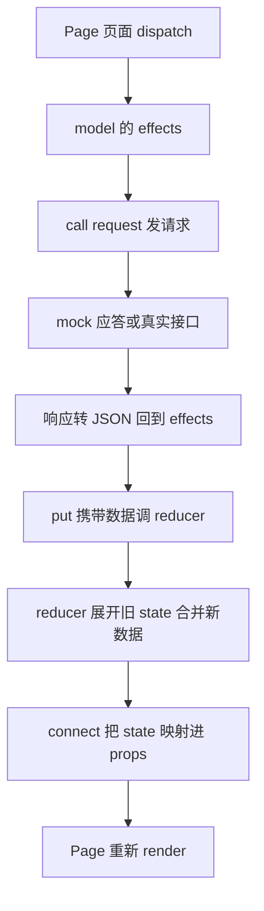
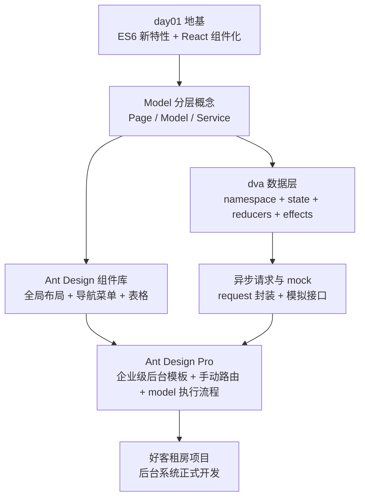

# day02 复习地图：把数据层、组件库与 Pro 模板串成一条开发流水线

ES6 与 React 的地基打完之后，day02 一天塞进了 Model 分层、dva、mock、Ant Design、Ant Design Pro 五块内容。课听完了，知识点却还散在几个演示工程里：数据为什么放 model、mock 在哪一步生效、Pro 的菜单从哪来，单看每一块都懂，串起来就模糊。总结课把这层窗户纸捅破了，顺着它把整个前端栈复盘一遍，进入项目开发之前，这张地图必须烂熟。

## 先给结论

- day02 的主线是数据分层：Page 管页面交互，Model 管数据状态，Service 管接口对接，dva 就是把 Model 层组织起来的那套方案。
- UmiJS 里启用 dva 与 antd 只动一处配置：`umi-plugin-react` 插件里写 `dva: true`、`antd: true`。
- model 的 effects 用 `call` 发请求、`put` 交 reducer；请求由基于 fetch 封装的 request 发出，接口没就位时由 mock 目录按「方法 + 路径」应答。
- Ant Design 的全局布局靠 `src/layouts/index.js` 约定生效；UmiJS 路由不配置也能按约定映射，Pro 采用的是手动配置路由。
- Ant Design Pro 是开箱即用的企业级后台模板，左侧菜单由路由配置自动生成；它的 model 执行流程与 dva 完全同构，只是封装得更正式。

## 一、数据层主线：dva 托管 state，connect 缝合两层

**第一，分层是把复杂度关进笼子。** 前端代码分三层：Page 承担页面渲染与交互，Model 承担数据的获取、更新与暂存，Service 专职与后台做 HTTP 读写。day02 所有内容都挂在这条分层思想上，复盘时先把它立住，后面的 dva、mock、Pro 才有挂靠点。

**第二，开启数据层只需一处插件配置。** UmiJS 通过 `umi-plugin-react` 插件把 dva 与 antd 整合进工程，`config/config.js` 里两个开关：

```js
export default {
  plugins: [
    ['umi-plugin-react', {
      dva: true, // 开启 dva 功能
      antd: true, // 开启 Ant Design 功能
    }]
  ]
};
```

**第三，model 的标准骨架要能默写。** 一个 model 就是命名空间加三件套：state 存数据，reducers 改数据，effects 承接异步。总结课回顾的这份骨架与此前手写的完全一致：

```js
export default {
  namespace: 'list',
  state: {
    list: [],
  },
  reducers: {
    updateList(state, { payload }) {
      return { ...state, list: payload }; // 展开旧 state，只覆盖目标字段
    },
  },
  effects: {
    *fetch({ payload }, { call, put }) {
      const response = yield call(request, '/api/list'); // 调 request 发请求
      yield put({
        type: 'updateList',
        payload: response.data, // 把结果交给 reducer
      });
    },
  },
};
```

**第四，请求与 mock 是这条链路的出入口。** request 工具基于 fetch 封装，检查状态码、转 JSON 两步走：

```js
export default async function request(url, options) {
  const response = await fetch(url, options); // 发出请求
  checkStatus(response); // 非 2xx 状态码直接抛错
  return await response.json(); // 响应体转成 JSON 返回
}
```

接口没就位时，mock 顶上。mock 目录里的文件按「请求方法 + 空格 + 路径」注册模拟服务，`res.json` 直接回数据：

```js
export default {
  'get /d/list': function (req, res) { // 模拟 GET /d/list 请求
    res.json({
      data: [1, 2, 3, 4],
      maxNum: 4
    });
  }
};
```

回顾片段里的 `/api/list` 与 `/d/list` 来自不同演示工程，地址各不相同，规律却只有一个：model 请求的地址必须与 mock 注册的键对得上，对不上就落空。mock 的新增与修改不热更新，重启 dev server 才生效。

数据层的完整流转用一张图收拢：



单向一圈，没有反向操作。connect 是 model 层与 Page 层之间唯一的缝合线，page 里不写取数逻辑，model 里不写渲染逻辑，职责就此分明。

## 二、界面层三件事：全局布局、菜单嵌套、表格出数

**第一，全局布局是约定出来的。** 在 `src/layouts` 下创建 `index.js`，它就自动成为整个应用的全局布局，之后访问的所有页面都会套进这个布局里渲染，页面组件通过 `children` 占位注入。改名或挪位置，约定失效，这一点比记代码更重要。

**第二，路由可以不配置。** UmiJS 不配路由时按约定式策略映射：`pages` 下的目录与文件名就是路径。需要自定义时才去写路由配置；Pro 项目里左侧菜单依据路由配置自动生成，所以 Pro 采用手动配置路由，两套方式都对，工程一大就显出配置式的可控。

**第三，菜单的嵌套关系要认清。** Menu 是根，`Menu.Item` 是叶子项，`SubMenu` 是可折叠分组，分组里还能再套分组。给菜单项接链接时用 Link 组件包裹，点击后由路由接管跳转，不整页刷新，选中效果也随之记录。深层菜单无非是这三类节点反复嵌套，看懂一层就看懂了全部。

**第四，表格只是展示，数据要分离。** 表格的基本用法照官方文档即可，关键动作是把数据从页面里抽出来：数据源放 model 层，page 层只负责把 state 里的数组递给 Table 的 `dataSource`。总结课回顾的这份数据就是典型的数据形状：

```js
import { Table, Divider, Tag, Pagination } from 'antd';

const data = [
  {
    key: '1',
    name: '张三',
    age: 32,
    address: '上海市',
    tags: ['前端', '帅气'],
  },
  {
    key: '2',
    name: '李四',
    age: 42,
    address: '北京市',
    tags: ['后端', '高大'],
  },
  {
    key: '3',
    name: '王五',
    age: 32,
    address: '杭州市',
    tags: ['产品经理', '富二代'],
  },
];
```

`key` 必须有，Table 靠它做行的身份标识；字段名与 `columns` 的 `dataIndex` 一一对应。这份结构与 model 里 state 的形状一致时，接口数据一来就能无缝替换本地常量。

## 三、工程层：Pro 的模板价值与那条熟悉的执行流程

**第一，定位再念一遍。** Ant Design Pro 是基于 Ant Design 的开箱即用的企业级后台系统模板：布局、菜单、登录、异常页全部预置，基于它直接做项目开发，省时省力。部署安装三步不变：解压、导入、`yarn install` 后 `yarn start`。

**第二，自定义从路由下手。** Pro 的左侧菜单由路由配置自动生成，想改菜单不是去硬改 Menu 组件，而是改路由配置文件；新增一个页面也就是两步：建页面组件、在路由配置里加一条映射，访问路径立刻可用。总结课里新建的 NewAnalysis 页面就是这条最短路径的演示。

**第三，Pro 的 model 执行流程与 dva 同构。** 从 dispatch 到 effects、reducer、connect，与自己此前手写的流程几乎一样，区别只在 Pro 又做了一层封装，写得更复杂、更正式：services 单独一层对接接口，`utils/request.js` 统一处理状态码，loading 状态由插件自动维护。读懂它的价值不在会用，而在学它的组织方式：源码大量使用 ES6 的解构表达式，取值层层剥开；模块职责划分清晰，接口、数据、视图互不越界。后面的项目开发就延续这套风格写下去，这正是引入 Pro 的目的。

## 四、全章知识地图

把 day01 与 day02 串起来，前端储备的全貌是这样一条依赖链：



依赖顺序就是学习顺序：没有组件化基础谈不上状态集中管理，没有 dva 就读不懂 Pro 的数据流，没有前两者，Pro 只是一个跑得起来的空壳。复盘时建议按图自底向上：先把 dva 的 demo 重写一遍，再去读 Pro 的 TableList 源码，两边对照，执行流程立刻严丝合缝。

到这一步，项目后台系统所需的前端储备全部到位，接下来的课程正式进入好客租房项目，从后台系统开始动工。

## 常见误区

- **跳过 dva 直接读 Pro 源码。** Pro 的封装建立在 dva 的概念之上，effects、reducers、connect 没亲手写过，读 TableList 只能看懂皮毛；复盘顺序必须是先 dva 后 Pro。
- **把 mock 的地址与 model 的请求当成两处独立配置。** 两边靠「方法 + 路径」对上号，任何一边改动不同步，请求落空，effects 拿到 undefined。
- **全局布局靠手动引入实现。** `src/layouts/index.js` 是 UmiJS 的约定，写对位置自动全局生效；挪进 pages 或改了文件名，布局就只对引入它的页面有效。
- **改 Pro 菜单去改 Menu 组件。** Pro 的菜单由路由配置驱动，硬改组件下次构建就被覆盖，正确入口是路由配置文件。
- **把 Pro 的封装当成新框架。** 从 dispatch 到 render 与 dva 一模一样，多出的只是 services 分层与请求封装，概念没有增量，恐慌没有必要。

## 面试可能被问到的问题

1. 面试官追问：「dva 里 model、page、connect 三者是什么关系？」
   答：model 集中托管业务数据，内部由 state、reducers、effects 组成；page 只负责渲染与交互；connect 是两者之间的桥，把 model 的 state 映射进组件 props，并把 dispatch 方法暴露给页面。数据单向流转：页面 dispatch，model 处理，connect 通知渲染。

2. 面试官追问：「effects 和 reducers 为什么要分开？」
   答：reducers 是纯函数，只根据旧 state 与 action 返回新 state，不能有副作用；effects 专承异步与副作用，通过 call 调接口、put 派发 action。分开后状态变更可预测、异步流程可测试，这是单向数据流能稳定运作的前提。

3. 面试官追问：「mock 的生效机制是什么，为什么改了要重启？」
   答：dev server 启动时扫描 mock 目录，把文件里「方法 + 路径」的键注册成模拟路由，运行期不再重新扫描。所以新增文件或改路由都要重启 dev server，让注册流程重跑。

4. 面试官追问：「UmiJS 的约定式路由和配置式路由怎么选？」
   答：约定式按 pages 目录结构自动映射，零配置适合小工程快速起步；配置式集中声明路径与组件的映射，便于控制嵌套、权限与菜单生成。工程规模变大或需要由路由驱动菜单时选配置式，Ant Design Pro 就是这么做的。

5. 面试官追问：「Ant Design Pro 的 model 执行流程和原生 dva 有区别吗？」
   答：核心流程完全同构，都是 dispatch、effects、reducer、connect 这条链。Pro 在外层做了更正式的工程化封装：services 层专职对接接口、utils/request.js 统一处理状态码、dva-loading 自动维护加载态，概念无增量，只是组织更规范。

6. 面试官追问：「前端做数据分层，最直接的收益是什么？」
   答：数据来源单一，所有共享状态收敛在 model 层，组件之间不必层层传 props；页面只管展示，取数逻辑集中可复用。页面一多，这套分层的维护成本远低于把数据散在各组件 state 里的写法。

## 配套资料

- 本教学日资料包暂无配套源码（`materials/code/03/day02-Ant Design以及Ant Design Pro入门/` 解压后为空，仅含提取记录），文中代码为按本课演示画面整理补全的示例，放入启用 dva 与 antd 插件的 UmiJS 工程对应位置即可运行；Pro 部分可对照官方脚手架 ant-design-pro 的 `src/models`、`src/services`、`config/router.config.js` 阅读验证
