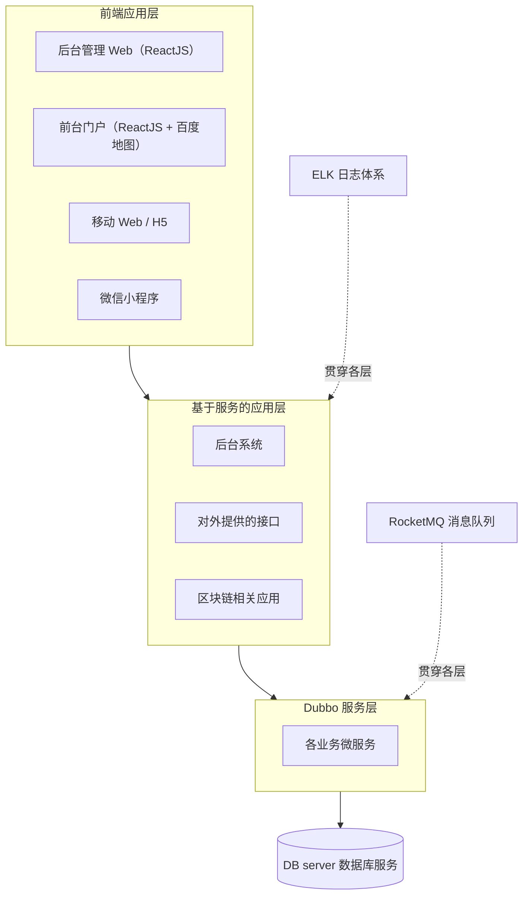

# 从 PRD 到系统架构：好客租房的双系统功能全景与微服务分层

市场需求分析解决「为什么做」，这一课的 PRD 与系统架构解决「做成什么样、用什么搭」。需求文档几百页、架构图好几层，直接埋头读很容易迷路。抓住两条主线就不会乱：功能上分前台与后台两套系统，架构上分前端应用、应用层、Dubbo 服务层、数据库四层。这两张地图立住了，后面十几天的开发每一步都能在图上找到坐标。

## 先给结论

- PRD（产品需求文档）是开发与设计的依据，也是协同工作的保障与项目评审验收的凭据，动工前先读修订记录与角色定义。
- 功能分两套系统：前台面向租客与房东（首页搜索、地图找房、房屋列表详情、预约看房、支付），后台面向运营（房源管理、房东管理、用户管理、系统设置），开发顺序先后台后前台。
- PRD 用文字描述需求，产品原型用 Axure 画成页面图形，两者互补；UI 设计依据原型，开发依据 PRD 加原型。
- 技术架构延续 SOA 思想（与微服务一脉相承）：后端 Spring Boot + Spring MVC + Dubbo + MyBatis，前端 ReactJS + 百度地图 + 微信小程序，RocketMQ 与 ELK 贯穿全局。
- 系统架构自下而上四层：DB server 数据库服务、Dubbo 服务层、基于服务的应用层（后台系统、对外接口）、前端应用层，整体是一个分布式系统架构。

## 一、PRD 怎么读：从修订记录到验收依据

**第一，先看修订记录。** 拿到需求文档，封面基本信息之后第一站是内容修订记录：哪个版本、谁改的、改了什么。需求是活的，版本追溯能避免拿旧需求写新代码。

**第二，认清文档的四个用途。** 需求文档的目的写得明白：为开发和设计提供依据（为什么这样开发，因为产品就是这样设计的）；帮助项目组成员对需求形成详尽理解（对某个功能的做法有疑问，翻文档）；在开发过程中为协同工作提供保障；作为项目评审与验收的依据，最后交付是否合格按文档逐条对照。

**第三，先记角色再记功能。** 文档定义了用户角色，管理员拥有后台所有菜单的管理权限，还可能有其他运营角色。角色决定权限边界，后台每个菜单项将来都要挂到具体角色上，这一步的伏笔在开发时才兑现。

**第四，总体流程先走一遍。** PRD 对产品总体流程与每个功能的流程都做了说明，租客侧的主链路是这条：


预约看房、取消预约、确认签约、支付等分支流程在文档里各有专图。开发任何一个功能前，先在文档里找到它对应的流程图，比凭感觉写代码靠谱得多。

## 二、两套系统的功能摘要

PRD 的功能摘要按系统分类，两大块一眼分明：

| 系统 | 一级模块 | 功能要点 |
|---|---|---|
| 前台 | 首页 | 房源搜索，按条件检索房源 |
| 前台 | 地图找房 | 地图上展示各区域房源数量，按小区细分查找 |
| 前台 | 房屋列表与详情 | 房屋筛选、列表展示、详情查看 |
| 前台 | 预约与交易 | 预约看房、取消预约、确认签约、支付 |
| 后台 | 房源管理 | 房源列表、查看图片、新增房源，审核状态的查看与关闭 |
| 后台 | 房东与用户管理 | 房东信息维护、租客信息维护 |
| 后台 | 资讯与问答 | 资讯管理、问答管理 |
| 后台 | 系统设置 | 字典配置、房源接口、合同模板等基础数据 |

**第一，为什么先后台。** 后台是数据的源头：房源先由后台录入与审核，前台才有可展示的数据；房东与用户资料先由后台维护，前台交易才有对象。先把后台系统开发出来，前台功能的每一环都有数据支撑，这是课程选择先后台后前台的工程逻辑。

**第二，功能详情配操作说明。** 文档对每个功能给出产品结构与特性描述，例如房源管理明确两条操作：显示所有房源列表；实现对房源的审核、状态查看和关闭操作。需求粒度细到按钮行为，开发照单实现即可。

## 三、原型：文字之外的第二份说明书

**第一，两种描述互为补充。** PRD 通过文字描述需求，产品原型通过图形化方式描述：首页长什么样、看房请求页面长什么样、房源管理怎么布局，打开原型一目了然。文字定逻辑，图形定形态。

**第二，原型的信息量足以照着做。** 后台原型里，房源管理页的看房请求列表已画出完整字段：编号、租客姓名、租客电话、项目小区、请求时间、预计时间、状态；用户管理页画出用户编号、姓名、手机号、性别、身份证号、职业信息、学历。列表字段、操作按钮、页面跳转都体现在原型中，相当于提前给了开发一份界面规格。

**第三，前台原型自带流程图。** 前台原型除产品结构图外，还配有租户流程、房东流程、认证流程、预约看房流程等图示，以及启动页、首页、房源列表、房源详情、预约看房等页面图。原型确认后，设计师依据它做 UI 设计，开发人员依据 PRD 与原型实现功能，三者的接力是：原型给设计，设计给开发，文档给验收。

## 四、技术栈与系统架构分层

**第一，架构思想：SOA 到微服务。** 项目介绍里明确，好客租房采用 SOA（面向服务的架构）思想，与当下流行的微服务一脉相承。项目融合了 RPC 远程调用（由 Dubbo 实现），配合大数据相关技术，覆盖移动 Web、微信小程序、后台管理等多端应用。

第二，技术栈分前后端两栏。
| 端 | 技术 |
|---|---|
| 后端 | Spring Boot、Spring MVC、Dubbo、MyBatis、ELK、区块链相关技术 |
| 前端 | ReactJS、HTML5、百度地图、微信小程序 |
| 贯穿 | RocketMQ 消息队列、ELK 日志体系 |

**第三，分层架构一张图。** 系统架构从最底层说起：最底层是 DB server 数据库服务；往上是 Dubbo 服务层，各业务微服务部署于此；再往上是基于服务的应用层，包括后台系统、对外提供的接口、区块链相关应用；最上层是前端应用层，包括 React 应用、百度地图应用、微信小程序与网站应用。RocketMQ 与 ELK 贯穿各层：



自上而下看是调用链：前端应用发起请求，应用层聚合编排，Dubbo 服务层执行业务，DB server 存取数据。Dubbo 服务层的具体服务划分随课程推进逐步展开， Dubbo 快速入门之后，读者就能自己写出这一层的一个服务，接口与实现的最小形态如下（示例为按本课技术栈补全）：

```java
/**
 * 房源服务接口：Dubbo 服务层的一个契约（示例）
 */
public interface HouseService {

    /**
     * 分页查询房源列表
     */
    PageResult<HouseVO> pageQuery(HouseQuery query);
}
```

服务提供方启动时把实现注册出去，消费方按接口引用，中间的注册与发现由注册中心接管，典型配置形如：

```yaml
# 服务提供方配置（示例，按本课技术栈补全）
dubbo:
  application:
    name: house-service
  registry:
    address: zookeeper://127.0.0.1:2181
  protocol:
    name: dubbo
    port: 20880
```

**第四，为什么说它是分布式架构。** 服务按业务拆分、各自独立部署，服务之间通过 RPC 协作，消息由 RocketMQ 异步解耦，日志由 ELK 统一收集检索，任何一层都可以横向扩容。这些特征合起来，就是一张典型的分布式系统架构图。课程对架构先做整体鸟瞰，每一块技术到对应章节再逐个拆解。

## 常见误区

- **以为前端直接调用 Dubbo。** 前端应用层面向 HTTP 请求，Dubbo 服务层藏在后端应用之下；浏览器与 Dubbo 之间隔着应用层的接口服务，两层协议不能混。
- **把架构图当部署图。** 系统架构图描述的是逻辑分层与职责边界，不是机器与进程的摆放；同一层可以部署多个实例，一层也可能跨多台机器，部署方案另行设计。
- **把区块链当成项目核心业务。** 架构里区块链相关应用是技术实践点之一，租赁业务的主链路仍由房源、用户、预约这些常规服务承担，主次不要颠倒。
- **跳过原型直接开发。** PRD 定逻辑、原型定形态，两者缺一；没有原型就写页面，样式与交互全靠猜，返工成本远高于提前画原型的成本。
- **需求文档只读一次。** 需求有修订记录，开发过程中文档会更新，定期回看修订记录与功能详情，才能保证实现与需求始终对齐。

## 面试可能被问到的问题

1. 面试官追问：「PRD 在开发过程中的作用有哪些？」
   答：它是开发与设计的依据，说明每个功能为什么这样设计；是项目组成员对需求达成详尽一致理解的载体，为协同工作提供保障；也是项目评审与验收的凭据，交付是否合格按文档逐条对照。开发前读修订记录与角色定义，开发中对功能详情，验收时对功能清单。

2. 面试官追问：「为什么这个项目先开发后台系统再开发前台？」
   答：后台是数据源头，房源录入与审核、房东与用户资料维护都发生在后台；后台先就位，前台展示、预约、交易各环节才有真实数据可用。先源后流，前台开发全程有据可依。

3. 面试官追问：「画出这个项目的系统架构分层。」
   答：自下而上四层：DB server 数据库服务；Dubbo 服务层，承载各业务微服务；基于服务的应用层，包括后台系统、对外接口、区块链相关应用；前端应用层，包括 React 后台与门户、移动 Web、微信小程序。RocketMQ 与 ELK 贯穿各层，分别承担异步消息与日志收集。

4. 面试官追问：「SOA 和微服务是什么关系？」
   答：SOA 是面向服务的架构思想，主张按业务拆分服务、以服务接口协作；微服务是其进一步演进，拆分粒度更细、去中心化更彻底、服务可独立部署与伸缩。两者思想同源，工程实践上微服务常配合 Spring Boot、Dubbo、注册中心与容器化落地。

5. 面试官追问：「RocketMQ 和 ELK 在这类架构里分别解决什么问题？」
   答：RocketMQ 是分布式消息队列，在服务之间做异步解耦与削峰，例如预约通知、数据同步这类不必同步等待的动作交给消息传递；ELK 是日志采集、存储与检索体系，把分散在各服务与各实例的日志集中起来，分布式系统排查问题全靠它。

6. 面试官追问：「前后端分离架构下，一次页面请求的数据是怎么流转的？」
   答：前端 React 应用发 HTTP 请求到后端接口层；接口层做参数校验与聚合，通过 Dubbo 调用对应微服务；服务层执行业务逻辑，读写数据库，必要时经 RocketMQ 发消息；结果沿调用链原路返回，接口层组装成 JSON 响应给前端，页面渲染展示。

## 配套资料

- 本教学日无配套源码与文档包（`materials/code/03/` 与 `materials/docs/` 均未收录本阶段资料），项目 PRD、Axure 原型与讲义仅随课程视频展示，文中功能摘要、流程节点与 Dubbo 接口、配置为按本课演示画面与讲解整理补全的示例，待 Dubbo 入门课程落地后以课程实际工程为准
