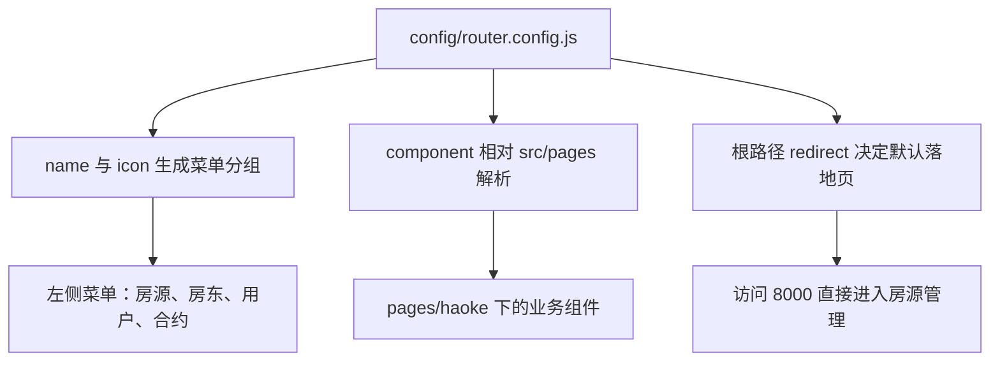

# 自定义业务菜单：路由配置长出房源管理菜单，根路径直达业务页

Pro 工程跑起来后，左侧菜单还是模板自带的分析页、表单页、列表页这些演示项，而租房后台需要的是房源管理、房东管理、用户管理、合约管理。菜单结构在哪改、业务页面放哪、访问 8000 端口为什么总落在分析页，这三件事在开发任何业务功能之前都要解决掉。

## 先给结论

- 菜单由 `config/router.config.js` 驱动：路由项的 `name` 决定菜单名、`icon` 决定图标、`routes` 的嵌套层级决定菜单分组与子项。
- 业务页面统一放 `src/pages` 下自建的业务目录（本课建 `haoke` 目录），与模板演示目录彻底隔开，避免混淆。
- 菜单中文文案由国际化 key 提供（`menu.house.resource` 这类），生成机制与 Pro 入门课讲过的一致。
- 根路径重定向默认是 `{ path: '/', redirect: '/dashboard/analysis' }`，把 redirect 值改成 `/house/resource`，一进系统直达房源管理。

## 一、按原型把菜单结构定下来

改菜单不能凭感觉，依据是需求文档与产品原型：原型上房源管理分组下画了看房请求、租房管理、房源列表、新增房源，另有房东管理、用户管理、合约管理等分组。照着原型，在 `router.config.js` 的 `/` 组路由里添加路由规则，Pro 框架会根据这些规则自动生成左侧菜单：

```javascript
export default [
  // user 组：登录注册，套简洁布局
  {
    path: '/user',
    component: '../layouts/UserLayout',
    routes: [
      { path: '/user', redirect: '/user/login' },
      { path: '/user/login', component: './User/Login' },
      { path: '/user/register', component: './User/Register' },
      { path: '/user/register-result', component: './User/RegisterResult' },
    ],
  },
  // app 组：业务页面，套后台布局
  {
    path: '/',
    component: '../layouts/BasicLayout',
    Routes: ['src/pages/Authorized'],
    authority: ['admin', 'user'],
    routes: [
      { path: '/', redirect: '/dashboard/analysis' },
      // 房源管理
      {
        path: '/house',
        name: 'house',
        icon: 'home',
        routes: [
          { path: '/house/resource', name: 'resource', component: './haoke/House/Resource' },
          { path: '/house/addResource', name: 'addResource', component: './haoke/House/AddResource' },
          { path: '/house/kanfang', name: 'kanfang', component: './haoke/House/KanFang' },
          { path: '/house/zufang', name: 'zufang', component: './haoke/House/ZuFang' },
        ],
      },
      // 房东管理、用户管理、合约管理结构相同，仅 path 与 component 不同
    ],
  },
];
```

每一组业务路由都是同一个模式：外层定分组路径、名称与图标，内层 `routes` 数组列出子页面。以房东管理为例，只有一个列表页：

```javascript
// 房东管理
{
  path: '/fangdong',
  name: 'fangdong',
  icon: 'key',
  routes: [
    { path: '/fangdong/list', name: 'list', component: './haoke/FangDong/List' },
  ],
},
```

保存刷新，左侧菜单立刻长出对应分组与子项。菜单项的中文文案另有出处：路由 name 按层级拼成 `menu.house.resource` 这样的 key，到 `src/locales/zh-CN.js` 里配置对应译文，key 缺失时菜单会直接显示 key 原文。

## 二、页面放自己的目录，别和模板混在一起

路由的 `component` 值相对 `src/pages` 解析，`./haoke/House/Resource` 就是 `pages/haoke/House/Resource.js`。开发项目时要做的第二件事，是在 `src/pages` 下创建自己的业务目录，所有业务页面都丢进这个目录，不与 Pro 模板自带的目录混淆：

```text
src/pages
├── haoke
│   ├── House
│   │   ├── Resource.js        房源列表
│   │   ├── AddResource.js     新增房源
│   │   ├── KanFang.js         看房请求
│   │   └── ZuFang.js          租房管理
│   ├── FangDong
│   │   └── List.js            房东列表
│   ├── Users
│   │   └── List.js            用户列表
│   └── Contract
│       └── List.js            合约列表
└── index.js
```

目录按业务模块分子文件夹，文件名沿用项目现有的大写开头风格。这样做的价值在维护期才显现：一眼就能分清哪些是模板演示页面、哪些是业务页面，后续删除演示代码、检索业务代码都不容易误伤。

## 三、根路径直达房源管理

默认行为有个别扭之处：直接访问 8000 端口，落地的总是模板的分析页，业务系统希望一进来就是房源管理。答案仍在路由文件里，`/` 组路由的第一条就是根路径重定向：

```javascript
// 修改前：进入系统默认打开分析页
{ path: '/', redirect: '/dashboard/analysis' },
// 修改后：进入系统直达房源管理
{ path: '/', redirect: '/house/resource' },
```

把房源管理的路径值拷过来填进 redirect，保存后访问 `http://localhost:8000`，页面自动跳到房源管理，左侧菜单的「房源管理」也同步处于选中态。重定向目标必须是一条真实存在的路由，否则打开即 404。

一张图收拢路由配置的三条作用线：



三条线共用一份配置：菜单是外观，component 是内容，redirect 是入口。改菜单、加页面、换首页，动的都是同一个文件，这正是 Pro 配置式路由的设计意图。

## 常见误区

- **加了路由，菜单却显示 `menu.house.resource` 原文。** 不是路由写错，是国际化 key 缺失；去 `src/locales/zh-CN.js` 按 `menu.分组.name` 的层级补上中文文案。
- **业务页面散放进模板演示目录。** 短期看能跑，时间一长分不清哪些可删哪些是业务；开工就建 `haoke` 这类业务目录，所有页面收进自家目录。
- **redirect 指向不存在的路径。** 根路径重定向目标是路由配置里的死值，拼错一个字母，打开系统就是 404；改完先访问一次根路径验证落地页。
- **分组路由漏写 `name`。** Pro 生成菜单时会过滤没有 name 的路由项，这样的路由只作为页面路径存在，不会出现在左侧菜单里；需要隐藏的页面反而可以利用这一点。

## 面试可能被问到的问题

1. 面试官追问：「Ant Design Pro 的左侧菜单是怎么生成的？」
   答：由 `config/router.config.js` 的路由配置驱动。路由项的 name 作为菜单名、icon 作为图标，routes 的嵌套层级对应菜单分组与子项，文案通过 name 拼出的 key 从国际化文件里取。改路由配置，菜单随之变化，无需单独维护菜单数据。

2. 面试官追问：「业务页面为什么要放在独立目录里？」
   答：Pro 脚手架自带大量演示页面，业务代码与模板代码混在一起后，升级脚手架、清理演示内容、检索业务逻辑都容易出错。按业务建目录隔离，是低成本高收益的工程纪律。

3. 面试官追问：「修改系统默认首页的原理是什么？」
   答：根路径 `/` 这条路由配置了 redirect。访问根路径时匹配到该条，框架内部重定向到 redirect 指定的路径，再按那条路由渲染组件。把值改成业务首页的路径即可，注意目标路由必须真实存在。

4. 面试官追问：「配置式路由和约定式路由怎么选？」
   答：约定式路由按目录自动生成，配置量小，但页面结构与权限的关系不直观；配置式路由集中在一份文件，菜单、布局、权限一目了然，中后台系统页面多、菜单层级深，配置式更可控。Pro 默认采用配置式。

5. 面试官追问：「路由配置里的 authority 和 Routes 是怎么配合做权限的？」
   答：authority 声明访问该组路由需要的角色，Routes 指定一个路由守卫组件（Pro 里是 `src/pages/Authorized`）。渲染前守卫组件校验当前用户是否具备声明的角色，不满足则拦截展示 403，菜单项也会按权限过滤。

## 配套资料

- 本教学日资料包未收录源码（`materials/code/03/` 下 day03 无解压内容），文中 `router.config.js` 片段与 `pages/haoke` 目录树为按本课演示画面整理补全的示例，可与 Ant Design Pro v2 脚手架的 `config/router.config.js` 对照验证
