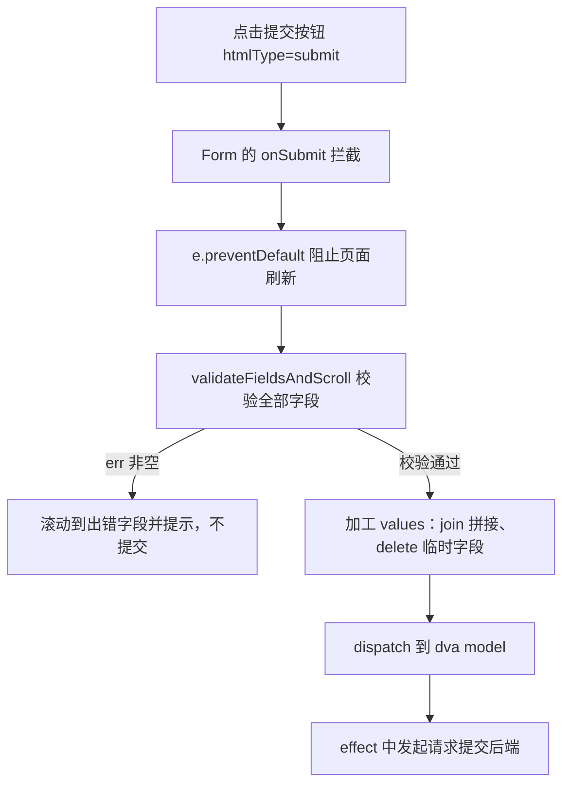

# Ant Design Form：getFieldDecorator 双向绑定与提交前的数据加工

新增房源表单十几个字段，既要逐项校验，提交前还要把页面上的值拼成后端要的格式：多选的配套设施要串成 `1,2,3`，楼层要拼成 `8/26`。Ant Design 的 Form 组件把收集、校验、提交打包成一套体系，但 `getFieldDecorator` 的注册规则、`defaultValue` 的警告、校验回调的分支时机，新手一踩一个准。这一课把这套流程从头到尾走通。

## 先给结论

- `Form.create()` 包装组件后，组件内部通过 `this.props.form` 拿到一套表单操作方法：注册字段、取值赋值、校验、查错。
- 字段必须经 `getFieldDecorator(id, { initialValue, rules })` 注册才有双向绑定；没注册的字段取不到值也设不进值。
- 绑定后 Form 接管控件的 `value` 与 `onChange`，不要再给控件写 `defaultValue`，初始值用 `initialValue`，否则控制台报警告。
- 提交走 `<Form onSubmit>` 拦截：`e.preventDefault()` 之后调 `validateFieldsAndScroll`，校验通过才 `dispatch` 到 model 发请求。
- 提交前的数据加工发生在校验回调里：数组 `join(',')`、楼层拼接、户型拼接、`delete` 掉中间字段，再交给 model。

## 一、Form 组件：把收集与校验打包

官方对 Form 的描述是：具有数据收集、校验以及提交功能的表单，包含复选框、单选框、输入框、下拉选择框等元素。价值在后半句：它不只是画出表单，连校验也一并做进去了，不必再手写一套逐项检查。表单的排列支持水平、垂直、行内三种方式，每个 `Form.Item` 由标签、控件、校验提示三部分组成，控件输入非法时提示自动出现在条目下方。

## 二、Form.create 与 form 属性

Form 的能力入口是 `Form.create()`。官方文档对它的说明是：经过 `Form.create()` 包装的组件，会自带 `this.props.form` 属性，这个 form 对象上挂着一整套操作方法：`getFieldDecorator`（字段注册与双向绑定）、`validateFields` 与 `validateFieldsAndScroll`（校验）、`getFieldValue` 与 `getFieldsValue`（取值）、`setFieldsValue`（赋值）、`getFieldError`（取校验错误）、`isFieldsTouched`、`isFieldValidating` 等。新增房源页面就是这么用的：

```jsx
import { Form } from 'antd';

@Form.create()
class AddResource extends PureComponent {
  // 组件内随处可用 this.props.form 操作表单
}

// 不用装饰器时的等价写法：
// export default Form.create()(AddResource);
```

类定义上加 `@Form.create()` 修饰，或在导出时用高阶组件包一层，两种写法效果相同。包装之后，`this.props.form` 在组件任何方法里都能取到，取值、赋值、校验从此都有据可依。

## 三、getFieldDecorator：注册字段才有双向绑定

表单项真正的关键在 `getFieldDecorator`，它把一个普通控件变成受 Form 管理的字段。新增房源页里的典型写法：

```jsx
<Form.Item {...formItemLayout} label="楼栋">
  <InputGroup compact>
    {getFieldDecorator('buildingNum', {
      rules: [{ required: true, message: '楼栋号必填' }],
    })(<Input />)}
    {getFieldDecorator('buildingFloorNum', {
      rules: [{ required: true, message: '楼层号必填' }],
    })(<Input />)}
  </InputGroup>
</Form.Item>
<Form.Item {...formItemLayout} label="支付方式">
  {getFieldDecorator('paymentMethod', {
    initialValue: '1',
    rules: [{ required: true, message: '此项为必填项' }],
  })(
    <Select style={{ width: '100%' }}>
      <Option value="1">付一押一</Option>
      <Option value="2">付三押一</Option>
      <Option value="3">付六押一</Option>
      <Option value="4">年付押一</Option>
      <Option value="5">其它</Option>
    </Select>
  )}
</Form.Item>
```

`getFieldDecorator(id, options)(控件)` 这个调用做了两件事：给字段起一个 id，作为后续取值赋值的键；把控件与 Form 做双向绑定。绑定的规则值得记牢：绑定后控件会自动获得 `value` 与 `onChange` 属性，值的变化由 Form 接管同步，因此不应该再手动给控件设置 `defaultValue`，初始值走 options 里的 `initialValue`（支付方式默认选中「付一押一」就是 `initialValue: '1'`），写了 `defaultValue` 会收到警告。

第二参数里的 `rules` 是校验规则，常用的几类：`required` 必填加 `message` 提示文案、`min` 与 `max` 长度区间、`pattern` 正则表达式，以及 `type` 内建类型校验。`type` 能约束值的类型，比如校验值必须是 `number`；可选类型在官方文档里点开可以跳到 async-validator 这个校验库的仓库页面，Form 的规则校验底层正是由它实现的。

## 四、提交：onSubmit 拦截、校验、加工、dispatch

提交按钮的类型是 submit，Form 上挂 `onSubmit` 指定拦截函数，拦截的意义在于提交之前有机会做处理，处理完才真正发往服务端：

```jsx
<Form onSubmit={this.handleSubmit} hideRequiredMark style={{ margin: '20px 0' }}>
  {/* ...中间是各个表单项... */}
  <Form.Item {...submitFormLayout} style={{ marginTop: 32 }}>
    <Button type="primary" htmlType="submit">提交</Button>
  </Form.Item>
</Form>
```

`handleSubmit` 定义在 class 内部，用箭头函数书写，因此 `this` 指向组件实例，能直接访问 `this.props` 与 `this.state`。它的完整流程：

```jsx
handleSubmit = (e) => {
  e.preventDefault();
  const { dispatch, form } = this.props;
  form.validateFieldsAndScroll((err, values) => {
    if (!err) {
      // 配套设施是勾选数组，拼成文档要求的 1,2,3 形式
      if (values.facilities) {
        values.facilities = values.facilities.join(',');
      }
      // 楼层：第几层/总共几层，如 8/26
      if (values.floor_1 && values.floor_2) {
        values.floor = values.floor_1 + '/' + values.floor_2;
      }
      // 户型拼成 2室1厅1阳台 的形式
      values.houseType = values.houseType_3 + '室' + values.houseType_2 + '厅' + values.houseType_4 + '阳台';
      // 拼接用的临时字段不再随表单提交
      delete values.floor_1;
      delete values.floor_2;
      delete values.houseType_1;
      delete values.houseType_2;
      delete values.houseType_3;
      delete values.houseType_4;
      delete values.houseType_5;
      // 交给 model 发起真实请求
      dispatch({ type: 'form/submitRegularForm', payload: values });
    }
  });
};
```

逐段读一遍。`e.preventDefault()` 先拦掉浏览器默认的表单提交行为，避免页面刷新。`validateFieldsAndScroll` 校验全部字段，校验不过时回调参数 `err` 非空，页面滚动定位到第一个出错字段并把错误信息显示在对应 `Form.Item` 下方，流程就此打住；全部通过才进入加工段。加工逻辑是页面展示结构与存储结构之间的转换：配套设施在页面上是多个勾选框，拿到的是数组，后端文档要求 `1,2,3` 的逗号分隔字符串，`join(',')` 完成转换；楼层在页面上是「第几层」「总共几层」两个输入框，存储格式是 `8/26`；户型由几个选择框拼成 `2室1厅1阳台`。拼接完成后，`floor_1`、`houseType_3` 这些中间字段已经没有用，逐一 `delete` 掉，保证提交给后端的 `values` 与文档字段严格一致。最后 `dispatch` 把数据交给 model 层，由 `form/submitRegularForm` 这个 effect 发起对后端的请求，model 的执行流程与 Pro 入门课讲过的一致。



这张图的主干就是一条带分叉的流水线：分叉点在 `validateFieldsAndScroll`，err 非空走提示分支，通过才放行到加工与提交。理解了这个分叉，表单提交的所有报错现象都能对号入座。

## 常见误区

- **字段没注册就想取值。** 直接调 `form.getFieldValue('rent')` 得到 `undefined`，因为该字段没经过 `getFieldDecorator` 注册；任何取值赋值操作都要求字段先完成双向绑定。
- **给控件写 `defaultValue` 设初值。** 绑定后数据同步由 Form 接管，再设 `defaultValue` 会收到警告且值不受控；初始值统一写在 `initialValue`。
- **把 `err` 判断写反。** 回调里写成 err 非空才提交，校验失败的表单反而发往后端；记住 `err` 是错误聚合，为空才代表校验通过。
- **多选值直接提交数组。** 后端文档要求配套设施是 `1,2,3` 形式的字符串，数组原样发出去后端解析失败；提交前 `join(',')` 归一化。
- **处理函数定义在组件外部。** 普通函数里拿不到 `this.props.form`，拦截与校验都无法进行；`handleSubmit` 要定义在 class 内部并用箭头函数绑定 `this`。

## 面试可能被问到的问题

1. 面试官追问：「`Form.create()` 到底做了什么？」
   答：它是一个高阶组件，包装目标组件后注入 `this.props.form` 属性，form 对象上挂载了字段注册、取值赋值、校验、错误查询等一批方法。业务组件由此获得操作表单的完整能力，自身不必维护一份表单状态。

2. 面试官追问：「`getFieldDecorator` 的双向绑定是怎么实现的？」
   答：它给传入的控件注入 `value` 与 `onChange` 属性，把控件变成受控组件；控件值变化时经由 onChange 通知 Form 存入内部状态，渲染时再由 value 回填。值与校验状态都由 Form 统一保管，组件里不需要为每个字段写 `setState`。

3. 面试官追问：「为什么绑定后不能再用 `defaultValue`？」
   答：绑定后的控件是受控组件，显示什么完全由 Form 的状态决定。`defaultValue` 只在非受控首次渲染时生效，之后改动既不进入 Form 状态也不反映到界面，还会收到 antd 的警告。设初值的正规入口是 `getFieldDecorator` 的 `initialValue`。

4. 面试官追问：「校验规则底层用什么实现，支持哪些规则？」
   答：底层是 async-validator 校验库。常用规则包括 `required` 必填、`message` 提示文案、`min` 与 `max` 长度、`pattern` 正则，以及 `type` 类型校验，type 可约束值必须是 number、string 等内建类型，规则数组按序执行。

5. 面试官追问：「`validateFields` 和 `validateFieldsAndScroll` 有什么区别？」
   答：校验能力相同，都执行全部规则并在回调里给出 err 与 values；区别在交互，`validateFieldsAndScroll` 校验失败时会自动滚动定位到第一个出错的表单字段，长表单里用户不用自己找错在哪，本课提交用的就是它。

6. 面试官追问：「提交前拼接数据为什么放在组件里做，而不是后端拼？」
   答：楼栋楼层两个输入框、户型几个选择框，是面向用户录入的展示结构；`8/26`、`2室1厅1阳台` 是面向存储的提交结构。两者在视图层转换，后端接口只认文档约定的字段格式，接口契约保持稳定，前端表单怎么摆都不影响后端。

## 配套资料

- 本教学日资料包未收录源码（`materials/code/03/` 下 day03 无解压内容），文中 `AddResource` 的表单项与 `handleSubmit` 代码为按本课演示画面整理补全的示例，校验规则的可选类型可对照 async-validator 官方文档，Form API 可对照 Ant Design v3 的 Form 组件文档
