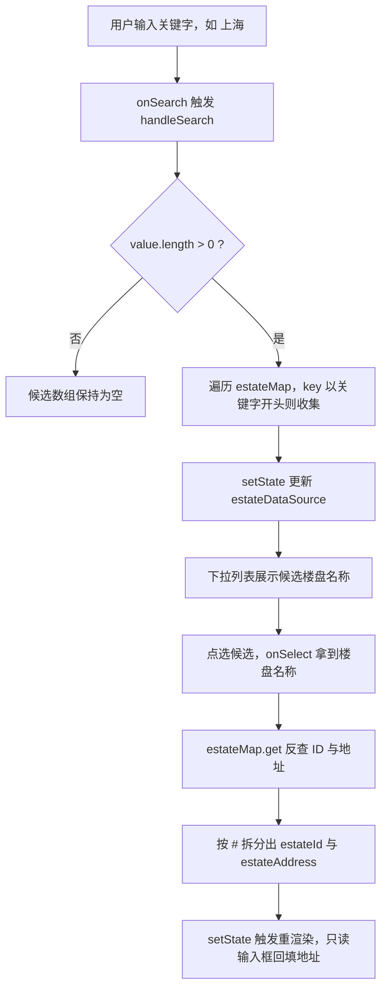

# 输入框自动完成：楼盘搜索联想与地址自动回填

新增房源表单里，「楼盘名称」这一栏注定不能让用户自由发挥：房源必须挂在系统里真实存在的楼盘上，随手写一个不存在的楼盘，后面的订单、看房预约全都会乱套。所以要的是一个搜索框，输入「上海」就弹出候选楼盘，点一下选中，连楼盘地址一起自动填好。这一课把这两步拆开讲透：输入时怎么联想、选中后怎么回填，以及为什么还要顺手留下一个看不见的楼盘 ID。

## 先给结论

- 候选列表由 AutoComplete 的 `dataSource` 属性决定，数据放在组件 `state` 里，构造函数中初始化为空数组，所以页面刚打开时联想框下面什么都没有。
- 输入每次变化触发 `onSearch`，课程在 `handleSearch` 里遍历楼盘 Map，把以关键字开头的楼盘名称收集成候选数组，再 `setState` 更新。
- 点选候选触发 `onSelect`，参数就是选中项的值；拿它回查 Map，把「楼盘 ID#楼盘地址」拆开，地址回填到只读输入框，ID 存进 state 等提交时用。
- 楼盘地址输入框设了 `readOnly`，地址的唯一来源就是选中楼盘，杜绝手写一个不存在的地址。
- 数据先写死在前端 Map 里跑通流程，后台就绪后把遍历换成一次模糊查询请求即可，迁移成本很低。

## AutoComplete：输入框的联想能力

Ant Design 官网把 AutoComplete 归在数据录入一类，功能是输入框的自动完成，典型场景就是搜索时的下拉联想：输入部分字符，组件在数据源里找匹配项列出来，点一下自动补全。官网的演示里能看到补全邮箱后缀、按输入实时过滤候选等一堆玩法，最基础的用法一行代码：

```jsx
const dataSource = ['12345', '23456', '34567'];
<AutoComplete dataSource={dataSource} />
```

`dataSource` 就是候选集合。落到本课的业务上，真正要吃透的是两个回调：`onSearch`，官方描述是「搜索补全项的时候调用」，也就是输入变化时触发；`onSelect`，官方描述是「被选中时调用，参数为选中项的 value」，也就是用户点中某个候选时触发。整条联想数据流就挂在这两个回调上。

## 数据放在组件状态里

新增房源页面 `AddResource` 是 class 组件，楼盘相关的三份数据全部挂在 state 上，构造函数里初始化：

```jsx
constructor(props) {
  super(props);
  this.state = {
    estateDataSource: [],  // 联想候选列表，初始为空数组
    estateId: '',          // 选中的楼盘 ID，提交表单时要用
    estateAddress: '',     // 选中的楼盘地址，回填到只读输入框
  };
}
```

初始为空意味着联想框一开始没有候选。什么时候填充、填什么，全看输入侧的 `handleSearch`；填充之后谁去消费，看选中侧的 `handleSelect`。state 是 React 组件渲染的驱动源，这两份数据不放 state，界面就动不起来。

## onSearch：前缀匹配出候选

`handleSearch` 挂在 AutoComplete 的 `onSearch` 上，每次输入变化都会带着最新输入值执行一遍：

```jsx
handleSearch = (value) => {
  let arr = new Array();
  if (value.length > 0) {              // 输入了内容才去找
    estateMap.forEach((v, k) => {
      if (k.startsWith(value)) {       // 楼盘名称以关键字开头就算命中
        arr.push(k);
      }
    });
  }
  this.setState({
    estateDataSource: arr,             // 整体替换候选数组，下拉随之刷新
  });
};
```

这里的 `value` 就是用户敲进输入框的字，敲一个「上」，`value` 就是「上」。`estateMap` 是楼盘数据，key 是楼盘名称，value 是「楼盘 ID#楼盘地址」拼接的字符串：

```jsx
const estateMap = new Map([
  ['上海康城', '1001#上海市闵行区莘松路958弄'],
  ['上海阳城', '1002#上海市闵行区罗南路888弄'],
  // 课程内共 5 条楼盘数据，此处节选 2 条
]);
```

输入「上」之后，`forEach` 遍历 Map，「上海康城」「上海阳城」两个 key 都以「上」开头，被 `push` 进候选数组；`setState` 一执行，下拉列表立刻出现这两个选项。没输入内容时数组保持为空，联想框下面自然不会冒出东西。

楼盘数据本来是后台数据表里维护的，写死在前端并不合理。课程的做法是先把功能跑通：写死数据足以验证联想逻辑，等后台服务就绪，把 `handleSearch` 里的遍历换成一次调后端的模糊查询，响应回来照样 `setState`，其余代码一行不用动。先写死再换接口，是前端功能先行时常用的推进节奏。

整条数据流画出来是这样：



图中前半段是「输入到联想」的回路，后半段是「选中到回填」的回路，两段各由一个回调驱动，交界点就是下拉列表被点中的那一刻。

## onSelect：选中之后拆出 ID 和地址

点选候选时触发 `onSelect`，收到的参数是选中项的值，也就是楼盘名称本身。拿名称回查 Map，得到的是「1001#上海市闵行区莘松路958弄」这样的字符串，里面绑着两份信息，按 `#` 拆开：

```jsx
handleSelect = (value) => {
  const v = estateMap.get(value);        // 用楼盘名称反查完整数据
  const idx = v.indexOf('#');
  this.setState({
    estateId: v.substring(0, idx),       // 前段：楼盘 ID
    estateAddress: v.substring(idx + 1), // 后段：楼盘地址
  });
};
```

为什么要截字符串？因为 value 里用 `#` 做了分隔，前段是楼盘 ID，后段是具体地址。表单展示要的是地址，提交时还要 ID，一次拆开各存各的。`setState` 执行后组件重渲染，地址输入框的内容自动跟着变，选中「上海康城」就出现莘松路的地址，选中「上海阳城」就换成罗南路的地址。

页面上的两个控件配合起来看：

```jsx
<FormItem {...FormItemLayout} label="楼盘名称">
  <AutoComplete
    style={{ width: '100%' }}
    dataSource={this.state.estateDataSource}
    placeholder="搜索楼盘"
    onSearch={this.handleSearch}
    onSelect={this.handleSelect}
    filterOption={(inputValue, option) =>
      option.props.children.toUpperCase().indexOf(inputValue) > -1
    }
  />
</FormItem>
<FormItem {...FormItemLayout} label="楼盘地址">
  <Input value={this.state.estateAddress} readOnly />
</FormItem>
```

`filterOption` 决定输入变化时组件要不要按输入过滤候选，传函数则自定义匹配规则，这里沿用官方示例的大小写不敏感写法兜底；真正的过滤已经在 `handleSearch` 里做完。楼盘地址的 `Input` 设了 `readOnly`，只能看不能改，用户想改地址的唯一办法是重新选一个楼盘。

## 楼盘 ID：页面上看不见，提交时少不了

有人会问，页面上只显示了地址，`estateId` 存下来干嘛？房源和楼盘是多对一的关联关系，房源表里存的是楼盘 ID 而不是地址文字：地址可能重复、可能变更，ID 才是唯一标识。表单提交时必须把这个 ID 一起交给后端，新建的房源才能正确挂到楼盘上。地址是给人看的，ID 是给数据库用的，这就是选中时宁可截一段字符串也要把两份值都留下的原因。

## 常见误区

- **在 onSelect 里做联想。** 联想发生在输入过程中，回调是 `onSearch`；`onSelect` 只在点选候选的那一刻触发。两个回调写反，功能就整个错位。
- **直接往 state 数组里 push。** `this.state.estateDataSource.push(k)` 不会触发重渲染，下拉不刷新；必须构造新数组整体 `setState` 替换。
- **把 Map 的 key 当成楼盘 ID。** 本例 key 是楼盘名称，ID 藏在 value 里；`onSelect` 拿到的是名称，还得 `get` 一次才能拿到 ID 和地址。
- **地址输入框不加 readOnly。** 用户能手改地址，表单里就会出现楼盘 ID 与地址对不上的脏数据，后端落库后无从校对。

## 面试可能被问到的问题

1. 面试官追问：「AutoComplete 的 onSearch 和 onChange 有什么区别？」
   答：`onSearch` 专指联想搜索场景下的输入变化回调，语义是拿输入去搜索补全项；`onChange` 是值变化的通用回调。做远程联想时通常用 `onSearch` 触发查询，避免和 `onChange` 混用造成重复请求。

2. 面试官追问：「联想数据为什么要放 state？」
   答：React 组件的界面由 state 和 props 驱动。候选列表是运行期不断变化的数据，放进 state 后每次 `setState` 都会触发重渲染，下拉列表自动刷新；写成普通变量组件感知不到变化，界面不会更新。

3. 面试官追问：「filterOption 是干什么的？」
   答：它决定输入变化时组件要不要按输入过滤候选，默认会做简单的包含匹配，设为函数则完全自定义匹配规则，参数是输入值和候选项，返回 true 表示保留该候选。数据源已经自己过滤时，也可以关掉它。

4. 面试官追问：「楼盘数据在后台时，这套代码怎么改？」
   答：把 `handleSearch` 里的本地遍历换成异步请求，拿关键字调后端的模糊查询接口，响应回来 `setState` 候选列表，ID 与地址都取自响应数据。组件其余部分不动，这正是先写死数据再换接口的价值。

5. 面试官追问：「表单提交时为什么必须带楼盘 ID？」
   答：房源与楼盘是数据库里的关联关系，房源表存楼盘主键而不是地址文本。地址会变、会重复，ID 才是唯一标识，提交 ID 后端才能建立正确的外键关联，地址只作展示与核对。

## 配套资料

- 本教学日资料包未收录源码（`materials/code/03/` 下无 day03 解压内容），文中 `estateMap`、`handleSearch`、`handleSelect` 与 JSX 为按本课演示画面与讲解逻辑整理补全的示例；AutoComplete 的 API 以 Ant Design v3 官方文档「输入框自动完成」一节为准（`dataSource`、`onSearch`、`onSelect`、`filterOption`）
