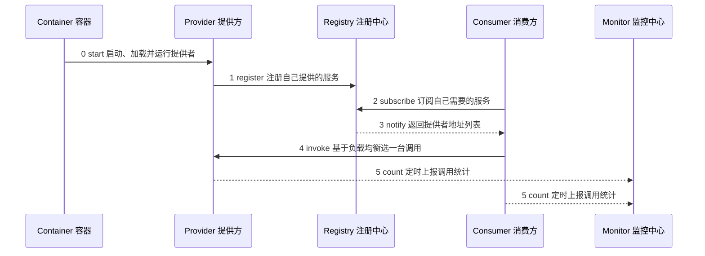

# Dubbo 架构全景：五个角色、六步时序与一次完整调用

dubbo 官方架构图画出来只有五个角色、六条带编号的连线，信息密度却极高：启动、注册、订阅、推送、调用、统计，一次远程调用的全生命周期都在这张图里。把六个编号按顺序走一遍，再分清哪些动作是同步的、哪些是异步的，后面写代码时每一段配置都能在图上找到落点。

## 先给结论

- 五个角色：Container 服务运行容器、Provider 暴露服务的服务提供方、Consumer 调用远程服务的服务消费方、Registry 服务注册与发现的注册中心、Monitor 统计调用次数与调用时间的监控中心。
- 六步时序：0 start 容器启动提供者，1 register 提供者注册服务，2 subscribe 消费者订阅服务，3 notify 注册中心推送地址列表，4 invoke 消费者直连调用提供者，5 count 双方向监控中心上报统计。
- 注册中心只在建立联系阶段出场，invoke 是消费者与提供者点对点直连；地址变更靠长连接推送，调用失败换一台重试由负载均衡兜底。
- 统计数据由双方在内存里累计、定时每分钟发送一次到监控中心，监控中心宕机只丢采样，不影响业务。
- 官方用连通性、健壮性、伸缩性概括这套架构的特性，排障时最有用的是健壮性那几条：注册中心与监控中心挂了，已运行的调用照常进行。

## 五个角色，各管一件事

| 节点 | 角色说明 |
|---|---|
| Provider | 暴露服务的服务提供方 |
| Consumer | 调用远程服务的服务消费方 |
| Registry | 服务注册与发现的注册中心 |
| Monitor | 统计服务的调用次数和调用时间的监控中心 |
| Container | 服务运行容器 |

用大白话补一句各自在干什么：Container 是 Provider 的运行环境，Spring 容器启动的那一刻就承担了这个角色；Provider 持有接口的真实实现；Consumer 只拿接口，通过代理发起远程调用；Registry 是地址簿，负责把「谁提供了什么服务」登记清楚并告知订阅者；Monitor 是统计员，只看数字不影响业务。

## 六步时序：从启动到统计



0 到 3 是建立联系的阶段，4 才是真正干活的一步。图上最值得盯住的是 4 这条线不经过注册中心：Consumer 从地址列表里直接挑一台 Provider 发起调用，注册中心不会成为调用链路上的瓶颈，这是 dubbo 高性能设计的重要一环。

**第一，notify 推送的是列表而不是单个地址。** 同一个服务可以由多台 Provider 同时提供，注册中心返回的是提供者地址列表，这正是负载均衡的前提。之后提供者增减，注册中心基于长连接把变更数据推送给消费者，本地缓存的列表自动更新。

**第二，调用失败自动换一台。** Consumer 从地址列表中基于负载均衡算法选一台进行调用，如果调用失败，再选另一台。多提供者加失败切换，构成 dubbo 最基础的容错路径。

**第三，统计是双方各自上报。** 服务消费者和提供者都在内存中累计调用次数和调用时间，定时每分钟发送一次统计数据到监控中心。所以监控中心看到的数字，是两边各报一份后汇总的结果。

## 哪些动作同步，哪些异步

官方图旁有一句容易被忽略的提醒：要分清楚哪些是同步操作、哪些是异步操作。按动作拆开看就清楚了：

- start、register、subscribe 都发生在启动阶段，一次性完成，之后不重复执行。
- notify 是注册中心的异步推送，平时不发生，服务列表有变化才推。
- invoke 默认是同步调用，Consumer 发出请求后要等结果返回，业务代码才继续往下走。
- count 是定时异步上报，不阻塞任何调用。

这套划分可以直接指导排障：启动阶段的报错去查注册中心连接，运行阶段的报错去查提供者与网络，数据对不上去看监控中心的采样。

## 健壮性：挂了谁都不慌

官方文档用连通性、健壮性、伸缩性三个词总结架构特性，与线上排障关系最直接的是健壮性几条结论：

- 监控中心宕掉不影响使用，只丢失部分采样数据。
- 注册中心对等集群，任意一台宕掉后自动切换到另一台。
- 注册中心全部宕掉，服务提供者与消费者仍能通过本地缓存的地址列表通信，注册中心恢复后重新注册与订阅。
- 服务提供者无状态，任意一台宕掉不影响使用；提供者全部宕掉，消费者会持续重连等待恢复。

这四条合起来解释了一个常见现象：注册中心在大多数故障里都不是元凶，因为调用是直连的，注册中心不可用只影响「第一次建立联系」和地址变更推送。

## 落到工程里长什么样

架构图对应到代码，Consumer 侧的最小表达就是一段注解加一个注册中心地址。下面两段是接下来实战课会写到的内容，此处先混个脸熟：

```java
@Reference(version = "1.0.0")
private UserService userService;   // 拿到的是远程服务代理，subscribe 与 invoke 的细节全藏在代理里
```

```properties
# 消费方只需要知道注册中心在哪，不需要知道提供方在哪
dubbo.registry.address = zookeeper://172.16.55.185:2181
dubbo.registry.client = zkclient
```

两段配置正好对应图上的 2、3、4 三步：`@Reference` 触发 subscribe，注册中心返回地址列表并持续推送变更，代理内部完成对 Provider 的 invoke。具体怎么写、怎么跑，下一课动手实现。

## 常见误区

- **以为调用也走注册中心。** invoke 是点对点直连，注册中心只是地址簿；排查调用失败先查提供者与网络连通性，别只盯着注册中心。
- **以为注册中心是单点瓶颈。** 它可以部署对等集群，且消费方持有本地缓存，注册中心短暂不可用不影响已在运行的调用。
- **把 Monitor 当成必部署组件。** 不部署监控中心，服务照常注册与调用，缺的只是调用次数与耗时的统计视图。
- **忽略「地址列表」三个字。** 一个服务通常对应多个提供者，容量规划、负载均衡、失败重试都建立在列表之上，只按单地址思考会理解不了 dubbo 的容错设计。

## 面试可能被问到的问题

1. 面试官追问：「画一下 dubbo 的架构图，说明每个角色的职责。」
   答：五个角色：Container 负责启动、加载、运行服务提供者；Provider 暴露服务；Consumer 调用远程服务；Registry 负责服务注册与发现；Monitor 统计调用次数与调用时间。调用关系六步：start、register、subscribe、notify、invoke、count。

2. 面试官追问：「为什么调用不经过注册中心？」
   答：消费方启动时从注册中心拿到提供者地址列表并缓存在本地，调用时按负载均衡策略直连某一台提供者。这样注册中心不参与运行期调用，不会成为性能瓶颈，注册中心宕机也不影响已建立的调用关系。

3. 面试官追问：「注册中心宕机会发生什么？」
   答：正在运行的服务不受影响，消费方用本地缓存的地址列表继续直连调用；受影响的只是新服务注册、新消费者订阅和地址变更推送。注册中心通常部署对等集群，单台宕机会自动切换，恢复后重新接管注册与订阅。

4. 面试官追问：「负载均衡和失败重试发生在哪一步？」
   答：都在 invoke 阶段。消费方从地址列表中基于负载均衡算法选一台提供者调用，调用失败则换另一台重试；负载均衡由框架在消费端完成，不依赖外部设备。

5. 面试官追问：「监控中心的统计数据是怎么来的，丢了要紧吗？」
   答：服务消费者和提供者在内存里分别累计调用次数和调用时间，定时每分钟发送一次到监控中心。监控中心宕机只是丢失部分采样数据，业务调用完全不受影响，恢复后统计继续。

6. 面试官追问：「dubbo 架构的同步异步怎么划分？」
   答：start、register、subscribe 是启动期一次性动作；notify 是注册中心基于长连接的异步推送；invoke 默认同步等待返回；count 是定时异步上报。分清这四类，配置超时与排障时才知道去查哪个环节。

## 配套资料

- 本教学日资料包未收录源码（`materials/code/03/` 下无 day03 解压内容），本课为架构讲解课；五角色说明、六步调用关系出自本课课件，与 dubbo 官网「架构」章节一致，文末两段代码为下一课实战内容的节选预告，按本课写法补全。
- 同一系列的 Dubbo 服务发现真实工程可对照阅读：`materials/code/10/nacos-discovery-RESTful服务发现与Dubbo服务发现/`（api 模块定义接口、server 模块实现并暴露服务的标准拆分）
