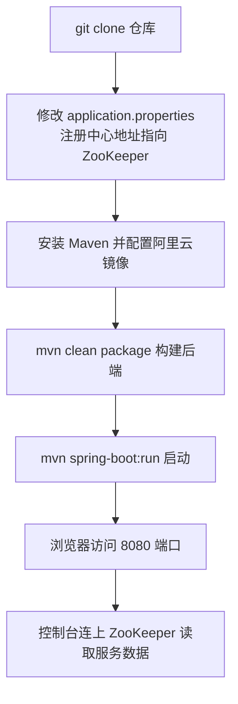
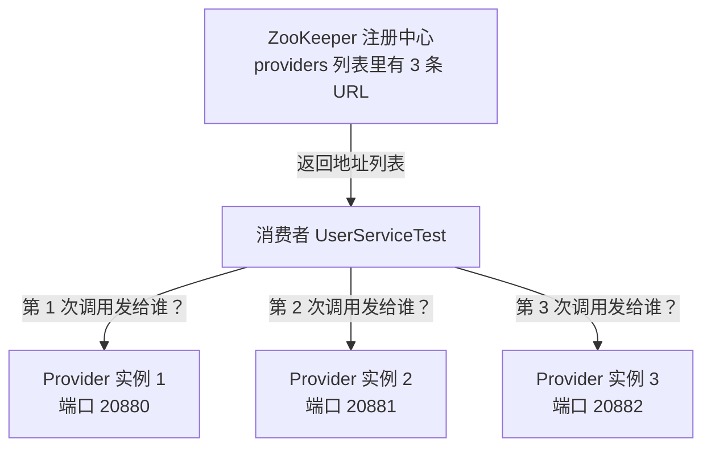

# 后台服务系统之 Dubbo 进阶：Admin 控制台、负载均衡实测与协议拆解

> 🔒 安全提示：文中示例的口令/密钥均为课程教学环境演示口径，生产环境的安全要求见《安全与合规须知》。

## 先给结论

- Dubbo Admin 是官方提供的可视化服务管理工具，前后端分离：`dubbo-admin-backend` 是 Spring Boot 后端，`dubbo-admin-frontend` 是前端页面。
- 部署四步：clone 仓库、改注册中心地址、`mvn clean package` 构建、spring-boot:run 启动，默认 8080 端口；构建机器先装 Maven，私服镜像建议改成阿里云。
- Admin 挂掉不影响 RPC 调用：它只是治理工具，服务发现走注册中心；控制台按应用名搜服务，看 Provider 的 URL 与 Consumer 列表，路由规则与动态配置也在同一页。
- 负载均衡解决多提供者时消费者每次调用选谁的问题：内置四种策略，random 随机（默认）、roundrobin 轮询、leastactive 最少活跃调用、consistenthash 一致性哈希。
- 策略通过 `loadbalance` 属性配置，消费方 `@Reference` 上标最常用，提供方 `@Service` 与 XML 也能配；单机多实例验证时协议端口必须不同，跨机器端口可相同。
- dubbo 协议默认单一长连接加 NIO 异步通讯，底层传输可选 mina、netty、grizzly；长连接建立后不销毁，省去反复建连断连的开销。
- 报文分定长 Header 与变长 Body 两段：头放魔数、序列化方式、请求标识与长度等控制信息，体放序列化后的调用参数；序列化默认 hessian 二进制，序列化器与传输器都可插拔。
- 适用小数据量大并发、消费者多于提供者的场景，官方建议单次传输参数小于 100KB；还支持 rmi、hessian、http 等协议，切换只改一行配置，多数 RPC 场景官方推荐仍是 dubbo 协议。

## 第1部分：Dubbo Admin 控制台：把服务治理从命令行搬进浏览器

服务注册成功后，验证手段一直是去 ZooKeeper 里翻节点：装个 ZooInspector，一层层展开 `/dubbo`，找到 providers 下的 URL 才能确认服务活着。消费者多了、提供者集群了，这种排查方式既不直观也不安全，总不能每次都连注册中心手动看。

Dubbo 官方给这套问题准备了一个答案：Dubbo Admin，一个带可视化界面的服务管理控制台。服务搜不搜得到、提供者有几个、消费者在谁那调用，浏览器里点几下就能看清。这一课把它部署起来，并且用它反过来验证前两课写的 `UserService` 确实已经注册进注册中心。

### 一、Dubbo Admin 是什么

一句话：它是架在注册中心之上的一层「驾驶舱」。服务提供者、消费者的一切注册数据本来就在 ZooKeeper 里，Dubbo Admin 读这些数据并画成页面，同时把「改配置、下发路由规则」这类治理动作封装成界面按钮，写回注册中心。

Dubbo 官方对它的定位是「提供了可视化界面管理工具，方便我们对服务进行管理」。代码地址是 GitHub 上的 `https://github.com/apache/incubator-dubbo-ops`，仓库结构两个模块最关键：

```text
incubator-dubbo-ops
├── dubbo-admin-backend      # Spring Boot 后端，连接注册中心
├── dubbo-admin-frontend     # 前端页面工程
├── pom.xml
└── README.md
```

它本身也是一个 Dubbo 应用的样板：后端启动后连上 ZooKeeper 订阅服务目录，前端再调后端的 HTTP 接口拿数据。所以部署它就是一个标准的 Spring Boot 工程部署流程。

### 二、部署四步走

#### 第一步：拿到代码

```bash
git clone https://github.com/apache/incubator-dubbo-ops.git
```

克隆到服务器上会生成 `incubator-dubbo-ops` 目录。不想走 git 也可以直接下载仓库压缩包解压，效果一样。

#### 第二步：指定注册中心地址

编辑 `dubbo-admin-backend/src/main/resources/application.properties`，核心是一条注册中心配置：

```properties
# 注册中心地址，默认指向本机 2181
dubbo.registry.address=zookeeper://127.0.0.1:2181
```

默认值就是本机的 2181 端口。如果 ZooKeeper 与控制台部署在同一台机器上，这一行可以不改；注册中心在别的机器上时，把 IP 换过去。这个地址必须与提供方、消费方配置的注册中心完全一致，否则 Admin 看到的是另一个 ZooKeeper，自然搜不到你的服务。

#### 第三步：Maven 构建

构建机器上要先装 Maven。课程环境是上传 `apache-maven-3.6.0-bin.tar.gz` 到服务器，解压后配置环境变量：

```bash
vim /etc/profile
# 添加如下内容
export MAVEN_HOME=/haoke/apache-maven-3.6.0
export PATH=$MAVEN_HOME/bin:$PATH
```

装完顺手把私服镜像换成阿里云，下载速度比直连中央仓库快一个量级，这一步在 Maven 的 `settings.xml` 里配置：

```xml
<mirrors>
  <mirror>
    <id>nexus-aliyun</id>
    <mirrorOf>*</mirrorOf>
    <name>Nexus aliyun</name>
    <url>http://maven.aliyun.com/nexus/content/groups/public/</url>
  </mirror>
</mirrors>
```

然后进入项目根目录执行构建：

```bash
mvn clean package
```

整个构建过程比较长，首次执行要把全部依赖拉下来，属于正常现象，耐心等它跑完即可。

#### 第四步：启动并访问

```bash
mvn -projects dubbo-admin-backend spring-boot:run
```

这条命令只对 `dubbo-admin-backend` 模块执行 Spring Boot 插件的 run 目标，起的是后端服务。看到类似启动完成的日志后，浏览器访问服务器 8080 端口，例如 `http://172.16.55.185:8080`，控制台首页就出来了。

整条部署链路串起来是这样的：



关键链路在最后一环：控制台能不能看到服务，完全取决于第二步那个注册中心地址填得对不对，前面三步只是把工程跑起来。

### 三、控制台里看什么

#### 按应用名搜索服务

首页的 Service 区有搜索框，可以按服务名、应用名等条件查询。填入前两课提供方配置的应用名 `dubbo-provider-demo`，点 Search，结果列表里就会出现 `com.example.dubbo.service.UserService`，版本 1.0.0，所属应用正是搜索的那个。这个结果与配置文件里的 `dubbo.application.name` 一一对应，应用名就是服务在控制台里的「户口」。

#### Detail 页：一次看全提供者与消费者

点开 Detail，页面上分几块信息：

- **Basic info**：服务接口全限定名、版本、应用名等基本档案。
- **Providers**：提供者列表，每一行是一个提供者的 URL，鼠标悬停可见完整地址；从这里能直接读出它使用的协议是 dubbo 协议，端口 20880。多个提供者实例启动后，这里会出现多行。
- **Consumers**：消费者列表。没有消费者在运行时这一块是空的，起一个消费方测试类再刷新就能看到。
- **Metadata**：元数据信息，没有上报时为空。

#### 治理入口

服务详情之外，控制台还有路由规则、动态配置（dynamic config）等功能入口，用于在运行期调整服务的路由与参数。这一课只把入口亮出来，具体怎么用后续课程遇到再展开。


控制台与注册中心是双向关系：读注册数据来展示，下发治理规则去改写。它不在 Provider 与 Consumer 的调用链路上，所以它停了，正在跑的 RPC 一单也不受影响。

## 第2部分：Dubbo 负载均衡策略实测：从默认随机到轮询的完整验证

消费方调用 `queryAll()` 时，注册中心返回的不再是一个地址，而是一份提供者列表：`UserService` 部署了三个实例，就注册了三条 URL。请求到底发给哪一个？这就是负载均衡要回答的问题。

这一课先把提供者起成三个实例的迷你集群，用默认的随机策略跑一百次调用观察分布，再把策略切成轮询，观察输出从「毫无规律」变成「1、2、3 循环点卯」。四种内置策略的配置方式完全一致，验证透一种，其余举一反三。

### 一、为什么需要负载均衡

单实例时代没有选择困难：注册中心里只有一条 providers URL，消费者拿到就用。可生产环境一个服务必然部署多份，一来扛并发，二来做高可用，任何一台宕机其余实例顶上。

多实例一上，新问题就来了：



消费者手里握着三个等价地址，每一次调用都要做一次选择。选择规则如果写得不好，会出现两个极端：全部压到一个实例上（其他两台闲死），或者平均到不合理（慢节点照样被塞满请求）。Dubbo 把选择逻辑抽成了负载均衡策略，默认随机，可配置替换。

### 二、四种内置策略

| 策略 | loadbalance 取值 | 选择逻辑 |
|---|---|---|
| 随机 | `random`（默认） | 按权重设定概率，随机挑一个实例 |
| 轮询 | `roundrobin` | 按权重设定轮询比例，依次轮流分发 |
| 最少活跃 | `leastactive` | 挑活跃数最少的实例，慢节点自动少接请求 |
| 一致性哈希 | `consistenthash` | 相同参数的请求总是发到同一个提供者 |

**第一，random 是默认值。** 每次调用按概率随机选，调用量大时分布趋近权重比例，实现简单且无状态，是多数场景的稳妥选择。

**第二，roundrobin 轮询。** 三个实例就 1、2、3、1、2、3 地转，分布最直观，方便肉眼验证；配合权重时按比例轮转。

**第三，leastactive 最少活跃调用。** 「活跃数」指已发出还没返回的调用计数。某个实例处理慢、手里攒着一堆未完成请求时，它的活跃数比别人高，新请求就绕开它，天然把慢节点削峰，适合提供者性能不均匀的场景。

**第四，consistenthash 一致性哈希。** 用方法入参算哈希再映射到实例，参数相同必然命中同一台，适合依赖本地状态或缓存的场景。

### 三、搭建三实例集群做验证

#### 提供者改造：打印实例标识

三个实例的 `queryAll()` 逻辑完全一样，靠日志区分谁在干活。在实现类里加一行打印：

```java
@Service(version = "${dubbo.service.version}")
public class UserServiceImpl implements UserService {

    public List<User> queryAll() {
        List<User> list = new ArrayList<>();
        for (int i = 0; i < 10; i++) {
            User user = new User();
            user.setAge(10 + i);
            user.setPassword("123456");
            user.setUsername("username_" + i);
            list.add(user);
        }
        System.out.println("----------Service 1--------------");   // 实例标识
        return list;
    }
}
```

#### 同机多实例：改端口、放开单实例限制

三个实例跑在同一台机器上，dubbo 协议端口必须互不相同，否则第二个实例绑定 20880 时直接失败。实例 2 的配置：

```properties
# 实例 2：协议端口改成 20881
dubbo.protocol.name = dubbo
dubbo.protocol.port = 20881
```

实例 3 再改成 20882。应用名、注册中心地址都不用动，注册中心会同时记录三条 URL。

还有一个 IDE 层面的拦路虎：运行配置默认限制单实例，同一个 main 方法第二次点运行会拒绝启动。打开运行配置编辑面板，把单实例运行的限制选项去掉，同一个类就能连续起多个进程。三个实例依次启动、依次改标识与端口，控制台上 `----------Service 1/2/3--------------` 各占一个窗口。

#### 消费者：循环一百次看分布

```java
@Test
public void testQueryAll() {
    for (int i = 0; i < 100; i++) {
        System.out.println("开始调用远程服务 >>>>> " + i);
        List<User> users = this.userService.queryAll();
        for (User user : users) {
            System.out.println(user);
        }
    }
}
```

每次调用后可以 `Thread.sleep(1000)` 放慢节奏，方便观察。跑起来盯着三个提供者控制台：`Service 1`、`Service 2`、`Service 3` 的输出次数有差异但没有固定顺序，某个实例偶尔连中几次，拉长了看次数大体接近。这就是默认 random 策略的样子，随机不等于均匀，短窗口内必然有抖动。

### 四、切到轮询：注解加一个属性

策略切换只需在 `@Reference` 上追加 `loadbalance` 属性：

```java
@Reference(version = "1.0.0", loadbalance = "roundrobin")
private UserService userService;
```

重跑消费者测试，三个提供者的输出立刻变成严格节奏：`Service 1`、`Service 2`、`Service 3`、`Service 1`、`Service 2`、`Service 3`，一轮一轮转下去，与随机的杂乱输出形成鲜明对照。

XML 方式的写法是同一个属性名：

```xml
<dubbo:service interface="com.example.dubbo.service.UserService" loadbalance="roundrobin" />
```

提供方注解 `@Service(loadbalance = "roundrobin")` 同样生效。配置位置的选择原则：想按消费方各自的节奏控制就用 `@Reference`，想让所有消费方统一遵守就在提供方声明，消费方配置的优先级更高，两边都配时以消费方为准。

## 第3部分：Dubbo 协议拆解：单连接长连接 NIO 背后的取舍

`application.properties` 里有一行 `dubbo.protocol.name = dubbo`，前面写服务提供方时照抄了，但没有追问过：这个 dubbo 协议到底是什么？为什么 Dubbo 官方推荐它，又有哪些协议可以替换它？

去注册中心看一眼服务 URL 就有直观印象：`dubbo://172.16.55.185:20880/com.example.dubbo.service.UserService`，协议头直接写在 URL 里。这一课把这行配置背后的传输机制拆开：它怎么连、报文长什么样、适合传什么、什么时候该换协议。

### 一、单连接长连接与 NIO 异步

**先分清长连接与短连接。** 长连接指消费方与服务方之间的连接一旦建立就不再销毁，之后所有调用复用这条通道传数据，省掉了反复创建连接与销毁连接的动作，性能损耗自然小。短连接的典型代表是 HTTP：每次请求先建连接，用完就断，下次请求再建再断，频繁握手挥手本身就是一笔开销。

**再看「单连接」。** 消费者与一个提供者之间默认只维持一条连接，而不是为每个请求各开一条。单一连接看似是瓶颈，配合 NIO 异步通讯就成立了：调用方把请求写进连接后不必原地等待，连接在请求与响应之间多路复用，一条链路就能承载大量并发调用。

**由此推出它擅长与不擅长的场景。** 请求与响应都是小数据包时，单连接加多路复用效率极高，所以 dubbo 协议适合小数据量、大并发的服务调用，尤其适合消费者机器数远多于提供者机器数的典型微服务形态。反过来有两个不适用的硬场景：一是大文件或超大字符串传输，单个大报文占住连接，同一条连接上的其他调用被阻塞；二是提供者很多而消费者很少时，单一消费者撑不满大量提供者的连接，资源利用率反而上不去。

### 二、一次调用在协议栈里的旅程

官方文档给 dubbo 协议画了一张分层架构图，一次调用从客户端到服务端要穿过这些组件：


**发送端做两件事。** 代理层（`@Reference` 注入的那个动态代理）把方法调用拦下来，交给 Codec 编码成协议报文，再由 Serialization 序列化成二进制字节，最后由传输层写进网络。传输层的可选项是 mina、netty、grizzly，都是高性能 NIO 框架，性能相当。

**报文的组织思想是定长头加变长体。** Header 段是定长的（dubbo 协议为 16 字节），里面放魔数（用于快速识别一帧数据是不是 dubbo 报文）、序列化类型、请求还是响应、Body 长度等控制信息；Body 段放序列化后的方法名与参数。接收端先读定长头，拿到 Body 长度后精准切出数据体，无论参数多大都不会粘包错位。

**接收端也做两件事。** 服务端收到字节流后反向走一遍解码与反序列化，Dispatcher 把请求分发出去，交给线程池调度执行真正的实现类。用线程池而不是来一个请求开一个线程，是为了省掉频繁创建线程与销毁线程的性能损耗，与长连接省掉建连开销是同一个思想：昂贵的资源只建一次，反复复用。

序列化默认采用 hessian 二进制方式，紧凑且跨语言友好；官网列出的可选项还有 dubbo 原生序列化、java 原生序列化、json 等，序列化器与传输器一样都是可插拔的。

### 三、配置与协议家族

回到配置文件，提供方里与协议相关的就三行：

```properties
# 协议名与端口
dubbo.protocol.name = dubbo
dubbo.protocol.port = 20880
# 注册中心
dubbo.registry.address = zookeeper://172.16.55.185:2181
```

协议切换的成本极低，把 `name` 换掉即可，例如换成 http 协议的 XML 写法：

```xml
<dubbo:protocol name="http" port="8080" />
```

Dubbo 协议参考手册里列出的家族成员不少：dubbo、rmi、hessian、http、redis、rest 等，各有适用面。**Dubbo 官方明确推荐的是 dubbo 协议**，常规远程方法调用场景下，它在性能与功能之间平衡得最好，这也是课程项目选它的原因。

**与 REST 的取舍**值得单独说。REST 走 HTTP，报文通常是 JSON 文本，可读性好、跨语言零门槛、浏览器直接能调，代价是文本序列化体积大、HTTP 短连接开销高，更适合对外开放 API、异构系统对接这类边界。dubbo 协议走 TCP 长连接加二进制序列化，报文小、传输效率高，代价是两端都得有 Dubbo 环境，更适合内部服务之间的高频 RPC。一句话：对内追求吞吐用 dubbo 协议，对外追求通用开放用 REST，两者在同一个系统里经常并存。

## 常见误区

- **注册中心地址没改对。** Admin 默认连 `127.0.0.1:2181`，你的 ZooKeeper 在另一台机器时，页面能打开但永远搜不到服务。排查顺序：先确认服务确实注册了（去 ZooKeeper 里看节点），再核对 Admin 的注册中心地址。

- **以为构建卡死了。** `mvn clean package` 首次构建拉全量依赖，时间以分钟计。没换阿里云镜像会更慢。环境没问题、网络通畅，多等一会儿就好；失败时重试一次往往就过。

- **没装 Maven 就敲构建命令。** `mvn` 命令不存在直接报 command not found。先把 Maven 装好、配好环境变量，`mvn -v` 能出版本号再继续。

- **把 Admin 当成调用链路的必经环节。** 它只是观察与治理工具，宕机不影响服务调用；反过来，服务注册信息的准确性也不由它决定，源头永远是注册中心。

- **同机多实例不换端口。** 第二个实例启动报端口占用异常，dubbo 协议端口在单机上必须唯一；只有跨机器部署时才能都用 20880。

- **被 IDE 单实例限制卡住。** 改完端口再点运行毫无反应或直接报错，多数是运行配置限制了单实例，去掉限制即可并行启动多个进程。

- **以为随机就是平均。** random 按概率分发，几十次调用的分布有明显抖动，判断分布要拉长样本量，不能跑十次就下结论。

- **提供方消费方各配各的，互相对不上。** 两边都配置时消费方优先级更高，排查「轮询没生效」先看 `@Reference` 是不是还写着旧的 `loadbalance` 属性。

- **拿 dubbo 协议传大文件。** 单一长连接被一个大报文占住，同连接上的其他调用全部排队，表现就是偶发超时。大文件走对象存储或分片通道，RPC 只传小参数与结果。

- **以为单连接等于并发上不去。** NIO 异步通讯让一条连接多路复用，成百上千的并发调用可以挤在同一条长连接上互不等待，性能瓶颈远没想象中来得早。

- **以为换协议要重写业务代码。** 协议是传输层的可插拔组件，`dubbo.protocol.name` 一改、端口对应调整即可，接口与实现类一行不动；要重新评估的是序列化兼容与消费方连接行为。

- **把报文想成「一段二进制而已」。** 定长 Header 加变长 Body 的结构是理解一切二进制协议的钥匙，先读头拿长度再切体，这个模式在 Redis、HTTP/2 等协议里反复出现，值得记牢。

## 面试可能被问到的问题

1. 面试官追问：「Dubbo Admin 是什么，解决什么问题？」
   答：Dubbo 官方的可视化服务管理控制台，读取注册中心里的服务注册数据，提供服务查询、提供者与消费者详情展示、路由规则与动态配置下发等治理能力，替代手工连注册中心排查的方式。

2. 面试官追问：「部署 Dubbo Admin 的步骤？」
   答：clone `apache/incubator-dubbo-ops` 仓库，在 `dubbo-admin-backend` 的 `application.properties` 里指定注册中心地址，用 Maven 执行 `mvn clean package` 构建，再以 `mvn -projects dubbo-admin-backend spring-boot:run` 启动，默认 8080 端口访问。

3. 面试官追问：「控制台里搜不到服务，你怎么排查？」
   答：先确认服务确实注册成功，可以直接连 ZooKeeper 看 `/dubbo` 下的节点；再核对 Admin 配置的注册中心地址是否与提供方一致，地址不同等于在看另一套注册中心；最后确认搜索条件填的是应用名或服务接口名。

4. 面试官追问：「Dubbo Admin 挂了，线上服务还能调用吗？」
   答：能。消费者与提供者之间通过注册中心做地址发现，直连调用不经过 Admin。Admin 只负责展示与治理，它的可用性与 RPC 链路无关，这也是治理工具与数据面分离的意义。

5. 面试官追问：「为什么构建 Dubbo Admin 特别慢？」
   答：它是一个多模块工程，首次构建要下载全部依赖。把 Maven 的 `settings.xml` 镜像指向国内私服（如阿里云）可以大幅提速；构建是一次性成本，之后启动走本地仓库就快了。

6. 面试官追问：「Dubbo 默认的负载均衡策略是什么？」
   答：random 随机。按权重设定概率随机挑一个提供者实例，调用量足够大时分布趋近权重比，实现无状态、适用面广， Dubbo 官方推荐与默认值都是它。

7. 面试官追问：「四种负载均衡策略分别适合什么场景？」
   答：random 适合通用场景；roundrobin 轮询分布均匀、便于观察，适合实例性能一致的集群；leastactive 最少活跃调用，适合实例处理能力不均、希望慢节点自动少接请求的场景；consistenthash 一致性哈希，让相同参数稳定路由到同一实例，适合有状态服务或本地缓存场景。

8. 面试官追问：「loadbalance 可以在哪些地方配置，冲突了听谁的？」
   答：消费方 `@Reference`、提供方 `@Service` 或 XML 标签上都可以配，粒度上还支持方法级覆盖接口级。两边同时配置时消费方优先，所以改策略没生效要优先检查消费方注解。

9. 面试官追问：「最少活跃调用为什么能避开慢节点？」
   答：每个提供者维护一个进行中调用的计数，请求处理越慢、堆积越多，活跃数越高。消费方选实例时优先挑活跃数最小的，慢节点自然被新请求绕开，负载随处理能力自适应倾斜。

10. 面试官追问：「轮询和随机怎么选？」
   答：性能一致、想验证分发行为用轮询，输出规律直观；对等集群日常运行用随机，省去序号管理的心智负担，且大样本下两者分布效果接近。差异主要体现在有权重的非对等集群上，轮询按比例严格轮转，随机只是概率趋近。

11. 面试官追问：「dubbo 协议默认的传输特点是什么？」
   答：单一长连接加 NIO 异步通讯，底层传输器可选 mina、netty、grizzly，默认序列化是 hessian 二进制方式。长连接建立后不复建，单连接靠 NIO 多路复用承载高并发。

12. 面试官追问：「长连接和短连接的区别，dubbo 协议为什么选长连接？」
   答：长连接建连一次持续复用，短连接每次请求都要建立并销毁连接。RPC 调用高频且双方固定，反复握手的开销占比高，长连接把这部分成本摊薄到近零，吞吐明显更高。

13. 面试官追问：「dubbo 协议适合什么场景，不适合什么场景？」
   答：适合小数据量、大并发，消费者远多于提供者的常规远程方法调用；官方建议单次参数小于 100KB。不适合传输大文件或超大字符串，单连接会被大报文阻塞；消费者少而提供者多时也无法压满提供者。

14. 面试官追问：「说说 dubbo 协议报文的结构思想。」
   答：定长 Header 加变长 Body。Header 定长 16 字节，含魔数、序列化类型、请求响应标志、Body 长度等控制信息；Body 是序列化后的调用数据。接收端先解析定长头获取 Body 长度，再精确切分报文，天然解决 TCP 粘包问题。

15. 面试官追问：「dubbo 协议和 REST 怎么选？」
   答：内部服务间高频 RPC 用 dubbo 协议，二进制序列化加 TCP 长连接，报文小吞吐高；对外开放或跨语言异构对接用 REST，HTTP 加 JSON 通用性好但开销大。协议可以共存，按调用边界划分即可。

16. 面试官追问：「Dubbo 支持哪些协议，默认推荐哪个？」
   答：内置 dubbo、rmi、hessian、http、redis、rest 等协议，通过 `dubbo.protocol.name` 或 `<dubbo:protocol>` 标签切换。官方推荐 dubbo 协议，常规方法调用场景下综合表现最好。

## 配套资料

- 本教学日资料包未收录源码（`materials/code/03/` 下无 day03 解压内容），文中部署命令、`application.properties` 配置、`settings.xml` 镜像与控制台页面信息均按本课画面与实操整理补全，可直接照做。

- Dubbo 服务发现的真实工程可对照阅读：`materials/code/10/nacos-discovery-RESTful服务发现与Dubbo服务发现/`，其中 api 模块与 server 模块分离的结构即控制台里看到的「一个应用对外提供一组服务」的标准形态。

- 本教学日资料包未收录源码（`materials/code/03/` 下无 day03 解压内容），文中实现类、启动类、测试类与配置均按本课实操画面整理补全（包名统一改写为 `com.example.dubbo`），三种 `loadbalance` 配置写法可直接照抄运行。

- 前一课的提供方与消费方完整工程结构见系列文章《后台服务系统之编写服务提供方实现》，本课的三个实例就是在那份代码上扩出来的。

- 同阶段后续 Dubbo 相关真实工程可对照阅读：`materials/code/10/nacos-discovery-RESTful服务发现与Dubbo服务发现/`。

- 本教学日资料包未收录源码（`materials/code/03/` 下无 day03 解压内容），文中协议配置与 XML 示例按本课画面与实操整理补全，`dubbo.protocol` 三行配置与提供方工程可对照前课《后台服务系统之编写服务提供方实现》直接使用。

- 协议架构分层（Proxy、Codec、Serialization、Transporter、Dispatcher、ThreadPool）依据本课讲义架构图整理，各组件可选项（mina/netty/grizzly、dubbo/hessian/java/json）来自 Dubbo 官方协议参考手册。
