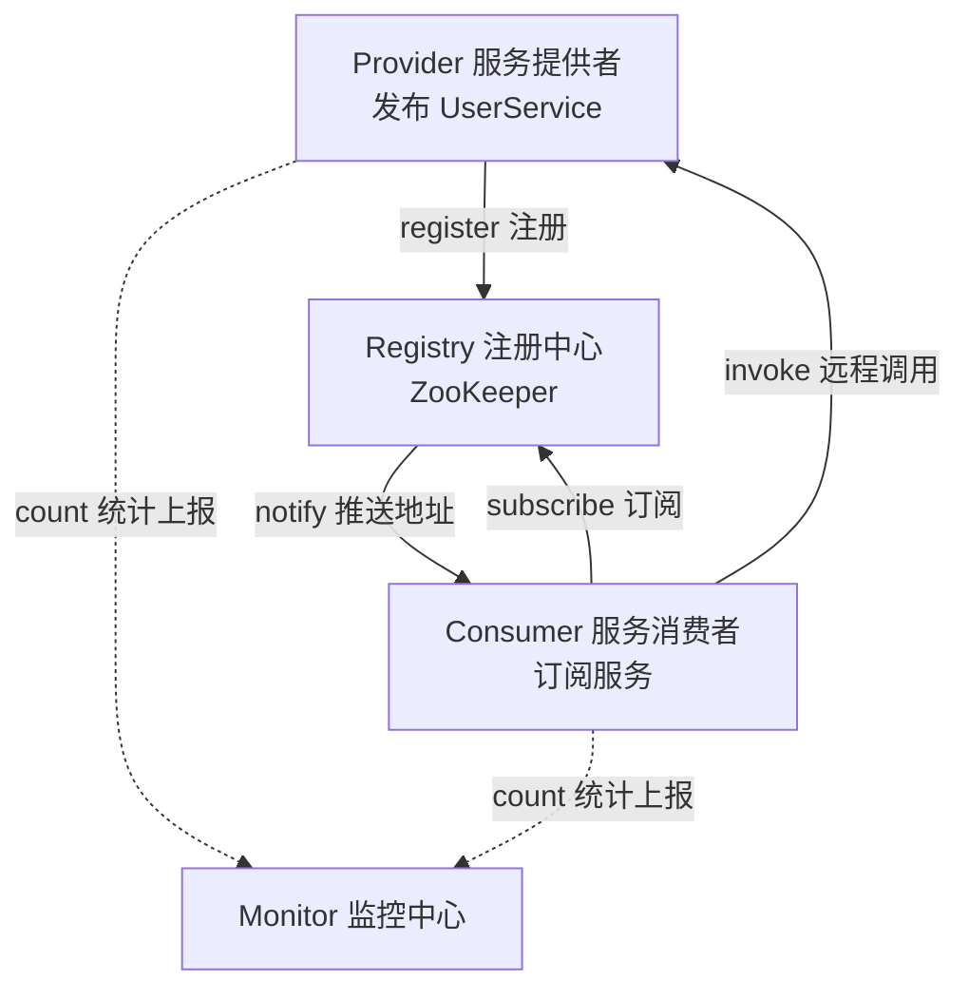
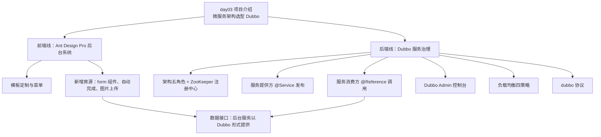

# day03 收束：前端后台系统与 Dubbo 后端服务两条线并轨

day03 的信息量在系列课程里排得上前列：前半段在浏览器里搭后台系统的界面，后半段钻进注册中心与 RPC 调用，两条线交替推进，学到后面容易忘了前面在干什么。收尾前把两条线各自走到哪、在哪里交汇，完整过一遍。

## 先给结论

- 第一条线是前端后台系统：基于 Ant Design Pro 模板搭建，改 logo 与版权、定制左侧菜单，重点完成了新增房源功能（数据结构、form 组件、表单提交、自动完成、图片上传），前端部分搭建完成。
- 第二条线是 Dubbo 后端服务：从「什么是 Dubbo」讲起，走通架构、ZooKeeper 注册中心、服务提供方、服务消费方，再到 Dubbo Admin、负载均衡、协议，RPC 链路完整跑通。
- 两条线的交汇点是数据：后台系统的页面操作最终要落到后台服务的接口上，服务以 Dubbo 形式对外提供。
- 后端技术栈定档：Spring Boot 加 Spring MVC 做工程骨架，Dubbo 做服务治理，MyBatis 做数据访问，注册中心选 ZooKeeper 并用 Docker 部署。
- 关键结论回收：Dubbo 默认负载均衡是 random，可切 roundrobin；dubbo 协议适合小数据量大并发；Dubbo 架构五角色图是理解一切的基础。

## 一、第一条线：前端后台系统成型

后台系统没有从零造轮子，而是以 Ant Design Pro 为模板工程创建项目，这一步换来的是现成的布局、权限框架与页面规范。模板到手后做了三件定制：

**第一，替换品牌信息。** 模板的 logo 与版权文案换成项目自己的，页面归属感就出来了。

**第二，制定左侧菜单。** 按业务功能规划导航结构，菜单项与路由一一对应，后续每个功能页面挂进对应菜单即可。

**第三，重点实现新增房源。** 这是后台系统第一个复杂表单功能，覆盖的技法是通用的：先设计数据结构，再落到页面；form 组件负责字段收集与校验，表单提交把数据组织成接口需要的形状；自动完成功能在输入框联想补全；图片上传处理文件列表并与表单联动。这些能力组合起来，后台系统的其余表单页面都是同一套打法的重复。

## 二、第二条线：Dubbo 后端服务从零到通

### Dubbo 是什么、从哪来

Apache Dubbo 是一款高性能 Java RPC 框架。它最初由阿里巴巴开源并内部使用，后进入 Apache 基金会孵化并顺利毕业成为顶级项目，名字读作「达博」还是「杜波」一直有争议，统一按官方读音 Dubbo 即可，不必纠结。

项目整体采用微服务架构，服务治理框架选的就是 Dubbo。理解它的钥匙是那张官方架构图：



五个角色的方向别记反：注册动作由提供者发起，订阅动作由消费者发起，注册中心把地址变化推给消费者，真正的调用在消费者与提供者之间直连，监控中心只收统计不参与调用。这张图是 day03 后端一切操作的地图。

### 注册中心：ZooKeeper 加 Docker

注册中心有多种实现，课程推荐 ZooKeeper。部署方式推荐 Docker，三条命令完成：

```bash
# 拉取镜像
docker pull zookeeper:3.5
# 创建容器
docker create --name zk -p 2181:2181 zookeeper:3.5
# 启动容器
docker start zk
```

镜像开箱即用、随起随停、不污染宿主机环境，这三条命令在前一课已实际跑过。

### 提供方与消费方

服务提供方用 dubbo 的 `@Service` 发布服务，配置协议端口与注册中心地址，以非 Web 方式启动，启动后在注册中心能看到服务 URL；消费方用 `@Reference` 注入远程代理，测试类直接调用就拿到了提供方返回的 10 条数据：

```java
@RunWith(SpringRunner.class)
@SpringBootTest
public class TestUserService {

    @Reference(version = "1.0.0", loadbalance = "roundrobin")
    private UserService userService;

    @Test
    public void testQueryAll() {
        for (int i = 0; i < 50; i++) {
            List<User> users = this.userService.queryAll();
        }
    }
}
```

从这一刻起，Dubbo 在本地完整跑通：发布、注册、订阅、调用四步全走了一遍。

## 三、把 Dubbo 用深一层：Admin、负载均衡与协议

**Dubbo Admin 是治理入口。** 官方可视化控制台，clone 后改注册中心地址，Maven 构建再启动，浏览器 8080 端口访问。构建耗时长属于正常，网络环境正常、Maven 私服换成阿里云镜像，失败就重试，一般都能过。进控制台按应用名搜服务、看提供者与消费者详情，路由与动态配置的入口也在里面。

**负载均衡是多实例的选路规则。** 同一服务起三个实例（同机部署协议端口分别为 20880、20881、20882），默认 random 随机分发，输出无固定规律；`@Reference` 上加 `loadbalance = "roundrobin"` 切成轮询，输出立刻变成 1、2、3 循环。四种策略同一套配置方式，验证透轮询，其余照搬。

**dubbo 协议定义了传输形态。** 单一长连接加 NIO 异步通讯，hessian 二进制序列化，报文定长头加变长体，适合小数据量大并发、消费者多于提供者的场景，不适合传大文件。它是官方推荐的默认协议。

## 四、全章知识地图



图里两条线在底部汇合：后台系统页面收集的数据要交给后台服务处理，服务以 Dubbo 形式提供，这就是下一天「实现具体功能」要走的路。

## 常见误区

- **把两条线当成两门课分开记。** 新增房源的表单提交最终指向的是 Dubbo 服务的接口设计，数据结构先于页面与代码定下来，前后端是围绕同一份数据结构协作的。
- **背架构图只记名词不记方向。** 五个角色谁发起注册、谁发起订阅、调用发生在谁和谁之间，方向错了排查问题就会南辕北辙；注册中心宕机时双方凭本地缓存的地址仍能调用一段时间，这个行为也从交互方向推导出来。
- **Admin 构建失败一次就放弃。** 首次构建拉全量依赖，失败常见于网络抖动与默认中央仓库过慢，换阿里云镜像后重试两三次是常规操作，不是环境坏了。
- **默认值记混。** 负载均衡默认 random 不是 roundrobin，协议默认 dubbo 不是 http，序列化默认 hessian 不是 json，这三组默认值是面试高频点。

## 面试可能被问到的问题

1. 面试官追问：「项目为什么选 Dubbo 做服务治理？」
   答：项目采用微服务架构，服务间需要高性能 RPC 与治理能力。Dubbo 是 Apache 顶级项目，Java 生态适配好，架构清晰，注册中心、负载均衡、可视化控制台配套齐全，学习与维护成本低。

2. 面试官追问：「画出 Dubbo 架构并说明各角色职责。」
   答：Container 负责启动 Provider，Provider 注册服务到 Registry，Consumer 订阅 Registry 并收到地址推送，随后与 Provider 直连调用，双方把调用统计上报 Monitor。注册中心宕机不影响已建立调用，因为地址已缓存在消费方本地。

3. 面试官追问：「ZooKeeper 注册中心为什么用 Docker 部署？」
   答：Docker 一条命令拉镜像、一条命令创建并映射 2181 端口，环境隔离、随起随停，避免在宿主机上装 JDK 配置目录的繁琐，团队环境也一致，课程与开发环境首选这种方式。

4. 面试官追问：「day03 里 Dubbo 调用链路是怎么验证打通的？」
   答：提供方启动后在注册中心出现服务 URL，消费方测试类通过 `@Reference` 注入代理调用 `queryAll()`，拿到提供方构造的 10 条数据；再起多个提供者实例，用 Admin 搜索确认实例都在，循环调用观察负载均衡分布。

5. 面试官追问：「这套后台系统前后端是怎么衔接的？」
   答：前端基于 Ant Design Pro，页面通过 form 组件收集数据并提交，后端以 Spring Boot 加 Dubbo 提供服务接口，双方约定同一份数据结构；前端不关心接口由哪个实例提供，服务发现由 Dubbo 完成。

## 配套资料

- 本教学日资料包未收录源码（`materials/code/03/` 下无 day03 解压内容），文中 Docker 命令、测试类与配置按本课画面与实操整理补全（包名统一改写为 `com.example.dubbo`），提供方与消费方的完整写法见系列文章《后台服务系统之编写服务提供方实现》。
- Dubbo 服务发现的真实工程可对照阅读：`materials/code/10/nacos-discovery-RESTful服务发现与Dubbo服务发现/`（api 模块与 server 模块分离的标准工程结构）。
