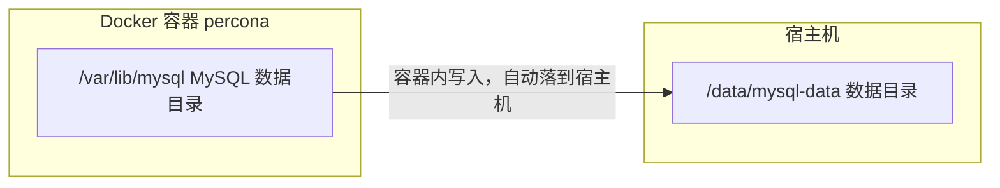

# 三条命令装好 MySQL：用 Docker 部署 Percona 并连上它验证

项目底层数据库已经定为 MySQL，接下来的现实问题是装在哪、怎么装。传统方式要在系统里解压、建用户、改配置、设开机自启，装完还得操心卸载残留。这套课程环境里更省事的路是容器化：镜像拉下来，容器建起来，数据库就能连。装哪个版本、参数怎么填、数据放在哪，就是这一篇要说清的三件事。

## 先给结论

- 选用 Percona 5.7.23，它是 MySQL 的衍生版，对 InnoDB 在高负载下的性能有明显增强，使用方式与原生 MySQL 完全一致。
- 部署只用三条命令：`docker pull percona:5.7.23` 拉镜像，`docker create` 建容器，`docker start percona` 启动。
- 容器创建命令里最关键的是 `-v /data/mysql-data:/var/lib/mysql`，它把数据库数据落到宿主机目录，数据与容器分离。
- root 密码通过环境变量 `-e MYSQL_ROOT_PASSWORD=root` 设置。
- 验证标准：远程客户端用虚拟机 IP 加 3306 端口、账号 root 能连上，看到系统库即部署成功。

## 为什么选 Percona 这个衍生版

MySQL 是开源数据库，开源带来一个自然结果：不少个人、组织和企业基于它的源码，结合自身业务做改进，形成了众多衍生版本。Percona 是其中知名度较高、性能做得非常好的一个，对原生 MySQL 在功能和性能上都有显著提升。

**第一，性能增强看得见。** 官方资料明确列出它提升了高负载情况下 InnoDB 存储引擎的性能。InnoDB 是 MySQL 目前默认的存储引擎，日常业务几乎全跑在它上面，这个改进直接受益于所有业务表。

**第二，给运维配了工具。** 它为 DBA 提供了一些非常有用的性能诊断工具，排查慢查询、定位瓶颈时更顺手。

**第三，学习成本约等于零。** 衍生版只在底层做改进，使用层面与原生 MySQL 没有任何区别。还有一个容易误会的地方：Percona Server 只包含 MySQL 服务器端，客户端和 GUI 工具并没有改动，客户端继续用 MySQL 官方提供的或第三方工具即可。

## 拉镜像、建容器、启动

镜像直接从 Docker Hub 的 percona 仓库拉取，版本固定为 5.7.23，对应的 MySQL 大版本就是 5.7：

```bash
# 镜像地址：https://hub.docker.com/_/percona/
# 拉取镜像
docker pull percona:5.7.23

# 创建容器
docker create --name percona -v /data/mysql-data:/var/lib/mysql -p 3306:3306 -e MYSQL_ROOT_PASSWORD=root percona:5.7.23

# 启动容器
docker start percona
```

创建命令参数多，逐个拆开看：

- `--name percona`：指定容器名称，后面 start、stop 都用它来指代这个容器。
- `-v /data/mysql-data:/var/lib/mysql`：把主机的 `/data/mysql-data` 目录挂载到容器内的 `/var/lib/mysql`。冒号前面是宿主机目录，后面是容器内目录。
- `-p 3306:3306`：端口映射，主机 3306 端口对应容器内部 3306 端口，外部程序连主机的 3306 就等于连进容器里的数据库。
- `-e MYSQL_ROOT_PASSWORD=root`：设置容器内环境变量，指定 root 用户的密码为 root。
- 结尾的 `percona:5.7.23` 是镜像名加版本，说明这个容器基于哪个镜像创建。

演示时机器上已经有一个旧的 percona 容器和旧的数据目录，为了看到干净的首启过程，先停掉并删除旧容器，再删掉旧数据目录：

```bash
docker stop percona
docker rm percona
docker ps -a        # 确认容器已删除
docker images       # 镜像列表里应有 percona:5.7.23
rm -rf /data/mysql-data
```

## 数据为什么要放在容器外面

`-v` 参数是整套命令里最值得琢磨的一处。容器是跑镜像的轻量运行环境，生命周期很随意，今天删明天建是常态；但数据库里不断产生的数据必须活得比容器久。办法就是把数据目录挂到容器外面：容器内部往 `/var/lib/mysql` 写的一切内容，实际都落到宿主机的 `/data/mysql-data` 里。



图里那条箭头就是 `-v` 建立的映射：应用视角看数据在容器里，物理上全部存在宿主机。验证这一点只需要两步观察：

**第一，create 之后目录并不存在。** 只执行 `docker create` 时容器还没运行，`ls -l /data/mysql-data` 会提示目录不存在。

**第二，start 之后目录自动生成。** 执行 `docker start percona`，MySQL 初始化数据目录，此时再看：

```bash
ls -l /data/mysql-data
# auto.cnf  ca-key.pem  ca.pem  ibdata1  ib_logfile0  ib_logfile1
# mysql/  performance_schema/  sys/
```

这些正是 MySQL 的数据库存储文件：`ibdata1` 与两个 `ib_logfile` 是 InnoDB 的数据与日志文件，`mysql/`、`performance_schema/`、`sys/` 是系统库目录。数据目录被实例化到了宿主机上，映射生效。

## 启动验证与远程连接

容器启动后用 `docker ps` 确认状态，列表里能看到 `percona:5.7.23` 处于运行中，并且带着 `3306` 的端口映射。接下来用图形化客户端做远程连接验证：新建一个 MySQL 连接，连接名随意（演示中直接用主机 IP 命名），主机地址填虚拟机 IP `172.16.55.185`，端口 `3306`，用户名 `root`，密码就是创建容器时通过 `-e` 设置的 `root`。

点击测试连接，通过后保存。能看到连接里的系统库，说明远程链路、端口映射、账号密码全部正确，数据库部署完成。整个部署从拉镜像到连上，十来分钟内可以结束，这也是容器化部署最直观的好处。

## 数据卷带来的底气：容器随便删

有了 `-v` 映射，容器和数据的生死就解绑了。`docker rm percona` 删掉容器，数据还安然躺在 `/data/mysql-data`；重新 `docker create` 一个同名容器并挂载同一个目录，数据原样接上。升级镜像版本、重建容器，都走这条路。

反过来也要警惕：如果建容器时忘了 `-v`，数据会写进容器内部的可写层，容器一删数据全没。所以建数据库容器时，第一件事就是检查挂载参数。

## 常见误区

- **`-v` 两边路径写反。** 格式是「宿主机路径在前，容器内路径在后」，写成 `-v /var/lib/mysql:/data/mysql-data` 会把一个空目录挂进 MySQL 的数据位置，实例起不来或数据丢失，启动日志里能看到初始化报错。
- **数据写进容器内部。** 不加 `-v` 时数据在容器可写层里，`docker rm` 之后数据随之消失，这是用容器跑数据库最容易踩的坑。
- **端口映射只写一个 3306。** `-p 3306` 不等于 `-p 3306:3306`，完整的「主机端口对容器端口」写法才能保证外部按预期连上。
- **旧数据目录残留导致状态异常。** 之前装过 MySQL 的机器上直接复用旧目录，可能出现权限或版本不一致问题。演示环境下先清空目录再建容器，首启初始化才干净。

## 面试可能被问到的问题

1. 面试官追问：「`docker create` 和 `docker start` 为什么分开执行？」
   答：create 只根据镜像创建容器并完成参数配置，处于未运行状态；start 才真正启动进程。分开写便于先检查容器配置（名称、挂载、端口）再启动，合并执行就是 `docker run`，两者等价。

2. 面试官追问：「容器删了，MySQL 的数据会丢吗？」
   答：不会。创建容器时用 `-v` 把容器内 `/var/lib/mysql` 挂载到了宿主机 `/data/mysql-data`，数据物理上存在宿主机，容器删除重建后挂回同一目录，数据原样保留。

3. 面试官追问：「Percona 和 MySQL 是什么关系？」
   答：Percona 是基于 MySQL 源码的衍生版本，在存储引擎层面做了改进，高负载下 InnoDB 性能更好，并附带性能诊断工具；使用层面与 MySQL 完全兼容，不改变 SQL 语法与客户端生态。

4. 面试官追问：「`-e MYSQL_ROOT_PASSWORD=root` 起什么作用？」
   答：`-e` 向容器内注入环境变量。MySQL 官方系列镜像在首次初始化时会读取这个变量，把它作为 root 账号的初始密码，免去进入容器手工改密码的步骤。

5. 面试官追问：「外部客户端是怎么连到容器里数据库的？」
   答：通过 `-p 3306:3306` 的端口映射，Docker 在宿主机监听 3306 并把流量转发到容器内的 3306。客户端连宿主机 IP 的 3306，实际到达的是容器里的 MySQL 进程。

## 配套资料

- 本教学日资料包未收录源码（`materials/code/03/day04-服务的具体实现以及MybatisPlus的入门/` 下仅存清单文件），文中全部 Docker 命令与参数解释抄录自本课屏幕画面，Navicat 连接流程出自本课实操演示。
- 建库建表 SQL 属于下一篇 MyBatis-Plus 快速入门的前置步骤，可先在 `materials/docs/10/Mybatis-Plus讲义v1.0.md` 的快速入门一节预览对应内容。
