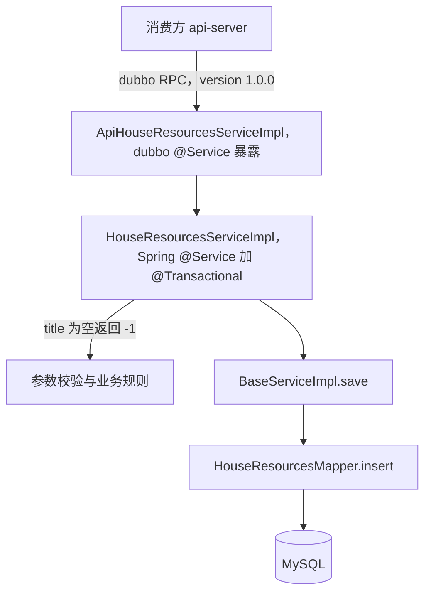

# 新增房源落库：Api 接口定义与 Spring Service、dubbo Service 两层分工

实体就位了，这一课把「新增房源」从接口定义一路写到数据库。动手前有个问题必须想清楚：dubbo 的服务实现类里到底该写业务逻辑，还是只做转发？事务加在哪一层？答案是 Service 拆两层，业务关切与协议暴露彻底分开，也是项目后续所有服务沿用的模式。

## 先给结论

- 对外的 dubbo 接口以 Api 开头命名，`saveHouseResources` 返回 int：-1 表示参数不符合要求，0 表示落库失败，1 表示成功，语义写进接口注释。
- dubbo-server 里 Service 分两层：Spring Service 贴着 Mapper 承担校验与事务，dubbo Service 只做转发与暴露。
- 通用 CRUD 收进抽象类 `BaseServiceImpl`，用 Spring 4 的泛型注入拿到对应的 `BaseMapper`，业务实现类继承即得。
- 提供方实现类标 dubbo 的 `@Service(version = "1.0.0")`，扫描包由 `dubbo.basePackages` 指向 api 包，启动类是非 web 应用。
- 事务注解 `@Transactional` 加在 Spring Service 上，不加在 dubbo 实现上。

## 一、对外契约：先定接口与返回值语义

interface 模块的 api 包里定义 dubbo 接口。项目约定所有 dubbo 服务接口以 Api 开头，一眼就能认出这是对外发布的契约：

```java
package com.haoke.manage.dubbo.server.api;

import com.haoke.manage.dubbo.server.pojo.HouseResources;

/**
 * 房源服务的对外接口，约定以 Api 开头命名
 */
public interface ApiHouseResourcesService {

    /**
     * 新增房源
     *
     * @param houseResources 房源数据
     * @return -1 参数不符合要求，0 插入数据库失败，1 成功
     */
    int saveHouseResources(HouseResources houseResources);
}
```

返回值用状态码而不是抛异常，是 RPC 接口的一种常见取舍：异常对象也要跨网络序列化，消费端还得按类型捕获，简单场景下返回值约定更直接。代价是语义全靠注释约束，-1、0、1 各代表什么必须当场写清。

## 二、配置与 Mapper：把数据库通道接好

dubbo-service 模块先补 Spring Boot 配置文件 `application.properties`：

```properties
# Spring Boot 应用名
spring.application.name = haoke-manage-dubbo-server-house-resources

# 数据库连接
spring.datasource.driver-class-name=com.mysql.jdbc.Driver
spring.datasource.url=jdbc:mysql://127.0.0.1:3306/haoke?useUnicode=true&characterEncoding=utf8&autoReconnect=true
spring.datasource.username=root
spring.datasource.password=root

# dubbo 服务实现所在的扫描包
dubbo.basePackages = com.haoke.manage.dubbo.server.api

# dubbo 应用名
dubbo.application.name = dubbo-provider-house-resources

# 协议与端口
dubbo.protocol.name = dubbo
dubbo.protocol.port = 20881

# 注册中心
dubbo.registry.address = zookeeper://127.0.0.1:2181
dubbo.registry.client = zkclient
```

`dubbo.basePackages` 指明去哪个包找要发布的服务实现；`dubbo.protocol.port` 是 dubbo 协议自己的监听端口，与 HTTP 的 8080 无关。Mapper 一行继承就够：

```java
package com.haoke.manage.dubbo.server.mapper;

import com.baomidou.mybatisplus.core.mapper.BaseMapper;
import com.haoke.manage.dubbo.server.pojo.HouseResources;

public interface HouseResourcesMapper extends BaseMapper<HouseResources> {
}
```

MyBatis-Plus 的扫描配置单独立一个配置类，不塞进启动类：

```java
package com.haoke.manage.dubbo.server.config;

import org.mybatis.spring.annotation.MapperScan;
import org.springframework.context.annotation.Configuration;

@Configuration
@MapperScan("com.haoke.manage.dubbo.server.mapper")
public class MybatisPlusConfig {
}
```

`@Configuration` 让 Spring Boot 启动时把它当配置类处理，`@MapperScan` 指明 Mapper 接口的包。写在启动类上也能跑，但配置职责单独收拢，工程长大后才不会搅成一团。

## 三、两层 Service：校验事务归 Spring，暴露归 dubbo

这是全课最值得吃透的设计。dubbo-server 里有两个签名一模一样的 Service 层，意义完全不同：



先写通用层。以后房东、楼盘、预约的 Service 都会有一模一样的 CRUD，把它们收进一个抽象类，子类继承即得。关键是 Mapper 的注入方式，这里用的是 Spring 4 开始支持的泛型注入：

```java
package com.haoke.manage.dubbo.server.service.impl;

import com.baomidou.mybatisplus.core.conditions.query.QueryWrapper;
import com.baomidou.mybatisplus.core.mapper.BaseMapper;
import com.baomidou.mybatisplus.core.metadata.IPage;
import com.baomidou.mybatisplus.extension.plugins.pagination.Page;
import com.haoke.manage.dubbo.server.pojo.BasePojo;
import org.springframework.beans.factory.annotation.Autowired;

import java.util.List;

/**
 * 通用 Service 实现，封装单表 CRUD
 *
 * @param <T> 实体类型，要求继承 BasePojo
 * @param <M> 该实体对应的 Mapper
 */
public abstract class BaseServiceImpl<T extends BasePojo, M extends BaseMapper<T>> {

    /**
     * 泛型注入：子类传入的泛型实参决定注入哪个 Mapper
     */
    @Autowired
    protected M mapper;

    /** 通用保存，返回影响行数 */
    public int save(T record) {
        return this.mapper.insert(record);
    }

    /** 通用条件查询 */
    public List<T> queryListByWhere(T record) {
        return this.mapper.selectList(new QueryWrapper<>(record));
    }

    /** 通用分页查询 */
    public IPage<T> queryPageListByWhere(T record, Integer page, Integer rows) {
        return this.mapper.selectPage(new Page<>(page, rows), new QueryWrapper<>(record));
    }
}
```

字段 `mapper` 的类型是泛型参数 M，Spring 装配时解析子类的泛型实参：`HouseResourcesServiceImpl` 传的是 `HouseResourcesMapper`，容器就把这个 Mapper 注进来；换成房东实现类，注进来的就是房东的 Mapper。一套抽象层，N 个业务服务复用。查询方法用的都是 `BaseMapper` 的通用 API，`QueryWrapper` 包一个实体对象，非空属性自动成为等值条件。

再写业务实现。接口 `HouseResourcesService` 的方法签名与 dubbo 接口一模一样，但它是 Spring 容器里的普通 Service，承担校验与事务：

```java
package com.haoke.manage.dubbo.server.service.impl;

import com.haoke.manage.dubbo.server.pojo.HouseResources;
import com.haoke.manage.dubbo.server.service.HouseResourcesService;
import org.apache.commons.lang3.StringUtils;
import org.springframework.stereotype.Service;
import org.springframework.transaction.annotation.Transactional;

@Service
@Transactional
public class HouseResourcesServiceImpl
        extends BaseServiceImpl<HouseResources, HouseResourcesMapper>
        implements HouseResourcesService {

    @Override
    public int saveHouseResources(HouseResources houseResources) {
        // 业务校验与附加逻辑统一收在这一层
        if (StringUtils.isBlank(houseResources.getTitle())) {
            // 标题为空，参数不符合要求
            return -1;
        }
        return super.save(houseResources);
    }
}
```

这里的 `@Service` 导入的是 `org.springframework.stereotype.Service`。`BaseMapper.insert` 的返回值是影响行数，成功是 1，失败是 0，正好对应接口约定的 1 与 0。`@Transactional` 也贴在这一层：事务要罩住的是与数据库打交道的方法，dubbo 层不该掺和。

最后是 dubbo 暴露层，薄到只剩转发：

```java
package com.haoke.manage.dubbo.server.api;

import com.alibaba.dubbo.config.annotation.Service;
import com.haoke.manage.dubbo.server.pojo.HouseResources;
import com.haoke.manage.dubbo.server.service.HouseResourcesService;
import org.springframework.beans.factory.annotation.Autowired;

@Service(version = "1.0.0")
public class ApiHouseResourcesServiceImpl implements ApiHouseResourcesService {

    @Autowired
    private HouseResourcesService houseResourcesService;

    @Override
    public int saveHouseResources(HouseResources houseResources) {
        return this.houseResourcesService.saveHouseResources(houseResources);
    }
}
```

这回的 `@Service` 是 `com.alibaba.dubbo.config.annotation.Service`，dubbo 靠它把类发布为 RPC 服务，version 标 1.0.0 供消费端对版本。拆两层的收益：业务特有逻辑（校验、事务、以后可能加的缓存）全收在 Spring Service；哪天把 dubbo 换成别的服务框架，只动这层薄壳，业务层原样可用。

## 四、启动类与注册验证

启动类是标准 Spring Boot 写法，唯一区别是声明为非 web 应用：

```java
package com.haoke.manage.dubbo.server;

import org.springframework.boot.WebApplicationType;
import org.springframework.boot.autoconfigure.SpringBootApplication;
import org.springframework.boot.builder.SpringApplicationBuilder;

@SpringBootApplication
public class DubboProvider {

    public static void main(String[] args) {
        new SpringApplicationBuilder(DubboProvider.class)
                .web(WebApplicationType.NONE) // 非 web 应用，不起内嵌 Tomcat
                .run(args);
    }
}
```

启动后容器加载配置类，dubbo 扫描 api 包里的实现，把服务注册进 ZooKeeper。验证去 dubbo-admin 控制台：搜 provider 能看到 `dubbo-provider-house-resources`，详情里的地址端口正是配置的 20881。到这里，dubbo 服务已对外发布，只等消费方上门。

## 常见误区

- **两个 @Service 导错包。** 实现类上要的是 dubbo 的 `com.alibaba.dubbo.config.annotation.Service`，换成 Spring 那个服务就发布不出去；IDE 自动导入时看清包名，也是最高频的翻车点。
- **@Transactional 标到 dubbo 实现上。** 事务该罩住直接操作 Mapper 的方法，dubbo 层只做转发，加在它身上语义混乱还多一层代理开销。
- **dubbo.basePackages 配错或漏配。** dubbo 找不到要发布的实现，ZooKeeper 上没有服务节点，消费端报找不到提供者，排查半天往往就错在这行包名。
- **把业务校验写进 dubbo 层。** 校验、缓存、事务这些业务关切全在 Spring Service，dubbo 层越薄，换服务框架的迁移成本越低。

## 面试可能被问到的问题

1. 面试官追问：「dubbo 服务实现里为什么还要再包一层 Spring Service？」
   答：职责分离。Spring Service 贴着 Mapper，承担校验、事务与业务规则；dubbo 实现只做转发与暴露。业务逻辑不与具体 RPC 框架绑定，换框架时业务层零改动，事务边界也清晰。

2. 面试官追问：「泛型注入是怎么实现的？」
   答：Spring 4 起容器能解析泛型类型信息。装配 BaseServiceImpl 的子类时，容器读取类声明里的泛型实参得到字段 mapper 的实际类型，再按类型匹配对应的 Mapper bean 注入。本质是按带泛型参数的完整类型做依赖匹配。

3. 面试官追问：「dubbo 的 @Service 注解做了什么？」
   答：dubbo 启动时扫描 basePackages 下标了 @Service 的类，按注解属性（版本、超时、重试等）导出服务并把地址注册到注册中心，同时在 Spring 容器里注册 ServiceBean，等消费端订阅调用。

4. 面试官追问：「BaseMapper.insert 的返回值是什么？」
   答：int 类型的影响行数，插入成功一条返回 1。工程里拿它与 1 比较区分落库成败，再映射成接口约定的返回值。

5. 面试官追问：「事务为什么放 Spring Service 层而不是 dubbo 层？」
   答：事务与数据访问紧密相关，@Transactional 方法内部要发生数据库操作才有意义。Spring Service 直接调 Mapper，是事务边界的自然位置；dubbo 层是协议转换壳，事务放那里会把 RPC 调用卷进事务上下文，白耗连接。

6. 面试官追问：「返回 -1、0、1 与抛业务异常，怎么选？」
   答：内部服务、调用方在自己团队，返回值约定简单直接，省去异常序列化与按类型捕获的成本；对外开放或错误分支复杂时抛业务异常更清晰，能携带错误码与消息。无论选哪种，语义都要写进接口注释或文档。

## 配套资料

- 本教学日资料包未收录源码（`materials/code/03/day04-服务的具体实现以及MybatisPlus的入门/` 下仅存清单文件），接口、配置与实现类为按本课画面写法补全的可运行示例，包名与工程名已改为中性命名。
- 真实 MP 工程可对照：`materials/code/10/mp-springboot/`（`config/MybatisPlusConfig.java` 的 `@Configuration` 加 `@MapperScan` 写法、`mapper/UserMapper.java` 继承 `BaseMapper` 的结构）。
- 讲义：`materials/docs/10/Mybatis-Plus讲义v1.0.md`（通用 CRUD 与条件构造章节）。
