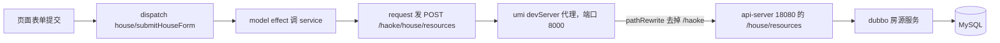

# 前端表单到数据库一条线：新增房源联调与反向代理治跨域

后端已经能回 201，但真正的使用者在浏览器里。把 Ant Design Pro 的管理后台接上：页面补回漏掉的房源标题，dva model 发请求，umi 的反向代理把 8000 端口的请求送到 18080，跨域问题顺带解决。联调通过的那一刻，从表单到数据库的整条链路才算真正打穿。

## 先给结论

- 前端数据流固定四步：页面 Form 提交，dispatch 到 dva model 的 effect，effect 调 service 里的请求函数，request 工具发出 POST。
- service 里请求地址写 `/haoke/house/resources`，`/haoke` 前缀是给代理看的标记，不是后端路由。
- 跨域的根因是端口不同：前端 8000，后端 18080，协议与域名相同、端口不同即不同源。
- 开发期解法是 umi 的 devServer 反向代理：`target` 指向 18080，`pathRewrite` 把 `^/haoke` 重写成空，浏览器只见同源的 8000 请求。
- 验证看两处：Network 面板里请求 8000 响应 201，数据库 `tb_house_resources` 多一条记录。

## 一、页面补标题，表单收集两处新字段

之前的房源表单漏了「房源标题」这一项，这一课补回来。Ant Design Pro 的表单用 `getFieldDecorator` 注册字段：

```jsx
<FormItem {...formItemLayout} label="房源标题">
  {getFieldDecorator('title', {
    // 必填校验，空值提交会被拦下
    rules: [{ required: true, message: '此为必填项' }],
    initialValue: '',
  })(<Input style={{ width: '100%' }} />)}
</FormItem>
```

楼盘选择也在这时补上了 `estateId`：自动完成组件选中楼盘后，把楼盘 id 一并收进表单值。点提交，`handleSubmit` 校验通过后把整个表单值 dispatch 出去：

```javascript
this.props.form.validateFields((err, values) => {
  if (!err) {
    // values 里带着 title、estateId 与表单全部字段
    this.props.dispatch({
      type: 'house/submitHouseForm',
      payload: values,
    });
  }
});
```

`type` 的前缀 `house` 是 dva model 的 namespace，斜杠后面是 effect 名，两处对不上，点击就没有任何反应，页面也不会报错。

## 二、model 与 service：dva 数据流的两环

service 层只管「怎么请求」，model 层管「请求前后做什么」。`src/services/haoke.js` 里定义请求函数：

```javascript
import request from '@/utils/request';

// 新增房源，params 是表单值对象
export async function addHouseResource(params) {
  return request('/haoke/house/resources', {
    method: 'POST',
    body: params,
  });
}
```

`request` 是脚手架封装过的请求工具，统一处理请求头、错误与超时。`src/models/house.js` 里挂上 effect：

```javascript
import { message } from 'antd';
import { addHouseResource } from '@/services/haoke';

export default {
  namespace: 'house',
  state: {},
  effects: {
    // 提交房源表单
    *submitHouseForm({ payload }, { call }) {
      yield call(addHouseResource, payload);
      message.success('提交成功');
    },
  },
};
```

effect 里 `call(addHouseResource, payload)` 就是去调 service 的函数，payload 原样传过去，成功后弹「提交成功」。这条提示是用户能感知的唯一反馈，链路上任何一环断了它都不会出现，联调时可以用它当哨兵。

## 三、跨域与反向代理

地址为什么不直接写 `127.0.0.1:18080/house/resources`？写也能发出去，但浏览器会拦：页面跑在 8000 端口，请求发往 18080，协议与域名相同、端口不同，就是不同源，同源策略下跨域响应默认被浏览器挡下。前端脚手架的通行解法是让请求看起来根本没发出去：umi 在 `config/config.js` 里提供 proxy 配置，devServer 收到带 `/haoke` 前缀的请求就替你转发：

```javascript
// config/config.js
proxy: {
  '/haoke': {
    // 命中 /haoke 前缀的请求，转发到后端 API 系统
    target: 'http://127.0.0.1:18080',
    changeOrigin: true,
    // 转发前把 /haoke 前缀重写掉，后端路由里没有它
    pathRewrite: { '^/haoke': '' },
  },
},
```

三个配置各司其职：`target` 是真实后端地址；`pathRewrite` 把 `^/haoke` 替换成空字符串，`/haoke/house/resources` 转发出去变成 `/house/resources`，正好命中 api-server 的路由；`changeOrigin` 让转发请求的 Host 头指向目标地址，避免后端按 Host 校验时出岔子。整条链路串起来：



浏览器视角里，请求自始至终只发往同源的 8000，跨域被 devServer 一笔勾销；devServer 与后端之间是服务器对服务器的 HTTP 转发，不受同源策略约束。这套代理是开发期手段，生产环境没有 devServer，跨域要靠 CORS 响应头或网关层统一处理，两条路线不能混为一谈。

## 四、联调验证：一条数据的完整旅程

脚手架用 `npm start` 启动，表单填一组数据（楼盘选康城，标题「康城 3室2厅」，租金 2000，支付方式付三押一，楼层 2 层共 20 层），打开浏览器 Network 面板点提交：

- 请求出现在 `http://127.0.0.1:8000/haoke/house/resources`，方法 POST，负载里是表单 JSON。
- 响应状态 201，页面弹出「提交成功」。
- devServer 控制台能看到对 18080 的转发；查数据库，`tb_house_resources` 多了一条康城的记录。

三处都对上，前端与后端的整合就完成了。回头看这条线：表单收集值，model 派发，service 请求，代理转发，RESTful 接口接收，dubbo 调用，Service 校验落库，中间没有断点。新房源能进库，楼盘、房东这些功能就是同一条流水线换个表单换个接口，后面功能的开发速度会明显快起来。

## 常见误区

- **以为 devServer 代理能解决线上跨域。** 代理只活在开发期的 node 服务里，打包上线的静态资源没有这层；生产环境用 CORS 响应头、网关路由或直接同域部署。
- **pathRewrite 忘写或前缀没去掉。** 转发到后端的路径还是 `/haoke/house/resources`，api-server 里没有这条路由，返回 404，表面上像代理没生效，实际是路径多了一段。
- **改了 proxy 不重启。** `config/config.js` 是脚手架启动时读取的，改完必须重启 devServer，页面热更新救不了配置文件。
- **namespace 与 effect 名对不上。** dispatch 的 `house/submitHouseForm`、model 的 `namespace: 'house'`、effects 的键名三者是一个整体，任何一处拼写不一致，请求根本不会发出，而且没有任何报错提示。

## 面试可能被问到的问题

1. 面试官追问：「跨域是怎么发生的？」
   答：浏览器同源策略要求脚本只能读写与当前页面同源的资源，同源指协议、域名、端口三者一致。页面在 8000 端口而接口在 18080，端口不同即跨域，浏览器会拦截跨域响应，请求可能已到达服务器，但脚本读不到结果。

2. 面试官追问：「开发期反向代理为什么能绕开跨域？」
   答：devServer 把前端请求转发给后端，浏览器看到的始终是与页面同源的 devServer 地址，不存在跨域；真正的跨服务器请求发生在 node 代理与后端之间，服务器之间的 HTTP 调用不受浏览器同源策略约束。

3. 面试官追问：「CORS 与反向代理怎么选？」
   答：CORS 是标准方案，后端加 Access-Control-Allow-Origin 等响应头，适合线上前后端分离部署；反向代理是开发期手段，不侵入后端代码，还能顺带做路径重写。常见组合是开发用代理、生产用 CORS 或网关。

4. 面试官追问：「dva 的数据流是怎样的？」
   答：组件 dispatch 一个 action 到 model，异步逻辑写在 effects 里用 call 调 service 请求，结果用 put 交给 reducers 修改 state，订阅 state 的组件自动重渲染。本课的提交场景不读回数据，effect 成功后直接弹提示即可。

5. 面试官追问：「pathRewrite 的作用是什么？」
   答：转发前对路径做正则替换，把前端专用的前缀（这里是 /haoke）改写为空或真实前缀，保证转发出去的路径与后端路由一致。它让前端可以自由设计请求前缀，而不必迁就后端路由。

6. 面试官追问：「提交提示成功但数据库没有数据，怎么排查？」
   答：按链路二分。先看 Network 面板确认请求是否发出、状态码与负载是否正确；再看后端日志确认请求到达哪一层；然后核对代理转发后的真实路径、JSON 字段名与实体属性是否一致；最后查事务是否回滚。多数问题集中在路径重写与字段名拼写上。

## 配套资料

- 本教学日资料包未收录源码（`materials/code/03/day04-服务的具体实现以及MybatisPlus的入门/` 下仅存清单文件），前端 model、service、代理配置与表单片段为按本课画面写法补全的示例，工程体系为 Ant Design Pro（umi 与 dva），本课无配套源码包。
- 后端 RESTful 接口与 dubbo 链路的实现细节见同阶段成稿 `0065-新增房源服务实现之新增房源RESTful接口的开发.md`。
