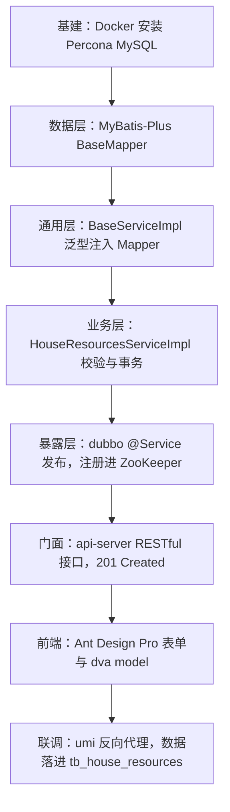

# day04 收官复盘：一条新增房源链路，串起 Docker、MyBatis-Plus 与 Dubbo

day04 是典型的「基建日」：装数据库、上增强插件、搭工程、写服务、开接口、联前端，六件事塞进一天。按顺序推进时感觉顺畅，回头复述却常常断片：Percona 到底是什么、`BaseServiceImpl` 为什么能省掉一半样板代码、两个 Service 究竟谁是谁。收尾这一课的全部价值，就在于把散点按数据的流向重新串成一条线。

## 先给结论

- 环境层一条命令链搞定数据库：Docker 拉取 Percona 镜像，创建容器时挂载数据卷并映射 3306，数据落在宿主机目录，容器重建不丢。
- MyBatis-Plus 定位是 MyBatis 的增强插件，只做增强不做改变；单表 CRUD 收进 `BaseMapper`，再由抽象类 `BaseServiceImpl` 统一封装，业务实现类继承即得。
- 服务端必须分清两个 Service：Spring Service 承担校验与事务，dubbo Service 只做转发与暴露，方法签名一样，职责完全不同。
- api-server 以消费者身份用 `@Reference` 注入远程代理，RESTful 接口按语义返回 201 Created。
- 前端补回「房源标题」字段，dva model 发请求，umi 反向代理顺带解决跨域；数据落进 `tb_house_resources`，整条链路才算闭环。

## 一、地基：容器里的数据库与增强版数据访问

数据库没装，后面一切都是空谈。部署方式沿用 Docker，三条命令完成：

```bash
# 镜像地址：https://hub.docker.com/_/percona
# 拉取镜像
docker pull percona:5.7.23
# 创建容器：数据目录挂到宿主机，3306 端口映射出去
docker create --name percona -v /data/mysql-data:/var/lib/mysql -p 3306:3306 -e MYSQL_ROOT_PASSWORD=root percona:5.7.23
# 启动容器
docker start percona
```

选 Percona 这个 MySQL 衍生版，看中的是它对高负载下 InnoDB 的性能改进，而使用层面与原生 MySQL 完全一致，SQL 语法、客户端、驱动全部照旧。`-v /data/mysql-data:/var/lib/mysql` 这一段是重点：数据目录落在宿主机，容器删了数据还在。

库建好之后轮到 MyBatis-Plus。它的入门之所以快，是因为机制上没有黑盒：启动时扫描实体类，用反射抽取表名与列名，把拼好的 SQL 模板注入 MyBatis 容器。所以 Mapper 只需继承 `BaseMapper` 就拥有整套单表 CRUD，一句 SQL 都不用写。本课的房源表是它服务的对象：

```sql
CREATE TABLE tb_house_resources (
    id bigint(20) NOT NULL AUTO_INCREMENT,
    title varchar(100) DEFAULT NULL COMMENT '房源标题',
    estate_id bigint(20) DEFAULT NULL COMMENT '楼盘id',
    rent_method tinyint(1) DEFAULT NULL COMMENT '租借方式，1-整租，2-合租',
    payment_method tinyint(1) DEFAULT NULL COMMENT '支付方式，1-付一押一 …',
    house_type varchar(255) DEFAULT NULL COMMENT '户型，如：2室1厅1卫',
    covered_area varchar(10) DEFAULT NULL COMMENT '建筑面积',
    pic varchar(200) DEFAULT NULL COMMENT '图片，最多3张'
    -- 其余楼层、朝向、装修、配套设施等列从略
) ENGINE=InnoDB DEFAULT CHARSET=utf8;
```

实体类那边靠 Lombok 撑起清爽度。引入 `org.projectlombok:lombok` 依赖后，一个 `@Data` 注解顶掉全部样板方法：

```java
@Data
public class Item {
    private Long id;
    private String title;
    private Long price;
}
```

源码里看不到 getter 与 setter，编译后的 class 文件里它们都在，编译期生成、运行期无感。它不会真正改变代码的逻辑，改变的只是代码长什么样。

## 二、服务层：一个抽象基类与两个 Service

房东、楼盘、预约的 Service 迟早都要一套一模一样的增删改查，day04 把它们收进抽象类 `BaseServiceImpl`。泛型注入是它的钥匙：字段 `mapper` 的类型是泛型参数 M，Spring 装配时解析子类声明的泛型实参，自动把对应的 Mapper 注进来。通用方法还顺手做了公共事：

```java
public Integer save(T record) {
    // 统一补创建与更新时间，业务层不用每个方法重复写
    record.setCreated(new Date());
    record.setUpdated(new Date());
    return this.mapper.insert(record);
}

public Integer update(T record) {
    record.setUpdated(new Date());
    return this.mapper.updateById(record);
}

public Integer deleteById(Long id) {
    return this.mapper.deleteById(id);
}
```

业务实现类在继承之上叠加校验，标题为空直接挡回：

```java
@Override
public int saveHouseResources(HouseResources houseResources) {
    if (StringUtils.isBlank(houseResources.getTitle())) {
        // 标题为空，参数不符合要求
        return -1;
    }
    return super.save(houseResources);
}
```

这一层是 Spring 的 `@Service` 加 `@Transactional`，贴着 Mapper 干活。往外一层才是 dubbo 的 `@Service(version = "1.0.0")`，实现类薄到只剩转发，把调用转交 Spring Service。两个 Service 长着同样的方法签名，却是两种身份：一个管业务规则与事务边界，一个管协议暴露。哪天 RPC 框架要换，动的只有外面那层壳。服务启动后注册进 ZooKeeper，消费方按版本订阅，这段在 dubbo 章节已经推演过，本日只是把「注册中心里的那个服务」第一次填上了真业务。

## 三、门面与前端：201、model 与反向代理

浏览器说不来 dubbo 协议，api-server 负责把 HTTP 翻译成 RPC。`POST /house/resources` 接收 JSON，创建成功按 RESTful 语义返回 201，异常返回 500。前端那头，页面把 day03 就该有的「房源标题」补了回来：

```jsx
<FormItem {...itemLayout} label="房源标题">
    {getFieldDecorator('title', {
        rules: [{ required: true, message: '此为必填项' }]
    })(<Input style={{ width: '100%' }} />)}
</FormItem>
```

提交后走 dva 的固定四步：表单 dispatch 到 model 的 effect，effect 调 service 的请求函数，`request` 工具发出 POST，`/haoke` 前缀被 umi 的反向代理重写后送到 18080 端口，跨域顺带消失。测试环节用 RESTClient 这类 HTTP 工具（Postman 或 curl 同理），请求头带 `Content-Type: application/json`，发送后响应 201，查库多一条记录，前后端各自开发的部分一次性对上了账。

## 四、全章知识地图



图从上到下就是数据的流向：一个房源从浏览器表单出发，经代理、接口、RPC、通用 Service，最后落到 `tb_house_resources`。任何一格卡住，链路就在那里断，排查时照图二分即可。

## 常见误区

- **以为 `docker create` 之后数据在容器里。** 容器是易失的，真正兜底的是 `-v /data/mysql-data:/var/lib/mysql` 这条数据卷挂载；漏写它，删容器等于删库。
- **给 `BaseMapper` 配套写 XML 才放心。** 单表 CRUD 由插件在启动时按实体反射生成，XML 里什么都不需要写；复杂多表查询才回到 MyBatis 原生写法。
- **两个 `@Service` 靠感觉 import。** 业务实现类要 Spring 的，暴露类要 `com.alibaba.dubbo.config.annotation.Service`，导错包服务就发布不出去，看到 `@Service` 先看 import 行。
- **HTTP 工具测 POST 漏掉 `Content-Type: application/json`。** Spring 取不到请求体里的 JSON，落库的是全 null 实体，表面上接口通了，数据却是空的。

## 面试可能被问到的问题

1. 面试官追问：「MyBatis-Plus 和 MyBatis 是什么关系？」
   答：它是 MyBatis 的增强插件，只做增强、不做改变。启动时扫描实体、反射解析表名列名，把通用 SQL 注入 MyBatis 容器，于是继承 `BaseMapper` 就有单表 CRUD；复杂 SQL 仍按 MyBatis 原生方式写，两者长期共存，已有代码零改动。

2. 面试官追问：「BaseServiceImpl 里的 mapper 字段是靠什么注入的？」
   答：Spring 4 起支持泛型注入。容器装配时读取子类声明里的泛型实参，解析出字段 `mapper` 的实际类型，再按类型匹配对应的 Mapper bean 注入。子类传什么实体，就拿到什么 Mapper，一套抽象层服务 N 个业务。

3. 面试官追问：「为什么把通用 CRUD 抽成抽象基类，业务代码直接写不行吗？」
   答：直接写会产生大量重复的模板代码，且 created、updated 这类公共字段容易漏。抽进 `BaseServiceImpl` 后业务类只剩差异逻辑，公共行为有且只有一处，修改与排查成本都降下来。

4. 面试官追问：「Spring Service 与 dubbo Service 为什么要拆两层？」
   答：职责分离。校验、事务、缓存这些业务关切收在 Spring Service，它贴着 Mapper 是事务边界的自然位置；dubbo 实现只做转发与暴露，不绑定业务逻辑。换 RPC 框架时业务层零改动，迁移成本最低。

5. 面试官追问：「Docker 部署 MySQL，怎么保证数据不随容器丢失？」
   答：创建容器时用 `-v` 把数据目录挂载到宿主机，容器内的 `/var/lib/mysql` 实际写在宿主机 `/data/mysql-data`。容器删除重建后重新挂载同一目录，数据原样可用，这也是容器化有状态服务的基本手法。

6. 面试官追问：「把你实现的新增房源链路完整描述一遍。」
   答：前端表单校验通过后 dispatch 到 dva model，model 经 service 发 POST 到 8000 端口，umi 代理重写 `/haoke` 前缀转发到 api-server 的 18080；api-server 用 `@Reference` 代理发起 dubbo 调用，提供方 Spring Service 校验标题非空，`BaseServiceImpl.save` 补时间戳后由 `BaseMapper.insert` 落库，影响行数逐层返回，api-server 回 201，前端提示成功。

## 配套资料

- 本教学日资料包未收录源码（`materials/code/03/day04-服务的具体实现以及MybatisPlus的入门/` 下仅存清单文件），文中命令、建表语句与代码片段按本课画面整理补全，包名与工程名已改为中性命名。
- MyBatis-Plus 章节可对照：讲义 `materials/docs/10/Mybatis-Plus讲义v1.0.md`（架构图与通用 CRUD 的章节划分与本课一致），可运行工程 `materials/code/10/mp-springboot/`（Spring Boot 集成、通用 Mapper 与分页插件配置）。
- 接口模块与服务实现分家的工程结构可对照：`materials/code/10/nacos-discovery-RESTful服务发现与Dubbo服务发现/`。
