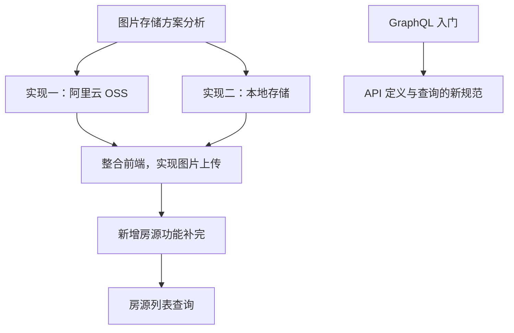

# day05 导览：给图片找一个家，再认识一种新的接口风格

新增房源在上一天打通了整条链路，但对照表结构会发现一个悬空的字段：`pic varchar(200) COMMENT '图片，最多3张'`。前端 day03 就画好了图片上传组件，后端却始终没有接住这张图。图片一旦离开浏览器，第一个问题立刻浮出来：到了服务器上，它存哪？

day05 的全部内容都从这个问题展开。把存储的方案想清楚、落地两种，上传功能才有处安放；随后顺手补上房源列表查询，最后用 GraphQL 开一个新话题：接口除了 REST 风格，还能怎么定义、怎么查。

## 先给结论

- 图片上传的难点不在接口，在存储：本地磁盘、分布式文件系统、NFS、第三方云对象存储是四条主流路线，各有明确的适用场景。
- 本课落地其中两条：阿里云 OSS（第三方对象存储）与本地存储，FastDFS 前面已学过，NFS 需要运维功底，自行学习即可。
- 存储选型定下来，才轮到上传功能本身：前端整合加后端接口，把新增房源补成完整形态。
- 新增房源闭环后顺势实现房源列表查询，管理端对房源的增与查两条基本能力就此成型。
- GraphQL 是关于 API 定义与查询的语言规范，本日只做入门，建立与 REST 对比的坐标系。

## 一、上传链路里，存储才是那个不确定的环节

一次图片上传可以拆成四步：前端选图、后端接收、存储落地、URL 回填表单。前三步里，接收是熟练活，`MultipartFile` 一接、参数一校验就完事；唯独「落地」牵扯整个技术选型，数据库 BLOB、本地文件系统、分布式文件系统、云对象存储都能做，代价与能力天差地别。

这也是为什么课程把存储方案的对比单独排一课，而不是在上传接口里顺带讲。选型错了，后面上传接口写得再漂亮也要返工。表结构早就给图片留好了位置：

```sql
-- 房源表里的图片字段，落库存的是 URL，不是图片本身
pic varchar(200) DEFAULT NULL COMMENT '图片，最多3张'
```

注意字段里存的是 URL，说明设计上就预期「图片存在别处，表里只记地址」。这个「别处」放在哪，就是 day05 前半段的全部内容。

## 二、两套方案都要亲手实现，原因很实际

第三方云存储与本地存储，本课各实现一遍，不是重复教学，而是两种真实存在的企业形态：

**云对象存储。** 以阿里云 OSS 为代表，通过 SDK 或 RESTful API 调用，水印、压缩、缩放这些增值能力开箱即用，运维全免，代价是持续计费。小团队、创业项目的首选。

**本地存储。** 图片写到服务器磁盘，零费用、完全可控，代价是扩容与备份都要自己操心。内网系统、预算敏感或数据不允许出网的场景用它。

两套都会写，切换时才有底气。工程上还会把「图片上传」抽成一个独立服务，房源、头像、以后任何要传图的功能都来调它，存储方案藏在服务内部，换方案时调用方一行不改。

## 三、上传补完与列表查询

存储落地后，新增房源把最后一块拼上：前端图片上传组件拿到返回的 URL，随表单一起提交，`pic` 字段从此有值。紧接着是房源列表查询，走的是同一套 RESTful 风格：分页参数进来，`IPage` 出去，复用 day04 沉淀的 `BaseServiceImpl` 通用分页，业务层几乎不用写新代码。新增加查询，管理端对房源的两条基本能力就立住了。

## 四、GraphQL：给 API 查询立一个规范

后半段的新面孔是 GraphQL，一句话定位：它是关于 API 的定义与查询的语言，或者说是一份规范。REST 的世界里，返回什么字段由服务端说了算，客户端常常要么拿多了、要么为凑齐一屏数据连发好几个请求；GraphQL 让客户端按需描述要什么，服务端按描述给什么。它不是数据库，也不是 ORM，只是一层接口约定。本日只搭概念，具体的服务开发放在后续课程。

day05 的推进顺序画出来是一条先分叉再汇合的线：



左半张图是存储与上传的主线，方案分析导出两条实现路径，汇合后完成上传功能；右下角 GraphQL 是独立的第二主题，不依赖前面的存储环节，可以并行学。

## 五、上传接口长什么样

后端接收图片的接口，按本课的 RESTful 写法补一个可运行的示例（真实实现待存储方案讲完才落地）：

```java
// 按本课写法补全的示例：图片上传接口的形状
@RestController
@RequestMapping("image")
public class ImageController {

    @PostMapping
    public ResponseEntity<String> upload(MultipartFile file) {
        // 存储方案落地后，这里把图片交给存储服务，换取可访问的 URL
        String url = imageService.upload(file);
        return ResponseEntity.ok(url);
    }
}
```

接口返回的是 URL 而不是文件本身，前端拿到后填进表单的 `pic` 字段，与表结构的设计完全对齐。这个 URL 指向 OSS 还是本地目录，取决于选了哪套存储方案，接口形状不变。

## 常见误区

- **把存储选型当成上传接口的实现细节。** 存储决定文件的可访问地址、扩容方式与费用结构，是架构决策，应该在上传接口动手前定下来。
- **以为 GraphQL 是数据库或后端框架。** 它是 API 的查询语言与规范，描述「客户端要什么数据」，底层存储与它无关。
- **把 OSS 当网盘用。** 对象存储面向程序，通过 API 与 SDK 读写，计费按存储量与流量算，高频读写的场景要先算清下行流量成本。
- **以为表里存的是图片二进制。** `pic` 字段存 URL，图片本体在存储服务里；把大文件塞进数据库会拖垮备份与查询。

## 面试可能被问到的问题

1. 面试官追问：「图片存储有哪些方案？你们怎么选？」
   答：常见四种，本地文件系统、分布式文件系统、NFS 网络文件系统、第三方云对象存储。选型看四件事：扩容需求、开发与运维能力、预算、数据是否允许出网。课程项目两种都实现了，云存储为默认，本地存储为低成本备选。

2. 面试官追问：「对象存储和直接存数据库 BLOB 有什么区别？」
   答：BLOB 把文件塞进数据库，备份变大、查询变慢、应用服务器承担全部读写压力；对象存储是专门的存储服务，容量弹性扩展、自带高可靠冗余，应用只持有 URL。图片这类非结构化大文件应放对象存储，数据库只存元数据。

3. 面试官追问：「GraphQL 与 REST 的核心区别是什么？」
   答：REST 按资源组织接口，返回结构由服务端固定；GraphQL 由客户端在查询里描述所需字段，一次请求取齐，避免过度获取与多次往返。GraphQL 需要 schema 与对应的执行引擎支撑，REST 生态与缓存体系更成熟，两者按场景取舍。

4. 面试官追问：「为什么要把图片上传抽成独立服务？」
   答：项目里上传点很多，房源图、用户头像都是。抽成独立服务后，存储方案、鉴权、图片处理收敛在一处，业务方只拿 URL；将来换存储或加处理逻辑，只改这一个服务。

## 配套资料

- 本教学日资料包未收录源码（`materials/code/03/day05-阿里云OSS以及GraphQL入门/` 下仅存清单文件），文中 SQL 与接口示例为按本课写法补全，表结构取自本课程件的建表语句。
- 第三方对象存储的完整接入流程可对照：`materials/docs/10/七牛云对象存储使用指南.md`（同类云对象存储，开通、鉴权、SDK 上传的步骤可互为印证）。
- 存储层独立成文件微服务的思路可对照：`materials/docs/10/文件服务部署指南.md`（独立文件服务默认对接七牛云，并规划对接阿里云等存储源）。
