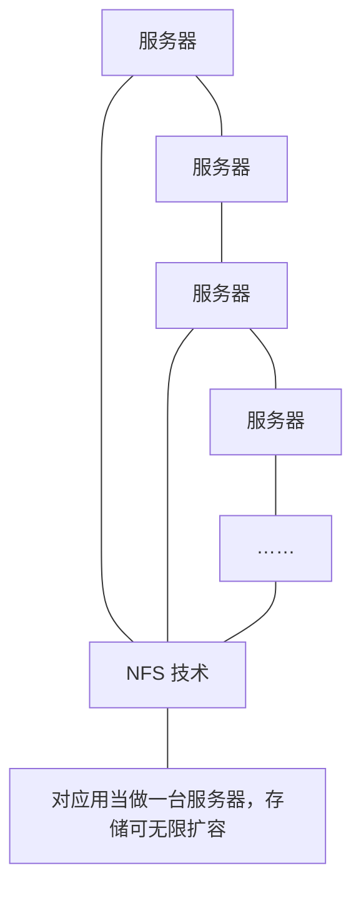
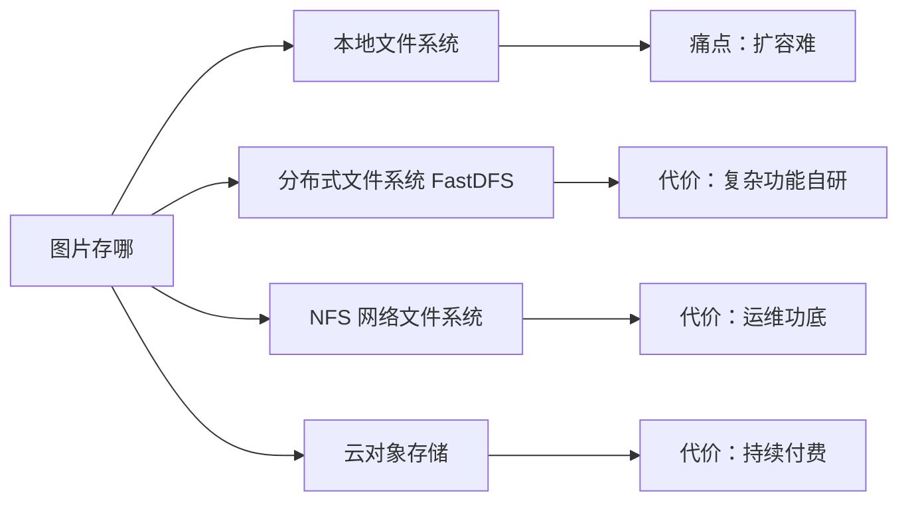

# 图片到底存哪：本地磁盘、分布式文件系统、NFS 与云对象存储的取舍

上传接口本身不难写，难的是接口背后那一步：用户把图片 POST 到服务器之后，这个文件往哪放。往硬盘一存了事？盘满了怎么办。塞进数据库？备份立刻膨胀。上分布式文件系统？学习成本谁付。这个问题不回答清楚，上传功能就没有地基。项目里要传图的场景不止新增房源一处，用户头像、以后的各类素材都在排队，把存储方案一次想透，比边写边改划算得多。

## 先给结论

- 主流方案四种：本地硬盘文件系统、分布式文件系统（FastDFS 是代表）、NFS 网络文件系统、第三方云对象存储。
- 本地存储开发最省事，JDK IO 直接写盘，致命伤是扩容难；三种网络化方案都在解这道题。
- FastDFS 与 NFS 都能横向扩容，一个要接受功能复杂度，一个要具备运维能力。
- 云对象存储开发简单、免维护、增值能力开箱即用，代价是持续付费，其中下行流量是大头。
- 本项目落地第一种与第四种：先实现云存储（阿里云 OSS），再实现本地存储；FastDFS 之前学过，NFS 留给运维自行搭建。

## 一、方案一：本地文件系统，简单到没有门槛

把图片当成普通文件，写到服务器硬盘的某个目录，Linux 下就是一个路径。优点是两条：开发便捷，不需要引入任何框架，JDK 的 IO 操作就够；成本低，不用学新东西。落地形态大致是：

```java
// 方案一的落地形态示例：本地文件系统，JDK IO 直接写盘
Path target = Paths.get("/data/upload/images", fileName);
Files.createDirectories(target.getParent());
// 写入成功即存储完成，URL 里的路径与这个目录对应
Files.copy(file.getInputStream(), target);
```

缺点藏在「硬盘是有限的」这句话里。写入量持续增长，盘一定会满；满了加一块新硬盘，要经过格式化、挂载、生成新目录一套流程，然后修改上传逻辑，让新文件写进新目录。代码跟着硬件走，这就是扩容困难的本意。

## 二、方案二：分布式文件系统，扩容交给架构

FastDFS 这类分布式文件系统，把扩容做成了系统能力：可以不断添加硬盘节点进入文件系统，对使用者来说它始终是一个整体，可以近似看成一个无限大的文件系统。上一方案「改上传逻辑迁数据」的痛点被架构层面消化掉了。

代价是复杂度。它只负责存取，业务侧常见的增值能力，比如上传后加水印、压缩体积、生成缩略图，都得自己实现。功能越复杂，这层自行开发的负担越明显。方案本身完全可行，前面课程已经专门学过 FastDFS，这里不再重复。

## 三、方案三：NFS，把多台机器的硬盘串成一块

NFS 是 Network File System，网络文件系统，N 代表 network，FS 代表 file system。它是 Linux 系统层面的技术：多台服务器的硬盘通过网络连接串起来，形成一个大的存储池，对应用来说，这一堆机器可以当做一台服务器来用。



机器越多存储池越大，扩容问题同样被解决。机器们在同一个机房、同一个局域网内时网络快，效果最好；跨广域网拼起来的 NFS 性能就难看了。它的优点是开发也较为便捷，应用看到的仍然是一个可写的目录；缺点是要有一定的运维知识才能完成部署与维护。企业里用它做图片存储并不少见。

对应用来说，NFS 的使用体验可以用一条命令说明：

```bash
# 方案三的使用形态示例：把 NFS 导出的目录挂载成本地目录（需 root 权限）
mount -t nfs 192.168.1.10:/export/images /mnt/images
# 挂载之后，应用仍像写本地目录一样写文件，感知不到背后是网络
cp house.jpg /mnt/images/
```

## 四、方案四：第三方云存储，用钱换省心

阿里云、七牛这类云厂商都提供存储服务。优点同样两条：开发比较简单，SDK 简单调用就能获得强大的功能，水印、缩放、防盗链这些能力是产品自带项；免维护，服务器的运维全部交给云厂商。缺点很直白：要付费。

但付费不能只看字面。自建方案买硬盘、买服务器、配网络，样样是真金白银，NFS 扩容加机器同样要花钱；云存储的账单有时比自建还低，取决于规模与访问模式。真正的结论是权衡，不是一句「云的贵」。

四种方案摆在一起看：

| 方案 | 扩容 | 开发难度 | 运维负担 | 费用 | 典型场景 |
|---|---|---|---|---|---|
| 本地文件系统 | 困难，改逻辑 | 最低 | 低 | 硬件一次投入 | 内网系统、小体量 |
| 分布式文件系统 | 容易，加节点 | 中，增值功能自研 | 中 | 硬件与机器 | 大体量自建存储 |
| NFS | 容易，加机器 | 低 | 高，需运维功底 | 服务器与网络 | 机房内网共享存储 |
| 云对象存储 | 天然弹性 | 低，SDK 调用 | 无，厂商负责 | 持续计费 | 公网图片、快速上线 |

## 五、本项目的落点

课程选择实现第一种与第四种：先做第三方存储，选型阿里云 OSS；再回到本地存储做对照。方案二在前面章节学过，方案三需要运维知识，留作自行学习。四个方案不只是清单，它们对应同一道题的不同解法：数据量涨了，文件放在哪里、由谁扩、谁来管。把这道题想清楚，上传功能才有了可以依赖的地基。



每种方案都带着自己的代价出现，选型就是在为自己的场景挑一副最合适的枷锁。

## 常见误区

- **把文件存进项目目录或 webapp 里。** 重新部署、打新包时目录被覆盖清空，图片说没就没；本地存储也要选独立的数据目录，与部署物分离。
- **以为分布式文件系统自带图片处理。** 存取只是它的本职，水印、压缩、缩放都要业务侧自己实现，评估方案二时要把这部分开发量算进去。
- **把 NFS 当广域网方案。** 它吃局域网带宽，跨机房或跨公网使用性能急剧下降，适合机房内部共享存储。
- **云存储只看存储单价。** 下行流量、请求次数都计费，图片这种读多写少的数据，外网访问的流量费往往超过存储费。

## 面试可能被问到的问题

1. 面试官追问：「本地存储的扩容为什么难？」
   答：文件路径与物理硬盘绑定。盘满之后加盘要格式化、挂载、出新目录，上传逻辑必须跟着改路径，存量数据还要迁移；本质是存储能力没有与代码解耦，所以扩容是应用层的改造而不是系统层的操作。

2. 面试官追问：「NFS 和 FastDFS 都能扩容，怎么取舍？」
   答：NFS 是系统层面的网络文件系统，搭建快、应用无感知，但要专人运维，且吃局域网环境，适合机房内共享存储；FastDFS 是应用层的分布式文件系统，节点管理、冗余由系统负责，但水印压缩等增值功能要自研。运维能力与开发能力哪个更充裕，是取舍的关键。

3. 面试官追问：「云存储要付费，自建不用花钱，这个说法对吗？」
   答：不对。自建要买硬盘、服务器、带宽，还有持续的电费与人力维护成本；云存储把一次性硬件投入摊成按量付费。规模小、访问模式不稳定时云更省，规模大到流量议价空间明显时自建才有优势，按真实账单权衡。

4. 面试官追问：「项目里上传图片的需求点很多，架构上怎么应对？」
   答：把图片上传与存储收敛成一个独立的文件服务，对内提供统一的上传接口并返回可访问 URL。存储方案藏在服务内部，房源、头像等业务方只认 URL；将来换存储、加处理逻辑，改动被限制在这一个服务里。

5. 面试官追问：「为什么图片不直接以 BLOB 存进数据库？」
   答：数据库的强项是结构化数据的事务与查询，不是大文件。BLOB 会让备份膨胀、查询变慢、连接被长传输占用，应用服务器还要独自扛全部读写流量。惯例是对象存储或文件系统存文件，数据库只存 URL 与元数据。

## 配套资料

- 本教学日资料包未收录源码（`materials/code/03/day05-阿里云OSS以及GraphQL入门/` 下仅存清单文件），文中代码与挂载命令为按本课写法补全的示例，用于说明各方案的使用形态。
- 第三方对象存储的实际接入步骤可对照：`materials/docs/10/七牛云对象存储使用指南.md`（同类云存储服务的开通、鉴权与 SDK 调用流程）。
- 存储能力独立成文件微服务的工程对照：`materials/docs/10/文件服务部署指南.md`（文件服务默认对接七牛云，规划对接阿里云等存储源）。
