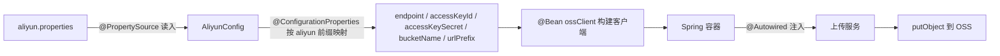

# 用 Java 代码往 OSS 传文件：SDK 依赖、AliyunConfig 与三项凭证的落位

控制台点鼠标上传，验证的只是「桶是通的」，服务真正需要的是代码上传：新增房源页面的室内图、日后可能加入的头像，都要走 API 而不是人手。上传能力落在 haoke-manage-api-server 里，其他模块要用时注入即可。动手之前有两个问题必须想清楚：SDK 在 Java 侧怎么调？endpoint、AccessKeyId、AccessKeySecret 这三个值放哪里、怎么进 Spring 容器？

## 先给结论

- 官方开发者指南的「简单上传」有流式、byte 数组、网络流、文件流四种形态，代码骨架一致，差别只在最后提交的内容，本课按 byte 数组走。
- 依赖三件套：`aliyun-sdk-oss` 是 SDK 本体，lombok 负责生成 getter/setter，joda-time 用来生成上传目录里的日期段。
- 上传入口是 OSSClient：endpoint 加一对 AccessKey 构建出来，`putObject` 一行完成上传；它应该注册成 Spring 容器里的单例 Bean，而不是用一次 new 一次。
- 凭证不硬编码：写进 `aliyun.properties`，`@PropertySource` 负责读入，`@ConfigurationProperties(prefix = "aliyun")` 按前缀自动映射到字段，字段值由 setter 写入。
- AccessKeySecret 只在创建时显示一次，当场下载保存；日常上传用 RAM 子账号密钥，主账号密钥权限过大。

## 一、开发者指南里找答案：简单上传的四种形态

控制台能传，代码怎么传？官方文档的路径是：概览页进入开发者指南，找到 SDK 参考，选 Java，再进「上传文件」里的「简单上传」。这一页给出四种形态的示例：流式上传、byte 数组上传、网络流上传、文件流上传。对照看下来，四段代码的差别只在构造最后一个参数：给 InputStream、给字节数组、给网络地址、给 File，前面的客户端构建与 `putObject` 调用一模一样。所以实现时选定一种即可，Spring MVC 收上来的 MultipartFile 天然能取 byte 数组，本课就用 byte 数组形态。

按官方骨架整理的最小示例（SDK 2.8.3 写法，密钥为打码占位）：

```java
// 示例：按官方「简单上传」骨架整理的可运行片段
String endpoint = "https://oss-cn-beijing.aliyuncs.com";
String accessKeyId = "LTAI5tExAmple12345678";        // 打码示例
String accessKeySecret = "AmpleSecretKey1234567890"; // 打码示例

OSSClient ossClient = new OSSClient(endpoint, accessKeyId, accessKeySecret);
// byte 数组形态：内容装进流里提交，对象名决定桶内的目录层级
ossClient.putObject("haoke-image", "images/2018/1220/1545201.jpg",
        new ByteArrayInputStream(content));
ossClient.shutdown();
```

一个值得记住的版本差异：3.x 起 SDK 推荐 `new OSSClientBuilder().build(endpoint, accessKeyId, accessKeySecret)` 构建客户端，返回类型用 `OSS` 接口；课程使用的 2.8.3 直接 new OSSClient。两种写法在 `putObject` 这一层完全等价，方法签名没变。

## 二、依赖进 pom：三个坐标各管一件事

三个坐标依次加入 api-server 的 pom（此前课程引入的 zookeeper、zkclient 等坐标与本功能无关，保持原样不动）：

```xml
<!-- OSS Java SDK 本体 -->
<dependency>
    <groupId>com.aliyun.oss</groupId>
    <artifactId>aliyun-sdk-oss</artifactId>
    <version>2.8.3</version>
</dependency>
<!-- 简化 pojo：自动生成 getter/setter -->
<dependency>
    <groupId>org.projectlombok</groupId>
    <artifactId>lombok</artifactId>
    <version>1.18.4</version>
</dependency>
<!-- 日期处理：生成上传目录的年、月、日 -->
<dependency>
    <groupId>joda-time</groupId>
    <artifactId>joda-time</artifactId>
    <version>2.9.3</version>
</dependency>
```

lombok 与 joda-time 在本课只是配角，但接下来两课的返回对象与路径生成都靠它们，一次引入到位。

## 三、AliyunConfig：客户端只该有一份

OSSClient 底层维护 HTTP 连接，构建一次即可反复使用，交给 Spring 管理成单例最合适：需要上传的位置 `@Autowired` 注入，而不是各自 new。于是有了配置类：

```java
package com.haoke.manage.dubbo.api.config;

import com.aliyun.oss.OSSClient;
import lombok.Data;
import org.springframework.boot.context.properties.ConfigurationProperties;
import org.springframework.context.annotation.Bean;
import org.springframework.context.annotation.Configuration;
import org.springframework.context.annotation.PropertySource;

@Data
@Configuration
@PropertySource("classpath:aliyun.properties")
@ConfigurationProperties(prefix = "aliyun")
public class AliyunConfig {

    private String endpoint;
    private String accessKeyId;
    private String accessKeySecret;
    // bucketName 与 urlPrefix 是上传服务要用的，一并在这里读入
    private String bucketName;
    private String urlPrefix;

    @Bean
    public OSSClient ossClient() {
        return new OSSClient(endpoint, accessKeyId, accessKeySecret);
    }
}
```

三个注解分工明确：`@Configuration` 声明这是配置类；`@PropertySource` 指定从 classpath 的 `aliyun.properties` 读配置；`@ConfigurationProperties(prefix = "aliyun")` 把 `aliyun.` 开头的键按后缀映射到同名字段。类上的 `@Data` 不是偷懒：属性绑定靠 setter 写入，字段全是 private，没有 setter 就绑不上，`@Data` 生成的 setter 正好补位，这比手写三个 set 方法省事得多。

## 四、配置文件与映射：前缀加字段名等于键

在 `src/main/resources` 下新建 `aliyun.properties`（密钥均为打码示例，真实值只放本地）：

```properties
aliyun.endpoint=https://oss-cn-beijing.aliyuncs.com
aliyun.accessKeyId=LTAI5tExAmple12345678
aliyun.accessKeySecret=AmpleSecretKey1234567890
aliyun.bucketName=haoke-image
aliyun.urlPrefix=https://haoke-image.oss-cn-beijing.aliyuncs.com/
```

映射规则一句话：前缀 `aliyun` 拼上字段名，等于 properties 里的键。`endpoint` 字段对应 `aliyun.endpoint`，`accessKeySecret` 字段对应 `aliyun.accessKeySecret`，五个字段一次绑完。bucketName 与 urlPrefix 本课还用不到，但下一课的上传服务要取桶名、要拼外链，这里一次配齐省得再改。

值从哪里来：

**endpoint。** 控制台进入 Bucket 概览，外网访问的域名就是它，形如 `oss-cn-beijing.aliyuncs.com`。区域在创建 Bucket 时定下，后面所有 URL 都跟着这个域名走。

**AccessKeyId 与 AccessKeySecret。** 官方文档有专门一章讲如何获取 AccessKey。注意官方的建议：主账号的 AccessKey 权限太大，日常调用应该用 RAM 子账号的密钥，只授予需要的权限。在 RAM 控制台创建子用户并为其生成 AccessKey，Secret 只在创建成功的那一刻显示，页面会明确提示这是唯一一次下载机会，当场保存成文件或复制进本地。创建完再回头找是找不到的，只能作废重建。

## 五、整条装配链路

配置文件、配置类、容器、使用方之间的关系：



链路里最容易断的一环是配置文件名：`@PropertySource` 写的路径与实际文件名差一个字母，启动阶段直接报找不到配置，所有依赖它的 Bean 都起不来。文件名、前缀、字段名三处拼对，这条链才算通，下一课的上传服务就能直接注入开写。

## 常见误区

- **密钥写死在 Java 代码里。** 换环境要改代码重新编译，代码一提交密钥就扩散；正确做法是外置到 properties 或环境变量，代码里只留打码占位。
- **`@ConfigurationProperties` 加了注解却没生成 setter。** 字段 private 又没有 setter，绑定静默失败，注入进来的全是 null，到 putObject 才报错。`@Data` 或手写 setter 二选一，不能都没有。
- **拿主账号 AccessKey 日常上传。** 主账号密钥能操作账号下所有资源，泄露就是全盘失守；RAM 子账号加最小授权才是日常姿势。
- **Secret 弄丢后去控制台反复找。** 它只在创建时显示一次，没保存就只能作废重建；重建后要同步更新所有环境的配置文件。

## 面试可能被问到的问题

1. 面试官追问：「为什么把 OSSClient 注册成 Bean，而不是用的时候 new？」
   答：OSSClient 内部维护连接池与 HTTP 客户端，创建有成本，而且它线程安全，官方推荐应用内复用。注册成单例 Bean 后配置集中、生命周期交给容器，业务代码只负责注入调用。

2. 面试官追问：「@PropertySource 和 @ConfigurationProperties 是怎么配合的？」
   答：@PropertySource 把指定的 properties 文件加载进环境，@ConfigurationProperties 按前缀加字段名从环境里取值，通过 setter 写入字段。不加 @PropertySource 时也可以把配置直接写在 application.yml 里，绑定效果相同。

3. 面试官追问：「AccessKey 管理有哪些最佳实践？」
   答：日常调用用 RAM 子账号密钥并最小授权；密钥不进代码库，放配置中心或环境变量；定期轮换；前端直传场景用 STS 临时凭证代替长期密钥。Secret 只在创建时可见，必须当场妥善保存。

4. 面试官追问：「putObject 有哪些内容形态？大文件怎么办？」
   答：常见四种：InputStream 流、byte 数组、File 文件、网络流。byte 数组会把内容整个装进内存，适合小图片；大文件应该用文件或流形态，再往上走分片上传，分片并发传、失败只重传单片。

5. 面试官追问：「配置文件的文件名写错了，应用会怎样？」
   答：@PropertySource 找不到文件时启动即失败，报无法加载配置源，依赖这些值的 Bean 全部创建不出来。这类错误发生在启动期反而是好事，比运行到一半拿 null 强得多。

## 配套资料

- 本教学日资料包未收录源码（`materials/code/03/day05-阿里云OSS以及GraphQL入门/` 下仅存清单文件），依赖清单、配置类与 properties 为按本课画面写法补全的示例，AccessKey 均为打码占位，Bucket 名沿用上一课的 `haoke-image`。
- 同类第三方对象存储的接入步骤可对照讲义：`materials/docs/10/七牛云对象存储使用指南.md`。
- 另一阶段云上传工具类的真实写法可对照：`materials/code/02/day09 图片上传及Jasper/图片上传及Jasper/资源/后端工具代码/QiniuUploadUtil.java`（密钥与外链前缀集中定义、byte 数组上传、返回拼接外链，思路与本课一致）。
