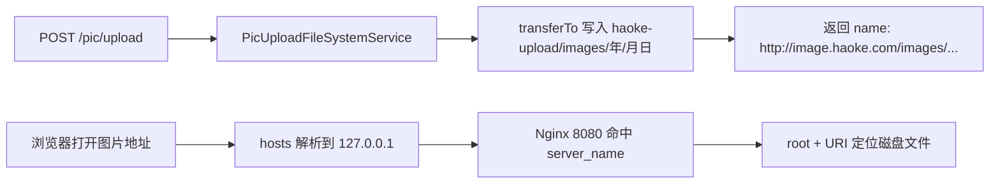

# 同一套上传逻辑落到本地磁盘：写盘实现、路径与 URL 的解耦、Nginx 静态映射

方案分析里排第一的本地文件系统存储，现在补上实现。写盘本身没有难度，JDK IO 十几行；麻烦在磁盘路径与访问 URL 是两回事：F 盘下的目录浏览器永远打不开，得有一层静态资源服务把 URL 映射过去。把 Service 写完、把 Nginx 配通，顺便就能看清云存储方案到底替你省了哪些事。

## 先给结论

- 与 OSS 版同构：白名单校验、生成路径、返回 PicUploadResult 全部复用，只有「写到哪」一步换成 transferTo 写本地磁盘。
- 目录按 上传根目录/images/年/月日 组织，文件名用 毫秒级时间戳 + 随机数 + 后缀，比 OSS 版多一道随机数保险。
- URL 与磁盘路径解耦：对外统一 `http://image.haoke.com` 加相对路径，拼 URL 前把反斜杠替换成正斜杠。
- 域名能访问的前提有二：hosts 把 image.haoke.com 指到本机，Nginx 把这个域名的请求映射到上传根目录。
- 与云方案的能力差距在增值项：水印、缩略图、裁剪在 OSS 是控制台开关，本地实现要自己写代码。

## 一、换一个 Service，架子不用动

新建 PicUploadFileSystemService，注解、校验、返回对象与 OSS 版几乎逐行对应，差异集中在写入与外链两处：

```java
package com.haoke.manage.dubbo.api.service;

import com.haoke.manage.dubbo.api.vo.PicUploadResult;
import org.apache.commons.lang3.RandomUtils;
import org.apache.commons.lang3.StringUtils;
import org.joda.time.DateTime;
import org.springframework.stereotype.Service;
import org.springframework.web.multipart.MultipartFile;

import java.io.File;
import java.io.IOException;
import java.util.Date;

@Service
public class PicUploadFileSystemService {

    private static final String[] IMAGE_TYPE = new String[]{"bmp", "jpg", "jpeg", "gif", "png"};

    // 上传根目录，按自己的磁盘环境调整
    private String baseFolder = "F:/code/haoke-upload";

    public PicUploadResult upload(MultipartFile uploadFile) {
        PicUploadResult fileUploadResult = new PicUploadResult();
        // 后缀白名单校验，与 OSS 版一致
        boolean isLegal = false;
        for (String type : IMAGE_TYPE) {
            if (StringUtils.endsWithIgnoreCase(uploadFile.getOriginalFilename(), type)) {
                isLegal = true;
                break;
            }
        }
        if (!isLegal) {
            fileUploadResult.setStatus("error");
            return fileUploadResult;
        }
        // 生成目标路径与相对 URL
        String fileName = uploadFile.getOriginalFilename();
        String filePath = getFilePath(fileName);
        // 磁盘路径里截出相对路径，反斜杠统一成正斜杠再拼 URL
        String picUrl = StringUtils.replace(
                StringUtils.substringAfter(filePath, baseFolder), "\\", "/");
        File newFile = new File(filePath);
        try {
            // 差异点一：直接写本地磁盘，不再走 SDK
            uploadFile.transferTo(newFile);
        } catch (IOException e) {
            fileUploadResult.setStatus("error");
            return fileUploadResult;
        }
        // 差异点二：外链前缀换成自己的图片域名
        fileUploadResult.setStatus("done");
        fileUploadResult.setName("http://image.haoke.com" + picUrl);
        fileUploadResult.setUid(String.valueOf(System.currentTimeMillis()));
        return fileUploadResult;
    }

    private String getFilePath(String sourceFileName) {
        String folder = baseFolder + File.separator + "images";
        Date nowDate = new Date();
        String filefolder = folder + File.separator
                + new DateTime(nowDate).toString("yyyy")
                + File.separator + new DateTime(nowDate).toString("MMdd");
        File file = new File(filefolder);
        if (!file.isDirectory()) {
            // 日期目录不存在则逐级创建
            file.mkdirs();
        }
        // 时间戳到毫秒再加随机数，重名概率趋近于零
        String name = new DateTime(nowDate).toString("yyyyMMddhhmmssSSS")
                + RandomUtils.nextInt(1000, 9999)
                + "." + StringUtils.substringAfterLast(sourceFileName, ".");
        return filefolder + File.separator + name;
    }
}
```

对照着读最省力：校验段与 OSS 版完全一样；putObject 的位置换成了 `transferTo(newFile)`，MultipartFile 的内容被直接写到目标文件；name 的拼法从 urlPrefix 加对象名，换成图片域名加相对路径。Controller 里把注入的服务换成这个新 Service，其余一行不改：

```java
// 切换实现只需换注入：两个 Service 的方法签名完全一致
@Autowired
private PicUploadFileSystemService picUploadService;
```

接口、返回对象、路径策略全部不变，注入哪个实现就上传到哪，这就是方案分析时说的「存储方案可替换」落到代码层的样子。

## 二、URL 与磁盘路径的解耦

写盘成功后磁盘上得到的是 `F:/code/haoke-upload/images/2018/1220/20181220103045123456.jpg` 这样的绝对路径，浏览器不认盘符。对外地址按两步算出来：先用 `substringAfter` 截掉根目录前缀，得到 `/images/2018/1220/xxx.jpg`；再把 Windows 的反斜杠替换成正斜杠，拼上图片域名。域名独立于接口域名是刻意的：图片流量大、可长缓存，与业务接口分属不同域名后，缓存策略、带宽配额、将来迁移到 CDN 或云存储都互不牵扯。

## 三、Nginx 与 hosts：让域名真的指向这台机器

代码只负责把文件写进目录，「http://image.haoke.com 出图」靠两件基础设施。第一件是 hosts，把域名指到本机：

```text
127.0.0.1 image.haoke.com
```

第二件是 Nginx（课程资料里自带压缩包，`start nginx` 启动），在 conf 下加一个 server 块，配置为按本课写法补全的示例：

```nginx
server {
    listen       8080;
    server_name  image.haoke.com;

    # 把上传根目录整个做成静态资源
    location / {
        root   F:/code/haoke-upload;
    }
}
```

请求进来后 Nginx 按 `root + URI` 拼出磁盘路径：`F:/code/haoke-upload` 加上 `/images/2018/1220/xxx.jpg`，正好落在写入的文件上。整条访问链路：



图中写盘与读图两条路径靠约定对齐：代码里生成的相对路径，必须与 Nginx 的 root 加 URI 的拼接结果一致，差一级目录就是 404。

不想装 Nginx 的开发环境有个替代写法：Spring Boot 自带的静态资源映射也能把磁盘目录挂到某个 URI 下，效果等价（示例为按主流写法补全）：

```java
@Configuration
public class WebConfig implements WebMvcConfigurer {

    @Override
    public void addResourceHandlers(ResourceHandlerRegistry registry) {
        // /images/** 的请求直接读磁盘目录，开发期替代 Nginx
        registry.addResourceHandler("/images/**")
                .addResourceLocations("file:F:/code/haoke-upload/images/");
    }
}
```

区别在于域名：这种写法图片仍从 18080 端口走，URL 前缀要跟着改；Nginx 方案则真正把图片流量分出了独立域名。

## 四、验证与两种方案的账

重启服务，用 REST 客户端再传一次：响应里 name 变成了 image.haoke.com 开头的地址；打开磁盘目录，images/2018/1220 下躺着新文件；浏览器访问返回的 URL，图片正常呈现。把 Controller 的注入切回阿里云实现重启，同样的请求又传到 OSS，两种方案在同一套接口签名下自由切换。

能力账也要算清楚：OSS 控制台上水印、裁剪、缩略图是产品开关，本地方案这些全部要自己写代码实现，本课的图片没有水印就是这个原因。开发便捷与零成本一边倒向本地，容量弹性与增值能力一边倒向云，与方案分析时的结论完全对上。

## 常见误区

- **文件名沿用上传原名。** 两个人同时传 logo.jpg，后来者覆盖先来者，中文文件名还会在 URL 里变成一堆百分号；用时间戳加随机数生成新名字，原名只用来取后缀。
- **mkdirs 写成 mkdir。** mkdir 只建最后一级，父目录不存在就失败，写文件时抛 IOException；逐级创建目录用 mkdirs。
- **反斜杠直接拼进 URL。** Windows 路径的分隔符是 `\`，拼出来浏览器无法解析；拼 URL 前统一替换成正斜杠。
- **域名打不开就回头改 Service。** 写盘成功而图片 404，问题几乎都在 hosts 与 Nginx：域名解析、server_name、root 三处逐一核对，Service 只对磁盘负责。

## 面试可能被问到的问题

1. 面试官追问：「本地文件系统存储的核心缺陷是什么？」
   答：容量受单机磁盘限制，扩容要加盘、迁移、改上传逻辑，代码跟着硬件走；多台机器之间文件不共享，负载均衡后请求落到不同机器就可能 404。它适合小规模或单机部署，规模上来要换分布式或云存储。

2. 面试官追问：「transferTo 与 getInputStream 有什么区别？」
   答：transferTo 直接把 multipart 解析出的临时文件移动或写入目标位置，基本不经过业务内存；getInputStream 返回输入流，内容由程序按块读取，适合边读边处理（如传给云 SDK）。大文件优先 transferTo 或流式处理，避免整文件进内存。

3. 面试官追问：「图片为什么要用独立域名访问？」
   答：图片是读多写少的大流量数据，独立域名可以单独配缓存与带宽，接口域名不被图片请求挤占；浏览器对不带 Cookie 的静态资源域名能省请求头开销；将来把域名指到 CDN 或对象存储，业务代码一行不改。

4. 面试官追问：「Nginx 的 root 是怎么和 URI 拼出磁盘路径的？」
   答：root 指定基准目录，请求 URI 直接追加在后面：root 为 F:/code/haoke-upload，URI 是 /images/2018/1220/a.jpg，最终文件就是 F:/code/haoke-upload/images/2018/1220/a.jpg。另有 alias 指令是替换 URI 前缀，两者语义不同，用错会 404。

5. 面试官追问：「本地存储将来怎么平滑演进到云存储？」
   答：接口与返回结构保持不变，Service 换实现即可，本课两个 Service 就是这个模式的雏形；对外 URL 用独立域名，把域名从 Nginx 切到云存储或 CDN；存量文件用脚本迁移后按相对路径映射，新增文件直接写云。

## 配套资料

- 本教学日资料包未收录源码（`materials/code/03/day05-阿里云OSS以及GraphQL入门/` 下仅存清单文件），本地存储 Service 为按本课画面写法补全的示例，Nginx server 块与 addResourceHandlers 亦为示例；上传根目录与图片域名按本课口径示例化。
- 文件能力独立成服务时的部署思路可对照讲义：`materials/docs/10/文件服务部署指南.md`。
- 四种存储方案的取舍分析见同系列成稿 `0069-图片存储解决方案的分析.md`。
