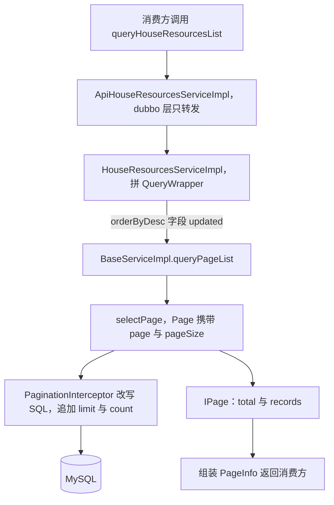

# 房源列表的 dubbo 服务：通用分页方法、PageInfo 封装与按更新时间倒序

新增房源走通之后，列表是下一个绕不开的功能。列表比新增多出两件事：分页和排序。分页意味着接口要同时交出「这一页的数据」和「一共有多少条」；排序意味着查询条件里要能表达「越新发布的排越前」。这两件事都不是房源业务独有的，做法是把它们压进通用层，业务 Service 只负责拼自己的条件。

## 先给结论

- dubbo 接口新增 `queryHouseResourcesList(int page, int pageSize, HouseResources queryCondition)`，返回通用的 `PageInfo<HouseResources>`；查询条件传 null 就是无条件分页。
- `PageInfo<T>` 是放在 vo 包的通用分页壳：total、pageNum、pageSize、records 四个属性，泛型决定里面装什么；它要跨 dubbo 网络传输，必须实现 `Serializable` 并声明 `serialVersionUID`。
- `BaseServiceImpl` 增加一个带 `QueryWrapper` 参数的 `queryPageList`，底层就是 MyBatis-Plus 的 `selectPage(new Page<>(page, pageSize), queryWrapper)`，返回 `IPage`。
- 列表按 `updated` 字段倒序：`queryWrapper.orderByDesc("updated")`，刚发布的房源排在最前面。
- 分页要真正生效，`PaginationInterceptor` 必须注册成 Spring 容器里的 bean，这是 MyBatis-Plus 分页最容易漏的一步。

## 一、接口先行：三个参数与一个泛型返回值

在 interface 模块的 `ApiHouseResourcesService` 里追加列表方法。新增房源的方法已经在里面，列表方法紧挨着它：

```java
package com.haoke.manage.dubbo.server.api;

import com.haoke.manage.dubbo.server.pojo.HouseResources;
import com.haoke.manage.dubbo.server.vo.PageInfo;

public interface ApiHouseResourcesService {

    /**
     * 新增房源
     *
     * @param houseResources 房源数据
     * @return -1 参数不符合要求，0 插入数据库失败，1 成功
     */
    int saveHouseResources(HouseResources houseResources);

    /**
     * 分页查询房源列表
     *
     * @param page           当前页
     * @param pageSize       页大小
     * @param queryCondition 查询条件，为 null 表示不带条件分页
     * @return 分页后的房源数据
     */
    PageInfo<HouseResources> queryHouseResourcesList(int page, int pageSize,
            HouseResources queryCondition);
}
```

三个参数各有分工：`page` 决定翻到第几页，`pageSize` 决定一页装多少条，`queryCondition` 是房源实体本身，非空属性会变成等值查询条件，整个传 null 就退化为无条件分页。返回值不是 `List` 而是 `PageInfo`，因为前端分页控件除了数据还需要总条数，只回一个列表，调用方就不知道还有多少页。

## 二、PageInfo：给所有列表用的分页壳

返回类型还不存在，先把它定义出来。放到 vo 包而不是 pojo 包，因为实体对应数据库表，而它对应「一次分页查询的结果」，两种东西不该混在一个包里：

```java
package com.haoke.manage.dubbo.server.vo;

import lombok.AllArgsConstructor;
import lombok.Data;

import java.io.Serializable;
import java.util.Collections;
import java.util.List;

@Data
@AllArgsConstructor
public class PageInfo<T> implements Serializable {

    private static final long serialVersionUID = 1L;

    /** 数据总条数 */
    private Integer total;

    /** 当前页 */
    private Integer pageNum;

    /** 一页显示的大小 */
    private Integer pageSize;

    /** 数据列表，初始给空集合，避免调用方拿到 null */
    private List<T> records = Collections.emptyList();
}
```

这个类有三个细节值得停下来看：

**第一，泛型 T 让它成为所有列表的通用壳。** 房源列表装 `HouseResources`，将来房东列表装房东实体，结构完全一样，只有 `records` 里的类型不同。不写泛型的话，每个业务都要复制一个自己的分页类。

**第二，`Serializable` 不是可选项。** 这个对象要经 dubbo 协议从提供方序列化后发给消费方，没实现序列化接口，调用时直接抛 `NotSerializableException`。`serialVersionUID` 也要显式声明，否则编译器按类结构自动生成，字段一变版本号就漂移，跨服务反序列化可能直接失败。

**第三，`records` 初始化为空集合。** `Collections.emptyList()` 生成一个只读空列表，哪怕某次查询确实没有数据，消费端拿到的也不是 null，少一层判空。

`@AllArgsConstructor` 是讲义里补上的：全参构造配合 `IPage` 组装返回值时一行搞定，不需要逐个 set。

## 三、条件与排序：把 QueryWrapper 引进通用层

实现从上往下走。dubbo 实现类保持转发风格，业务逻辑不写在这里：

```java
@Service(version = "1.0.0")
public class ApiHouseResourcesServiceImpl implements ApiHouseResourcesService {

    @Autowired
    private HouseResourcesService houseResourcesService;

    @Override
    public PageInfo<HouseResources> queryHouseResourcesList(int page, int pageSize,
            HouseResources queryCondition) {
        return this.houseResourcesService.queryHouseResourcesList(page, pageSize, queryCondition);
    }
}
```

`HouseResourcesService` 是 Spring 容器里的业务 Service，先定义同名方法，再进入实现类。实现里遇到一个问题：通用层已有的 `queryPageListByWhere(record, page, rows)` 走的是 `new QueryWrapper<>(record)`，只能表达等值条件，表达不了排序。所以给 `BaseServiceImpl` 再加一个重载，条件由调用方用 `QueryWrapper` 自由拼装：

```java
/**
 * 通用分页查询：查询与排序条件由调用方通过 QueryWrapper 拼装
 */
public IPage<T> queryPageList(QueryWrapper<T> queryWrapper, Integer page, Integer pageSize) {
    return this.mapper.selectPage(new Page<>(page, pageSize), queryWrapper);
}
```

业务实现顺势成形。列表的业务规则是按更新时间倒序，也就是刚发布的房源排最前：

```java
@Override
public PageInfo<HouseResources> queryHouseResourcesList(Integer page, Integer pageSize,
        HouseResources queryCondition) {
    QueryWrapper<HouseResources> queryWrapper = new QueryWrapper<>();
    // 列表按更新时间倒序，最新的房源排最前
    queryWrapper.orderByDesc("updated");
    IPage<HouseResources> iPage = super.queryPageList(queryWrapper, page, pageSize);
    // getTotal() 返回 long，PageInfo 里是 Integer，先装箱再 intValue 收窄
    int total = Long.valueOf(iPage.getTotal()).intValue();
    return new PageInfo<>(total, page, pageSize, iPage.getRecords());
}
```

`IPage` 是 MyBatis-Plus 的分页结果接口，`getTotal()` 给总条数，`getRecords()` 给当前页数据。收尾是结构转换：`IPage` 是框架内部的返回结构，`PageInfo` 是跨服务的传输结构，两者不能混用，靠全参构造一次装完：总条数、当前页、页大小、数据列表，顺序与 `PageInfo` 的字段一一对应。

整条链路串起来是这样的：



图里最容易忽略的一环是 F：`selectPage` 本身不会拼 limit，改写 SQL 的是分页插件，它没在容器里，整条链路的分页就断了。

## 四、启动验证与分页插件

服务写完先验证提供方。重启 dubbo 服务后打开 dubbo-admin，按应用名搜索，列表里出现新服务就说明注册中心已经收到，提供方状态正常。消费端的联调留给下一篇的 RESTful 接口。

启动前还有一步必须确认：分页插件在配置类里注册成 bean。资料包里 MyBatis-Plus 工程的配置类正是这个写法：

```java
@Configuration
@MapperScan("com.haoke.manage.dubbo.server.mapper")
public class MybatisPlusConfig {

    @Bean
    public PaginationInterceptor paginationInterceptor() {
        // 不注册这个 bean，selectPage 不会拼 limit，一查就是全表
        return new PaginationInterceptor();
    }
}
```

`@Configuration` 让 Spring Boot 把它当配置类加载，`@Bean` 把插件交给容器管理。MyBatis-Plus 执行 `selectPage` 时会探测容器里有没有这个拦截器：有，就在原 SQL 外面套一层 count 查总数、追加 limit 取当页；没有，SQL 原样执行，方法不报错，只是页大小失效、`total` 也拿不到正确值。

## 常见误区

- **忘了注册分页插件**：`selectPage` 不抛异常，SQL 里也没有 limit，看起来「查询正常」，实际每次都查全表，total 也永远是当前结果集的条数。症状隐蔽，先查插件再查代码。
- **PageInfo 不实现 `Serializable`**：dubbo 默认的 hessian 序列化遇到没实现序列化接口的对象直接抛异常，而且报错发生在调用时而非启动时，容易被误判成网络问题。
- **排序列名当参数随手写**：`orderByDesc("updated")` 里的列名是字符串，编译期不检查，表里字段叫 `updated`、写成 `update` 只会在运行时收到 SQL 异常。列名建议抽成常量或枚举统一维护。
- **想用 `queryPageListByWhere` 硬凑排序**：那个重载只接受实体对象，等值条件是全部能力，排序根本没入口。正确做法是加带 `QueryWrapper` 的重载，而不是在业务层先查全量再内存排序。

## 面试可能被问到的问题

1. 面试官追问：「PageInfo 为什么要实现 Serializable 并声明 serialVersionUID？」
   答：它作为 dubbo 方法的返回值要跨网络序列化传输，没实现序列化接口调用时直接抛 NotSerializableException。serialVersionUID 若不显式声明，JVM 会按类结构自动计算，服务端与消费端类结构不一致时版本号对不上，反序列化会失败；固定值可以保证字段小幅度演进时前后兼容。

2. 面试官追问：「MyBatis-Plus 的 selectPage 为什么分页不生效？」
   答：最常见原因是分页拦截器没注册。selectPage 只是声明了分页意图，真正把 SQL 改写成 count 加 limit 的是 PaginationInterceptor，它必须以 bean 的形式在 Spring 容器里。插件缺失时方法不报错，SQL 原样执行，表现为查全表、页大小失效。

3. 面试官追问：「IPage 和自己封装的 PageInfo 是什么关系，为什么不直接返回 IPage？」
   答：IPage 是 MyBatis-Plus 内部的分页结果结构，绑定框架类型；PageInfo 是自定义的传输对象，字段按前端需求裁剪，且完全受自己控制。返回 IPage 会把第三方类型泄漏到 dubbo 接口上，框架升级换结构时所有消费方都要跟着动，转换一层是解耦。

4. 面试官追问：「排序写在 SQL 层还是查出来在内存里排？」
   答：分页场景必须 SQL 层排。内存排序只能对已取回的数据生效，而分页的意义恰恰是不取全量；数据库对排序列建索引后成本也远低于把全表拉到应用层。业务规则如「最新在前」翻译成 orderByDesc 加到查询条件里，与分页参数一起下发。

5. 面试官追问：「dubbo 接口的查询条件直接用实体对象，有什么隐患？」
   答：实体与数据库表结构绑定，表加字段实体跟着变，接口参数随之演进，老消费方拿新提供方的类反序列化时靠 serialVersionUID 与字段兼容性兜底。更规范的做法是定义独立的查询 DTO，只暴露允许作为条件的字段，避免调用方把不该传的字段（如状态、金额）当条件塞进来。

6. 面试官追问：「getTotal() 返回 long，PageInfo 里却是 Integer，怎么处理比较稳妥？」
   答：单表分页总条数不会超 int 上限，先装箱成 Long 再 intValue 是课程里的写法，直接强转 (int) 语义相同。真要严谨可以自己定义 getTotal 返回 long，或在大数据量表上预估上限；超过 int 范围的分页本身就该换方案，比如滚动游标分页。

## 配套资料

- 本教学日资料包未收录源码（`materials/code/03/day05-阿里云OSS以及GraphQL入门/` 下仅存清单文件），接口、PageInfo、两层 Service 与配置为按本课画面写法补全的可运行示例，包名沿用同系列成稿的中性命名。
- 分页插件的真实工程写法可对照：`materials/code/10/mp-springboot/`（配置类 `config/MybatisPlusConfig.java` 中 `PaginationInterceptor` 注册为 bean，文中代码与其一致，包名已改写）。
- 讲义：`materials/docs/10/Mybatis-Plus讲义v1.0.md`（通用 CRUD 与条件构造章节；分页插件以工程配置为准）。
- 两层 Service 与 `BaseServiceImpl` 泛型注入的来龙去脉见同系列成稿 `0064-新增房源服务实现之新增房源服务的具体实现.md`。
