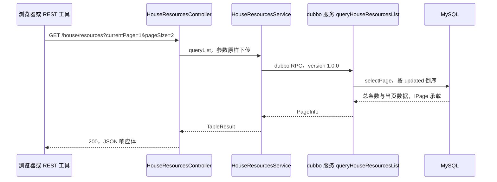

# 房源列表的 RESTful 门面：GET 参数、TableResult 响应结构与分页联调

dubbo 服务已经在注册中心待命，但它只会说 dubbo 协议，浏览器和前端系统都调不到它。和新增房源一样，api-server 要再开一扇 HTTP 门：把 `GET /house/resources?currentPage=1&pageSize=2` 翻译成对 dubbo 服务的分页调用，再把结果装进前端表格能直接消化的结构里。这一课把门面补齐，并用工具把分页链路打穿。

## 先给结论

- Controller 用 `@GetMapping` 暴露列表接口，查询条件用实体对象接 query string，`currentPage` 与 `pageSize` 用 `@RequestParam` 接并给默认值，参数名照着前端组件的约定走。
- 响应结构自定义 `TableResult<T>`：`list` 装数据，`pagination` 装分页信息；结构对齐前端 Table 组件的期望，字段名不能随便改。
- `Pagination` 三个属性 current、pageSize、total，total 给的是总条数，前端拿它自己算总页数。
- Service 层调 dubbo 的 `queryHouseResourcesList` 拿 `PageInfo`，再转成 `TableResult` 返回，两次转换各司其职。
- 联调用 GET 请求验证：总条数 9、每页 2 条，翻到第 2、3 页数据不重不漏，且最新的房源排第一页。

## 一、GET 接口：三个参数怎么收

api-server 依赖 web starter 与 interface 模块，这两条依赖在新增房源时已经导好，这一课只加代码。Controller 里追加列表方法：

```java
/**
 * 查询房源列表
 *
 * @param houseResources 查询条件，字段名与 query string 一一对应
 * @param currentPage    当前页
 * @param pageSize       页大小
 * @return 分页数据与分页信息
 */
@GetMapping
@ResponseBody
public ResponseEntity<TableResult> list(HouseResources houseResources,
        @RequestParam(name = "currentPage", defaultValue = "1") Integer currentPage,
        @RequestParam(name = "pageSize", defaultValue = "10") Integer pageSize) {
    return ResponseEntity.ok(this.houseResourcesService.queryList(houseResources, currentPage, pageSize));
}
```

类上已有 `@RequestMapping("house/resources")`，方法上的 `@GetMapping` 空着路径，GET 请求落到 `/house/resources` 就会命中它，与新增房源的 POST 共用同一个地址、不同动词，这正是 RESTful 的用法。

参数接收有两条路：

**第一，查询条件用实体收。** GET 请求没有请求体，`HouseResources` 上也没有 `@RequestBody`，Spring MVC 走数据绑定：把 query string 里的 `title=xxx` 按名字找到实体的 `setTitle` 填进去。前端想按标题过滤，就在地址后面拼 `title` 参数，非空属性到达 dubbo 层后自动变成等值条件。

**第二，分页参数用 `@RequestParam` 收。** `currentPage`、`pageSize` 这两个名字不是后端随手起的，前端分页组件发请求时就带这两个名字，后端参数名向它对齐，联调时少一层映射。`defaultValue` 的价值在于接口可以先测：不传任何参数，默认查第 1 页、每页 10 条，不会因为缺参数直接被挡在 400。

## 二、TableResult：给前端表格的响应壳

返回什么结构，取决于前端表格吃什么结构。前端 Table 组件期望的数据就是两部分：数据列表加分页信息。照着这个契约定义两个 VO：

```java
package com.haoke.manage.dubbo.api.vo;

import lombok.AllArgsConstructor;
import lombok.Data;

import java.io.Serializable;
import java.util.List;

@Data
@AllArgsConstructor
public class TableResult<T> implements Serializable {

    private static final long serialVersionUID = 1L;

    /** 数据列表 */
    private List<T> list;

    /** 分页信息 */
    private Pagination pagination;
}
```

```java
package com.haoke.manage.dubbo.api.vo;

import lombok.AllArgsConstructor;
import lombok.Data;

import java.io.Serializable;

@Data
@AllArgsConstructor
public class Pagination implements Serializable {

    private static final long serialVersionUID = 1L;

    /** 当前页 */
    private Integer current;

    /** 每页大小 */
    private Integer pageSize;

    /** 总条数，前端用它计算总页数 */
    private Integer total;
}
```

这两个类与上一篇的 `PageInfo` 长得像，但住址和身份都不同：`PageInfo` 在 dubbo-server 的 vo 包里，跟着 interface 模块跨服务传输；`TableResult` 与 `Pagination` 在 api-server 的 vo 包里，只做 HTTP 响应。传输结构和展示结构分开，前端要什么字段、叫什么名，只在门面层调整，dubbo 接口不动。

## 三、Service：dubbo 结果到前端结构的转换

消费端 Service 在新增房源时已经建好，里面追加 `queryList`：

```java
@Service
public class HouseResourcesService {

    @Reference(version = "1.0.0")
    private ApiHouseResourcesService apiHouseResourcesService;

    public boolean save(HouseResources houseResources) {
        int result = this.apiHouseResourcesService.saveHouseResources(houseResources);
        return result == 1;
    }

    public TableResult<HouseResources> queryList(HouseResources houseResources,
            Integer currentPage, Integer pageSize) {
        PageInfo<HouseResources> pageInfo = this.apiHouseResourcesService
                .queryHouseResourcesList(currentPage, pageSize, houseResources);
        return new TableResult<>(pageInfo.getRecords(),
                new Pagination(currentPage, pageSize, pageInfo.getTotal()));
    }
}
```

注意参数顺序的细节：dubbo 接口的签名是 `page`、`pageSize`、`queryCondition`，条件对象排在最后；这里调用时按接口签名传参，组装时再把 `currentPage`、`pageSize`、`total` 按构造器顺序塞进 `Pagination`。`PageInfo.getRecords()` 出来的就是当页数据，直接交给 `list`，一进一出两次转换，Controller 全程不碰 dubbo 类型。

整条链路画出来是这样：



关键路径在 S 到 D 的那次转换：HTTP 世界里的 currentPage 与 dubbo 世界里的 page 在这里交接，响应再从 `PageInfo` 变回 `TableResult`，两侧协议互不感知。

## 四、联调：三个页码各发一次

服务重启后用 REST 客户端发起 GET 请求：

```bash
curl -i "http://127.0.0.1:18080/house/resources?currentPage=1&pageSize=2"
```

响应是 200，响应体形如这样（数据为示例）：

```json
{
  "list": [
    { "id": 9, "title": "最后一次新增的房源", "price": "3200" },
    { "id": 8, "title": "较早发布的房源", "price": "2800" }
  ],
  "pagination": { "current": 1, "pageSize": 2, "total": 9 }
}
```

三个信息可以当场核对：总条数 9，与数据库里实际插入的房源数一致；列表第 1 条是最后一次新增的房源，说明 dubbo 层的 `orderByDesc("updated")` 生效了；总页数没有直接给，用 9 除以 2 向上取整得 5，这正是把 total 而不是总页数交给前端的原因，页大小一变总页数就得重算，算术留在消费端最灵活。

把页码改成 2 再发一次，拿到的是第 3、4 条数据；改成 3，数据继续后移。数据不重不漏，分页链路就算完整打穿，剩下的就是让前端表格来发这个请求。

## 常见误区

- **`@RequestParam` 不给 `defaultValue` 也不允许为空**：它的 `required` 默认 true，前端一旦漏传 `currentPage`，请求直接 400，页面上表现为列表整页空白。给默认值或者把 required 设为 false 再自行兜底，二选一。
- **实体当查询条件时字段对不上名**：数据绑定靠属性名匹配，前端传 `houseTitle` 后端实体叫 `title`，绑不上也不报错，条件悄悄丢失，查询结果「看起来不对但没异常」。契约靠接口文档对齐。
- **擅自改 `TableResult` 的字段名**：`list` 与 `pagination` 是前端表格的数据契约，改成 `data`、`pageInfo` 后端看着更顺，前端取值却是 undefined。改名要两端一起动。
- **把 `PageInfo` 直接序列化给前端**：功能上可行，但 `pageNum`、`records` 这套字段名与前端组件的期望对不上，还得在前端二次转换；传输结构泄漏到 HTTP 契约里，dubbo 层重构会波及前端。

## 面试可能被问到的问题

1. 面试官追问：「GET 请求的实体参数没有 @RequestBody，Spring MVC 是怎么填充的？」
   答：走 ServletRequest 的参数绑定。框架按 query string 的参数名通过反射找实体对应的 setter 逐个填充，类型转换失败或名称不匹配就跳过。它与 @RequestBody 的区别在于：绑定基于名字、来自 URL，而 @RequestBody 基于消息体、由 HttpMessageConverter 反序列化。

2. 面试官追问：「@RequestParam 的 defaultValue 和 required 是什么关系？」
   答：设置了 defaultValue 后该参数等价于非必填，请求里没带时用默认值，带了就用请求值；不带 defaultValue 时 required 默认 true，缺参数直接返回 400。默认值还有一个作用是让接口在最小请求下就能工作，降低联调成本。

3. 面试官追问：「为什么不把 dubbo 返回的 PageInfo 直接响应给前端？」
   答：PageInfo 是 dubbo 接口的传输结构，字段为跨服务传输设计；前端表格有自己的数据契约。在 Service 层转成 TableResult，一来字段名对齐前端组件，二来把 dubbo 类型挡在门面之内，提供方重构或换 RPC 框架时前端与 Controller 都不动。

4. 面试官追问：「total 传总条数还是总页数，为什么？」
   答：传总条数。总页数等于总条数对页大小向上取整，是派生值，页大小可变时算一次即可；直接传总页数反而要求前后端约定页大小永远不变。前端分页组件普遍也是按总条数建模的。

5. 面试官追问：「GET 和 POST 查询接口在参数接收上有什么本质区别？」
   答：GET 的语义是读资源，参数走 URL，Spring MVC 按名字绑定到实体或 @RequestParam；POST 的语义常是创建或提交复杂条件，参数在请求体里，需要 @RequestBody 反序列化。列表过滤条件简单时 GET 足够，条件结构复杂或包含隐私数据时用 POST 传条件更合适。

6. 面试官追问：「@Reference 注入的代理调用一次，网络层面发生了什么？」
   答：代理按接口与版本找到订阅的提供者列表，经负载均衡选一个地址，把方法名、参数类型与实参序列化后通过网络发给提供方；提供方反序列化后调用真实实现，结果原路返回。调用代码看起来是本地方法调用，实际完成了一次远程通信。

## 配套资料

- 本教学日资料包未收录源码（`materials/code/03/day05-阿里云OSS以及GraphQL入门/` 下仅存清单文件），Controller、两个 VO 与 Service 为按本课画面写法补全的可运行示例，包名沿用同系列成稿的中性命名，响应 JSON 为示例数据。
- RESTful 消费方与 dubbo 提供方分层的真实工程可对照：`materials/code/10/nacos-discovery-RESTful服务发现与Dubbo服务发现/`（`nacos-restful-consumer` 的消费端 Controller、`nacos-restful-provider` 的提供方接口实现）。
- dubbo 提供方的分页实现与 `PageInfo` 封装见同系列成稿 `0075-实现房源列表的Dubbo服务的开发.md`，POST 门面的写法见 `0065-新增房源服务实现之新增房源RESTful接口的开发.md`。
