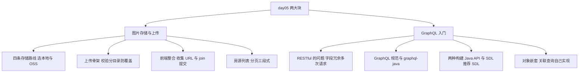

# 图片上传与 GraphQL 入门：day05 两大块的知识收束

day05 干了两件事：把房源图片的「存」解决掉，把接口查询的「新范式」开个头。前者从存储方案选型讲到
阿里云 OSS 与本地存储两套实现，再到前后端整合上传和房源列表分页；后者从 RESTful 的问题一路讲到
graphql-java 的两种构建方式和对象嵌套。两块内容互不相干又彼此呼应：一个回答「数据放哪」，一个回答
「数据怎么取」。

## 先给结论

- 图片存储有四条路线：本地硬盘、分布式文件系统、NFS、第三方存储服务，项目选了第一条和第四条（本地存储 + 阿里云 OSS）。
- 两套存储实现共用同一个上传骨架：格式白名单校验、按日期分目录、随机文件名防覆盖，差别只在文件落盘的位置和返回的 URL 来源。
- 前端整合有两个必须搞清的点：上传成功后返回的 URL 要收集进组件状态；表单提交前把图片集合拼成逗号分隔字符串再入库。
- 房源列表是标准三段式：Dubbo 服务用 MybatisPlus 做分页，RESTful 接口包一层，前端页面调接口渲染。
- GraphQL 部分：规范由 Facebook 提出，graphql-java 是它的 Java 实现，构建方式有 Java API 与 SDL 两种且官方推荐 SDL；对象嵌套声明容易，但关联查询要自己实现。

## 图片存储：四条路线，两条落地

选型逻辑一张表就能说清：

| 方案 | 优点 | 缺点 |
|---|---|---|
| 直接保存到服务硬盘 | 开发便捷，成本低 | 扩容困难 |
| 分布式文件系统 | 容易扩容 | 开发复杂度稍大 |
| NFS 做存储 | 开发较为便捷 | 需要运维知识做部署维护 |
| 第三方存储服务 | 开发简单，功能强大，免维护 | 付费 |

项目采用第一、第四两种：本地存储用于开发调试，第三方选阿里云 OSS 用于生产。OSS 用起来确实省心，
SDK 几行代码就能完成上传，真正的成本在流量：图片站的下行流量随访问量线性增长，控制台里购买
下行流量包是常规操作，预算要提前算进方案里。

## 同一套上传骨架，两种落盘目标

本地存储的服务类骨架如下（画面线保留了类与格式白名单片段，方法体按本课写法补全为可运行版本）：

```java
@Service
public class PicUploadFileSystemService {

    // 允许上传的格式
    private static final String[] IMAGE_TYPE = new String[]{"bmp", "jpg", "jpeg", "gif", "png"};

    public PicUploadResult upload(MultipartFile uploadFile) throws IOException {
        // 后缀白名单校验，不合法直接返回错误状态
        boolean isLegal = false;
        for (String type : IMAGE_TYPE) {
            if (StringUtils.endsWithIgnoreCase(uploadFile.getOriginalFilename(), type)) {
                isLegal = true;
                break;
            }
        }
        PicUploadResult result = new PicUploadResult();
        if (!isLegal) {
            result.setStatus("error");
            return result;
        }
        // 目录按日期分层，避免单目录文件爆炸；文件名拼随机数防覆盖
        String path = "/images/" + new DateTime().toString("yyyy/MM/dd") + "/";
        String fileName = RandomUtils.nextInt(100, 999999) + "_" + uploadFile.getOriginalFilename();
        File target = new File("D:/upload" + path, fileName);
        FileUtils.forceMkdir(target.getParentFile());
        uploadFile.transferTo(target);
        result.setStatus("done");
        result.setName("/pics" + path + fileName);
        return result;
    }
}
```

这套骨架换个落盘动作就是 OSS 版：`transferTo(target)` 换成 SDK 的 `putObject`，返回的 name 换成
OSS 生成的访问 URL，校验、分目录、防覆盖的思路一字不改。理解了这一点，两套实现就只剩一份代码要读。
返回值 `PicUploadResult` 携带 status 和 name，前端靠这两个字段判断成败并拿到图片地址。

## 前后端整合的两个关键点

前端上传组件把请求发到后端的上传接口：

```jsx
<Upload
  action="/haoke/pic/upload"
  listType="picture-card"
  fileList={fileList}
  onPreview={this.handlePreview}
  onChange={this.handleChange}
>
  {fileList.length ? null : uploadButton}
</Upload>
```

**第一，上传返回的 URL 要收集进状态。** 每张图传完，从响应里取 `response_name` 存进组件的集合，
后续预览、回显、删除都围绕这个集合做：

```js
handleFileList = (obj) => {
  let pics = new Set();
  obj.forEach((v, k) => {
    if (v.response_name) {
      pics.add(v.response_name);
    }
  });
  // 存入 state，随表单一起提交
};
```

**第二，提交时有个小技巧。** 房源表单里图片字段是字符串，提交前把集合展开拼成逗号分隔的串：

```js
// 处理图片
values.pic = [...this.state.pics].join(',');
dispatch({
  type: 'house/submitHouseForm',
  payload: values,
});
```

一条房源记录对应多张图，库里只存一个逗号分隔的 URL 串，展示时再 split。整条上传链路串起来是：


关键路径在 E 到 G：URL 从响应流转到组件状态，再随表单进库，中间任何一环断了，列表页就出图。

## 房源列表：三段式分页查询

列表功能的实现照旧走三段式。服务层 `HouseResourcesServiceImpl` 继承 `BaseServiceImpl` 实现
`HouseResourcesService`，类上标 `@Transactional`，内部用 MybatisPlus 的 `Page` 封装页码与页大小、
`QueryWrapper` 拼条件，查完包成 `PageInfo` 返回；RESTful 接口层暴露 `GET` 入口接收 page 与 pageSize
两个参数；前端列表页带着分页参数调接口，拿数据渲染表格。流程没有新东西，值得动手敲一遍的只有
MybatisPlus 分页插件的配置和 `PageInfo` 的包装。

## GraphQL：一天之内从规范走到嵌套

这部分按四步走完：

**第一，看清 RESTful 的问题。** `GET /user/1` 固定返回 id、name、age、address 全套字段，前端只要
name 也得照单全收，字段冗余；要的数据散在多个资源上，客户端就得发多次请求。GraphQL 针对的正是
这两点：查询什么就返回什么，一个请求按层级取齐。

**第二，认识规范与实现。** GraphQL 是 Facebook 提出的前后端接口调用查询规范，官网有完整的规范文档；
graphql-java 是这个规范的 Java 实现，前面几个 demo 用的就是它。

**第三，两种构建方式收束。** 纯 Java API 用 Builder 链逐层拼类型，对象一多就繁琐；SDL 把类型定义
写进 `.graphqls` 文件，`SchemaParser` 解析、`RuntimeWiring` 绑定取数、`SchemaGenerator` 合成 Schema，
官方推荐后者。

**第四，对象嵌套与最终运行结果。** User 里挂 Card 一对一嵌套，最终 demo 的取数器返回
`new User(id, "张三_" + id, 20 + id.intValue(), new Card("number_" + id, id))`，三组查询的结果把
「按需裁剪 + 嵌套」验证完整：

```text
查询 {user(id:1){id,name}}
结果 {user={id=1, name=张三_1}}

查询 {user(id:1){id,name,card{cardNumber}}}
结果 {user={id=1, name=张三_1, card={cardNumber=number_1}}}

查询 {user(id:1){id,name,card{cardNumber,userId}}}
结果 {user={id=1, name=张三_1, card={cardNumber=number_1, userId=1}}}
```

要特别记住的一点：GraphQL 并没有实现关联查询。Schema 里声明了 `card: Card` 不代表引擎会去把身份证
数据查出来，嵌套字段的数据仍是取数器自己准备的，真实项目里这一步要调 Service 查库。声明形状与
生产数据，始终是两件事。

## 全章知识地图



左半边是工程能力，右半边是接口范式，day06 之后 GraphQL 会接进真实房源数据，两块正式合流。

## 常见误区

- **只算 OSS 的存储费，忽略下行流量费。** 图片站的成本大头在流量，上线前把流量包和单价一起测算，
  否则账单会明显超出预期。
- **格式校验只靠前端。** 前端限制能被绕过，后端必须有 `IMAGE_TYPE` 这样的白名单，校验失败的请求
  直接拒绝。
- **上传后的 URL 不进状态随手处理。** 返回的 `response_name` 不收集，提交房源时图片字段就是空的；
  收集进 Set、提交时 join，才能保证库里的 URL 与页面上看到的一致。
- **以为 GraphQL 声明了嵌套就有数据。** 关联数据必须自己在 DataFetcher 里实现，忘写的结果是
  card 为 null 而且没有任何报错。

## 面试可能被问到的问题

1. 面试官追问：「图片存储方案怎么选型？」
   答：按规模和成本权衡。本地硬盘开发便捷成本低但难扩容，适合开发期；分布式文件系统易扩容但开发
   复杂；NFS 部署省事但吃运维；第三方存储免维护、功能全但要付费。中小团队上线通常选第三方存储，
   开发期配一套本地实现便于调试。
2. 面试官追问：「OSS 版和本地版上传代码差在哪？」
   答：骨架完全一致，都是格式白名单、日期分目录、随机文件名，差别只在落盘动作与 URL 来源：
   本地版 transferTo 写磁盘并拼相对路径，OSS 版调 SDK 的 putObject 并使用 OSS 返回的访问 URL。
   抽象出一个上传接口，两个实现可以随时切换。
3. 面试官追问：「前端上传多张图后，房源表单怎么把图片提交到后端？」
   答：每次上传成功把响应里的图片 URL 收集进组件状态，提交前把集合展开拼成逗号分隔字符串放进
   表单字段一起入库；后端存这一个字段，展示时再拆分。关键是 URL 的收集时机要和上传组件的回调对齐。
4. 面试官追问：「房源列表分页是怎么实现的？」
   答：Dubbo 服务层用 MybatisPlus 的 Page 传页码页大小、QueryWrapper 拼过滤条件，查询结果包成
   PageInfo 返回；RESTful 接口暴露 GET 参数透传；前端按页请求渲染。三层职责清晰，分页逻辑集中在服务层。
5. 面试官追问：「RESTful 的问题 GraphQL 都解决了吗？」
   答：字段冗余和多次请求这两点解决得很直接：按需返回加单请求多层级取数。但它也带来新成本：
   取数逻辑要自己实现包括关联查询、嵌套过深有 N+1 问题、缓存也因查询灵活而复杂化。选型要看业务形态，
   页面数据形状多变、层级深的场景收益最大。
6. 面试官追问：「graphql-java 里 SDL 构建和 Java API 构建的核心差别是什么？」
   答：产物同为 GraphQLSchema，但 SDL 把静态契约移进 .graphqls 文件，由 SchemaParser 解析成
   TypeDefinitionRegistry，再与 RuntimeWiring 里注册的 DataFetcher 合成；编程式则用 Builder 链在
   代码里完成全部定义。SDL 修改类型不用重编译，官方推荐。

## 配套资料

- 本课资料包未提供源码工程（`materials/code/03/day05-阿里云OSS以及GraphQL入门/` 解压后无代码文件），
  上传服务与 GraphQL 示例为按本课写法补全的可运行版本。
- 下一单元开始接真实数据库，前台系统的库脚本在
  `materials/code/03/day06-开发GraphQL服务以及前台系统搭建/day06-开发GraphQL服务以及前台系统搭建/资料/myhome.sql`。
