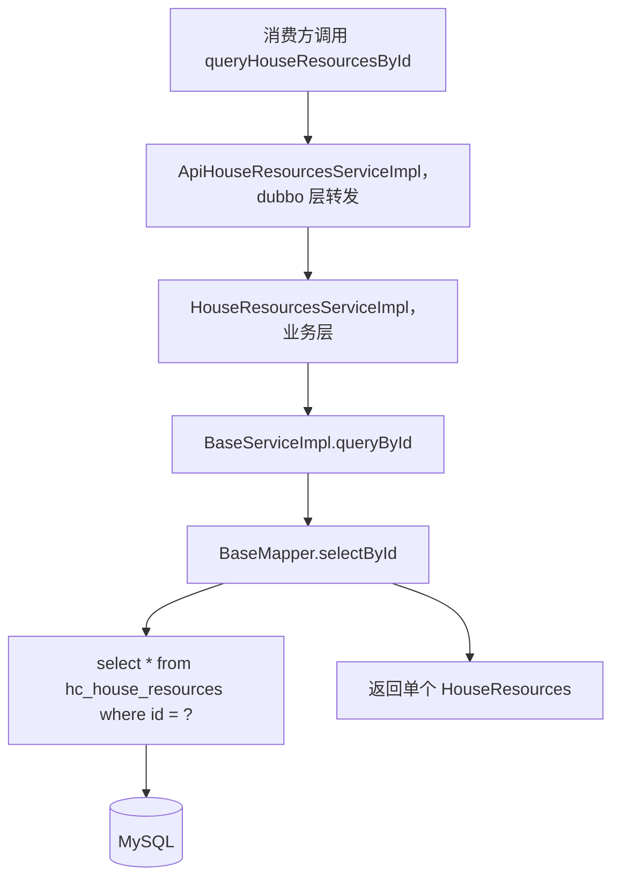

# 按 id 查房源的 Dubbo 服务：一条主键直达的查询链

把房源接口 GraphQL 化，要写的服务有两个：按 id 查单条、按条件查列表。列表的 Dubbo 服务在房源列表开发那天已经完成，按 id 查单条却一直欠着：管理后台从来都是按列表拿数据，单条详情没人调过。现在前台要上 GraphQL，客户端点开一条房源就要看详情，这块底座必须先补上。

## 先给结论

- dubbo 接口模块的 `ApiHouseResourcesService` 新增 `queryHouseResourcesById(Long id)`，返回单个 `HouseResources`，单条查询用不到 `PageInfo`。
- 实现沿用既有的两层结构：dubbo 实现类只做转发，业务落在 `HouseResourcesServiceImpl`，方法体就一句 `super.queryById(id)`。
- `BaseServiceImpl` 补一个通用的 `queryById`，底层是 MyBatis-Plus 的 `selectById`，主键直达，不需要 `QueryWrapper`。
- 最容易踩的坑在泛型：子类继承时把泛型实参写全，让 `T` 定死成 `HouseResources`；裸用泛型时 `queryById` 返回 `Object`，调用处要么编译不过，要么被迫强转。
- 这一步只把能力放进 dubbo，对外还暴露不出去；套上 GraphQL 门面是下一篇的事。

## 一、接口先行：单条查询的签名长什么样

在 interface 模块的 `ApiHouseResourcesService` 里追加方法。这个接口是提供方与消费方共享的 jar，方法签名就是两边的契约，先把它定下来：

```java
/**
 * 分页查询房源列表
 *
 * @param page           当前页
 * @param pageSize       页面大小
 * @param queryCondition 查询条件
 * @return
 */
PageInfo<HouseResources> queryHouseResourcesList(int page, int pageSize,
                                                 HouseResources queryCondition);

/**
 * 根据id查询房源数据
 *
 * @param id 房源id
 * @return
 */
HouseResources queryHouseResourcesById(Long id);
```

对比上面已有的列表方法，两处差别值得留意。**其一，返回值从 `PageInfo<HouseResources>` 换成了单个 `HouseResources`。** 单条查询没有「一共多少条」的概念，返回值里再套一层分页壳纯属多余，调用方拿到 null 或拿到对象，二选一。**其二，参数只有一个 `Long id`。** 主键查询的语义就是精确匹配，没有条件、没有排序、没有分页，签名越短，契约越清楚。

## 二、两层转发：dubbo 层只递话，业务层查数据

接口定好了，往下实现。dubbo 实现类 `ApiHouseResourcesServiceImpl` 保持转发风格，新增方法同样不写任何业务：

```java
@Service(version = "1.0.0")
public class ApiHouseResourcesServiceImpl implements ApiHouseResourcesService {

    @Autowired
    private HouseResourcesService houseResourcesService;

    @Override
    public int saveHouseResources(HouseResources houseResources) {
        return this.houseResourcesService.saveHouseResources(houseResources);
    }

    @Override
    public PageInfo<HouseResources> queryHouseResourcesList(int page, int pageSize,
                                                            HouseResources queryCondition) {
        return this.houseResourcesService.queryHouseResourcesList(page, pageSize, queryCondition);
    }

    @Override
    public HouseResources queryHouseResourcesById(Long id) {
        return this.houseResourcesService.queryHouseResourcesById(id);
    }
}
```

它转发到的 `HouseResourcesService` 是 Spring 容器里的业务 Service，接口里同步声明这个方法，实现落在既有实现类里：

```java
@Service
@Transactional
public class HouseResourcesServiceImpl
        extends BaseServiceImpl<HouseResources, HouseResourcesMapper>
        implements HouseResourcesService {

    @Override
    public int saveHouseResources(HouseResources houseResources) {
        // 添加校验或者其他的一些逻辑
        if (StringUtils.isBlank(houseResources.getTitle())) {
            return -1;
        }
        return super.save(houseResources);
    }

    @Override
    public PageInfo<HouseResources> queryHouseResourcesList(int page, int pageSize,
                                                            HouseResources queryCondition) {
        QueryWrapper<HouseResources> queryWrapper = new QueryWrapper<>();
        // 根据数据的更新时间倒序排序
        queryWrapper.orderByDesc("updated");
        IPage<HouseResources> iPage = super.queryPageList(queryWrapper, page, pageSize);
        return new PageInfo<>(Long.valueOf(iPage.getTotal()).intValue(),
                page, pageSize, iPage.getRecords());
    }

    @Override
    public HouseResources queryHouseResourcesById(Long id) {
        return super.queryById(id);
    }
}
```

`super.queryById(id)` 是通用层的单条查询，这次要在 `BaseServiceImpl` 里补上。它不需要任何条件对象，直接走 MyBatis-Plus 的主键查询：

```java
/**
 * 通用按 id 查询，主键直达
 */
public T queryById(Long id) {
    return this.mapper.selectById(id);
}
```

整条链路从消费方一路铺到数据库，画出来是这样：



图里最直观的一点是「直」：整条链没有条件拼装、没有分页改写、没有排序，主键索引一次命中。列表查询复杂的根源是要表达「哪些、几条、怎么排」，单条查询把这些全砍掉了，所以每一层都薄。

## 三、泛型绑定：一个编译期的小细节

方法体就一行，真正的细节藏在类声明上。`BaseServiceImpl` 是泛型抽象类，`queryById` 的返回类型是 `T`，`T` 是什么，取决于子类继承时传了什么。声明写全，`T` 就被定死为 `HouseResources`：

```java
public class HouseResourcesServiceImpl
        extends BaseServiceImpl<HouseResources, HouseResourcesMapper>
        implements HouseResourcesService {
```

如果继承时不写泛型实参，用了裸类型（raw type），编译器不知道 `T` 是谁，`queryById` 返回的就是 `Object`。调用处的代码会变成两种难看的样子：要么 `Object obj = super.queryById(id)` 拿到对象后无法直接当 `HouseResources` 用，要么在方法里加一句 `(HouseResources) super.queryById(id)` 强转。强转能跑，但这是把编译期就能确定的事推迟到运行期赌一把，类型错了就是 `ClassCastException`。

所以课程里反复强调的做法是统一在类声明处把泛型写全：`queryById` 内部返回 `T`，`T` 已经是 `HouseResources`，方法签名上的返回值自然对上，一行强转都不用写。这也是 Spring 泛型注入能工作的前提，容器按 `BaseServiceImpl<HouseResources, HouseResourcesMapper>` 这个带实参的完整类型解析，才知道该注 `HouseResourcesMapper`。

改完之后验证服务本身，把提供方重启，在 dubbo-admin 里能看到新方法挂在服务下即可。真正的调用验证留给下一篇：GraphQL 门面接上之后，一条查询语句就能把它打穿。

## 常见误区

- **裸类型继承 `BaseServiceImpl`**：`extends BaseServiceImpl` 不带尖括号，`queryById` 返回 `Object`，覆写 `HouseResources queryHouseResourcesById` 时直接编译不过；加强转虽然能过编译，类型安全的口子已经撕开。正确写法是继承处写全 `<HouseResources, HouseResourcesMapper>`。
- **把业务写进 `ApiHouseResourcesServiceImpl`**：dubbo 实现类里开始出现校验、判空、拼条件，几次迭代后它和业务层就没有边界了。dubbo 层只转发，业务规则统一收在 `HouseResourcesServiceImpl`，这个分层在新增和列表上已经验证过，单条查询照旧。
- **以为查不到会抛异常**：`selectById` 对不存在的 id 返回 null，不抛任何异常。调用方（后面的 DataFetcher）必须自己决定 null 怎么呈现，指望数据库报错兜底是不成立的。
- **接口模块改完不重新 install**：`ApiHouseResourcesService` 在共享 jar 里，提供方加完方法，消费方工程里还是旧 jar，启动时方法对不上。改完接口模块先 `mvn install`，两边工程再刷新依赖。

## 面试可能被问到的问题

1. 面试官追问：「单条查询为什么不返回 PageInfo？」
   答：PageInfo 的价值是同时携带数据与总量，服务于分页场景。按 id 查主键唯一，结果非一条即无，总量概念不存在，返回单个实体最贴合语义；调用方对 null 的处理也简单直接，不需要拆壳。

2. 面试官追问：「selectById 和用 QueryWrapper 拼等值条件查主键有什么区别？」
   答：selectById 语义就是主键查询，生成 where id = ? 且必然走主键索引；QueryWrapper 的等值条件是否走索引取决于列上有没有索引。按主键查一行数据时，selectById 更明确，还省去构造条件对象的成本。

3. 面试官追问：「子类继承泛型抽象类时不写泛型实参，会有什么后果？」
   答：T 退化为 Object，抽象类里所有返回 T 的方法都变成返回 Object，覆写时编译不过或需要强转；同时 Spring 按完整泛型类型注入 Mapper 的机制也失效，因为容器解析不到泛型实参。泛型既是类型安全，也是框架装配的依据。

4. 面试官追问：「dubbo 接口新增方法后，老消费方不受影响吗？」
   答：不受影响。接口的新增方法只意味着消费方多了一种可调用的能力，老消费方不调用就不会触发；序列化层面 provider 与 consumer 靠接口全限定名和方法签名匹配，已调用的方法签名没变，协议兼容。前提是消费方升级了包含新接口的 jar，否则它连新方法都看不到。

5. 面试官追问：「这种 dubbo 层转发、业务层实现的分层，好处到底在哪？」
   答：转发层保持接口实现零逻辑，意味着接口契约的改动不会牵连业务代码，业务规则集中在一处便于复用与测试；同一批业务能力既能被 dubbo 消费方调，也能被本工程的 Controller 直接调，不用复制逻辑。代价是多一层样板代码，但换来的是边界清晰。

## 配套资料

- 本教学日资料包仅含前台系统库脚本：`materials/code/03/day06-开发GraphQL服务以及前台系统搭建/day06-开发GraphQL服务以及前台系统搭建/资料/myhome.sql`（前台系统的 10 张表，与按 id 查房源的查询链路不直接相关，房源表在后端自己的库里）。
- 本课无后端源码包，接口方法、两层 Service 与 `queryById` 为按本课画面写法补全的可运行示例，包名沿用同系列成稿的中性命名。
- `BaseServiceImpl` 泛型注入与两层 Service 的来龙去脉见同系列成稿 `0064-新增房源服务实现之新增房源服务的具体实现.md`，列表服务见 `0075-实现房源列表的Dubbo服务的开发.md`。
