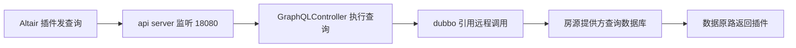

# 用 Altair GraphQL Client 测试 GraphQL 接口：装插件、发查询、看响应

Provider、Controller、Dubbo 链路都已就位，接口却还一次没跑过。GraphQL 的查询语句是一段结构化字符串，手工拼进 URL 再看一堆 JSON 不是不行，而是每次改一个字段都要重拼一遍。这一篇用 Chrome 上的 Altair GraphQL Client 插件把验证变成「写查询、点发送」，顺带看清楚一个 GraphQL 请求在网络上的真实样子。

## 先给结论

- 测试前两个服务都要起：Dubbo 提供方负责房源数据，api server 对外提供 GraphQL 接口，端口 18080。
- 插件从 Chrome 网上应用店搜索 Altair GraphQL Client 安装，点击「添加至 Chrome」即可；应用商店需要科学上网，离线安装包实测装不上。
- 请求方式选 GET，地址填 `http://127.0.0.1:18080/graphql`，查询语句 `{ HouseResources(id:1){...} }` 按 `haoke.graphqls` 里的定义手写，插件没有字段提示。
- 多写一个字段响应就多一段数据，删掉就少一段，按需取数在响应里肉眼可见。
- 打开开发者工具的 Network 面板看本质：请求就是 `GET /graphql?query=<URL 编码后的查询语句>`，这正是 Controller 里 `@RequestParam("query")` 接住的东西。

## 一、测试前的两件事：起服务、装插件

服务端是一条链：查询先打到 api server，取数时再通过 dubbo 调房源提供方。任何一段缺失，测试都会失败，所以先把两个服务都跑起来。



插件安装走 Chrome 网上应用店：进入扩展程序页面搜索 GraphQL，结果里的 Altair GraphQL Client 就是目标，详情页点「添加至 Chrome」完成安装。已经装过的话按钮会变成「从 Chrome 中删除」，状态一目了然。有一点要提前说明：谷歌应用商店的访问需要自行解决网络问题，尝试过离线安装包，装不上，这条路走不通，还是从应用商店装最省事。装完后工具栏出现插件图标，点击即打开主界面。

## 二、构造第一条查询

打开插件，先配置请求的两要素：左上角方法选 GET，地址栏填 `http://127.0.0.1:18080/graphql`。这个地址与 Controller 上的注解一一对应，端口 18080 是 api server 的，别填成提供方的 8080。

中间的查询区写查询语句。字段名要与 SDL 一致，插件此刻没有自动补全，拿不准就回到项目的 `haoke.graphqls` 里对照着写。查 id 为 1 的房源，只要几个核心字段：

```graphql
{
    HouseResources(id: 1) {
        id
        title
        rent
        houseType
        coveredArea
        orientation
    }
}
```

点 Send 发送，右侧出现 JSON 响应（示例数据，实际值取决于库里的房源记录）：

```json
{
    "data": {
        "HouseResources": {
            "id": "1",
            "title": "安贞西里 三室一厅",
            "rent": 4500,
            "houseType": "2室1厅1卫",
            "coveredArea": "72.32",
            "orientation": 3
        }
    }
}
```

响应里只有点名的六个字段，SDL 里声明的其余十几个一概没有出现。这就是 GraphQL 与 RESTful 在使用体感上最大的差别：返回什么由查询语句当场决定，不是服务端预先打包好的。

## 三、按需增减字段与请求的本质

在查询里随手加几个字段再发送，响应立刻跟上新字段；把不想要的删掉再发，响应里对应数据就消失。增删之间不需要服务端改任何代码，Schema 已有的字段都可以自由组合，前端要调什么字段，在这里先试出来。

想看清插件到底发了什么，打开开发者工具的 Network 面板再点一次 Send：

```bash
GET /graphql?query=%7B%20HouseResources(id:1)%7B%20id,title,rent%7D%20%7D HTTP/1.1
Host: 127.0.0.1:18080
```

请求行里 `query=` 后面那串百分号编码，就是查询区里的语句做 URL 转义后的样子。服务端的 `@RequestParam("query")` 拿到的正是解码后的查询字符串，交给 `execute` 执行。工具、浏览器、curl，只是包裹查询语句的不同外壳，服务端看到的永远是一段字符串加一个参数名。用命令行也能做等价测试：

```bash
curl "http://127.0.0.1:18080/graphql?query=%7B%20HouseResources(id:1)%7Bid,title%7D%20%7D"
```

## 四、插件里值得顺手记住的两个功能

查询语句写乱了，比如多缩进、同行堆了几个字段，点一下格式化按钮，语句按标准风格重排，可读性立刻回来。反过来，需要把语句压成一行时也有对应按钮，压完就是 `{ HouseResources(id:1){id,title} }` 这种紧凑形式，与入门篇命令行 demo 里手写的样式一致。日常开发用得上的基本就这两个，其余功能暂时用不着。

## 常见误区

- **只起 api server 不起提供方。** GraphQL 门面活着，dubbo 引用调不到提供方，查询要么超时要么返回错误，容易被误判成查询语句写错。先确认两个服务都在，再排查语句。
- **凭记忆写字段名。** GraphQL 字段区分大小写，SDL 里是 `propertyCost`，查询里写 `propertycost` 会直接进 errors，错误信息还会给出相似字段建议。拿不准就回 `haoke.graphqls` 对照，工具没有补全，SDL 就是唯一的字典。
- **把地址填成提供方端口。** 提供方是 dubbo 服务，不监听 HTTP 的 GraphQL 路径，填 8080 只会得到连接失败或 404。GraphQL 入口在 api server 的 18080。
- **以为是 POST 接口。** 这套实现限定了 `@GetMapping`，插件里选 POST 请求会直接方法不匹配。接口用什么方法，测试端就跟什么方法。

## 面试可能被问到的问题

1. 面试官追问：「测试 GraphQL 接口和测试普通 RESTful 接口，工具上有什么不同？」
   答：RESTful 接口路径加参数就是请求本体，Postman 一类工具足够；GraphQL 的请求体是一段结构化查询语句，用 Altair、GraphiQL 这类专用客户端能自动识别 Schema、按需书写字段并直接看到裁剪后的响应，改字段即改请求，不需要反复手拼报文。

2. 面试官追问：「同一个查询，GET 和 POST 两种发送方式有什么区别？」
   答：GET 把查询语句编码进 URL，简单直观，但受 URL 长度限制，且查询会留在日志里；POST 把查询和变量放进请求体，长度不受限、不易泄漏，也是生产环境的常规选择。服务端按实现而定，本课接口只支持 GET，测试端要与之匹配。

3. 面试官追问：「客户端怎么知道一个 GraphQL 接口支持哪些字段？」
   答：服务端持有 Schema，支持内省查询，客户端工具可以拉取全部类型与字段定义，甚至自动补全。本课的老版本插件没有做补全，所以靠对照 SDL 文件书写；Schema 本身始终是字段合法性的唯一裁判，写错了在 errors 里会得到明确提示。

4. 面试官追问：「响应里 data 和 errors 的关系是什么？」
   答：两者按规范互斥出现在同一响应里：执行成功只有 data；校验失败或字段取数抛错时出现 errors，data 可能整体为 null 或部分字段为 null。测试时先看 errors，GraphQL 的报错信息通常精确到字段，比传统接口的堆栈日志更好定位。

## 配套资料

- 本教学日资料包仅含前台系统库脚本：`materials/code/03/day06-开发GraphQL服务以及前台系统搭建/day06-开发GraphQL服务以及前台系统搭建/资料/myhome.sql`（前台系统数据域，与 GraphQL 接口测试无关，列出仅为说明资料包内容）。
- 本课无配套源码包，测试用查询语句、示例响应与 curl 命令为按本课写法补全的示例；被测接口的实现见同系列成稿 `0092-实现根据id查询房源数据的GraphQL服务.md`，字段清单以其中的 `haoke.graphqls` 为准。
