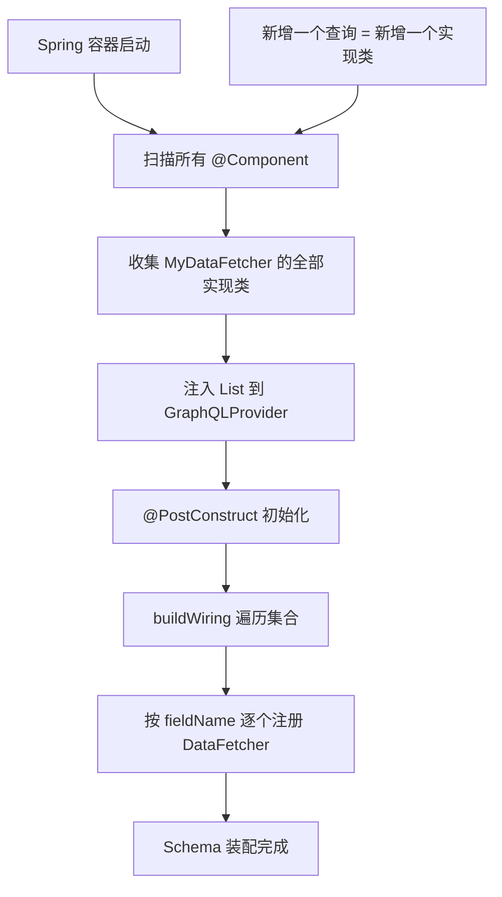

# 重构 GraphQLProvider：把取数逻辑抽成可插拔的 DataFetcher

GraphQL 服务跑通之后回看 `buildWiring`，功能没问题，代码却不耐看：`HouseResources` 的取数逻辑以一段 lambda 内联在装配方法里。眼下只有一个查询还看不出痛，等房源列表、地图找房、轮播广告接连上线，每个查询都要往这个方法里塞一段逻辑，每加一个接口都要改一遍 Provider，装配方法迟早膨胀成谁都不敢动的巨物。这一篇把 Provider 重构一次，让新增查询变成「加一个类」，而不是「改一个方法」。

## 先给结论

- 问题定性：DataFetcher 的取数逻辑内联在 `buildWiring`，新增查询必然修改这个方法，与方法数量线性耦合，违背对扩展开放、对修改关闭的原则。
- 改造核心：自定义 `MyDataFetcher` 接口，两个方法各有分工，`fieldName()` 声明自己对应哪个查询名，`dataFetcher(DataFetchingEnvironment)` 承载取数逻辑。
- 每个查询写一个实现类，打上 `@Component` 交给 Spring；`GraphQLProvider` 注入 `List<MyDataFetcher>`，`buildWiring` 里遍历集合统一注册。
- 重构后 Provider 不再注入任何业务 Service，它只认识 `MyDataFetcher` 接口；业务逻辑随实现类走。
- 以后新增查询的全部动作：写一个实现类。Provider、Controller、SDL 的装配代码零改动。

## 一、问题出在哪：装配方法吞掉了业务逻辑

现状的 `buildWiring` 是这样：

```java
private RuntimeWiring buildWiring() {
    return RuntimeWiring.newRuntimeWiring()
            .type("HaokeQuery", builder ->
                    builder.dataFetcher("HouseResources", environment -> {
                        Long id = environment.getArgument("id");
                        return this.houseResourcesService.queryHouseResourcesById(id);
                    })
            ).build();
}
```

一个字段，六行 lambda，现在看还算清爽。往深处想一步：后面要加 `HouseResourcesList` 查列表、要加轮播 `Swipes` 查广告，每个都是同样结构的一段 lambda，取数器一多，这个方法就成了注册表加业务代码的混合体。更麻烦的是职责搅在一起：Provider 本该只管装配，却被迫认识 `HouseResourcesService`、知道每个查询怎么取参数，业务每变一次它都跟着改。

改造思路三句话就能说完：定义一个接口；所有具体查询逻辑实现这个接口；Provider 只面对接口，遍历注册。之后新增查询只需要新增实现类。

## 二、定义接口：一个名字，一段取数

接口只需要两个方法，各自对应取数器的一半职责：

```java
public interface MyDataFetcher {

    /**
     * 当前实现类对应的 GraphQL 查询名称
     */
    String fieldName();

    /**
     * 具体的取数逻辑，处理查询参数并返回数据
     */
    Object dataFetcher(DataFetchingEnvironment environment);
}
```

`fieldName()` 返回的就是 `buildWiring` 里现在写死的那个 `"HouseResources"`，即查询语句里点名的字段名；`dataFetcher` 的参数类型 `DataFetchingEnvironment` 与 graphql-java 原生取数器的入参一致，`getArgument("id")` 从这里拿查询传进来的参数。接口虽然自定义，形状却与引擎要求的取数器完全对齐。

## 三、实现类：业务逻辑回到它该在的地方

原来内联在 Provider 里的六行，整体搬进一个实现类：

```java
@Component
public class HouseResourcesDataFetcher implements MyDataFetcher {

    @Autowired
    private HouseResourcesService houseResourcesService;

    @Override
    public String fieldName() {
        return "HouseResources";
    }

    @Override
    public Object dataFetcher(DataFetchingEnvironment environment) {
        Long id = environment.getArgument("id");
        return this.houseResourcesService.queryHouseResourcesById(id);
    }
}
```

`@Component` 是这套机制的关键开关：打上它，Spring 扫描时把这个类当作组件注册进容器，后面 Provider 才能以集合形式把所有实现类收齐。取数逻辑与业务 Service 的关联也随实现类走，Provider 从此不必知道 `HouseResourcesService` 的存在。

## 四、Provider 改造：遍历集合，统一注册

Provider 里做两处修改。业务 Service 的注入删掉，换成接口的集合注入：

```java
@Autowired
private List<MyDataFetcher> myDataFetchers;
```

Spring 的集合注入在这里挑了大梁：容器会把所有 `MyDataFetcher` 类型的 bean 收集成一个 List 注进来，实现类有一个收一个，有十个收十个，Provider 一行不用改。`buildWiring` 随之变形：

```java
private RuntimeWiring buildWiring() {
    return RuntimeWiring.newRuntimeWiring()
            .type("HaokeQuery", builder -> {
                this.myDataFetchers.forEach(myDataFetcher -> {
                    builder.dataFetcher(myDataFetcher.fieldName(),
                            environment -> myDataFetcher.dataFetcher(environment));
                });
                return builder;
            }).build();
}
```

这段代码有两个细节容易写错。**其一，外层 lambda 必须返回 builder。** `.type` 的第二个参数期望拿到构建器本身，写成 `builder -> { ... }` 的语句块后，遍历完要把 `builder` 返回回去，漏了这行编译不过。**其二，注册的是一层薄委托。** `builder.dataFetcher` 的第二个参数没有直接传 `myDataFetcher`，而是又包了一层 lambda，把引擎传来的 `environment` 转交给 `myDataFetcher.dataFetcher(environment)`。这一层薄皮让自定义接口与 graphql-java 的 `DataFetcher` 函数式接口解耦，将来引擎接口变化，改的也只是这一层。

改造前后的结构对比如下：



图里最值得看的是 I 指向 B 这条回路：新增查询的入口变成了「写一个实现类」，剩下的扫描、收集、注册全部自动发生。改造前这条线是从 I 直接插进 `buildWiring` 方法体的，那是每次都要动手术的位置。

## 五、Debug 验证：集合真的注进来了吗

接口改造涉及容器行为，光看代码不放心，打断点实测。在 `buildWiring` 的遍历处下断点，以 debug 方式启动 api server：命中后观察 `myDataFetchers`，它是一个 `ArrayList`，当前里面正好一个元素 `HouseResourcesDataFetcher`，集合注入生效。往后每多一个实现类，这个列表就多一个元素。

把断点移到实现类的 `dataFetcher` 方法里，从插件再发一次查询：断点进入，`environment.getArgument("id")` 取到的正是 `1`，`houseResourcesService` 注入正常，往下走一步查询完成，响应与改造前完全一致。随手换几个字段、把 id 换成 8 再查，数据照常返回。功能等价，结构已经换血，这套「接口加实现类」的写法就是后面不断叠加查询接口的地基。

再补一句延伸：`DataFetcher` 里抛出的异常会被 graphql-java 收进响应的 `errors` 而不是打挂请求，这给统一异常处理留了天然切入口，把异常翻译成业务错误信息的改造可以在每个实现类或公共层做，属于这条链路后续自然的进化方向。

## 常见误区

- **实现类忘打 `@Component`。** 类存在但没进容器，集合里没有它，对应查询字段没人取数，症状是 data 里该字段为 null 且无报错。新增实现类后查询不生效，先查注解。
- **遍历后忘记 `return builder`。** 外层 lambda 的返回值必须是构建器，语句块写完直接收尾，编译期就报不兼容。对照课程画面里那句「别忘了 return build」。
- **`fieldName()` 与 SDL 字段名不一致。** 注册挂在写错的名字上，SDL 里真正的字段依旧没有取数器，查询永远 null。字段名是 SDL、实现类、查询语句三方对齐的锚点，改名要三处同步。
- **以为 Provider 还需要业务 Service。** 重构后 Provider 里残留的 `houseResourcesService` 注入是死代码，删掉。Provider 只依赖 `MyDataFetcher`，业务依赖全部下沉到实现类。

## 面试可能被问到的问题

1. 面试官追问：「这次重构用的是什么设计思想？」
   答：策略模式加注册表。每个查询的取数逻辑是一个策略，`MyDataFetcher` 是策略接口，Spring 容器充当注册表，Provider 遍历集合完成装配。新增策略不需要改动装配逻辑，符合对扩展开放、对修改关闭的原则。

2. 面试官追问：「Spring 是怎么把接口的所有实现类注进一个 List 的？」
   答：@Autowired 按类型解析依赖时，目标类型是集合会触发多实例解析，容器遍历所有 bean 定义，找出类型兼容 `MyDataFetcher` 的全部 bean，按依赖排序后装进 List 注入。空集合与多个实现都能处理，这正是组件扫描配合集合注入的常用扩展手法。

3. 面试官追问：「为什么不直接让实现类实现 graphql-java 的 DataFetcher 接口？」
   答：直接实现也能跑，但引擎的函数式接口只约定了 get(environment)，表达不了「我对应哪个查询字段」这层语义，字段名还是要在外部写死。自定义接口用 fieldName() 把字段名和取数逻辑绑在同一个类里声明，注册时完全自描述，同时让业务代码不直接依赖引擎类型。

4. 面试官追问：「注册时外面又包了一层 lambda，这层委托有必要吗？」
   答：有必要。builder.dataFetcher 接受的是引擎的 DataFetcher 类型，而集合里存的是自定义接口类型，一层 lambda 做类型适配，把 environment 转交进去。这层适配同时隔离了引擎 API 的变化，将来取数器签名升级，只需调整这一处委托。

5. 面试官追问：「这种自动化注册有什么代价？」
   答：隐式性换来了扩展性。注册关系不再集中可见，排查某个字段取了什么数要顺着接口找实现类；实现类增多后容器启动多扫描若干 bean，字段名冲突也只能在运行期暴露。规范命名加约定的包结构可以缓解，属于结构化换来的正常成本。

## 配套资料

- 本教学日资料包仅含前台系统库脚本：`materials/code/03/day06-开发GraphQL服务以及前台系统搭建/day06-开发GraphQL服务以及前台系统搭建/资料/myhome.sql`（前台系统数据域，与 Provider 重构无关，列出仅为说明资料包内容）。
- 本课无配套源码包，`MyDataFetcher` 接口、实现类与改造后的 Provider 为按本课画面写法补全的可运行示例，包名沿用同系列成稿的中性命名；改造前的 Provider 全貌见同系列成稿 `0092-实现根据id查询房源数据的GraphQL服务.md`。
