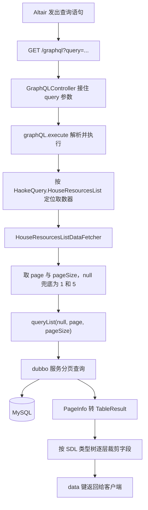

# 房源列表查询的 GraphQL 化：分页参数、TableResult 类型树与默认值兜底

按 id 查单条房源的 GraphQL 接口已经跑通，下一个需求马上就来：列表页要分页查询。照 RESTful 的惯性思维，第一反应是加个 `GET /house/resources?page=1`，但 GraphQL 门面已经立起来了，列表自然也该走同一扇门。问题跟着出现：分页参数在 SDL 里怎么声明？返回的「数据列表加分页信息」这种嵌套结构怎么表达？前端一个参数都不传时接口还该不该干活？这一篇把房源列表查询补齐，顺手把这三个问题全部解决。

## 先给结论

- SDL 的 `HaokeQuery` 上加一个 `HouseResourcesList(page: Int, pageSize: Int): TableResult` 字段，分页参数直接写在字段声明里，参数是可缺省的，不传就是 null。
- 返回类型用两张新表表达：`TableResult` 包 `list` 与 `pagination`，`Pagination` 包 `current`、`pageSize`、`total`，结构与 RESTful 门面里的 `TableResult`、`Pagination` 两个 VO 完全同构，直接复用。
- 新增一个 `HouseResourcesListDataFetcher` 实现 `MyDataFetcher`，`fieldName()` 返回 `HouseResourcesList`，Provider 那边一行都不用改。
- 取数器从 `DataFetchingEnvironment` 拿 `page` 与 `pageSize`，拿到 null 就兜底成 1 和 5，保证不传参数也能查。
- 查询语句的层级必须与 SDL 定义的类型树严格一致，`list` 下面嵌哪些字段、`pagination` 要不要带上，都在查询语句里点名。

## 一、在 SDL 里声明列表查询：把 Java 嵌套结构翻译成类型树

`haoke.graphqls` 是整个 GraphQL 服务的契约文件，加列表查询从这里开始。`HaokeQuery` 上追加一行，原来的单条查询原样保留：

```graphql
schema {
  query: HaokeQuery
}

type HaokeQuery {
  HouseResources(id:Long): HouseResources
  HouseResourcesList(page:Int, pageSize:Int): TableResult
}
```

`page` 与 `pageSize` 都是 `Int`，后面没有加叹号，意味着这两个参数可传可不传，不传时取数器拿到的就是 null，这一点决定了后面必须有默认值兜底。

真正的难点在返回类型。RESTful 门面里列表接口返回 `TableResult<HouseResources>`，对象里套着对象和集合；SDL 是纯类型系统，得把这个嵌套结构一层层摊开。于是契约文件里多出两个类型：

```graphql
type TableResult{
  list:[HouseResources]
  pagination:Pagination
}

type Pagination{
  current:Int
  pageSize:Int
  total:Int
}
```

翻译一下这两段声明：`TableResult` 有两个字段，`list` 是 `HouseResources` 的列表，方括号就是集合的意思；`pagination` 又是一个独立对象，所以要再定义一层。`Pagination` 的三个属性 `current`、`pageSize`、`total` 与 `com.haoke.manage.dubbo.api.vo` 包里的 `Pagination` 类一一对应，`total` 装总条数，前端拿它自己算总页数。

这里有个必须强调的规矩：**SDL 的类型树必须和 Java 返回对象的结构保持一致。** graphql-java 拿到 DataFetcher 返回的对象后，按字段名逐层取值，SDL 里声明了 `list`，返回对象上就得有 `getList()`；声明了 `pagination`，就得有 `getPagination()`。对不上名的字段不报错，直接给你 null，联调时出现「结构有了但永远是空」，先对的就是这套契约。

顺带一个屏幕细节：讲义截图里 `total` 写成了小写的 `int`。GraphQL 的标量类型是区分大小写的，内置标量只有 `Int`，照抄小写会在解析 SDL 时报「未知类型」的错误，代码里已按规范写成 `Int`。

## 二、实现取数器：默认值兜底是关键

Provider 经过 0094 篇的重构已经是「新增查询只写一个实现类」的形态，列表查询照方抓药。新建 `HouseResourcesListDataFetcher`：

```java
@Component
public class HouseResourcesListDataFetcher implements MyDataFetcher {

    @Autowired
    private HouseResourcesService houseResourcesService;

    @Override
    public String fieldName() {
        return "HouseResourcesList";
    }

    @Override
    public Object dataFetcher(DataFetchingEnvironment environment) {
        Integer page = environment.getArgument("page");
        if (page == null) {
            page = 1;
        }
        Integer pageSize = environment.getArgument("pageSize");
        if (pageSize == null) {
            pageSize = 5;
        }
        return this.houseResourcesService.queryList(null, page, pageSize);
    }
}
```

逐段拆开看：

**第一，`fieldName()` 是注册锚点。** 它返回的字符串必须与 SDL 里 `HaokeQuery` 下的字段名 `HouseResourcesList` 逐字符一致，Provider 的 `buildWiring` 遍历所有 `MyDataFetcher` 实现类时，就按这个名字把取数器挂到对应字段上。名字对不上，查询这个字段时没有取数器应答，结果永远是 null。

**第二，null 兜底不能省。** SDL 里两个参数都没加叹号，客户端不传时 `getArgument` 返回 null。如果不做处理，把 null 一路传给 dubbo 的分页方法，Mybatis Plus 的分页插件面对 null 页码的行为就不受控了。所以拿到 null 立即赋默认值：第一页、每页 5 条。这与 RESTful 门面里 `@RequestParam` 的 `defaultValue` 是同一个思路，只是 GraphQL 里没有现成注解，得自己手写判断。

**第三，查询条件传 null。** `queryList` 的第一个参数是 `HouseResources` 类型的查询条件对象，这里显式传 null，表示这一版只做分页不做过滤，条件对象一路透传到 dubbo 层也不会拼进查询。等前端要按标题、租金筛选时，往 SDL 字段里加参数、往这里取值就行，接口骨架不用动。

`queryList` 本身是 0076 篇写好的本地业务方法：内部调 dubbo 的 `queryHouseResourcesList` 拿 `PageInfo`，再转成 `TableResult` 返回。取数器拿到的直接就是这个现成结构，与 SDL 的 `TableResult` 同名同构，graphql-java 自动完成字段映射，列表查询的后端逻辑到这里就全部就位，一行现有代码都不用改。

## 三、测试：查询语句与类型树逐层对齐

重启 api 服务，在 Altair 客户端里发查询。列表查询的语句是嵌套的，写法跟着 SDL 的类型树走：

```graphql
{
  HouseResourcesList {
    list {
      id
      title
      estateId
      buildingUnit
      buildingFloorNum
      mobile
      useArea
      pic
    }
    pagination {
      current
      pageSize
    }
  }
}
```

注意查询语句里没有写 `page` 和 `pageSize`，故意先测不传参数的场景。响应（数据为示例）：

```json
{
  "data": {
    "HouseResourcesList": {
      "list": [
        { "id": 9, "title": "整租 安贞西里 三室一厅", "rent": 4500 },
        { "id": 8, "title": "整租 安贞西里 两室一厅", "rent": 4200 }
      ],
      "pagination": { "current": 1, "pageSize": 5, "total": 9 }
    }
  }
}
```

默认值生效，返回 5 条数据，`total` 是 9。接着把参数显式带上做两组验证：

```graphql
{
  HouseResourcesList(page: 1, pageSize: 1) {
    list { id title }
    pagination { current pageSize total }
  }
}
```

`pageSize: 1` 时列表只剩 1 条；把 `page` 改成 2，返回的是第二页的那 1 条，数据不重不漏。分页参数、默认值、翻页三件事全部验证通过。

整条请求链画出来：



图里最关键的一段是 E 到 G：字段定位靠 `fieldName()` 与 SDL 对齐，参数兜底靠取数器里的两次 null 判断，这两处是列表查询与单条查询仅有的结构差异，其余链路完全复用。

## 常见误区

- **照抄讲义里的小写 `int`。** SDL 内置标量是 `Int`，区分大小写，`total:int` 会让 `SchemaParser` 直接抛出解析异常，服务起不来。类型名一律按规范写。
- **漏掉 null 兜底直接透传。** 参数没传时 `getArgument` 返回 null，不做判断就传给分页方法，轻则查询行为不可控，重则 dubbo 层抛空指针。可缺省参数必须配默认值。
- **查询语句层级与 SDL 不一致。** 想要分页信息却在顶层直接写 `pagination`，或者 `list` 后面忘了继续嵌字段，语句结构对不上类型树，查询解析阶段就报错。写查询前先回看 SDL 定义，一层一层往下写。
- **以为要重新造一套分页 VO。** RESTful 门面里已经有 `TableResult` 和 `Pagination`，字段名与 SDL 完全同构，取数器直接返回即可。另造一套 `GraphQLPageResult` 之类只会多一层转换，没有任何收益。

## 面试可能被问到的问题

1. 面试官追问：「GraphQL 里怎么表达分页？和 RESTful 的分页参数有什么区别？」
   答：GraphQL 把分页参数声明在字段签名上，`HouseResourcesList(page: Int, pageSize: Int)`，调用方在查询语句里传值；RESTful 是把参数拼在 URL 的 query string 上。参数是否必填由 SDL 的非空叹号决定，不加叹号就是可缺省，服务端要自己做 null 兜底，这点与 RESTful 框架的 defaultValue 机制不同。

2. 面试官追问：「返回对象里有集合和嵌套对象，SDL 怎么声明？」
   答：集合用方括号表达，`list:[HouseResources]`；嵌套对象继续定义独立类型，`pagination:Pagination`。声明的前提是与 Java 返回对象的结构同构，graphql-java 按字段名逐层做属性映射，名字对不上该字段静默为 null 而不报错。

3. 面试官追问：「客户端不传参数时 GraphQL 取数器拿到什么，怎么处理？」
   答：拿到 null。规范做法是在取数器里判空并赋业务默认值，比如页码兜底 1、页大小兜底 5。也可以在 SDL 里给参数写默认值，由引擎在解析阶段填充，但业务默认值放在取数器里更直观，调试时看得见。

4. 面试官追问：「新增这个列表查询，改动面有多大？」
   答：三处：SDL 加字段与两个返回类型；新增一个 `MyDataFetcher` 实现类并打上 `@Component`；查询语句由客户端新写。Provider、Controller、业务 Service 全部零改动，这正是 0094 篇把 DataFetcher 抽成接口加实现类后换来的扩展性。

5. 面试官追问：「同一个房源数据既供 RESTful 又供 GraphQL，服务层怎么组织？」
   答：业务能力收在 `HouseResourcesService` 一层，RESTful Controller 和 GraphQL 取数器都调它，dubbo 细节被封在这层之下。两个门面各自面对自己的契约：RESTful 面向 URL 参数绑定，GraphQL 面向 SDL 类型树，互不渗透，业务重构时只动一处。

## 配套资料

- 本教学日资料包仅含前台系统库脚本：`materials/code/03/day06-开发GraphQL服务以及前台系统搭建/day06-开发GraphQL服务以及前台系统搭建/资料/myhome.sql`（前台系统数据域，GraphQL 列表查询走的是后端房源库，两者不混）。
- 本课无后端源码包，SDL 追加段与 `HouseResourcesListDataFetcher` 为按本课画面写法补全的可运行示例，包名沿用同系列成稿的中性命名。
- 列表分页链路的 RESTful 版本见同系列成稿 `0076-实现房源列表的RESTful接口的开发.md`（`TableResult`、`Pagination` 两个 VO 与 `queryList` 的出处），取数器接口的由来见 `0094-优化改进GraphQLProvider实现逻辑.md`。
