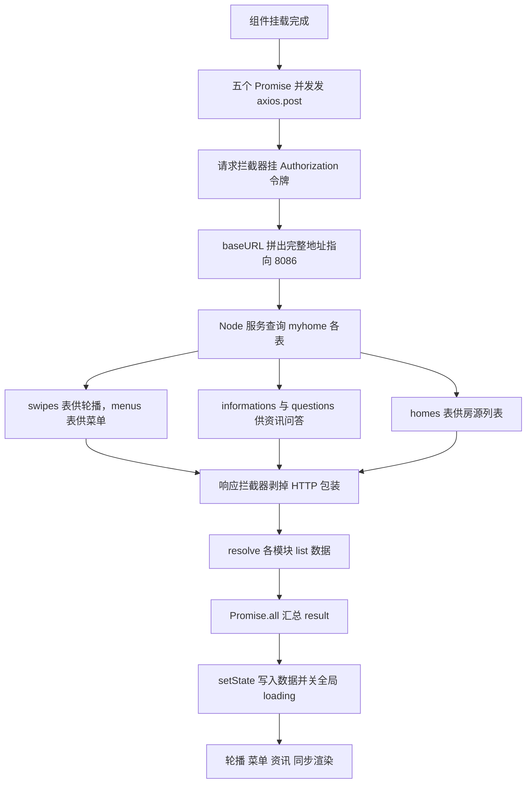

# 读懂前台 React 工程：模块划分、入口渲染链与首页数据加载流程

工程能跑起来只算看热闹。前后端整合开发的要求是摸清两件事：前端代码怎么组织的，页面数据是怎么请求回来的。这两件事弄明白，后端的工作清单会自动浮出水面：前端发什么请求、打向哪个地址、期望什么响应结构，照单提供数据，整合就完成了。这一篇以前台工程的目录结构为纲，以首页的数据加载为样本，把整条数据流拆开看透。

## 先给结论

- 源码全部在 `src` 下，`modules` 目录按业务分模块：`chat` 微聊、`find` 资讯头条问答、`home` 首页、`mine` 个人中心，首页目录里还挂着地图找房。
- 渲染链是标准 React 三段式：`index.html` 的 `root` 容器、`index.js` 的 `ReactDOM.render`、`App.js` 汇总业务组件，路由切换决定展示哪个模块。
- 首页五块数据（轮播、菜单、资讯、问答、房源）各用一个 Promise 包装 axios 请求，`Promise.all` 汇总后一次性 `setState`，同时关掉全局 loading。
- 全局配置收在两处：`common.js` 定义 `apiBaseUrl` 等三个服务地址，`App.js` 给 axios 配置统一 baseURL 与请求、响应两个拦截器。
- 请求最终打向 Node 服务的 8086 端口；后端整合的目标就是替换这个服务，按前端已经约定好的地址与响应结构出数据。

## 一、src 目录：按业务切的模块地图

打开工程，这是一个标准 React 项目的结构，源码集中在 `src` 下，其中业务代码几乎都在 `modules` 目录里，按功能切成五个模块：

| 模块目录 | 对应功能 |
|---|---|
| `modules/chat` | 微聊，即页面上与房东即时聊天的功能 |
| `modules/find` | 资讯、头条、问答三个标签页组成的发现页 |
| `modules/home` | 首页主体，目录下还有地图找房，已集成百度地图相关 API |
| `modules/mine` | 个人中心，用户资料相关内容 |
| `assets` | 静态资源，目前存放的是字体文件 |

这张地图和页面上看到的功能一一对应：首页、资讯、问答、微聊、我的中心都能在目录里找到归属，地图找房因为挂在首页菜单下，随 `home` 模块走。看懂这张表的价值在于，后面接手任何一块功能开发，先能定位到该改哪个目录。

## 二、从 index.html 到业务组件：一条渲染链

页面是渲染出来的，链路只有三层。最外层是 `public` 下的 `index.html`，里面只有一个关键的空容器：

```html
<div id="root"></div>
```

接着是工程入口 `index.js`，它把 `App` 组件挂到这个容器上：

```javascript
import React from 'react';
import ReactDOM from 'react-dom';
import App from './App';

ReactDOM.render(<App />, document.getElementById('root'));
```

`App.js` 是整个应用的骨架，引入 `modules` 下的 main 等组件作为主体入口，同时引入 login、house（房源列表）等业务组件，配合路由做切换：切到 home 展示首页，切到列表页就展示房源列表。`index.html` 放容器、`index.js` 负责挂载、`App.js` 组织组件树，任何 React 脚手架工程都是这个套路，认清一次以后看同类项目不再陌生。

## 三、首页数据加载：Promise 包装加 Promise.all 汇总

进入正题。首页 `home.js` 里有五块数据要请求：轮播广告、菜单、资讯、问答、房源列表。组件的构造方法里先把状态初始化好，各数据是空数组，各模块 loading 与全局 loading 标志为初始值；组件挂载完成后开始加载数据。写法很有代表性，每个数据块包一个 Promise：

```javascript
let swipe = new Promise((resolve, reject) => {
    axios.post('/homes/swipe').then((data) => {
        resolve(data.data.list);
    });
});
let menu = new Promise((resolve, reject) => {
    axios.post('/homes/menu').then((data) => {
        resolve(data.data.list);
    });
});
// info、faq、house 同构，分别请求 /homes/info、/homes/faq、房源列表接口
```

每个 Promise 内部干的事一样：用 axios 发一个 POST 请求，成功后从响应里取出 `data.data.list`，调用 `resolve` 把它交给外层。代码里的 `data` 之所以还要再点一次 `data`，是因为 axios 的响应拦截器已经把 HTTP 层剥过一次（后面会看到），这里的 `data` 是业务响应体，而 Node 服务的响应体外层还包着一个 `data` 字段，`list` 藏在它里面。响应分层这件事，读完拦截器配置就完全通透了。

五个 Promise 一起交给 `Promise.all` 汇总：

```javascript
Promise.all([swipe, menu, info, faq, house]).then((result) => {
    this.setState({
        swipeData: result[0],
        menuData: result[1],
        infoData: result[2],
        faqData: result[3],
        houseData: result[4],
        menuLoading: true,
        swipeLoading: true,
        infoLoading: true,
        faqLoading: true,
        houseLoading: true,
        globalLoading: false
    });
});
```

`Promise.all` 的语义是「全到齐了再走」：五个请求并发发出，全部成功后把结果按顺序装进 `result` 数组，一个回调里统一 `setState`。`result` 的顺序与传入 Promise 的顺序严格一致，`result[0]` 就是轮播数据。这次 `setState` 一举做了三类事：写入五块数据、把各模块 loading 置为已加载、关闭全局 loading。React 的数据驱动渲染随即接管：状态一变，`render` 重跑，页面成型。

渲染环节每块数据各找各的组件。轮播交给 `ImageGallery`：

```javascript
swipe = <ImageGallery
    preventDefaultTouchmoveEvent={true}
    autoPlay={true}
    disableSwipe={false}
    showThumbnails={false}
    items={swipeData}
/>
```

菜单用语义化 UI 的栅格组件，把 `menuData` 做 `map` 遍历，每个菜单项生成一个图标加文字的小块：

```javascript
<Grid padded divided>
  <Grid.Row columns={4}>
    {list}
  </Grid.Row>
</Grid>
```

资讯列表是纯函数式的写法，`map` 的回调直接返回 JSX：

```javascript
infos = this.state.infoData.map(item => {
    return (
        <Item.Header key={item.id}>
            <span>限购</span>
            <span>{item.info_title}</span>
        </Item.Header>
    );
});
```

数据在状态里，界面是状态的投影，这套代码把 React 的核心理念演示得相当完整。

## 四、全局请求配置：baseURL 与两个拦截器

上面的请求写的都是 `/homes/swipe` 这种相对路径，真正的主机地址在哪配置？打开浏览器开发者工具的 Network 面板能看到，请求打向 `127.0.0.1:8086`，正是上一篇启动的 Node 服务。地址前缀来自全局配置。`common.js` 集中定义了三个服务地址：

```javascript
export default {
    imgBaseUrl: 'http://127.0.0.1:8086/',
    apiBaseUrl: 'http://127.0.0.1:8086/',
    wsBaseUrl: 'ws://127.0.0.1:8087'
};
```

`apiBaseUrl` 是接口前缀，`imgBaseUrl` 是图片资源前缀，`wsBaseUrl` 是 WebSocket 地址，预留给微聊的即时通讯，后续课程会用到（本地联调时把课程画面里的服务器地址换成自己的环境即可）。`App.js` 在应用启动时对 axios 做一次性全局配置：

```javascript
import config from './common.js';
axios.defaults.baseURL = config.apiBaseUrl;
axios.interceptors.request.use(function (config) {
    if (!config.url.endsWith('/login')) {
        config.headers.Authorization = localStorage.getItem('mytoken');
    }
    return config;
}, function (error) {
    return Promise.reject(error);
});
axios.interceptors.response.use(function (response) {
    return response.data;
}, function (error) {
    return Promise.reject(error);
});
```

三个配置各司其职：

**第一，baseURL 统一前缀。** `axios.defaults.baseURL` 设好后，业务代码里只写相对路径，`/homes/swipe` 请求时自动拼成 `http://127.0.0.1:8086/homes/swipe`。地址变化只改 `common.js` 一处，业务代码零感知。

**第二，请求拦截器统一带令牌。** 每个请求发出前先过一遍这里：URL 不以 `/login` 结尾的，一律从 localStorage 取 `mytoken` 塞进请求头 `Authorization`。登录请求本身当然不能带，所以有这个结尾判断。上一篇登录成功后存下来的令牌，就是在每次请求的这条路上被用起来的。

**第三，响应拦截器剥一层皮。** 所有响应先经过它，`return response.data` 把 axios 包装的 HTTP 响应剥掉，业务代码拿到的直接是响应体。回头看第三节的 `data.data.list`：外层 `data` 是拦截器吐出来的响应体，内层 `data` 是 Node 服务自定义的包结构，两层各有其主。

## 五、数据流全景：一条链看懂，一份清单照着做

把前四节的内容接成一条完整链路：



关键路径有两处：C 到 D 是全局配置的收口，令牌与地址前缀都在请求离开浏览器前补齐；E 到 F 那一步暴露了后端整合的完整清单。对照上一篇建的 `myhome` 库，前端要的每个接口都对应一张表：`/homes/swipe` 对应 `swipes`、`/homes/menu` 对应 `menus`、`/homes/info` 对应 `informations`、`/homes/faq` 对应 `questions` 与 `answers`，房源列表对应 `homes`。后端要做的，就是用真正的服务按这些地址和响应结构提供数据，替换掉这台 demo 性质的 Node 服务，整合即告完成。

## 常见误区

- **以为五块数据互不相干。** 它们被 `Promise.all` 绑成一个整体，任何一个请求失败，整体 `then` 不执行，五块数据一起不渲染，页面卡在加载态。demo 服务一切正常掩盖了这个风险，接真实后端时要考虑逐个 `catch` 或改用逐项兜底的聚合方式。
- **`setState` 里漏关 loading。** 数据写进去了但 `globalLoading` 忘了置 false，页面永远转圈，新手常以为是请求没通。排查时先看数据状态、再看 loading 标志。
- **相对路径请求 404 就去改接口代码。** baseURL 没配置或写错时，请求会打到前端自己所在的 9000 端口，dev server 上当然没有 `/homes` 路由。先在 Network 面板确认请求的完整地址，再决定动哪一层。
- **改地址只改 `apiBaseUrl`。** 接口通了但图片全裂开，因为图片走的是 `imgBaseUrl`。两个前缀是独立的常量，服务地址迁移时必须成对修改。

## 面试可能被问到的问题

1. 面试官追问：「Promise.all 的结果顺序有保证吗？」
   答：有。结果数组与传入的 Promise 顺序严格对应，与哪个请求先完成无关。代码里 `result[0]` 一定是轮播、`result[1]` 一定是菜单，前提是调用方自己记住顺序约定；更稳妥的写法是给每个 Promise 附带名字或用对象聚合，避免顺序耦合。

2. 面试官追问：「Promise.all 里一个请求失败了会怎样？」
   答：整体立即以第一个失败的原因 reject，已经成功的请求结果不会交付给 then。首页这种聚合场景里意味着一个接口挂掉全部模块不渲染，生产代码需要给每个请求单独 catch 返回兜底值，或改用 allSettled 这类无论成败都汇总结果的聚合方式。

3. 面试官追问：「axios 拦截器适合做哪些事？」
   答：请求拦截器适合统一注入鉴权头、追加公共参数、埋点计时；响应拦截器适合统一剥响应包装、按状态码做登录失效跳转、把错误翻译成统一提示。本质是把与具体业务无关的横切逻辑从每个调用点抽出来，一处配置全局生效。

4. 面试官追问：「请求头里的 Authorization 为什么在登录接口上要特殊处理？」
   答：登录请求发生时尚未持有令牌，localStorage 里取到的是空值，带上空鉴权头不仅无意义，还可能干扰服务端对登录接口的判断，甚至触发放行策略之外的校验分支。按 URL 白名单跳过登录接口，是拦截器里典型的例外处理。

5. 面试官追问：「为什么说状态一变页面就变，中间发生了什么？」
   答：setState 触发 React 对组件的重新渲染，render 函数基于最新状态生成新的虚拟 DOM，与上次结果做差异比较，只把变化的部分更新到真实 DOM。业务代码从不直接操作页面元素，只维护状态，这正是数据驱动渲染与手动操作 DOM 的本质区别。

6. 面试官追问：「后端接手这种现成前端，第一步做什么？」
   答：抓请求而不是读代码。用 Network 面板把前端发出的每个请求记录下来：地址、方法、参数、响应结构，形成接口清单；再用数据库脚本对照清单确认每个接口背后的数据来源。前端契约已经跑在现成的 demo 服务上，照单实现即可完成整合。

## 配套资料

- 首页各接口的数据源对照（本课核心资料）：`materials/code/03/day06-开发GraphQL服务以及前台系统搭建/day06-开发GraphQL服务以及前台系统搭建/资料/myhome.sql`（`swipes`、`menus`、`informations`、`questions`、`answers`、`homes` 等表即前端各模块请求的真实数据来源）。
- 前端工程包未随当前资料目录提供，`home.js`、`common.js`、`App.js` 的代码段为按本课画面抄录并按 JavaScript 语法整理的可运行版本，个别被画面截断的请求（房源列表接口）为按同构写法补全。
