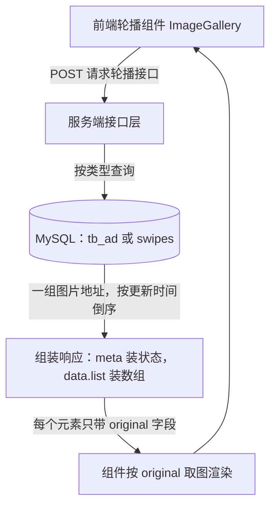

# 首页轮播广告的数据结构与表设计：先拆请求，再定表

首页最上方那块自动轮播的广告图，看起来是纯展示型的功能，做起来却要先回答两个问题：前端到底吃什么数据？服务端的表该怎么建？跳过这两步直接写接口，多半会在联调时返工，因为轮播组件对响应结构的字段名有硬性要求，而表结构一旦按「只有首页要用」的思路建窄了，后面每个页面都得再建一张表。

这一课把一次真实的轮播请求从 Network 面板里拆出来，看前端期望的响应长什么样，再从「广告」这个更准确的定位出发，给出两张不同取舍的建表方案，其中资料包里的真实建库脚本是讲解的重点。

## 先给结论

- 轮播组件真正需要的只是一组图片地址：响应的 `data` 数组里每个元素只带一个 `original` 字段，这个字段名来自前端轮播组件的属性约定，服务端照这个名字给数据就能直接渲染。
- 响应外层是 `data` 与 `meta` 两层包装：`meta` 装状态码与消息，`data` 装业务数据，这是全站统一的响应规范，不是轮播接口独有的。
- 广告表的定位是全站广告，不是首页轮播专用：讲义方案用 `type` 字段区分广告位，首页轮播只是其中一种取值。
- 资料包的真实建库脚本 `myhome.sql` 给的是另一套精简方案 `swipes` 表：`original_path` 原图、`thumbnail_path` 缩略图、`status` 状态，正好对应轮播组件的 `original` 与 `thumbnail` 两个属性。
- 图片地址存相对路径还是完整外链，两种方案各有取舍，域名迁移的成本是主要分水岭。

## 一、先看请求：前端到底要什么

打开浏览器开发者工具的 Network 面板，切到首页，能看到轮播块发出的请求打向演示环境的 8086 端口，路径是 `/homes/slide`，响应头里有两条信息值得留意：`Content-Type` 是 `application/json`，`Access-Control-Allow-Origin` 指向 9000 端口的前端地址。后者说明这是一次跨域请求，跨域怎么处理放到后面专门讲，这里先记住现象。

响应体才是关键，它的结构是这样的：

```json
{
  "data": {
    "list": [
      { "original": "http://127.0.0.1:8086/public/1.png" },
      { "original": "http://127.0.0.1:8086/public/2.png" },
      { "original": "http://127.0.0.1:8086/public/3.png" },
      { "original": "http://127.0.0.1:8086/public/4.png" }
    ]
  },
  "meta": { "status": 200, "msg": "请求成功" }
}
```

对着这个结构拆两层：

**第一，外层的 `meta` 与 `data` 是统一响应规范。** `meta` 里放状态码和消息，`data` 里放业务数据，所有接口都套这一个壳。前端在响应拦截器里统一处理状态码，业务代码只关心 `data` 里的内容。

**第二，`original` 这个字段名不是后端起的。** 前端渲染轮播用的是 `ImageGallery` 组件，它的数据项约定就是 `original` 属性放原图地址、`thumbnail` 属性放缩略图地址。首页代码里 `showThumbnails` 设置为 `false`，所以缩略图暂时没用上，但字段约定是组件定的，后端返回什么名字，组件就认什么名字。看懂这一点，服务端要做什么就清楚了：按顺序返回一组图片地址，字段名叫 `original`，仅此而已。

前端源码里这块数据请求的路径写作 `/homes/swipe`，演示环境的抓包里是 `/homes/slide`，两种命名指的是同一块数据。联调时以两端实际暴露与调用的地址为准对齐即可，不必纠结名字本身。

## 二、表怎么建：从首页轮播推到全站广告

服务端要返回图片地址，地址存在哪？建表之前先想清楚定位。

**第一，这张表服务的是全站广告，不只是首页轮播。** 首页顶部的轮播是广告的一种展示位置，资讯页的横幅、列表页的弹窗，将来都是广告。如果按「首页轮播」建一张专用表，每多一个广告位就要多一张表；反过来按「广告」建模，用类型字段区分位置，一张表全站通用。

**第二，字段围绕「展示一个广告需要什么」来定。** 课程讲义的方案是一张 `tb_ad` 广告表，建表语句如下（整理自课程画面，资料包未含此脚本）：

```sql
CREATE TABLE `tb_ad` (
  `id` bigint(20) NOT NULL AUTO_INCREMENT,
  `type` int(10) DEFAULT NULL COMMENT '广告类型',
  `title` varchar(100) DEFAULT NULL COMMENT '描述',
  `url` varchar(200) DEFAULT NULL COMMENT '图片url地址',
  `created` datetime DEFAULT NULL,
  `updated` datetime DEFAULT NULL,
  PRIMARY KEY (`id`)
) ENGINE=InnoDB DEFAULT CHARSET=utf8 COMMENT='广告表';
```

逐个字段看设计意图：`type` 区分广告类型，首页轮播取值 1，其他页面各占一个值；`title` 是广告的描述文案，有的广告位除了图还要显示文本；`url` 是图片地址，轮播场景里这是唯一真正参与渲染的字段；`created` 与 `updated` 是审计字段，记录创建与最近更新时间，配合按更新时间倒序的查询，保证最新上传的广告先展示。讲义给这张表预置了 4 条初始数据，图片是已经传到阿里云 OSS 的真实可访问地址。

## 三、资料包里的真实脚本：swipes 表

课程资料包里这天的建库脚本是 `myhome.sql`，它服务的是前台系统的演示库，里面同样有一张轮播表，但走的是另一条更精简的思路。真实 DDL 原样如下：

```sql
CREATE TABLE `swipes` (
  `id` int(11) NOT NULL AUTO_INCREMENT,
  `original_path` varchar(255) COLLATE utf8_bin DEFAULT NULL,
  `thumbnail_path` varchar(255) COLLATE utf8_bin DEFAULT NULL,
  `status` tinyint(2) DEFAULT NULL,
  PRIMARY KEY (`id`)
) ENGINE=InnoDB AUTO_INCREMENT=4 DEFAULT CHARSET=utf8 COLLATE=utf8_bin;
```

初始数据只有 3 条，地址全部是相对路径：

```sql
INSERT INTO `swipes` VALUES ('1', 'public/1.png', 'pic-thumb1.png', null);
INSERT INTO `swipes` VALUES ('2', 'public/2.png', 'pic-thumb2.png', null);
INSERT INTO `swipes` VALUES ('3', 'public/3.png', 'pic-thumb3.png', null);
```

这张表的设计逻辑与前端组件严丝合缝：`original_path` 对应轮播组件的 `original` 原图属性，`thumbnail_path` 对应 `thumbnail` 缩略图属性，`status` 预留上下架开关，下架的广告查询时直接过滤。表名 `swipes` 就是前端请求路径里那个 `swipe`，同库的 `menus` 表按同样的命名思路供给导航菜单接口，一表对一接口，demo 服务的映射关系一目了然。

把两张表摆在一起对比：

| 维度 | 讲义方案 `tb_ad` | 资料包真实脚本 `swipes` |
|---|---|---|
| 定位 | 全站广告位，轮播只是 `type` 的一种 | 首页轮播专用 |
| 字段 | `type`、`title`、`url`、`created`、`updated` | `original_path`、`thumbnail_path`、`status` |
| 图片地址 | 完整外链，OSS 直出 | 相对路径，前端拼 `imgBaseUrl` |
| 文案能力 | 有 `title`，支持带文本的广告位 | 无，纯图片 |
| 生命周期 | 审计字段靠应用层填充 | 预留 `status` 控制上下架 |

两种方案没有绝对优劣：`tb_ad` 赢在扩展性，广告位增多时不动表结构；`swipes` 赢在简单直接，字段与组件属性一一对应，demo 场景下联调成本最低。后面课程实现广告查询服务时走的是 `tb_ad` 的思路，而前台演示环境的数据来自 `swipes`，读代码时不要把两张表混为一谈。

## 四、从表到页面：一条完整的数据链

把请求、响应、存储三头接起来，轮播广告的数据链是这样闭环的：



链路里最值得盯紧的是最后两步：数据库里的字段名与响应里的字段名不必一致，中间靠接口层转换，真正不能破坏的是前端组件的属性约定。表建得再好，响应里的 `original` 给成了 `url`，页面就是一片空白。

## 常见误区

- **按「首页轮播」建专用表，丢了类型维度。** 下一页面要广告位就再建一张表，三张表之后才发现结构一模一样。正确做法是建表时想清楚定位，至少预留类型字段，哪怕是精简方案，也要知道 `swipes` 这种纯轮播表的边界在哪。
- **图片地址存法摇摆不定。** 存完整外链，换图床或换域名时要把表刷一遍；存相对路径，前端拼前缀，迁移只改 `imgBaseUrl` 一处配置。两种都成立，选定一种就保持一致，别一半存外链一半存路径。
- **响应字段名自作主张。** 后端觉得 `url` 比 `original` 语义清楚，响应里就写了 `url`，组件取不到图还不报错。字段名是前端契约，以组件约定为准，想换名字必须两端一起改。
- **审计字段只建不填。** `created`、`updated` 建了却靠手工插数据，查询按更新时间倒序就失了意义。应用层统一填充或建表时给默认值，二选一，别留空。

## 面试可能被问到的问题

1. 面试官追问：「轮播广告为什么要建广告表，而不是一张简单的图片表？」
   答：轮播只是广告的一种展示位置，按广告建模并用类型字段区分位置，一张表就能支撑全站的广告需求，新增广告位不动表结构。纯图片表短期简单，页面一多就退化成复制粘贴，扩展成本反而更高。

2. 面试官追问：「图片地址存相对路径还是完整 URL，怎么权衡？」
   答：相对路径加统一前缀的方案迁移友好，图床或域名变更只改一处配置，但前端要负责拼接；完整 URL 直出简单，省一次拼接，代价是数据与存储位置耦合，迁移时要刷库。生产环境多选相对路径，demo 与内容长期不变的场景存完整外链也无妨。

3. 面试官追问：「响应结构为什么要套 data 和 meta 两层？」
   答：meta 承载协议级信息，状态码与消息，前端拦截器统一处理错误与登录失效；data 承载业务数据，业务代码只关心它。两层分离后，业务接口不需要各自定义成功失败的表达方式，全站响应规范一致。

4. 面试官追问：「轮播数据需要分页查询吗？」
   答：不需要。轮播位一次只展示固定几张图，数据量个位数，全量返回成本可忽略；分页是为列表型数据的浏览体验服务的。给轮播接口加分页参数属于过度设计，但按更新时间倒序仍然必要，保证最新配置的广告先出现。

5. 面试官追问：「status 这类状态字段在查询时怎么用？」
   答：它承担软性上下架的职责，下架操作把状态置为不可用而非删行，保留历史数据便于审计与恢复。查询时作为固定过滤条件拼进 SQL，配合索引开销极小；相比物理删除，它能避免误删后不可恢复的问题。

## 配套资料

- 前台演示库的真实建表脚本（本课核心资料，`swipes` 轮播表 DDL 与 3 条初始数据、`menus` 等表同库）：
  `materials/code/03/day06-开发GraphQL服务以及前台系统搭建/day06-开发GraphQL服务以及前台系统搭建/资料/myhome.sql`
- 讲义方案 `tb_ad` 建表语句与 4 条 OSS 初始数据整理自课程视频画面（「数据库表设计」一节），资料包未收录该脚本，文中 DDL 按画面整理为可执行版本。
- 首页五块数据的请求与加载流程见同系列成稿 `0098-前台系统之了解功能模块以及分析数据加载流程.md`，`ImageGallery` 组件的用法与响应拦截器在那篇已拆解过。
