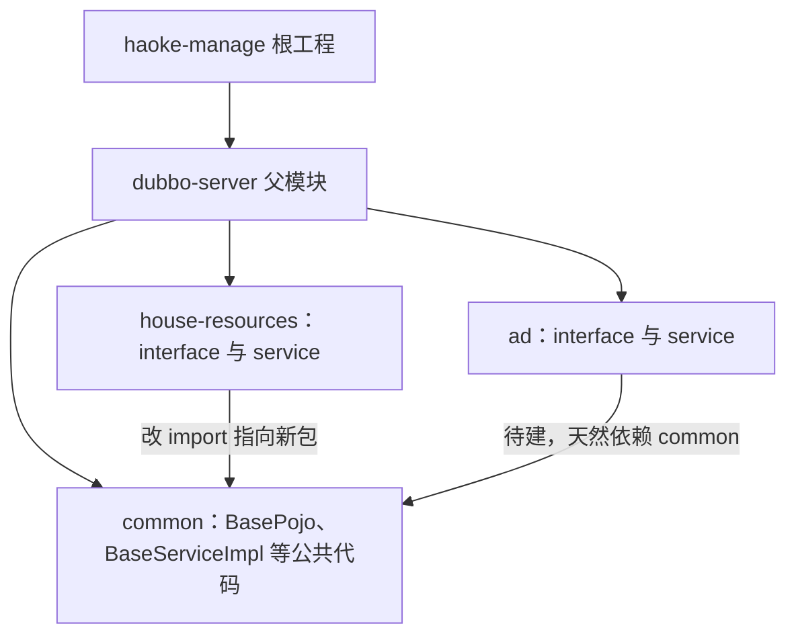

# 多个 dubbo 服务并存，公共代码怎么放：抽取 common 工程

房源服务是后台唯一的 dubbo 服务时，`BasePojo`、`BaseServiceImpl` 这些公共类住在它里面，没人觉得不对。广告服务马上要动工，问题浮出来了：第二个服务也要用这些基类，是去房源工程里依赖它，还是把类拷一份？两条路都不对，前者让广告服务背上房源服务的全部依赖，后者埋下双份代码各自漂移的隐患。

正确答案是给公共代码一个自己的家：抽取 common 工程。这一课讲清楚为什么抽、抽什么、依赖怎么定，以及搬家过程中最容易踩的坑。

## 先给结论

- 广告功能的定位是全站广告，实现为独立的 dubbo 服务；后台因此出现多个 dubbo 服务并存，公共类与方法下沉到 common 工程共用。
- common 模块挂在 dubbo-server 父工程下，与各业务服务平级，首批迁入 `BasePojo` 与 `BaseServiceImpl` 两个类。
- common 的 pom 只放最小依赖：`lombok` 与 `mybatis-plus-boot-starter`，且都标记 `optional=true`，不把实现细节传染给使用方。
- 原有模块删除公共类的本地拷贝，改为依赖 common，包路径同步调整，`BaseServiceImpl` 从 impl 包迁到 service 包。
- 依赖加了却不生效，多半不是 pom 写错，而是 IDE 的 Maven 自动导入没刷新，这是搬家过程里最磨人的一步。

## 一、为什么是现在抽：三个前置判断

动工前有三个判断决定了工程结构，值得逐条过一遍。

**第一，功能定位要站高一层。** 轮播广告虽然从首页切入，但不能按「轮播」来开发，要按「整个网站的广告功能」来开发。定位决定了表设计（上一篇已经处理）也决定了服务边界：广告查询是独立能力，不该寄生在房源服务里。

**第二，广告做成独立的 dubbo 服务。** 后台系统由两部分组成：API Server 对外提供 HTTP 接口，dubbo 服务层对内提供 RPC 接口。dubbo 层现在只有房源服务，广告再加一个，各自独立演进。独立的好处很直接：扩展新功能、维护旧功能都只动自己的工程，互不牵连。

**第三，多服务并存必然催生公共工程。** 一个服务时公共类放服务里无所谓；两个、三个服务之后，公共类必须有自己的归宿，否则只能在拷贝与怪异的跨服务依赖之间二选一。common 工程就是那个归宿，往后凡是多个工程都要用的类，一律往里放。

这三个判断落实成一次工程改造：建 common 模块，搬家，接依赖。

## 二、建模块与搬家：先迁两个基类

模块创建有个容易搞错的细节：common 不是建在根工程下，而是建在 dubbo-server 父模块之下，与 house-resources、ad 这类业务服务平级，这样它才能继承 dubbo-server 父 pom 里的公共依赖配置。模块命名为 `haoke-manage-dubbo-server-common`，pom 挂好父级：

```xml
<parent>
    <artifactId>haoke-manage-dubbo-server</artifactId>
    <groupId>com.haoke.manage</groupId>
    <version>1.0-SNAPSHOT</version>
</parent>
<modelVersion>4.0.0</modelVersion>
<artifactId>haoke-manage-dubbo-server-common</artifactId>
```

首批搬家清单是两个类，来源分别是房源服务的 interface 模块与 service 模块：

```java
package com.haoke.manage.dubbo.server.pojo;

import lombok.Data;

import java.io.Serializable;
import java.util.Date;

@Data
public abstract class BasePojo implements Serializable {

    /** 创建时间 */
    private Date created;

    /** 更新时间 */
    private Date updated;
}
```

```java
package com.haoke.manage.dubbo.server.service;

import com.baomidou.mybatisplus.core.mapper.BaseMapper;
import org.springframework.beans.factory.annotation.Autowired;

import java.util.List;

public abstract class BaseServiceImpl<T> {

    @Autowired
    protected BaseMapper<T> mapper;

    /** 根据id查询数据 */
    public T queryById(Long id) {
        return this.mapper.selectById(id);
    }

    /** 查询所有数据 */
    public List<T> queryAll() {
        return this.mapper.selectList(null);
    }
}
```

两个细节值得注意。其一，`BasePojo` 是抽象类，它存在的意义是让所有实体共享 `created` 与 `updated` 两个审计字段，谁继承谁就带上；实现 `Serializable` 是因为实体要跨 dubbo 传输。其二，`BaseServiceImpl` 搬家时包路径变了：原来在 `service.impl` 包里，common 工程里没有业务实现，去掉 `impl` 直接放 `service` 包，包名更贴合它的身份，泛型 `T` 由继承它的业务子类指定，`mapper` 注入的也是对应实体的 `BaseMapper`。

## 三、common 的依赖：最小集加 optional

搬来的类带出了两个依赖诉求：`BasePojo` 上的 `@Data` 需要 lombok，`BaseServiceImpl` 里的 `BaseMapper` 需要 MyBatis-Plus。common 的 pom 照此引入，但多了一个关键标记：

```xml
<dependencies>
    <dependency>
        <groupId>org.projectlombok</groupId>
        <artifactId>lombok</artifactId>
        <optional>true</optional>
    </dependency>
    <dependency>
        <groupId>com.baomidou</groupId>
        <artifactId>mybatis-plus-boot-starter</artifactId>
        <version>3.0.5</version>
        <optional>true</optional>
    </dependency>
</dependencies>
```

`optional=true` 的含义常被误读，这里掰开说：它不是说「这个依赖可有可无」，而是说 common 自己编译必须要它，但 Maven 不会把它传递给依赖 common 的工程。这样设计的好处是 common 不替任何使用方做依赖决策：房源服务想要 MyBatis-Plus，自己在 pom 里声明；将来某个只用 `BasePojo` 的模块不必被迫吞下一整套 MyBatis-Plus。依赖树上少一条隐藏的传递链，版本冲突的排查成本也跟着降。

## 四、使用方接入与依赖全景

搬家之后，房源服务里原来的两个类成了需要删除的重复拷贝，删除的同时把 common 依赖接进来。interface 模块与 service 模块的 pom 各加一条：

```xml
<dependency>
    <groupId>com.haoke.manage</groupId>
    <artifactId>haoke-manage-dubbo-server-common</artifactId>
    <version>1.0-SNAPSHOT</version>
</dependency>
```

MyBatis-Plus 与 lombok 这两个被 optional 挡住的依赖，使用方按需自行声明。service 模块的 `HouseResourcesServiceImpl` 原本继承本地包里的基类，现在把 import 改到 common 的新包路径，业务代码一行不动：

```java
@Service
@Transactional
public class HouseResourcesServiceImpl extends BaseServiceImpl<HouseResources> {

    @Override
    public HouseResources queryById(Long id) {
        if (StringUtils.isBlank(id.toString())) {
            throw new RuntimeException("输入的参数不符合要求");
        }
        return this.baseMapper.selectById(id);
    }
}
```

改完之后编译报错集中在 import 语句上，逐个修正包路径即可，类与方法签名没有任何变化。整个后台的模块依赖关系到这一步长成了这样：



图里能看出 common 的位置刻意选得很中立：它依赖业务模块，业务模块也依赖它，双向依赖就是循环依赖，Maven 直接拒绝构建。common 永远只被依赖、不依赖别人，这条单向规则是它能长期存在的前提。

实操中最后卡人的往往不是代码，而是 IDE：pom 改完，类上的红线迟迟不消。进设置找到构建工具里的 Maven 导入选项，确认自动导入已启用，再手动刷新 Maven 面板，依赖同步完成后报错自然消失。遇到「明明引了依赖却找不到类」，先刷 IDE 再怀疑配置。

## 常见误区

- **用拷贝代替移动。** 房源服务里留一份、common 里再放一份，短期都能编译，长期必然漂移：改了 common 的基类忘了改拷贝，两个服务同名类行为不一致，排查时极难定位。公共代码只允许存在一份。
- **误读 optional 的语义。** 以为标了 optional 使用方就不用引依赖了，结果使用方编译报 `BaseMapper` 找不到。optional 只切断传递，common 自己编译离不开它，使用方要用也得自己声明。
- **模块建错父级。** common 建到根工程下，聚合关系与依赖继承全乱，还可能与 dubbo-server 父模块形成平级误置。建之前确认右键的是 dubbo-server 父模块。
- **公共工程变成大杂烩。** 往 common 里塞业务逻辑，任何业务改动都波及所有服务，公共工程失去中立性。放进去的只有跨业务复用的基础设施：基类、通用查询、分页 VO。

## 面试可能被问到的问题

1. 面试官追问：「公共代码什么时候该下沉到 common 工程？」
   答：出现第二个真实消费者时。只有一个服务用就先放在服务里，过早抽取会为不存在的复用付出维护成本；第二个使用方出现，重复与漂移的风险变成现实，此时抽取的收益才覆盖成本。判断依据是复用是否已经发生，而不是预测。

2. 面试官追问：「Maven 里 optional=true 到底管什么？」
   答：管依赖传递。optional 依赖在本模块编译打包时正常生效，但不会随依赖链传递给下游。下游要用必须自己声明，于是版本选择权回到使用方手里，common 不至于把某个框架版本强加给所有使用方，这是公共工程保持低侵入的常用手段。

3. 面试官追问：「BaseServiceImpl 里注入泛型 BaseMapper，Spring 是怎么解析的？」
   答：Spring 注入时会解析字段声明里的泛型实参。子类写 extends BaseServiceImpl<HouseResources>，泛型实参在编译期固定，Spring 解析继承链拿到它，再到容器里按 BaseMapper<HouseResources> 这个完整泛型类型匹配对应的 mapper bean，注入由此精确到实体。MyBatis-Plus 为每个实体生成 mapper bean，泛型匹配正好把它们各归各位。

4. 面试官追问：「公共工程的依赖方向有什么讲究？」
   答：单向且只进不出。common 依赖基础框架，被业务模块依赖，绝不依赖任何业务模块，否则马上出现循环依赖；同时它也不能成为垃圾桶，业务专属代码进 common 会让所有服务被动承担无关变更。中立与克制是公共工程能长期存活的两个条件。

5. 面试官追问：「pom 里依赖已经写了，IDE 里类还是红的，怎么排查？」
   答：先确认 pom 无误后刷新 Maven 面板，多数是自动导入未触发；再看设置里 Maven 的导入选项是否启用；仍不行就看本地仓库里依赖是否真的下载成功，排除网络与镜像问题。依赖问题的排查顺序是先 IDE 同步、再仓库、最后才是配置本身。

## 配套资料

- 本教学日资料包未收录源码（`materials/code/03/day06-开发GraphQL服务以及前台系统搭建/` 下仅有 `myhome.sql`），模块划分、两个基类与 pom 片段为按本课画面写法补全的可运行示例，包名沿用同系列成稿的中性命名。
- lombok 与 MyBatis-Plus 依赖组合的真实工程可对照：`materials/code/10/mp-springboot/`（pom 中 `lombok` 标记 `optional=true` 并引入 `mybatis-plus-boot-starter`，与文中写法同源，版本号以本课 3.0.5 为准）。
- 讲义：`materials/docs/10/Mybatis-Plus讲义v1.0.md`（通用 CRUD 与条件构造章节）。
- `BaseServiceImpl` 的来历与两层 Service 的设计见同系列成稿 `0064-新增房源服务实现之新增房源服务的具体实现.md`、`0075-实现房源列表的Dubbo服务的开发.md`。
