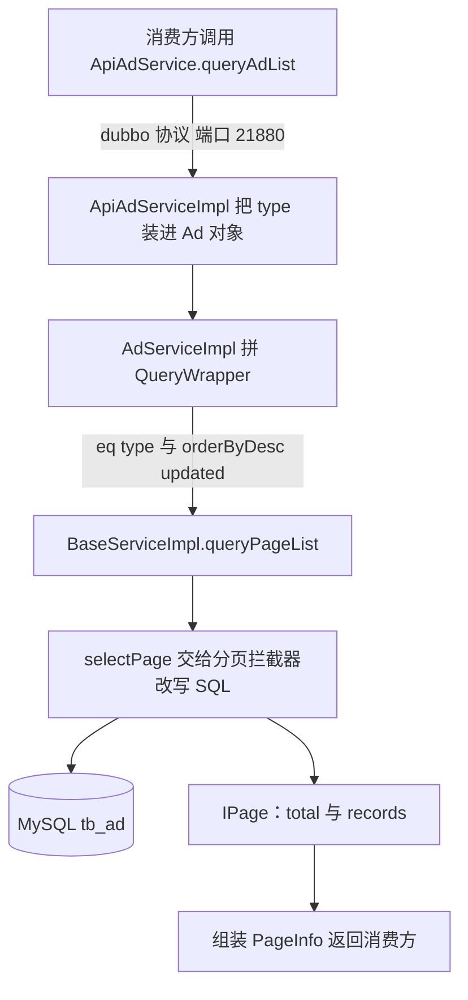

# 广告查询的 dubbo 服务：三模块结构、PageInfo 下沉与端口错开

common 工程就位后，广告服务可以正式动工了。这套 dubbo 服务的工程结构与房源服务完全同构，照着搭不会错；真正的增量在三处：`PageInfo` 这类公用 VO 也要下沉、同一台机器上第二个 provider 的端口必须错开、以及讲义代码里漏掉的那行排序。这一课把工程搭起来、把查询接口实现到能在注册中心看到服务为止。

## 先给结论

- 工程结构照房源服务复制：`dubbo-server-ad` 父模块下挂 interface 与 service 两个子模块，service 依赖 interface，两者都依赖 common。
- dubbo 接口 `ApiAdService.queryAdList(type, page, pageSize)` 返回 `PageInfo<Ad>`；`PageInfo` 是公用 VO，搬家到 common 的 vo 包。
- 业务实现用 `QueryWrapper` 拼两个条件：`type` 等值过滤，`updated` 倒序；讲义代码漏了倒序，查出来的就不是最新配置的广告，这里必须补上。
- 分页插件与 mapper 扫描包照旧要配置，`AdMapper` 接口即使方法体为空也必须存在。
- 同一台机器跑两个 dubbo provider，协议端口必须错开：房源服务占 20880，广告服务用 21880，端口撞车服务直接起不来。

## 一、工程结构：照房源服务再搭一套

在 dubbo-server 父模块下创建 `haoke-manage-dubbo-server-ad`，它只是个聚合壳，真正的代码在两个子模块里：interface 放实体与 dubbo 接口定义，service 放实现。依赖关系三条：ad 父模块依赖 common（承接 `BasePojo`、`BaseServiceImpl`、`PageInfo`），service 依赖 interface，service 还要引入 `spring-boot-starter-jdbc` 支撑数据库操作，MySQL 驱动也别忘了，缺了驱动配置文件里的 `driver-class-name` 会直接标红。interface 子模块的 pom 干净得只有继承：

```xml
<parent>
    <artifactId>haoke-manage-dubbo-server-ad</artifactId>
    <groupId>com.haoke.manage</groupId>
    <version>1.0-SNAPSHOT</version>
</parent>
<modelVersion>4.0.0</modelVersion>
<artifactId>haoke-manage-dubbo-server-ad-interface</artifactId>
```

这套结构的价值在于隔离：接口定义与实现分属两个模块，消费方只依赖 interface，不碰 service 里的任何实现细节。依赖方向永远是消费方指向 interface、实现方指向 interface 与 common，没有反向边。

## 二、interface 模块：Ad 实体与 Api 接口

实体对着表建，字段与 `tb_ad` 一一对应，公共的审计字段已经随 `BasePojo` 下沉，这里只剩业务字段：

```java
package com.haoke.manage.dubbo.server.pojo;

import com.baomidou.mybatisplus.annotation.IdType;
import com.baomidou.mybatisplus.annotation.TableId;
import com.baomidou.mybatisplus.annotation.TableName;
import lombok.Data;
import lombok.experimental.Accessors;

@Data
@Accessors(chain = true)
@TableName("tb_ad")
public class Ad extends BasePojo {

    @TableId(value = "id", type = IdType.AUTO)
    private Long id;

    /** 广告类型 */
    private Integer type;

    /** 描述 */
    private String title;

    /** 图片URL地址 */
    private String url;
}
```

`@TableName("tb_ad")` 把实体绑到表上，`@TableId` 声明主键自增，`@Accessors(chain = true)` 让 setter 返回自身，组装条件对象时可以链式连写。`created` 与 `updated` 不在这里，继承自 common 里的 `BasePojo`。

接着定义 dubbo 接口，一个分页查询方法，参数是类型、页码、页大小：

```java
package com.haoke.manage.dubbo.server.api;

import com.haoke.manage.dubbo.server.pojo.Ad;
import com.haoke.manage.dubbo.server.vo.PageInfo;

public interface ApiAdService {

    /**
     * 分页查询广告数据
     *
     * @param type     广告类型
     * @param page     当前页
     * @param pageSize 页大小
     * @return 分页后的广告数据
     */
    PageInfo<Ad> queryAdList(Integer type, Integer page, Integer pageSize);
}
```

写接口时遇到 `PageInfo` 导不进来的问题，它原本住在房源服务的 interface 模块里。分页结果是所有 dubbo 服务都要用的结构，与 `BasePojo` 一样属于公共代码，照上一篇的做法搬进 common 的 vo 包，房源服务删本地拷贝改依赖，广告服务直接引用。公共代码的下沉就是这样逐个触发的：谁第二个被需要，谁就搬家。

## 三、service 模块：两层实现与查询条件

实现保持两层：dubbo 层只做参数适配，业务层拼条件调通用查询。dubbo 实现类上标的是 dubbo 的 `@Service`，版本号 1.0.0，消费方按这个版本找服务：

```java
package com.haoke.manage.dubbo.server.api;

import com.alibaba.dubbo.config.annotation.Service;
import com.haoke.manage.dubbo.server.pojo.Ad;
import com.haoke.manage.dubbo.server.service.AdService;
import com.haoke.manage.dubbo.server.vo.PageInfo;
import org.springframework.beans.factory.annotation.Autowired;

@Service(version = "1.0.0")
public class ApiAdServiceImpl implements ApiAdService {

    @Autowired
    private AdService adService;

    @Override
    public PageInfo<Ad> queryAdList(Integer type, Integer page, Integer pageSize) {
        // dubbo 接口收三个散参，业务接口收条件对象，适配在这完成
        Ad ad = new Ad().setType(type);
        return this.adService.queryAdList(ad, page, pageSize);
    }
}
```

业务接口 `AdService` 定义在 service 包，实现类继承通用基类并实现接口：

```java
package com.haoke.manage.dubbo.server.service.impl;

import com.baomidou.mybatisplus.core.conditions.query.QueryWrapper;
import com.baomidou.mybatisplus.core.metadata.IPage;
import com.haoke.manage.dubbo.server.pojo.Ad;
import com.haoke.manage.dubbo.server.service.AdService;
import com.haoke.manage.dubbo.server.service.BaseServiceImpl;
import com.haoke.manage.dubbo.server.vo.PageInfo;
import org.springframework.stereotype.Service;
import org.springframework.transaction.annotation.Transactional;

@Service
@Transactional
public class AdServiceImpl extends BaseServiceImpl<Ad> implements AdService {

    @Override
    public PageInfo<Ad> queryAdList(Ad ad, Integer page, Integer pageSize) {
        QueryWrapper<Ad> queryWrapper = new QueryWrapper<>();
        // 讲义实现没有排序，查出来的不是最新配置的广告，按更新时间倒序补上
        queryWrapper.orderByDesc("updated");
        queryWrapper.eq("type", ad.getType());
        IPage<Ad> iPage = super.queryPageList(queryWrapper, page, pageSize);
        int total = Long.valueOf(iPage.getTotal()).intValue();
        return new PageInfo<>(total, page, pageSize, iPage.getRecords());
    }
}
```

房源列表那课给 `BaseServiceImpl` 加的 `queryPageList(QueryWrapper, page, pageSize)` 已经随基类进了 common，这里直接复用，条件拼装在业务层完成：`eq("type", …)` 把广告类型变成等值条件，`orderByDesc("updated")` 保证最新配置排前面。返回组装时注意 `IPage.getTotal()` 是 `long`，`PageInfo.total` 是 `Integer`，先装箱再 `intValue` 收窄。

支撑这套查询还要三件配套。Mapper 接口必须有，方法体为空也要有：

```java
package com.haoke.manage.dubbo.server.mapper;

import com.baomidou.mybatisplus.core.mapper.BaseMapper;
import com.haoke.manage.dubbo.server.pojo.Ad;

public interface AdMapper extends BaseMapper<Ad> {
}
```

配置类把 mapper 扫描包与分页插件一次配齐：

```java
@Configuration
@MapperScan("com.haoke.manage.dubbo.server.mapper")
public class MybatisConfig {

    @Bean
    public PaginationInterceptor paginationInterceptor() {
        return new PaginationInterceptor();
    }
}
```

最后是 Spring Boot 配置文件，重点看 dubbo 段：

```properties
# 应用名称
spring.application.name = haoke-manage-dubbo-server-ad

# 数据库
spring.datasource.driver-class-name=com.mysql.jdbc.Driver
spring.datasource.url=jdbc:mysql://127.0.0.1:3306/haoke?useUnicode=true&characterEncoding=utf8&autoReconnect=true&failOverReadOnly=false&maxReconnects=10
spring.datasource.username=root
spring.datasource.password=root

# 服务的扫描包
dubbo.scan.basePackages = com.haoke.manage.dubbo.server.api

# 应用名称
dubbo.application.name = dubbo-provider-ad

# 协议及端口
dubbo.protocol.name = dubbo
dubbo.protocol.port = 21880

# zk注册中心
dubbo.registry.address = zookeeper://127.0.0.1:2181
dubbo.registry.client = zkclient
```

端口 21880 是这一课的硬性知识点：房源服务已经占了 20880，两个 provider 同机启动，dubbo 协议端口必须唯一，写成 20880 的话第二个服务绑定端口失败直接起不来。`dubbo.scan.basePackages` 指向 api 包，容器启动时扫描这个包，把标了 dubbo `@Service` 的实现注册到注册中心。

## 四、启动类与验证

启动类与房源服务同款，纯 RPC 应用不起 Web 容器：

```java
package com.haoke.manage.dubbo.server;

import org.springframework.boot.WebApplicationType;
import org.springframework.boot.autoconfigure.SpringBootApplication;
import org.springframework.boot.builder.SpringApplicationBuilder;

@SpringBootApplication
public class AdDubboProvider {

    public static void main(String[] args) {
        new SpringApplicationBuilder(AdDubboProvider.class)
                .web(WebApplicationType.NONE) // 非 Web 应用，纯 dubbo 服务
                .run(args);
    }
}
```

第一次启动课程里踩了个真实的坑：报错说找不到 `AdService` 的实现类。原因是在业务实现类上漏了 Spring 的 `@Service`，容器里没有这个 bean，dubbo 实现类注入 `AdService` 时拿不到东西。这里要分清两个同名注解：dubbo 的 `@Service` 标 Api 实现负责暴露服务，Spring 的 `@Service` 标业务实现负责注册 bean，导包时看清楚是谁家的，漏一个、错一个都会在启动期炸出来。

补上注解再次启动，控制台正常拉起。到注册中心里按应用名搜索，`dubbo-provider-ad` 已经注册上去，协议端口正是配置的 21880。整条查询链路现在长这样：



到这里 dubbo 服务端完工，消费方怎么调、响应怎么装，留给下一篇的 RESTful 接口。

## 常见误区

- **provider 端口照抄房源服务的 20880。** 本地同时启动两个服务，后启动的那个绑定端口失败，报错栈看着像注册中心的问题，实际就是端口冲突。每新增一个 provider，先规划协议端口。
- **业务实现类漏标 Spring 的 `@Service`。** dubbo 实现类上有注解、启动类也正常，却报找不到 `AdService` 实现类，排查半天才发现是业务类没交给容器。两个同名注解并存的项目里，导包错误与漏标都常见。
- **`AdMapper` 接口不建或 `@MapperScan` 漏配。** `BaseServiceImpl` 注入 `BaseMapper<Ad>` 时容器里没有对应 bean，启动直接失败；`@MapperScan` 指错包则扫描不到接口，症状一样。
- **照抄讲义漏掉排序。** 不排序的查询数据顺序随数据库返回，最新配置的广告可能排在第 2 页永远看不到。功能「能跑」与「符合业务语义」之间，差的就是这行 `orderByDesc`。

## 面试可能被问到的问题

1. 面试官追问：「BaseServiceImpl 里已经有 BaseMapper 了，为什么每张表还要单独建 Mapper 接口？」
   答：Spring 注入按完整泛型类型匹配，BaseMapper<Ad> 这样的 bean 必须有对应载体。MyBatis-Plus 为每个继承 BaseMapper 的接口生成代理 bean，AdMapper 虽然方法体为空，但它的存在让容器里出现 BaseMapper<Ad> 类型的 bean，泛型注入才能精确命中。没有它，基类里的 mapper 字段注入不到任何东西。

2. 面试官追问：「dubbo.scan.basePackages 扫描的是什么？」
   答：扫描的是 dubbo 服务实现，实现类上标了 dubbo 的 @Service 注解（本课程是 com.alibaba.dubbo.config.annotation.Service），容器启动时按包扫描找到它们，按注解里的版本号把接口注册到注册中心，形成服务目录。它扫的是实现不是接口，接口靠消费方依赖 interface 模块获得。

3. 面试官追问：「一台机器起多个 dubbo provider，端口与注册中心怎么规划？」
   答：协议端口必须全局唯一，20880 给房源、21880 给广告，冲突即绑定失败；注册中心可以共用一个 ZooKeeper，服务以应用名加接口名加版本号区分，互不干扰。规划端口的习惯要在工程扩容前建立，而不是等冲突报错后再改。

4. 面试官追问：「启动类里 WebApplicationType.NONE 是干什么用的？」
   答：告诉 Spring Boot 不要启动内嵌 Web 容器。纯 dubbo 提供方走 RPC 协议不需要 HTTP 端口，省掉 Tomcat 的资源占用，也避免误占 8080 之类的端口。如果不显式指定，类路径上有 Web 依赖时 Spring Boot 会自动按 Web 应用启动，白白多起一个容器。

5. 面试官追问：「查询条件与排序拼在业务层，而不是 dubbo 层，为什么？」
   答：dubbo 层是参数适配，把散参数装成条件对象，保持薄；业务层才是规则所在，type 等值、updated 倒序这些属于广告业务自身的语义。规则集中在业务层，换一个 dubbo 接口、加一个消费方，规则不会重复实现也不会漂移，测试也只测一层。

## 配套资料

- 本教学日资料包未收录源码（`materials/code/03/day06-开发GraphQL服务以及前台系统搭建/` 下仅有 `myhome.sql`），实体、接口、两层实现与配置为按本课画面写法补全的可运行示例，包名沿用同系列成稿的中性命名，配置里的数据库地址已换成本地环境。
- `MybatisConfig` 与数据源配置的真实工程可对照：`materials/code/10/mp-springboot/`（`config/MybatisPlusConfig.java` 的 `@MapperScan` 与 `PaginationInterceptor` 注册、`application.properties` 的数据源写法）。
- 讲义：`materials/docs/10/Mybatis-Plus讲义v1.0.md`（通用 CRUD、条件构造与分页插件章节）。
- 同构的房源服务实现见同系列成稿 `0075-实现房源列表的Dubbo服务的开发.md`，common 工程抽取与 `PageInfo` 下沉见 `0100-轮播广告实现之common工程的抽取.md`。
