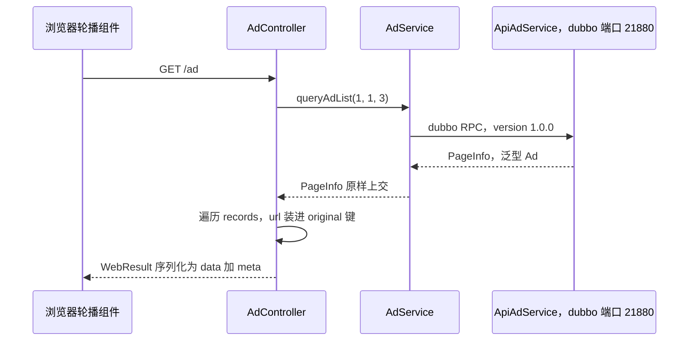

# 首页广告的 RESTful 接口：WebResult 的极简封装与 original 契约

dubbo 服务已经在注册中心待命，但浏览器的轮播组件只会发 HTTP 请求，而且它认的数据结构相当挑剔：外层 `data` 与 `meta` 两层包装，`data.list` 里的每个元素只认一个 `original` 字段。这一课在 api-server 里开最后一扇门，真正有意思的地方不在 Controller，而在怎么用最少的对象糊出这个嵌套结构。

## 先给结论

- api-server 引入 ad-interface 依赖，消费端 `AdService` 用 `@Reference(version = "1.0.0")` 注入 dubbo 服务，版本号必须与提供方一致，差一点都拿不到服务。
- 首页广告的查询参数是固定的：类型 1、第 1 页、3 条，Controller 不需要暴露任何参数。
- 严格按前端结构建模要 4 个对象，实际有效的数据只有 `status`、`msg`、图片地址 3 个值，`WebResult` 用 3 个字段加 2 个手工 getter 就能序列化出一模一样的 JSON。
- 3 个字段全部标 `@JsonIgnore`，JSON 输出只来自 `getData()` 与 `getMeta()` 两个方法，字段藏起来，方法被当成 `data`、`meta` 两个属性。
- `Ad` 实体不能原样吐给前端：遍历 `records` 把 `url` 装进 `{original: …}`，字段名由前端组件说了算。

## 一、接上 dubbo：依赖与消费端 Service

api-server 引入广告的 interface 模块，这是调用 dubbo 服务的前提，接口类都不在 classpath 里，注入无从谈起：

```xml
<dependency>
    <groupId>com.haoke.manage</groupId>
    <artifactId>haoke-manage-dubbo-server-ad-interface</artifactId>
    <version>1.0-SNAPSHOT</version>
</dependency>
```

消费端 Service 与房源那套同款：Spring 的 `@Service` 把自己注册进容器，dubbo 的 `@Reference` 负责远程注入，版本号 1.0.0 与提供方 `@Service(version = "1.0.0")` 严格对应：

```java
package com.haoke.manage.dubbo.api.service;

import com.alibaba.dubbo.config.annotation.Reference;
import com.haoke.manage.dubbo.server.api.ApiAdService;
import com.haoke.manage.dubbo.server.pojo.Ad;
import com.haoke.manage.dubbo.server.vo.PageInfo;
import org.springframework.stereotype.Service;

@Service
public class AdService {

    @Reference(version = "1.0.0")
    private ApiAdService apiAdService;

    /**
     * 分页查询广告数据
     */
    public PageInfo<Ad> queryAdList(Integer type, Integer page, Integer pageSize) {
        return this.apiAdService.queryAdList(type, page, pageSize);
    }
}
```

方法体一行转发。HTTP 世界与 dubbo 世界的参数形态在这里交接：上层传散参数，接口按签名原样下传，`PageInfo` 原样返回，转换工作留给 Controller。

## 二、Controller：参数固定的首页广告查询

```java
package com.haoke.manage.dubbo.api.controller;

import com.haoke.manage.dubbo.api.service.AdService;
import com.haoke.manage.dubbo.api.vo.WebResult;
import com.haoke.manage.dubbo.server.pojo.Ad;
import com.haoke.manage.dubbo.server.vo.PageInfo;
import org.springframework.beans.factory.annotation.Autowired;
import org.springframework.web.bind.annotation.GetMapping;
import org.springframework.web.bind.annotation.RequestMapping;
import org.springframework.web.bind.annotation.RestController;

import java.util.ArrayList;
import java.util.HashMap;
import java.util.List;
import java.util.Map;

@RestController
@RequestMapping("ad")
public class AdController {

    @Autowired
    private AdService adService;

    /**
     * 查询首页轮播广告
     */
    @GetMapping
    public WebResult queryIndexAd() {
        // 首页轮播：类型 1，取第 1 页的 3 条
        PageInfo<Ad> adPageInfo = this.adService.queryAdList(1, 1, 3);
        List<Object> result = new ArrayList<>();
        for (Ad ad : adPageInfo.getRecords()) {
            Map<String, Object> map = new HashMap<>();
            map.put("original", ad.getUrl());
            result.add(map);
        }
        return WebResult.ok(result);
    }
}
```

类上 `@RestController` 一步到位，方法返回值自动写进响应体，省掉逐方法 `@ResponseBody`。三个参数写死是有依据的：广告表初始数据里 `type` 全部是 1，首页轮播就是类型 1；轮播位一次展示三五张图，取第 1 页的 3 条足够。这个接口没有动态参数，谁调它都是同一组广告，写死参数反而让契约更清晰。

方法体里那层遍历是刻意为之：`adPageInfo.getRecords()` 直接丢给前端是不行的，`Ad` 实体带着 `id`、`title`、`created` 一堆字段，前端只认 `original` 一个键。逐条把 `url` 装进 `Map`，键名对齐组件约定，多余字段一个不带。

## 三、WebResult：用 3 个字段糊出 4 层嵌套

前端要的响应长这样（图片地址取自资料包 `myhome.sql` 的轮播初始数据）：

```json
{
  "data": {
    "list": [
      { "original": "http://127.0.0.1:8086/public/1.png" },
      { "original": "http://127.0.0.1:8086/public/2.png" },
      { "original": "http://127.0.0.1:8086/public/3.png" }
    ]
  },
  "meta": { "status": 200, "msg": "请求成功" }
}
```

拿着在线 JSON 可视化工具看一眼就知道这结构有多深：最外层一个对象，里面有 `data` 与 `meta` 两个对象；`data` 里又挂一个 `list` 集合，集合元素还是对象；`meta` 里再装两个属性。照葫芦画瓢建对象的话，外层响应、`data`、`meta`、`list` 元素，一共 4 个类。

数一数结构里真正要传输的值：状态码、消息、图片地址，一共 3 个。为 3 个值建 4 个类不值当。`WebResult` 的思路是把「结构」留给方法，把「数据」留给字段：

```java
package com.haoke.manage.dubbo.api.vo;

import com.fasterxml.jackson.annotation.JsonIgnore;
import lombok.AllArgsConstructor;
import lombok.Data;
import lombok.NoArgsConstructor;

import java.io.Serializable;
import java.util.HashMap;
import java.util.List;
import java.util.Map;

@Data
@NoArgsConstructor
@AllArgsConstructor
public class WebResult implements Serializable {

    private static final long serialVersionUID = 1L;

    @JsonIgnore
    private Integer status;

    @JsonIgnore
    private String msg;

    @JsonIgnore
    private List<?> list;

    /** 序列化时充当 data 属性：list 挂到 data 里 */
    public Map<String, Object> getData() {
        HashMap<String, Object> data = new HashMap<>();
        data.put("list", this.list);
        return data;
    }

    /** 序列化时充当 meta 属性：状态与消息挂到 meta 里 */
    public Map<String, Object> getMeta() {
        HashMap<String, Object> meta = new HashMap<>();
        meta.put("status", this.status);
        meta.put("msg", this.msg);
        return meta;
    }

    /** 成功结果的快捷构造 */
    public static WebResult ok(List<?> list) {
        return new WebResult(200, "请求成功", list);
    }

    /** 允许自定义消息的重载 */
    public static WebResult ok(String msg, List<?> list) {
        return new WebResult(200, msg, list);
    }
}
```

拆开看三个机关：

**第一，字段全标 `@JsonIgnore`。** Jackson 序列化时跳过 `status`、`msg`、`list` 对应的属性，JSON 里不会再出现这三个键。字段仍在类里活着，承担存值职责，只是不直接出面。

**第二，两个手工 getter 充当派生属性。** Jackson 发现属性靠 getter 命名约定：`getData()` 生成属性 `data`，`getMeta()` 生成属性 `meta`，返回的 `Map` 内容就是这个属性的结构。字段被藏、方法出场，最终 JSON 只剩 `data` 与 `meta` 两个键，形状与前端契约严丝合缝。这就是「两个保留」：藏的是字段，留的是方法派生的属性。

**第三，静态工厂加构造器配套。** `@AllArgsConstructor` 生成的全参构造给 `ok()` 用，一行造出成功结果；`@NoArgsConstructor` 补的无参构造留给框架反序列化等场景。`ok()` 的两个重载覆盖「默认成功消息」与「自定义消息」两种调用习惯，Controller 里 `WebResult.ok(result)` 一行收尾。

`List<?>` 的通配符也是省事的选择：这里只放 `{original: url}` 的 Map，明天放别的结构也能装，通配符表明「内容形状由调用方决定」。

## 四、整条链路与响应验证

把 HTTP 与 RPC 两段接起来看全貌：



关键路径有两处：S 到 D 是版本号校验的关卡，1.0.0 对不上注册中心里就没有可用提供者；C 的最后一行是结构契约的关卡，`WebResult.ok` 出来的对象交给 Jackson，产出与前端组件约定的 JSON。用 REST 客户端先打一发：

```bash
curl http://127.0.0.1:18080/ad
```

返回第三节那份 JSON（示例数据），`status` 200、`msg` 请求成功、`list` 里三条 `original`。把浏览器里前端应用的接口地址指向这个服务，首页轮播就能从 demo 数据切到真实广告表的数据，浏览器端的联调细节放在后续整合篇展开。

## 常见误区

- **版本号对不上还想拿到服务。** `@Reference(version = "1.0.0")` 与提供方 `@Service(version = "1.0.0")` 是按版本精确匹配的，消费方写 1.0、提供方 1.0.0，注入的是空代理，一调就报找不到提供者。版本是服务契约的一部分，两端抄同一份配置。
- **把 `PageInfo` 或 `Ad` 原样序列化给前端。** 功能上能通，但 `id`、`title`、`pageNum` 这些字段全泄漏出去，前端真正要的 `original` 却对不上名。门面层必须完成字段裁剪与改名，实体字段是内部实现，不是 HTTP 契约。
- **`@JsonIgnore` 漏标。** 三个字段照常输出，响应里同时出现 `status`、`msg`、`list` 与 `data`、`meta`，结构翻倍，前端取值错乱却看不出来是后端多给了。写完封装类先看一眼真实响应再联调。
- **响应结构跟着后端习惯改。** 觉得 `meta` 不如 `message` 语义好就改了名，前端一行代码没动，接口全挂。契约由消费方定义，前端组件吃 `{data, meta}` 与 `{original}`，后端只能对齐，要改必须两端一起动。

## 面试可能被问到的问题

1. 面试官追问：「WebResult 为什么用手工 getter 生成属性，不直接定义 data 和 meta 字段？」
   答：data 与 meta 是派生结构：data 的内容挂在 list 字段上，meta 的内容来自 status 与 msg，直接定义字段就要维护两份数据源，赋值时还要互相拷贝。getter 让序列化时的形状从字段实时计算出来，字段只存一份，结构与数据天然一致，这是用最小对象表达深层嵌套的常用技巧。

2. 面试官追问：「@JsonIgnore 的作用范围是什么，getter 派生属性为什么不受影响？」
   答：@JsonIgnore 标在字段上，压制的是该字段对应的同名属性。Jackson 发现属性走 getter 与字段两条路，getData() 派生出的属性名叫 data，与被压制的 status、msg、list 不同名，所以照常输出。想让派生属性也消失，得在方法上另加注解。

3. 面试官追问：「@Reference 注入的代理是怎么找到提供方的？」
   答：按接口全名加版本号在注册中心订阅服务目录，拿到提供者地址列表后，经集群容错与负载均衡选一个地址发起调用。version 是匹配键之一，不一致时订阅结果为空，注入的代理一调用就抛出找不到提供者的异常，这也是联调期最常见的报错之一。

4. 面试官追问：「Controller 返回 WebResult 而不是 dubbo 的 PageInfo，除了字段名还有什么考虑？」
   答：解耦。PageInfo 是跨服务传输结构，字段为 dubbo 契约设计；WebResult 是 HTTP 契约，只按前端需求成形。隔离之后 dubbo 层重构、换 RPC 框架、改分页字段，都不会波及前端，前端要的字段变化也只在门面层调整，两个契约各自演进。

5. 面试官追问：「用 Map 组装响应有什么利弊？」
   答：好处是零成本表达任意嵌套，为对齐一次性契约很划算；坏处是弱类型，键名拼错编译器不报错，结构靠人肉记忆。正规做法是为稳定契约定义 VO 类，Map 只用在像本课这样键少且结构临时的场景，长期维护的项目里 Map 泛滥会让接口文档与代码脱节。

## 配套资料

- 本教学日资料包未收录源码（`materials/code/03/day06-开发GraphQL服务以及前台系统搭建/` 下仅有 `myhome.sql`），消费端 Service、Controller、`WebResult` 为按本课画面写法补全的可运行示例，响应 JSON 为示例数据，图片路径取自 `myhome.sql` 中 `swipes` 表的初始数据。
- 消费方与提供方分层的真实工程可对照：`materials/code/10/nacos-discovery-RESTful服务发现与Dubbo服务发现/`（`nacos-restful-consumer` 的消费端 Controller、`nacos-restful-provider` 的提供方实现，以及 api 与 server 分模块的 dubbo 工程结构）。
- `original` 契约与轮播数据结构的来源见同系列成稿 `0099-轮播广告实现之分析数据结构以及表结构.md`，dubbo 服务端实现见 `0101-轮播广告实现之实现查询的dubbo服务.md`，HTTP 门面与 dubbo 消费端的同构写法另见 `0076-实现房源列表的RESTful接口的开发.md`。
