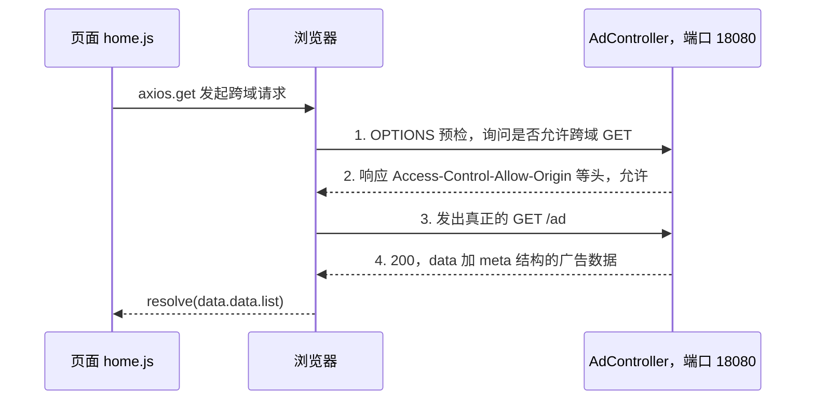

# 首页轮播接上真实广告数据：一次前后端联调要迈过的版本号、跨域与请求方法三道坎

REST 客户端里 `GET /ad` 明明能返回整整齐齐的广告 JSON，页面上的轮播组件却始终是空的。把前端请求地址从演示环境切到自己的服务，联调才算真正开始，而这一步暴露的问题比写代码本身多：dubbo 引用的属性敲错、跨域 403、请求方法对不上，三个坑挨个踩一遍，轮播图才会转起来。

## 先给结论

- 消费端注入 dubbo 服务时，`@Reference` 的属性名被 IDE 补全带偏，敲成了相邻的 V 开头选项，版本号匹配不上，症状是应用启动正常、一请求就找不到提供者。
- axios 的请求地址换成 `http://127.0.0.1:18080/ad` 这种绝对路径后，不会再叠加 `baseURL`，组件内部对绝对路径有判断。
- 前端在 9000 端口、后端在 18080 端口，属于跨域请求；axios 走的是 CORS 方案，服务端在 Controller 上加 `@CrossOrigin` 即可放行。
- `@CrossOrigin` 只解决「域允不允许」，不解决「方法对不对」：前端发 POST、服务端只挂 `@GetMapping`，请求照样失败。
- 非简单请求跨域前浏览器会先发一次 OPTIONS 预检，Network 面板里「先 OPTIONS 再真请求」是正常流程，不是多余流量。

## 一、先修启动前埋下的雷：dubbo 引用的版本属性

联调从服务端自测开始，一请求就报找不到提供者，应用却启动得干干净净。排查下来问题出在消费端 `AdService` 的注解上：写代码时借 IDE 补全敲属性名，`version` 与另一个 V 开头的选项紧挨着，手快选错，dubbo 引用带着错误的匹配条件去注册中心找服务，自然拿不到版本号为 1.0.0 的提供方。改回正确的写法：

```java
@Service
public class AdService {

    @Reference(version = "1.0.0")
    private ApiAdService apiAdService;

    /**
     * 分页查询广告数据
     */
    public PageInfo<Ad> queryAdList(Integer type, Integer page, Integer pageSize) {
        return this.apiAdService.queryAdList(type, page, pageSize);
    }
}
```

版本号是 dubbo 服务匹配的一部分，提供方 `@Service(version = "1.0.0")` 与消费方 `@Reference(version = "1.0.0")` 必须逐字符一致。修正后重启，REST 客户端再打 `GET /ad`，返回 200 与完整数据：

```json
{
  "data": {
    "list": [
      { "original": "http://127.0.0.1:8086/public/1.png" },
      { "original": "http://127.0.0.1:8086/public/2.png" },
      { "original": "http://127.0.0.1:8086/public/3.png" }
    ]
  },
  "meta": { "status": 200, "msg": "请求成功" }
}
```

这组响应正是 `WebResult` 封装想要的效果，图片地址与资料包 `myhome.sql` 里 `swipes` 表的三条初始数据同源。它验证了一件事：**最终响应的形状不必与 Java 对象的字段一一对应。** 字段全部标 `@JsonIgnore` 藏起来，由 `getData()`、`getMeta()` 两个方法派生出 `data`、`meta` 属性，JSON 长什么样由方法决定，前端契约说了算。

## 二、前端换地址：绝对路径与 baseURL 的关系

前端系统的 `home.js` 里，轮播、菜单、资讯三块各挂一个 Promise，用 axios 发请求：

```javascript
let swipe = new Promise((resolve, reject) => {
    axios.post('/homes/swipe').then((data) => {
        resolve(data.data.list);
    });
});

let menu = new Promise((resolve, reject) => {
    axios.post('/homes/menu').then((data) => {
        resolve(data.data.list);
    });
});

let info = new Promise((resolve, reject) => {
    axios.post('/homes/info').then((data) => {
        resolve(data.data.list);
    });
});
```

相对路径会先被拼上 axios 配置里的 `baseURL`，这是前几课定下的机制。把轮播的地址直接换成后端服务的绝对路径，会不会变成 `baseURL + http://...` 的拼接怪胎？不会。axios 在发请求前会判断 URL 是否已经是绝对路径，是则跳过 `baseURL` 拼接。把 `swipe` 的请求改掉：

```javascript
let swipe = new Promise((resolve, reject) => {
    axios.post('http://127.0.0.1:18080/ad').then((data) => {
        resolve(data.data.list);
    });
});
```

这一步只是把「数据从哪来」换了个源头，Promise 的形状没动，页面其余代码零感知。

## 三、第一道坎：403 与跨域

刷新页面，Network 面板里请求变红了，状态码 403。原因是浏览器视角下的这次请求跨了域：前端应用跑在 9000 端口，接口在 18080 端口，协议、域名、端口任何一项不同都算跨源，浏览器的同源策略会拦下响应。

解决跨域有两条经典路线：JSONP 借 `script` 标签绕道，只支持 GET 且要前后端配合改写；CORS 是标准方案，由服务端在响应头里声明允许哪些来源访问。axios 走的是 CORS 这条路，所以要做的事只有一个：让服务端声明放行。Spring MVC 对此的支持薄到只有一层注解，在 `AdController` 类上加 `@CrossOrigin`：

```java
@RequestMapping("ad")
@RestController
@CrossOrigin
public class AdController {

    @Autowired
    private AdService adService;

    /**
     * 查询首页轮播广告
     */
    @GetMapping
    public WebResult queryIndexAd() {
        PageInfo<Ad> adPageInfo = this.adService.queryAdList(1, 1, 3);
        List<Object> result = new ArrayList<>();
        for (Ad ad : adPageInfo.getRecords()) {
            Map<String, Object> map = new HashMap<>();
            map.put("original", ad.getUrl());
            result.add(map);
        }
        return WebResult.ok(result);
    }
}
```

重启服务，页面刷新，依然失败。跨域这一层已经放行了，卡住的是另一个更朴素的问题。

## 四、第二道坎：方法对不上，POST 改 GET

看 Network 面板的请求详情，前端发出去的是 POST，而 `AdController` 只注册了 `@GetMapping`，路径能匹配、方法不匹配，Spring 直接回绝。前端代码里那三个 Promise 一直用的是 `axios.post`，那是配合演示环境写法留下的习惯。服务端支持 GET，那就把前端改成 `axios.get`。

再次刷新，这一次的请求序列值得逐个看：



图里第 1、2 步就是预检：对非简单请求，浏览器先替页面问一句「我要跨域发 GET，你允许吗」，服务端被 `@CrossOrigin` 注解加持后回应允许的方法列表，浏览器确认无误才放行第 3 步的真请求。面板里先看到 OPTIONS 再看到 GET，且两者都返回 2xx，才是跨域联调成功的完整标志。此时页面轮播位已经转起真实广告图，前后端整合的第一条数据通路宣告打通。

这种在页面里直接写死后端绝对地址的做法只是过渡：地址散落在各个组件里，环境一换就得全局搜索替换，后续会收敛成统一的配置与封装，先跑通再收口。

## 常见误区

- **把 403 一律当成权限问题。** 接口没有做任何鉴权却返回 403，先看响应头里有没有 CORS 相关字段、控制台有没有跨域报错，跨域被拦时浏览器还会额外打印一条错误信息，比状态码本身更有指向性。
- **以为加了 `@CrossOrigin` 就万事大吉。** 这个注解声明的是「来源允许」，预检应答里同时列出了允许的方法；前端发 POST、服务端只有 GET，照样失败。域与方法要分别对上。
- **把 OPTIONS 预检当多余请求想去掉。** 它由浏览器按规则自动发起，服务端删不掉也不该删；只有请求落在「简单请求」白名单内（如 GET 加表单类 Content-Type）才会跳过预检。
- **dubbo 引用配错没有排查方向。** 应用能启动不代表引用有效，dubbo 默认在首次调用时才暴露找不到提供者的问题；这类症状先核对消费端注解的 `version`、`group` 与提供方注册的信息是否逐字符一致。

## 面试可能被问到的问题

1. 面试官追问：「什么情况下浏览器会先发 OPTIONS 预检请求？」
   答：跨域请求不满足「简单请求」条件时触发，典型条件包括使用 GET、POST、HEAD 之外的方法，或携带自定义头、Content-Type 为 JSON 等非表单类型。浏览器先以 OPTIONS 询问服务端允许的来源、方法与头，确认通过后才发送真正请求，失败则真请求不会发出。

2. 面试官追问：「`@CrossOrigin` 的原理是什么，加在类和方法上有什么区别？」
   答：它借助 Spring MVC 的 CORS 处理器，在请求进入 Controller 前校验来源并往响应头写入 Access-Control-Allow-Origin 等字段，预检的 OPTIONS 请求也由它应答。加在类上对该 Controller 的所有方法生效，加在方法上只影响单个方法，两者可以组合出更细的粒度。

3. 面试官追问：「JSONP 和 CORS 各自的适用场景？」
   答：JSONP 利用 script 标签不受同源限制的特性，兼容老浏览器但只支持 GET，需要服务端按回调函数名包一层返回，本质上是在借脚本加载传数据。CORS 是标准方案，支持全部 HTTP 方法与自定义头，由服务端声明放行策略，现代项目基本只用 CORS，axios 这类库也是按 CORS 设计的。

4. 面试官追问：「dubbo 消费端报找不到提供者，你的排查步骤是什么？」
   答：先核对接口全名、版本号、分组在消费端与注册中心是否一致，这是最常见的匹配失败；再到注册中心确认提供方真的注册上去了，看应用名与地址列表；接着检查协议端口、网络连通与防火墙；开发期还要留意消费端注解属性敲错，比如 version 写成别的属性名，引用条件一错，订阅结果就是空。

## 配套资料

- 前台演示库脚本（本教学日唯一随包资料，`swipes` 轮播表的 DDL 与三条初始数据即文中响应示例的图片来源）：
  `materials/code/03/day06-开发GraphQL服务以及前台系统搭建/day06-开发GraphQL服务以及前台系统搭建/资料/myhome.sql`
- day06 教学资料包未收录后端源码，`AdService`、`AdController`、`home.js` 片段为按本课画面写法补全的可运行示例，包名沿用同系列成稿的中性命名。
- `WebResult` 封装与 `/ad` 接口的完整实现见同系列成稿 `0102-轮播广告实现之查询广告服务的实现(RESTful接口).md`，dubbo 提供方与 21880 端口规划见 `0101-轮播广告实现之实现查询的dubbo服务.md`。
