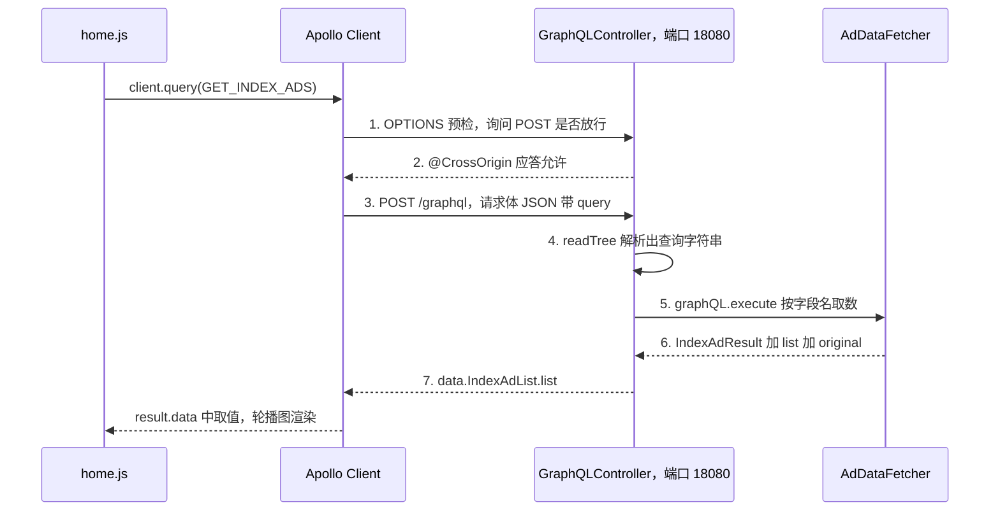

# Apollo Client 实战：前端发出第一条 GraphQL 查询，跨域与 POST 两道坎跟进

GraphQL 服务端已经能按契约返回轮播数据，剩下一个现实问题：前端是 React 加 axios 的世界，浏览器发不出 dubbo 调用，也没有内建能力去拼 GraphQL 查询。解决思路是给前端请一位 GraphQL 专用的客户端，让它替组件发起查询、解析响应。选型落在了 Apollo Client 上，从安装到页面转出广告图，中间还有跨域与请求方式两个必然要踩的坑。

## 先给结论

- JS 生态的 GraphQL 客户端里选 Apollo Client：功能完整、文档成熟，与 React 配合是社区主流组合。
- 使用只有两步：`new ApolloClient({ uri })` 创建客户端指向 `http://127.0.0.1:18080/graphql`，用 `gql` 模板字符串定义查询，`client.query({ query })` 发起请求。
- Apollo Client 发查询固定走 POST，请求体是形如 `{ "query": "..." }` 的 JSON；服务端原先只有 GET 入口，必须补一个 `@PostMapping`。
- POST 加 JSON 请求体属于非简单请求，CORS 预检必然触发，`@CrossOrigin` 要加在 `GraphQLController` 上，与上一课 `/ad` 的处理是两处独立的门。
- POST 入口要自己解析请求体：`ObjectMapper.readTree` 读出 JSON，取 `query` 节点的文本值再交给 `graphQL.execute`。

## 一、选型：客户端列表里为什么是 Apollo Client

GraphQL 官网列了一串 JavaScript 客户端：Relay、Apollo Client 等。Relay 是 Facebook 自家方案，性能与工程化程度高，但学习曲线陡、约定重，适合大型长期演进的项目；Apollo Client 是社区事实标准，查询、缓存、状态管理一套打包，API 直白，从编码式调用到组件式封装都有现成路径。学习期与中型项目选它，成本收益比最好。

官网的快速上手给出的路径也很短：装依赖、建客户端、发查询。照着走一遍就能跑通，细节坑集中在服务端的配合上，这正是本课的后半段。

## 二、安装依赖，创建 client

进入前端工程停掉 dev 服务，安装依赖：

```bash
npm install apollo-boost react apollo graphql --save
```

`--save` 会把依赖写进 `package.json` 的 `dependencies`，装完打开这个文件确认一眼，别靠感觉。创建客户端的代码放在 `home.js` 顶部：

```javascript
import ApolloClient from 'apollo-boost';

const client = new ApolloClient({
    uri: 'http://127.0.0.1:18080/graphql',
});
```

`uri` 指向 api-server 的 GraphQL 入口，之前在 Altair 里测试用的就是它。到这里，前端已经握着一只会发 GraphQL 查询的手，还差查询语句本身。

## 三、gql 定义查询，替换轮播的数据来源

```javascript
import gql from 'graphql-tag';

const GET_INDEX_ADS = gql`
    query {
        IndexAdList {
            list {
                original
            }
        }
    }
`;
```

反引号是 ES6 的模板字符串语法，`gql` 把这段字符串解析成 GraphQL 的抽象语法树对象，供客户端复用与校验。查询内容与 Altair 里验证过的完全一致，声明要 `IndexAdList` 下的 `list` 集合及每个元素的 `original`。

接着改造 `home.js` 里轮播的 Promise，把 axios 那行换成 client 调用：

```javascript
let swipe = new Promise((resolve, reject) => {
    client.query({ query: GET_INDEX_ADS }).then(result => {
        resolve(result.data.IndexAdList.list);
    });
});
```

`client.query` 返回 Promise，结果的取值路径 `result.data.IndexAdList.list` 与上一课的响应结构逐层对应：最外层 `data` 是 GraphQL 协议规定的数据键，往下一层是查询里的字段名，再往下才是集合。Promise 的 `resolve` 形状不变，页面里消费轮播数据的代码依旧零改动。

## 四、第一道坎：403，`/graphql` 也要跨域声明

刷新页面，登录后轮播区报 403，套路与上一课一模一样：9000 的前端向 18080 发请求，`/graphql` 入口同样没有跨域声明。在 `GraphQLController` 类上补 `@CrossOrigin`，重启服务。这是第二扇门，`/ad` 上加过的注解管不到这个路径，两个入口各管各的。

## 五、第二道坎：Apollo 发的是 POST，服务端只有 GET

加上注解后依然 403。这次的问题藏在请求方式里：Apollo Client 发查询固定用 POST，而 `GraphQLController` 只注册了 `@GetMapping`。用 Altair 把请求方式切成 POST 再发一次，观察请求体就能看明白它长什么样：

```json
{
  "query": "query { IndexAdList { list { original } } }"
}
```

查询语句不再是 URL 参数，而是 JSON 里的一个字符串值。POST 加 JSON 请求体不满足简单请求的条件，预检 OPTIONS 先行，服务端既要应答预检、又要有 POST 处理器，缺一个都不行。给 Controller 补上 POST 入口：

```java
package com.haoke.manage.dubbo.api.controller;

import com.fasterxml.jackson.databind.JsonNode;
import com.fasterxml.jackson.databind.ObjectMapper;
import graphql.GraphQL;
import org.springframework.beans.factory.annotation.Autowired;
import org.springframework.web.bind.annotation.*;

import java.io.IOException;
import java.util.HashMap;
import java.util.Map;

@Controller
@RequestMapping("/graphql")
@CrossOrigin
public class GraphQLController {

    /** ObjectMapper 线程安全，全工程共用一个实例 */
    private static final ObjectMapper OBJECT_MAPPER = new ObjectMapper();

    @Autowired
    private GraphQL graphQL;

    /**
     * GET 入口：查询语句挂在 URL 参数上
     */
    @GetMapping
    @ResponseBody
    public Map<String, Object> query(@RequestParam("query") String query) {
        return this.graphQL.execute(query).toSpecification();
    }

    /**
     * POST 入口：Apollo Client 等客户端以 JSON 请求体发送查询
     */
    @PostMapping
    @ResponseBody
    public Map<String, Object> postQuery(@RequestBody String json) {
        Map<String, Object> error = new HashMap<>();
        try {
            JsonNode node = OBJECT_MAPPER.readTree(json);
            if (node.has("query")) {
                // 取出查询语句字符串，交给引擎执行
                String query = node.get("query").textValue();
                return this.graphQL.execute(query).toSpecification();
            }
            error.put("status", 500);
            error.put("msg", "查询出错");
        } catch (IOException e) {
            error.put("status", 500);
            error.put("msg", "查询出错");
        }
        return error;
    }
}
```

解析逻辑三步：`readTree` 把请求体字符串读成 JSON 树；`has("query")` 判断节点是否存在，防御畸形请求体；`textValue()` 把该节点的值取成纯文本，正好是查询语句字符串，交给与 GET 入口同一个 `graphQL.execute`。结构异常与解析异常都落进同一个 error 返回，带 500 状态与「查询出错」消息。`ObjectMapper` 声明为 `static final` 是常规做法，它创建成本高且线程安全，全工程共用一个实例。

重启后再刷页面，请求序列完整走通：



第 3 步的请求体里，查询字符串就是我们定义的 `GET_INDEX_ADS` 原文；第 7 步回流的 JSON 与 Altair 里看到的完全一致，页面轮播位从此吃上了 GraphQL 的数据。

## 六、延伸：比 client.query 更优雅的组件式写法

编码式的 `client.query` 要自己管 Promise 与状态，Apollo 还提供组件式封装，用 `<Query query={GET_INDEX_ADS}>` 包住渲染逻辑，子组件直接拿到 `loading`、`error`、`data` 三个值，加载态与异常态的处理写进 JSX。两种写法原理相同，底层的请求、解析、缓存一回事，组件式只是把样板代码收进了组件内部，官网标注它为更优雅的用法。课程留作练习：把首页查询改造成 Query 组件版本。

## 常见误区

- **以为 Apollo Client 能配置成 GET。** 它按 GraphQL 最佳实践固定用 POST 加 JSON 请求体发送查询，服务端要配合 POST 入口，而不是去客户端里想办法改请求方式。
- **把请求体原样塞给 execute。** `graphQL.execute` 要的是查询语句字符串，POST 入口收到的是整段 JSON，先 `readTree` 取出 `query` 节点再执行，直接把 JSON 丢进引擎只会得到解析错误。
- **跨域注解只加在 `/ad` 上。** `@CrossOrigin` 作用域是它所在的 Controller，`/graphql` 是另一个入口，预检应答与放行都要单独声明，两个入口各配各的。
- **取值路径凭感觉写。** 响应里最外层 `data` 是协议键，下一层才是查询字段名，写成 `result.data.list` 或多包一层都会拿到 undefined。打开 Altair 看一眼真实响应再写取值，永远比猜快。

## 面试可能被问到的问题

1. 面试官追问：「为什么 GraphQL 客户端普遍用 POST 而不是 GET？」
   答：查询语句作为字符串放进请求体，不受 URL 长度限制，不会出现在访问日志里，也能携带 variables 与 extensions 等结构化字段。GET 拼查询串只适合简短的调试场景，生产客户端都走 POST，代价是需要服务端提供解析请求体的 POST 入口。

2. 面试官追问：「POST 加 JSON 请求体为什么会触发 CORS 预检？」
   答：浏览器的简单请求白名单只覆盖 GET、POST、HEAD 且 Content-Type 限于表单与文本等几种，JSON 类型不在其中，属于非简单请求，浏览器必须先发 OPTIONS 确认服务端允许该来源、方法与头，得到肯定应答后才发送真请求。跨域联调时先看预检的应答头，能省一半排查时间。

3. 面试官追问：「ObjectMapper 为什么要声明成 static final？」
   答：它创建成本高，内部维护大量配置与缓存，且文档明确线程安全，多线程共享一个实例没有竞态问题。声明成静态常量避免每次请求新建对象带来的内存与 GC 压力，是 Jackson 的官方推荐用法。

4. 面试官追问：「Apollo Client 在前端承担了哪些职责？」
   答：核心是把查询语句解析成 AST 并发送请求、解析响应，此外还内置了规范化的缓存，同一对象的多次查询会按 id 合并去重，组件式用法下数据变更还能驱动视图更新。相当于 axios 之于 REST，它是 GraphQL 查询的专用通道加数据层。

5. 面试官追问：「client.query 与 Query 组件两种用法怎么选？」
   答：逻辑等价，差别在样板代码的归属。client.query 适合在事件回调、非组件场景里手动触发查询；Query 组件把 loading、error、data 直接交给渲染，组件挂载自动查询、状态自动驱动视图，页面数据加载优先用它。工程里两者常并存，按触发时机选。

## 配套资料

- 前台演示库脚本（本教学日唯一随包资料，页面展示的图片地址与 `swipes` 表初始数据同源）：
  `materials/code/03/day06-开发GraphQL服务以及前台系统搭建/day06-开发GraphQL服务以及前台系统搭建/资料/myhome.sql`
- day06 教学资料包未收录前端工程与后端源码，依赖安装命令、`home.js` 改造与 `GraphQLController` 为按本课画面写法补全的可运行示例，包名沿用同系列成稿的中性命名。
- `IndexAdList` 查询的服务端实现见同系列成稿 `0104-编写广告查询的GraphQL接口服务.md`，GET 入口与 GraphQL 装配见 `0092-实现根据id查询房源数据的GraphQL服务.md`，`/ad` 入口的跨域处理见 `0103-轮播广告实现之前后端整合测试.md`。
