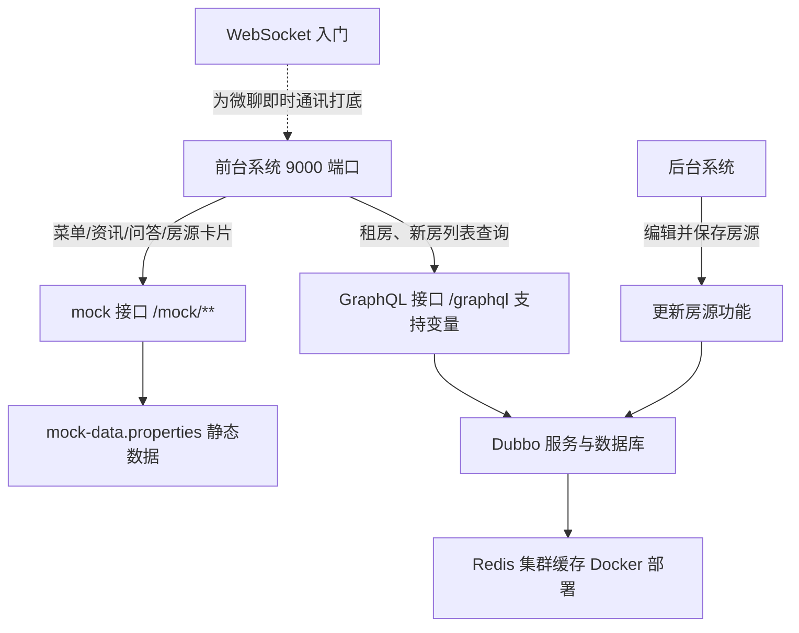

# 第七天开篇：把前端要的每一份数据都接过来，WebSocket 开始入门

首页的轮播广告已经由自己的接口服务供数，可页面往下拉，菜单、资讯、问答点一圈，请求依然打到前端团队那个 Node.js 演示服务上；租房、新房的列表查询，参数还写死在查询语句里；后台系统对房源只有查和增，想改一条数据得绕到数据库。第七天的任务就是把这一圈口子补齐，最后为微聊即时通讯铺一段 WebSocket 的底子。

## 先给结论

- 今天五件事：为前端系统提供 mock 服务、前台系统通过 GraphQL 查询房源列表、实现后台系统的更新房源功能、为接口服务添加 Redis 缓存、WebSocket 入门。
- mock 是自己动手实现的「伪 mock」：不引第三方 mock 框架，把模拟数据放进配置文件，接口先返回，具体实现随后补上。
- 房源列表查询走 GraphQL，参数用变量（variables）机制传入，查询语句不再写死 id，客户端定义与服务端处理各占一课。
- 更新房源让后台系统补上「改」这一环，前端编辑弹窗的代码就在资料包的 `EditResource.js` 里。
- 缓存用 Docker 部署 Redis 集群来扛，WebSocket 则是微聊即时通讯的前置知识。

## 一天任务的地图

五个任务不是并列的散点，它们围绕同一个 api 服务层层递进：



图的读法：B、C 两条线解决「前台系统还在向 Node.js 服务要数据」的问题，先把数据用 mock 顶上，列表查询再升级成带变量的 GraphQL 真实接口；G 是后台系统自身的功能补全；H 给已经打通的接口减压；I 单独成线，为微聊功能做知识储备。

## 二、mock 服务：先把请求都接住

前面的实践中只实现了首页轮播广告的数据支持，菜单、资讯、问答这些请求，响应方一直是前端团队用 Node.js 写的接口服务。后端要接管它们，但真实实现一时做不完，于是采用讲义里的策略：为方便后面的项目开发，需要对前端所有的请求都进行支持，暂时不实现的，先模拟数据返回。

模拟数据不是散落在代码里的字面量，而是集中放进一份 `mock-data.properties`，菜单、资讯、问答、房源卡片、个人中心各占一个键，值是完整的 JSON 串。这一步的真实资料已经随包提供，首页菜单那份数据长这样（一行较长，截断展示）：

```properties
mock.indexMenu={"data":{"list":[{"id":1,"menu_name":"\u4E8C\u624B\u623F","menu_logo":"home","menu_path":"/home","menu_status":1,"menu_style":null}, ...]},"meta":{"status":200,"msg":"\u6D4B\u8BD5\u6570\u636E"}}
```

数据齐了，再用一个配置类把它读进来、一个 Controller 把它按路径吐出去，前端把请求地址一换，Node.js 服务的担子就轻了一大半。为什么这么急着接管？因为前端系统后续每个功能的联调都要等数据，mock 让后端先「应答所有请求」，真实实现可以按节奏逐个补位，两条线不再互相卡进度。

## 三、GraphQL 变量：列表查询的前置课

点击首页的「租房」「新房」进入列表页，查询的是房源列表，每次进入页面的筛选条件都可能不同。前面用过的 GraphQL 查询里，参数是静态写死的 `id: 8`，显然满足不了动态查询的需求。

GraphQL 对此有正式规范：用 `$id` 这样的变量名替代静态值，在查询操作上声明变量类型，变量值以 JSON 结构随请求一并发送。客户端怎么定义变量、服务端怎么接住变量，今天拆成两课讲透，这也是列表接口能落地的前提。

## 四、更新房源：补上后台的「改」

后台系统目前只实现了房源的列表查询与新增，更新功能今天补上。前端这一侧的编辑组件是真实资料，`EditResource.js` 用 Ant Design 的 Modal 弹出编辑表单，保存时把表单值连同图片一并提交：

```javascript
handleSave = () => {
  const { dispatch, form, record } = this.props;
  form.validateFieldsAndScroll((err, values) => {
    if (!err) {
      // 把图片墙收集到的图片地址拼成逗号分隔的字符串
      if(this.state.pics.size > 0){
        values.pic = [...this.state.pics].join(',');
      }
      values.id = record.id;
      dispatch({
        type: 'house/updateHouseForm',
        payload: values,
      });
      // 保存成功后关闭弹窗并刷新列表
    }
  });
};
```

组件里能看到更新功能的几个要素：表单回填 `record` 里的原值、房源标题与租金等字段必填校验、`PicturesWall` 图片墙支持换图、`values.id = record.id` 保证提交带主键。dva 的 `dispatch` 走 `house/updateHouseForm` 这个 effect 发请求，后端对应的更新接口随后实现，前后端在这里会合。

## 五、缓存与 WebSocket：性能线与实时线

功能实现完，接口服务就该考虑扛量了。没有缓存时，每一次请求都会穿透到数据库查询，请求一多数据库必然吃紧，所以要为接口服务添加 Redis 缓存，缓解数据库压力。部署方式也和前面单机装软件不同：采用 Docker 的形式部署 Redis 集群，用集群为接口服务提供缓存服务。资料包里已经放进了 `RedisCacheInterceptor`、`MyResponseBodyAdvice` 这两个拦截器/通知类的雏形，缓存的具体玩法到那一课展开。

最后一条线是 WebSocket 入门。学它是为了做首页底部的「微聊」功能：一个站内即时通讯，消息要能实时推到对方页面上，这件事靠 HTTP 一问一答的姿态做起来别扭，WebSocket 的全双工长连接才是对口工具。今天先把概念与 API 入门，下一阶段的微聊实现直接用上。

## 常见误区

- **以为 mock 就得引第三方 mock 框架。** 本课的 mock 是自己用 Spring Boot 写的：数据放 properties，Controller 返回字符串，没有引入任何 mock 库，所以叫「伪 mock 服务」。
- **把 mock 数据当成能长期跑的数据。** `mock-data.properties` 里是写死的测试 JSON，接口路径再正规也不会查库，它的使命是过渡，真实实现随后跟上。
- **以为缓存是锦上添花，可以先不做。** 每个请求都打数据库，页面一多就是线上事故的前奏；缓存是接口服务上线前的标配，并且集群化部署才谈得上高可用。
- **以为微聊可以用定时轮询凑合。** 轮询延迟高、无效请求多，即时通讯的正解是 WebSocket 长连接，服务端有消息主动推，客户端不必反复问。

## 面试可能被问到的问题

1. 面试官追问：「前后端分离项目里 mock 的价值是什么，什么时候可以撤掉？」
   答：mock 让前端不依赖后端真实实现就能开发联调，双方按约定好的数据结构并行推进。当后端把对应接口真实实现并通过对比验证后，前端把请求地址切回真实接口，mock 即可撤掉；本课保留了 Node.js 服务，是因为上传头像等少数请求还没迁移。
2. 面试官追问：「GraphQL 查询的参数为什么要设计成变量机制，直接拼字符串不行吗？」
   答：拼字符串要自己做转义与类型处理，容易注入出错，查询语句也无法复用。变量机制把查询结构与参数值分离，查询语句可以缓存复用，参数类型由 Schema 校验，类型不符在执行前就报错，安全性和可维护性都更好。
3. 面试官追问：「后台系统的更新接口要特别注意什么？」
   答：更新必须带主键，前端提交时把 `record.id` 合进表单数据；图片这类多值字段要约定拼接或结构化格式；还要处理「只改部分字段」的语义，是全量覆盖还是按非空字段更新，前后端要对齐，否则会把没填的字段清空。
4. 面试官追问：「接口缓存为什么选 Redis，为什么还要集群？」
   答：缓存数据要求高速读写且能被多个服务实例共享，Redis 基于内存、读写性能高，天然适合。单节点缓存有宕机与容量上限问题，集群提供分片与高可用，用 Docker 部署可以快速搭出多节点环境，降低运维成本。
5. 面试官追问：「WebSocket 和 HTTP 是什么关系，为什么即时通讯要用它？」
   答：WebSocket 借用 HTTP 完成握手升级，之后切换到全双工的长连接通道，双方都能主动发消息。即时通讯要求服务端能把新消息实时推给在线用户，HTTP 的请求响应模型做不到服务端主动推送，轮询又有延迟与资源浪费，长连接是更合适的方案。

## 配套资料

- 前端编辑房源组件（更新房源功能的前端侧，含表单校验与图片墙）：`materials/code/03/day07-完善前端功能以及WebSocket入门/day07-完善前端功能以及WebSocket入门/资料/EditResource.js`
- mock 数据文件（首页菜单、资讯、问答、房源卡片、个人中心共九个键）：`materials/code/03/day07-完善前端功能以及WebSocket入门/day07-完善前端功能以及WebSocket入门/资料/mock-data.properties`
- 缓存雏形代码（`RedisCacheInterceptor.java`、`MyResponseBodyAdvice.java`，Redis 缓存课的主角）：`materials/code/03/day07-完善前端功能以及WebSocket入门/day07-完善前端功能以及WebSocket入门/资料/`
- 资料源码里的机构包名已按写作规范统一改写为中性包名（如 `com.haoke`），代码逻辑保持原样。
