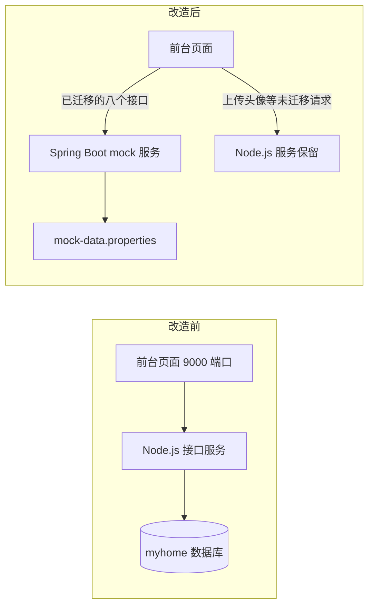

# 自己动手写 mock 服务：一份 properties、一个配置类、一个 Controller，前端就此不再依赖 Node.js

前台系统的首页已经能跑，但轮播广告之外，菜单、资讯、问答、房源卡片这些请求，响应方仍是前端团队用 Node.js 写的接口服务。后端不可能一口气把所有真实接口都实现完，可前端又不能一直吊在别人的服务上，折中方案就是 mock：接口路径先按约定提供，数据先用模拟的顶上，真实实现随后逐个替换。这一课把这层 mock 完整搭出来。

## 先给结论

- 本课的 mock 叫「伪 mock」：不引入第三方 mock 框架，用 Spring Boot 自己实现，数据就是接口原样返回的内容。
- 模拟数据集中放在 `resources/mock-data.properties`，九个键覆盖首页菜单、资讯、问答、房源、资讯列表三种类型、个人中心。
- 读取用 `MockConfig`：`@PropertySource` 指定文件，`@ConfigurationProperties(prefix = "mock")` 按前缀绑定，`@Data` 生成 getter。
- 对外用 `MockController`：类上 `@RequestMapping("mock")`，方法上 `@GetMapping` 一路径一方法，直接返回配置里的 JSON 串。
- 前端逐个页面把地址换成 mock 服务并把请求方法改成 GET；浏览器报跨域就给 Controller 加 `@CrossOrigin`；Node.js 服务先保留，上传头像等未迁移的请求还在用它。

## 一、先看清前端在要什么

动手前先盘需求。打开首页，浏览器开发者工具切到 Network 面板，用 XHR 过滤，刷新页面，首页发出的每个异步请求、每个响应结构都摊在眼前：菜单一份、资讯一份、问答一份、房源卡片一份，资讯页还有按类型区分的三份列表，个人中心还有一份用户信息。这些请求 Node.js 服务都能应答，说明数据结构已经约定好了，后端要做的只是「同路径、同结构、能返回」。



图里能看出撤退路线：mock 服务接管的是「读数据」的请求，Node.js 服务只兜住还没迁移的功能，两套服务并存一个过渡期，等真实接口全部就位再退场。

## 二、数据文件：mock-data.properties 与中文显示

在 `src/main/resources` 下新建 `mock-data.properties`，把整理好的八份模拟数据拷进去（`infos/list` 的数据按类型拆成三份，合计九个键）。这份文件是本课的真实资料，个人中心那条不长，可以看全：

```properties
mock.my={"data":{"id":1,"username":"tom","password":"123","mobile":"123","type":null,"status":null,"avatar":"public/icon.png"},"meta":{"status":200,"msg":"\u83B7\u53D6\u6570\u636E\u6210\u529F"}}
```

拷进去会发现中文全变成了 `\u4E8C\u624B\u623F` 这样的转义序列。这是 properties 文件的特性：它默认按 ISO-8859-1 编码处理，非拉丁字符必须转成 unicode 转义才能被正确读取，所以文件内容本身就是转码后的形态。为了查看方便，在 IDE 的 `Settings → Editor → File Encodings` 里勾选 `Transparent native-to-ascii conversion`，编辑器会把转义序列还原成中文显示。注意这只是**显示层**的转换，文件落盘的内容依旧是转码后的编码，拷贝到别处时贴出去的还是 `\uXXXX` 序列。

## 三、MockConfig：把配置读成对象

数据文件就位，下一步是把它读进程序。写一个 `MockConfig` 配置类，这套组合前面读其他 properties 时用过：

```java
package com.haoke.manage.dubbo.api.config;

import lombok.Data;
import org.springframework.boot.context.properties.ConfigurationProperties;
import org.springframework.context.annotation.Configuration;
import org.springframework.context.annotation.PropertySource;

@Configuration
@PropertySource("classpath:mock-data.properties")
@ConfigurationProperties(prefix = "mock")
@Data
public class MockConfig {

    private String indexMenu;
    private String indexInfo;
    private String indexFaq;
    private String indexHouse;
    private String indexList;
    private String infosList1;
    private String infosList2;
    private String infosList3;
    private String my;
}
```

三个注解各管一段：`@PropertySource` 把 classpath 下的 `mock-data.properties` 装进环境；`@ConfigurationProperties(prefix = "mock")` 做前缀绑定，`mock.indexMenu` 的值会自动塞进同名字段 `indexMenu`，九个键九个字段一一对应；`@Data` 让 Lombok 生成全部 getter，Controller 里直接 `getXxx()` 取数据。字段类型都是 `String`，因为值本来就是整段 JSON 串，接口要做的只是转发，不需要解析。

## 四、MockController：一个路径一个方法

对外接口照着前端现有的请求路径来写：

```java
package com.haoke.manage.dubbo.api.controller;

import com.haoke.manage.dubbo.api.config.MockConfig;
import org.springframework.beans.factory.annotation.Autowired;
import org.springframework.web.bind.annotation.GetMapping;
import org.springframework.web.bind.annotation.RequestMapping;
import org.springframework.web.bind.annotation.RequestParam;
import org.springframework.web.bind.annotation.RestController;

@RequestMapping("mock")
@RestController
public class MockController {

    @Autowired
    private MockConfig mockConfig;

    @GetMapping("indexMenu")
    public String indexMenu() {
        return this.mockConfig.getIndexMenu();
    }

    // 资讯列表：同一个路径，按 type 返回三份数据
    @GetMapping("infos/list")
    public String infosList(@RequestParam("type") Integer type) {
        switch (type) {
            case 1:
                return this.mockConfig.getInfosList1();
            case 2:
                return this.mockConfig.getInfosList2();
            case 3:
                return this.mockConfig.getInfosList3();
        }
        return this.mockConfig.getInfosList1();
    }
}
```

类级 `@RequestMapping("mock")` 定了统一前缀，方法级 `@GetMapping` 细分路径，`@RestController` 让返回的 String 直接作为响应体写出去。前端首页菜单请求 `indexMenu`，资讯列表统一走 `infos/list`，靠 `type` 参数区分资讯、头条、问答三种数据，这与前端原来的请求方式保持一致，切换时前端只需要改地址。

服务重启后先用 REST 客户端验证：

```bash
curl http://127.0.0.1:18080/mock/indexMenu
# 返回 mock.indexMenu 的整段 JSON，状态 200
```

拿到与 Node.js 服务一模一样的数据，第一个 mock 接口就算通了，其余接口照此模式逐个补齐。

## 五、前端切换：改地址、换请求方法、补跨域

后端就绪，回到前端逐个页面改造。以资讯页 `find.js` 为例，三个 tab 的请求地址分别指向 mock 服务并带上 type：

```javascript
url: 'http://127.0.0.1:18080/mock/infos/list?type=2'
```

两处细节值得记下。**第一，请求方法要跟着后端改。** 原来发的是 POST，mock 接口声明的是 `@GetMapping`，前端必须换成 GET 请求，方法不匹配浏览器里直接报 405。**第二，跨域要后端放行。** 地址从 9000 指向 18080，端口不同就是跨域，浏览器控制台立刻报不支持 CORS，解决办法是在 `MockController` 类上再加一个 `@CrossOrigin` 注解，响应头里带上允许跨域的声明，前端请求才能落到服务上。

个人中心 `mine.js` 同理，用户信息请求改成 GET 指向 `mock/my/info`，头像上传这类还没实现的请求不动，继续走 Node.js。改造过程中还有一个小教训：第一次刷新发现某接口 404，排查半天是后端加了方法却忘了重启，mock 服务每加一个接口都要重启才生效。

为「最小化改动」还得点个赞的细节：资讯页请求参数里原有的 `type` 属性保留在请求体中，仅把地址换成带 `?type=x` 的形式，前端逻辑一行不多改，功能即可恢复如初。切换完成，首页从菜单到问答全部由自己的 mock 服务供数，与 Node.js 服务的响应逐字节一致，过渡目标达成。

## 常见误区

- **在 properties 里直接写中文。** properties 按 ISO-8859-1 读取，直接写中文会读出乱码，必须保持 unicode 转义；IDE 的 native-to-ascii 显示选项只是看着友好，别以为文件内容真的变成中文了。
- **前端只改地址不改请求方法。** Node.js 服务许多接口收 POST，mock 接口统一是 GET，地址换了方法不换，报错还以为是地址写错。
- **漏掉跨域注解。** 接口用 curl 测一切正常，浏览器里却拿不到数据，多半是 CORS 被拦，`@CrossOrigin` 加在 Controller 上即可。
- **顺手把 Node.js 服务停了。** 上传头像等功能尚未迁移，停掉服务这些功能当场瘫痪，确认所有请求都迁移完再谈退役。

## 面试可能被问到的问题

1. 面试官追问：「mock 服务和直接在代码里 return 写死的字符串相比，好处在哪？」
   答：数据与代码分离。模拟数据集中在 properties 里可整体维护、可按环境替换，接口代码只负责按路径转发；放在代码里每份数据都是一个字符串常量，改数据要动代码、重新编译，九份数据堆在 Controller 里也没法复用与管理。
2. 面试官追问：「`@ConfigurationProperties` 绑定配置的原理是什么，和 `@Value` 有什么区别？」
   答：它在容器启动时把指定前缀下的配置项按字段名批量绑定到 bean 的属性上，支持松散绑定与类型转换，配合 `@PropertySource` 可指定任意配置文件。`@Value` 是逐个占位符取值，适合零散配置；成组的结构化配置用前缀绑定更清爽，新增字段只需加属性。
3. 面试官追问：「跨域是怎么产生的，`@CrossOrigin` 做了什么？」
   答：浏览器同源策略限制不同协议、域名、端口的脚本发起的请求读取响应。对非简单请求浏览器会先发 OPTIONS 预检，服务端返回 `Access-Control-Allow-Origin` 等响应头表示放行，`@CrossOrigin` 就是让 Spring MVC 在响应里写入这些头，浏览器校验通过后放行响应。
4. 面试官追问：「如果 mock 数据量大、有嵌套结构，还适合放 properties 吗？」
   答：不适合。properties 里塞长 JSON 难以维护也没有结构校验，更常见的做法是按接口路径拆分 JSON 文件或用专门的 mock 平台管理数据，启动时或请求时加载。properties 适合本课这种数据量小、结构已固化的过渡场景。
5. 面试官追问：「mock 阶段返回的数据结构与真实实现不一致，会有什么后果？」
   答：前端按 mock 结构写的渲染逻辑在切真实接口时会批量报错，联调成本反而升高。所以 mock 的前提是先约定契约，数据结构、字段名、状态码都以真实接口的规划为准，mock 只顶替数据来源，不改契约。

## 配套资料

- mock 数据文件（本课真实资料，九个键与正文一致）：`materials/code/03/day07-完善前端功能以及WebSocket入门/day07-完善前端功能以及WebSocket入门/资料/mock-data.properties`
- `MockConfig`、`MockController` 与前端 `home.js`、`find.js`、`mine.js` 的改动未随资料包提供源码，文中代码为按本课画面写法补全的可运行示例，包名沿用本系列成稿的中性命名。
