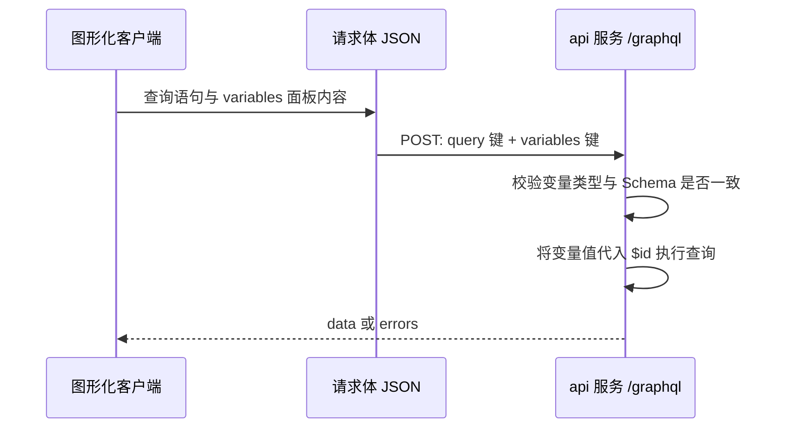

# 别把 id 写死在查询里：GraphQL 变量的定义、传值与类型校验

前面的 GraphQL 查询里，房源 id 都是硬编码的：`HouseResources(id: 8)` 一写到底，在图形化客户端里测试毫无问题。可列表页的现实中，用户点哪条房源，id 就是谁，八条房源就是八个值，查询语句不可能改八遍。GraphQL 对动态参数有正式的变量（Variables）规范，这一课把它从语法到请求形态讲清楚，服务端怎么接是下一课的事。

## 先给结论

- 变量的用法固定三步：查询里用 `$变量名` 替代静态值；操作名后声明变量及类型；变量值以 JSON 结构随请求传输。
- `query hk($id: Long)` 里的 `hk` 只是操作名，随意命名，作用是给这次操作起个标识。
- 客户端真正发出的请求体是一个 JSON 对象，只有两个关键键：`query` 装查询语句，`variables` 装变量值。
- 变量类型必须与 Schema 声明一致：Schema 里 id 是 `Long`，客户端声明 `Int` 会直接报 `VariableTypeMismatch`，查询根本不执行。
- 本课只解决客户端侧的定义与传参，服务端要改造 Controller 才能消费变量。

## 一、静态参数撑不起列表查询

现状先摆出来。在 Altair 这类图形化客户端里，之前的查询长这样：

```graphql
{
  HouseResources(id: 8) {
    id
    title
    estateId
    buildingUnit
    buildingFloorNum
    mobile
    useArea
    pic
  }
}
```

执行正常，返回 id 为 8 的房源详情。但这个 `8` 是写死在查询字符串里的静态参数，官方文档对此的描述很直白：目前为止参数写在了查询字符串内，而实际应用中参数往往是动态的，比如下拉菜单选中的选项、搜索框里输入的关键字。房源列表正是典型场景：同一个列表页，每次请求只是 id 或筛选条件不同，查询结构完全一样。

GraphQL 官网在规范里专门有一节 Variables 讲这件事，结论是参数可以「设置」进查询，而不是拼进查询。

## 二、官方规范：使用变量的三步

规范把使用变量拆成三件事。**第一，用变量替代静态值。** 查询里不再写 `id: 8`，改写 `id: $id`。**第二，声明变量。** 在原有查询外面包一层 `query` 关键字，起一个操作名，并在其后声明变量的名字与类型。**第三，单独传值。** 变量的值不写在查询语句里，而是通过一个 JSON 结构随请求发送。

套到房源查询上，完整写法是：

```graphql
query hk($id: Long) {
  HouseResources(id: $id) {
    id
    title
    estateId
    buildingUnit
    buildingFloorNum
    mobile
    useArea
    pic
  }
}
```

外层的 `query hk` 是操作定义，`hk` 是操作名，随便起，它只是这次操作的标识；括号里的 `$id: Long` 是变量声明，`$` 是变量的固定前缀，`Long` 是类型。内部查询原来写 `8` 的位置换成了 `$id`，引用上面声明的变量。

变量还可以带默认值，官方片段（fragment）示例里出现过：

```graphql
query HeroComparison($first: Int = 3) {
  leftComparison: hero(episode: EMPIRE) {
    ...comparisonFields
  }
  rightComparison: hero(episode: JEDI) {
    ...comparisonFields
  }
}

fragment comparisonFields on Character {
  name
  friendsConnection(first: $first) {
    edges {
      node {
        name
      }
    }
  }
}
```

`$first: Int = 3` 表示请求没带这个变量时就用 3。这个例子还顺带展示了变量的另一个价值：同一段 fragment 里引用的变量，可以在两次并行的查询中复用，参数与查询结构彻底解耦。

## 三、发出去的请求长什么样

在客户端里把变量值填进 variables 面板（内容是 `{"id": 8}`），发起请求。此刻服务端还没改造，查询不会返回数据，但这不影响观察请求本身。打开浏览器开发者工具的 Network 面板，请求体一目了然：

```json
{
  "query": "query hk($id: Long) { HouseResources(id: $id) { id title estateId buildingUnit buildingFloorNum mobile useArea pic } }",
  "variables": {
    "id": 8
  }
}
```

整个请求体是一个 JSON 对象，`query` 键装查询语句字符串，`variables` 键装变量值对象，两者一起提交到服务端。这个结构揭示了变量机制的本质：查询结构与参数值在传输层就是分离的，服务端拿到的是「一份结构」加「一份值」。



图的末两步目前是空的：服务端还没有处理 `variables` 的代码，所以此刻点击查询拿不到数据。客户端把值送到了，服务端还没伸手接，这正是下一课要补的环节。

## 四、类型必须和 Schema 对上

变量声明里的类型不是随便写的。第一次测试时把变量声明成 `Int`，服务端 Schema 里 `HouseResources(id: Long)` 声明的是 `Long`，请求发过去立刻收到错误响应：

```json
{
  "errors": [
    {
      "message": "Validation error of type VariableTypeMismatch. Variable type 'Int' doesn't match expected type 'Long'",
      "locations": []
    }
  ]
}
```

`VariableTypeMismatch` 说得很明白：变量类型 `Int` 与期望类型 `Long` 不匹配。这发生在执行前的校验阶段，graphql-java 拿变量声明与 Schema 里的字段参数类型逐一对账，对不上就直接把错误放进响应的 `errors` 键，根本不会去碰数据库。把声明改成 `$id: Long`，与 Schema 一致，类型校验这道闸门就通过了。

这件事反过来是好事：参数类型在 Schema 里只声明一次，所有客户端传错类型都在门口被拦下，错误信息还精确到变量名与期望类型，排查成本极低。

## 常见误区

- **变量类型按值的大小随手写。** 值是 8 就声明 `Int`，可 Schema 里是 `Long`，校验直接失败。变量类型以 Schema 声明为准，不是以字面值大小为准。
- **以为变量加上就自动生效。** 变量只是客户端的语法，服务端 Controller 不读取 `variables` 并构造执行输入的话，查询照样拿不到数据，客户端与服务端要配对改造。
- **把 variables 当成查询语句的一部分。** 它与 `query` 是请求体里平级的两个键，往查询字符串里找变量值是找错了地方。
- **纠结操作名要不要特定写法。** `hk` 也好 `HeroNameAndFriends` 也好，操作名只是标识，真正约束类型的是括号里的变量声明。

## 面试可能被问到的问题

1. 面试官追问：「GraphQL 为什么要设计变量机制，直接字符串拼接参数不行吗？」
   答：拼接要自己处理转义，容易产生语法错误与注入风险，且查询无法复用。变量机制让查询结构与参数值分离，同一份查询语句配不同 variables 反复使用，参数类型由 Schema 统一校验，类型不符在执行前报错，安全与性能都占优。
2. 面试官追问：「一次 GraphQL 的 POST 请求体里有哪些组成部分？」
   答：核心是 `query` 与 `variables` 两个键，前者是查询语句字符串，后者是变量值的 JSON 对象；有多个具名操作时再带 `operationName` 指明执行哪一个。服务端据此构造执行输入。
3. 面试官追问：「变量类型不匹配这类错误发生在什么阶段？」
   答：执行前的校验阶段。graphql-java 先对查询做静态校验，包括变量声明与 Schema 类型的一致性检查，不通过就把 `VariableTypeMismatch` 这类错误放进响应的 errors 键，DataFetcher 与数据源完全不会被触达。
4. 面试官追问：「变量支持默认值和必填约束吗？」
   答：都支持。声明时写 `$first: Int = 3` 即默认值，请求未携带时生效；类型后加叹号如 `$id: Long!` 表示必填，请求没带这个变量会在校验阶段直接报错。默认值与必填配合，可以让查询对调用方更宽容或更严格。
5. 面试官追问：「具名操作和操作名有什么用？」
   答：`query hk(...)` 的 `hk` 是具名操作的名字，一个请求文档里可以放多个具名操作，靠 `operationName` 指定执行哪个。名字也便于日志定位与客户端缓存查询语句，匿名查询则没有这些能力。

## 配套资料

- 本课无 GraphQL 源码包，查询语句、变量声明与请求体示例为按本课画面与 GraphQL 官方 Variables 规范补全，可直接在 Altair 等图形化客户端中复现。
- 本教学日资料包位于 `materials/code/03/day07-完善前端功能以及WebSocket入门/day07-完善前端功能以及WebSocket入门/资料/`，其中 `mock-data.properties` 服务于 mock 一课，GraphQL 相关源码随后续单元按画面补全。
