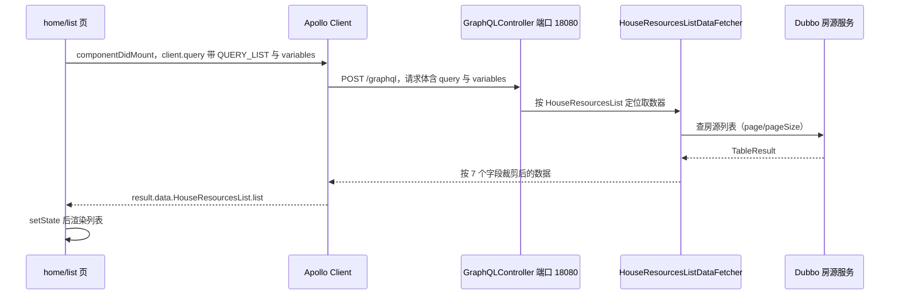

# 前台房源列表接入 GraphQL：七个字段的按需查询与 Apollo Client 对接

前台首页点「二手房」「租房」「新房」进入的房源列表页，至今还在吃假数据：`home/list` 页里一段 `axios.post('/homes/list')`，请求打向约定路径，返回什么渲染什么。后端这边基石其实已经铺好，列表查询的 GraphQL 门面在前几课立起来了，SDL 里 `HouseResourcesList` 字段与取数器都在岗。这一课把列表页从 mock 线切到 GraphQL 线，顺手把「前端按需取字段」第一次落到实处。

## 先给结论

- 列表卡片只需要 7 个字段：`id`、`pic`、`title`、`coveredArea`、`orientation`、`floor`、`rent`，查询语句里点谁返回谁，多余字段一个都不给。
- 动代码前先把查询语句在 Altair 客户端里跑通，核对返回结构与字段名，再进前端工程照抄，联调成本最低。
- 前端改造三个动作：引 `apollo-boost` 与 `graphql-tag`，`new ApolloClient({uri})` 指向 GraphQL 入口，`client.query({query, variables})` 发请求。
- 数据落在两层之下：`result.data.HouseResourcesList.list`，根字段名与 SDL 声明一致，`list` 才是真正的数组。
- `pic` 在库里是逗号分隔的多图字符串，列表只展示第一张，`pic.split(',')[0]`。

## 一、列表页现状：POST 打 mock，字段给什么用什么

打开 `home/list.js`，`componentDidMount` 里是原来对接 mock 的查询：

```javascript
axios.post('/homes/list', {
  home_type: query.type
}).then(ret => {
  this.setState({
    listData: ret.data,
    loadFlag: true
  })
})
```

页面结构上，列表区用 Semantic UI 的 `Item` 组件渲染房源卡片，每张卡片要展示的东西在页面上摆得清清楚楚：图片、房屋标题、建筑面积、朝向、楼层、所在地区、租金。对照数据库里 `tb_house_resources` 表的字段，一一有主：`pic`、`title`、`coveredArea`、`orientation`、`floor`、`rent`，地区一栏页面上暂时写死「上海」，没参与查询。

这就是 GraphQL 的用武之地。换成 RESTful 接口，返回的是整个实体，前端要 7 个字段也得收下几十个；换成 GraphQL 查询，字段在语句里点名，返回的 JSON 恰好就是要点的那几样。

## 二、先在客户端把查询语句跑通

写前端之前，先把查询语句与变量放进 Altair 验证一遍。操作名起作 `HouseResourcesList`，分页变量 `$pageSize` 与 `$page` 在操作签名里声明：

```graphql
query HouseResourcesList($pageSize: Int, $page: Int) {
  HouseResourcesList(page: $page, pageSize: $pageSize) {
    list {
      id
      pic
      title
      coveredArea
      orientation
      floor
      rent
    }
  }
}
```

变量以 JSON 单独放一栏：

```json
{
  "pageSize": 3,
  "page": 1
}
```

发送后返回 3 条房源，每条恰好 7 个字段。这里有个层级关系值得说清：操作名只是这条查询的名字，不进返回结构；真正的取数路径是根字段 `HouseResourcesList`（与后端 SDL 里 `HaokeQuery` 下的字段声明同名），它下面的 `list` 才是数据数组。后端这个字段返回的 `TableResult` 结构里，`list` 与 `pagination` 并列，本页只要 `list`，`pagination` 一个字都没点，响应里就没有它。

## 三、改造 list.js：Apollo Client 的三个动作

客户端验证通过，进工程改代码。轮播广告那课已经引过依赖（`apollo-boost`、`react-apollo`、`graphql`），这里直接用。`list.js` 顶部补导入与客户端：

```javascript
import ApolloClient from 'apollo-boost';
import gql from 'graphql-tag';

const client = new ApolloClient({
  uri: 'http://127.0.0.1:18080/graphql'
});

const QUERY_LIST = gql`
  query HouseResourcesList($pageSize: Int, $page: Int) {
    HouseResourcesList(page: $page, pageSize: $pageSize) {
      list {
        id
        pic
        title
        coveredArea
        orientation
        floor
        rent
      }
    }
  }
`;
```

`uri` 与轮播广告课指向同一个 GraphQL 入口。查询语句用 `gql` 模板字符串包起来存进 `QUERY_LIST`，Altair 里调通的那段原样搬进来。

`componentDidMount` 里把原来的 `axios.post` 注释掉，换上 `client.query`：

```javascript
client.query({
  query: QUERY_LIST,
  variables: {"pageSize": 3, "page": 1}
}).then(result => {
  this.setState({
    listData: result.data.HouseResourcesList.list,
    loadFlag: true
  });
})
```

与 REST 版本对比，变化集中在两处。**其一，参数从请求体挪进了 `variables`。** REST 版把 `home_type` 塞进 POST 请求体；GraphQL 版在 `client.query` 上有一个专门叫 `variables` 的参数，键名与查询语句里声明的 `$pageSize`、`$page` 对应，值就是 Altair 里调通的那份 JSON。**其二，取数路径深了一层。** `ret.data` 变成 `result.data.HouseResourcesList.list`，两层路径对应第二节说的两个层级。

贴进 `gql` 模板后编辑器可能划红线，这类报错来自语法插件不认识模板串里的查询语言，保存后运行完全不受影响，装上 GraphQL 相关插件即可消除，不值得为它改代码。

整条链路走下来是这样：



图里最值得看的一环是 DF 到 DS：后端取数器与 Dubbo 服务在前几课已经接好，前端这次一行后端代码都没动，只是换了个门进。

## 四、render 遍历与首图截取

数据进了 `listData`，渲染层把遍历逻辑的字段名对齐过来：

```jsx
return (
  <Item key={item.id}>
    <Item.Image src={item.pic.split(',')[0]}/>
    <Item.Content>
      <Item.Header>{item.title}</Item.Header>
      <Item.Meta>
        <span className="cinema">{item.coveredArea}㎡/{item.orientation}/{item.floor}</span>
        <Item.Description>
          上海
        </Item.Description>
        <Item.Description>{item.rent}</Item.Description>
      </Item.Meta>
    </Item.Content>
  </Item>
)
```

`Meta` 一行把面积、朝向、楼层拼在一起，租金单独一栏。图片这里有个小处理必须做：数据库里 `pic` 存的是多张图逗号分隔的字符串，直接塞给 `src` 浏览器当成一个地址加载，图必挂。按逗号 `split` 之后取第 0 个，列表里永远展示第一张图，详情页才有机会看全所有图。

刷新页面，加载态走完，三张房源卡片出来了，标题、租金、图全部是真实数据。不过有个现象一眼可见：点二手房、点新房、点租房，三个入口查回来的都是同一批数据。原因在 `variables` 里只有分页参数，`query.type` 压根没进查询条件。本课的目标是把 GraphQL 主链路打通，按类型筛选留待后续补齐，这一点心里要有数。

## 常见误区

- **把编辑器对 `gql` 模板串的报错当成语法错误去改代码。** 报错来自编辑器插件不识别，运行时 `graphql-tag` 会正常解析，照着波浪线「修」反而改坏语句。
- **取数路径少写一层。** `result.data.list` 是 `undefined`，根字段名 `HouseResourcesList` 是返回结构的第一层，`list` 才是数组；对不上就先打印 `result.data` 看结构。
- **多图字符串直接喂给 `src`。** 逗号分隔的多图必须先 `split(',')` 再取下标，否则浏览器按一个 URL 解析整串。
- **忘了跨域声明。** 前台 9000 端口直连 18080，`/graphql` 入口类上需要 `@CrossOrigin`，轮播广告课已配过，换端口重跑服务时别丢了这条。

## 面试可能被问到的问题

1. 面试官追问：「前端按需取字段，实际收益体现在哪？」
   答：一是响应体变小，本例只要 7 个字段，REST 实体里的几十个字段都不再传输；二是前端不用维护字段映射，返回的 JSON 键名与查询语句一致，少了「接口返回什么、页面用哪个」的对照成本；三是后端不用为不同页面维护多个精简版 VO。
2. 面试官追问：「`variables` 和把参数直接写进查询字符串有什么区别？」
   答：写死的参数要拼接字符串，转义与注入风险都在拼接处；`variables` 把语句与参数分离，语句可静态化、可被客户端缓存复用，参数按声明的类型校验。多页复用同一查询只换 variables，不用重发新语句。
3. 面试官追问：「`result.data.HouseResourcesList.list` 为什么有两层？」
   答：第一层是根字段名，与 SDL 里 `HaokeQuery` 的字段声明同名；第二层才是该字段返回的 `TableResult` 内的数组。响应结构完全由查询语句的层级决定，语句里嵌几层，返回就包几层。
4. 面试官追问：「从 REST 切到 GraphQL，后端要跟着改吗？」
   答：本例一行没改。SDL 与取数器早已就位，前端只是新调一个已存在的接口门面。如果现有门面没有需要的字段，才需要动 SDL 或取数器，而已有字段的组合查询不需要任何后端工作，这正是 GraphQL 对前后端协作最大的解耦价值。
5. 面试官追问：「Apollo Client 和直接用 axios 发 POST 到 /graphql 有什么区别？」
   答：GraphQL 端点本身就是 POST + JSON，axios 也能打。Apollo Client 在其上封装了查询语句解析、variables 组装、响应解包与错误归一化，后续还能叠加缓存与请求去重。小项目用 axios 也能跑，工程化项目客户端的缓存层是主要价值。

## 配套资料

- 本课无前端源码包：`materials/code/03/day07-完善前端功能以及WebSocket入门/day07-完善前端功能以及WebSocket入门/资料/` 内只有更新房源与后端拦截器相关文件，不含 `list.js`，文中查询语句与页面改造代码为按本课讲义画面写法补全的可运行示例。
- 后端列表查询的 SDL 声明与 `HouseResourcesListDataFetcher` 实现见已成稿的 `0095-实现查询房源列表的GraphQL接口服务.md`，前端取数路径与那份契约一一对应。
