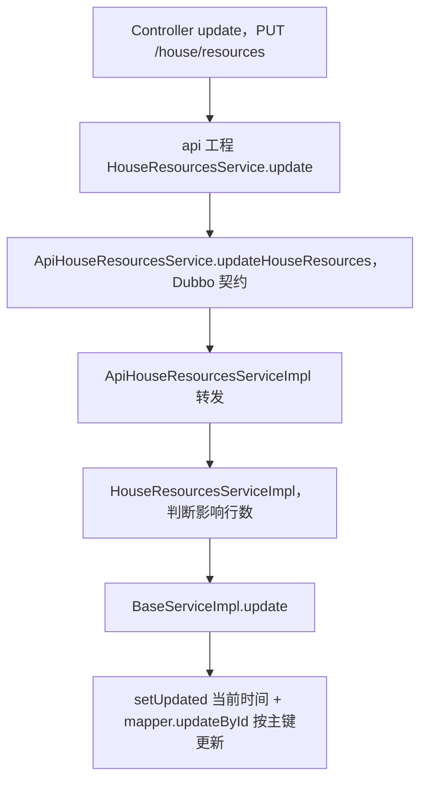

# 给房源补上更新接口：PUT 语义、204 响应与四层调用链

管理后台的房源管理页，操作列里至今只有「查看」和「删除」两个动作，录错一条租金、传错一张图，除了删掉重录没有别的办法。更新功能要补上，它分两半：后端接口与前端交互页面。这一课先把接口这半立起来，逻辑本身不难，看点在链路长，一个 PUT 请求从 Controller 到数据库要穿过四层。

## 先给结论

- 更新接口用 `@PutMapping` 承接：RESTful 里 GET 查、POST 增、PUT 改、DELETE 删，更新语义对应 PUT。
- 成功返回 `HttpStatus.NO_CONTENT`（204）：更新操作没有响应体要给，204 比 200 更贴切。
- 调用链四层：api 工程本地 Service 转发 Dubbo 接口 `updateHouseResources`，dubbo-server 实现类再转业务 Service，最后落进 `BaseServiceImpl.update`。
- `BaseServiceImpl` 统一盖章：更新前 `record.setUpdated(new Date())` 把修改时间刷成当前时间，然后 `mapper.updateById(record)`。
- 更新条件是主键 `id`，前端提交的数据必须带 `id`，没有它更新落不到任何一行。
- 影响行数等于 1 才返回 `true`，把数据库的真实结果如实递给上层。

## 一、PUT 语义：Controller 里的更新入口

之前新增房源用的 `@PostMapping`，列表查询用的 `@GetMapping`，更新补上第三个动词。类上加 `@PutMapping` 就声明了这个方法只吃 PUT 请求，与新增的 `save` 摆在一起看：

```java
/**
 * 修改房源
 * @param houseResources json 数据
 * @return
 */
@PutMapping
@ResponseBody
public ResponseEntity<Void> update(@RequestBody HouseResources houseResources) {
    try {
        boolean bool = this.houseResourcesService.update(houseResources);
        if (bool) {
            return ResponseEntity.status(HttpStatus.NO_CONTENT).build();
        }
    } catch (Exception e) {
        e.printStackTrace();
    }
    return ResponseEntity.status(HttpStatus.INTERNAL_SERVER_ERROR).build();
}
```

结构与 `save` 高度相似：`@RequestBody` 接 JSON 反序列化成的实体，业务成功与失败走不同的状态码。差别有两处值得留意。**其一，请求方法从 POST 换成 PUT。** 地址不变，仍是 `/house/resources`，同一个资源路径靠 HTTP 动词区分操作，这正是 RESTful 的核心约定，前端据此一眼判断这个地址该发什么请求。**其二，成功态用的是 204 而不是 200。** 更新完成后没有新数据要返回，`NO_CONTENT` 明确告诉调用方「成了，但没有响应体」，比 200 配空 body 语义更准。

## 二、api 工程的中间层：本地 Service 与 Dubbo 接口补方法

Controller 里的 `houseResourcesService` 是 api 工程自己的本地门面 Service，新增与查询时它就是这个角色：对上承接 Controller，对下调 Dubbo 接口。更新照旧，加一个纯转发方法：

```java
public boolean update(HouseResources houseResources) {
    return this.apiHouseResourcesService.updateHouseResources(houseResources);
}
```

真正干活的服务在 dubbo-server，所以先要在接口模块的 `ApiHouseResourcesService` 上补声明，带着注释一起：

```java
/**
 * 修改房源
 * @param houseResources
 * @return
 */
boolean updateHouseResources(HouseResources houseResources);
```

接口是服务提供方与消费方之间的契约，方法加在这里，api 工程才有的可调，dubbo-server 才有的可实现。这一层没有逻辑，它存在的意义是约束两边的签名永远一致。

## 三、dubbo-server：实现类转发，BaseServiceImpl 盖章

顺着调用往下，先是 Dubbo 接口的实现类，与其他方法一样只做转发：

```java
@Override
public boolean updateHouseResources(HouseResources houseResources) {
    return this.houseResourcesService.updateHouseResources(houseResources);
}
```

被转发的 `HouseResourcesService` 是 dubbo-server 里的业务 Service，实现类继承 `BaseServiceImpl`，更新逻辑在父类里早就备好了，这里只需调用加判断：

```java
@Override
public boolean updateHouseResources(HouseResources houseResources) {
    return super.update(houseResources).intValue() == 1;
}
```

`super.update` 是通用层提供的标准更新方法：

```java
/**
 * 更新数据
 * @param record
 * @return
 */
public Integer update(T record) {
    record.setUpdated(new Date());
    return this.mapper.updateById(record);
}
```

两行代码各管一件事。`record.setUpdated(new Date())` 在更新前把修改时间刷成当前时刻，任何一张表走这个方法都自动带上这条规矩，业务代码不用各自操心时间戳。`mapper.updateById(record)` 是 MyBatis-Plus 的按主键更新，实体里的 `id` 就是 SQL 里 `WHERE` 条件的唯一依据，其余非空字段全部进 `SET` 子句。返回值是影响行数，往上传到业务层做 `intValue() == 1` 的判断：等于 1 说明恰好更新了这一条，返回 `true`；不是 1，无论是 0 行还是异常，一律按失败处理。用行数说话而不是凭感觉返回成功，是数据操作的基本纪律。

四层链条画出来是这样：



图里 B、D 两层是纯转发，真正的规则只有两条：E 层的行数判断与 F 层的时间戳盖章。转发层看着冗余，但 Dubbo 的服务契约、门面隔离全靠它们撑着，与新增、查询的既有分层完全同构。

## 四、重启两个服务，接口就绪

接口横跨两个工程，dubbo-server 的提供方改了实现类，api 工程的消费方改了本地 Service 与 Controller，两边都要重启，Dubbo 注册中心里的服务元数据才会刷新。起服务后可以先在命令行压一发验证（示例）：

```bash
curl -X PUT http://127.0.0.1:18080/house/resources \
  -H "Content-Type: application/json" \
  -d '{"id": 1, "title": "新标题", "rent": 3000}'
```

返回 204 即成功，数据库里 id 为 1 的记录标题与租金已变、`updated` 刷新为刚才的时间。接口就位后，页面怎么把数据组织起来发这个 PUT，是接下来两课的事。

## 常见误区

- **用 `@PostMapping` 承接更新。** 后端语义就歪了，前端按 PUT 发请求会直接 405。同一个资源地址靠动词区分操作，动词与操作必须对号。
- **更新数据不带 `id`。** `updateById` 的条件就是主键，`id` 为空时更新匹配不到任何行，影响行数为 0，接口按失败返回，数据库却什么都没动还查不出原因。
- **只重启 api 工程。** dubbo-server 里加了实现方法，提供方不重启，注册中心里还是旧的服务定义，消费方调用直接报找不到方法。
- **以为 `updateById` 会覆盖全部字段。** MyBatis-Plus 默认忽略实体里为 null 的字段，前端只传标题和租金，其余列保持原值，这是「补丁式」更新。要做全量覆盖需改字段策略或先查后改，两种做法都要想清楚再选。

## 面试可能被问到的问题

1. 面试官追问：「更新用 PUT 而不是 POST，除了语义还有什么差别？」
   答：核心差别是幂等性。PUT 对同一资源重复提交，结果与提交一次相同，天然适合更新；POST 不保证幂等，重复提交可能产生多次效果。网络重试、消息重发场景下，幂等与否直接决定要不要额外的防重机制。
2. 面试官追问：「204 和 200 都能表示成功，为什么更新接口选 204？」
   答：204 明确表示响应无正文，客户端不会白等一个空 body，也不会误把空内容当数据解析；200 隐含「有内容可读」。更新操作只关心成败、不产出数据，204 与 RESTful 语义贴合，调用方处理分支也更干净。
3. 面试官追问：「MyBatis-Plus 的 `updateById` 对 null 字段怎么处理？」
   答：默认字段策略下 null 不进 SET 子句，等价于只更新实体里非空的列。好处是前端可以只提交变化的部分；代价是无法用它把某列清空。要清空就得用 `UpdateWrapper` 显式 set，或调整全局与字段级的更新策略。
4. 面试官追问：「更新接口为什么也要穿过 Dubbo，api 工程直连数据库不行吗？」
   答：架构上 api 工程不持库，数据的读写全部收敛在 dubbo-server，单一出口便于统一缓存、校验与后续分库分表。门面层只做协议转换，数据库的访问权收口，是微服务拆分的基本纪律。
5. 面试官追问：「用影响行数判断更新成功，有没有漏网的情况？」
   答：有。MySQL 默认行为下，如果新值与旧值完全相同，影响行数是 0，接口会误报失败，但数据其实已经一致。对「幂等提交」敏感的场景要打开 `useAffectedRows` 的真实行数语义之外的另一种口径，或改用「提交前后状态比对」来判断，业务上明确成功标准是前提。

## 配套资料

- 本课无后端源码包：`materials/code/03/day07-完善前端功能以及WebSocket入门/day07-完善前端功能以及WebSocket入门/资料/` 内不含本次改造的 Controller 与 Service 类，文中各层代码为按本课讲义画面写法补全的可运行示例，包名沿用本系列成稿的中性命名。
- `BaseServiceImpl` 的来历与两层 Service 的分层脉络见已成稿的 `0064-新增房源服务实现之新增房源服务的具体实现.md`，新增接口的 Controller 写法可对照 `0065-新增房源服务实现之新增房源RESTful接口的开发.md`。
