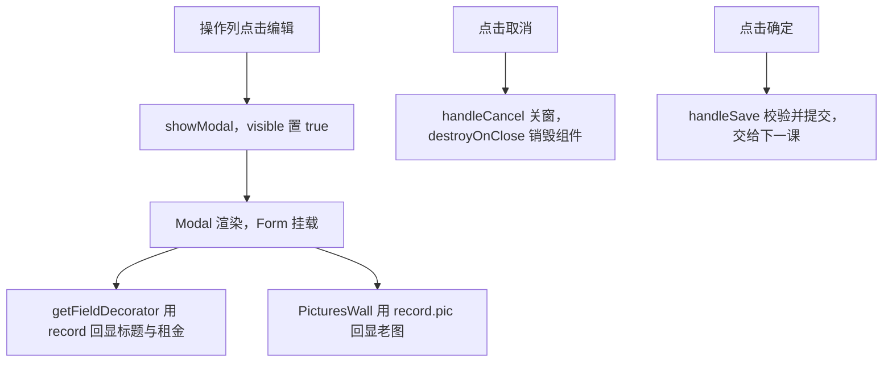

# 编辑弹窗怎么搭：EditResource 组件、表单回显与 destroyOnClose 的必要性

更新接口已经就位，剩下的是前端这半：列表操作列里塞进一个「编辑」，点开弹出表单，当前行的数据填进输入框。这是后台系统的高频场景，也是新坑密集区：装饰器没挂就报 `getFieldDecorator is not defined`，回显只在第一次生效，弹窗关了数据还残留在组件里。这一课把 `EditResource` 组件从空壳搭到完整，代码以课程资料包里的 `EditResource.js` 原件为准。

## 先给结论

- 编辑功能做成独立组件 `EditResource`，在列表操作列里以 `<EditResource record={record} reload={...}/>` 的形式引入，弹窗的开关由组件自己管。
- 弹窗显隐就是一个 `state.visible`：`showModal` 置 `true`，`handleCancel` 置 `false`，Modal 的 `visible` 属性只认这个状态。
- 表单回显靠 `@Form.create()` 装饰器：`getFieldDecorator` 要从 `this.props.form` 里解构出来，`initialValue` 直接取 `record` 的字段。
- `Modal` 必须加 `destroyOnClose={true}`：装饰器给表单的初始值只在字段首次挂载时生效，关闭不销毁，第二次打开还是上一行的数据。
- 图片回显给 `PicturesWall` 传 `fileList={record.pic}`，新上传与原图统一收进一个 `Set` 去重。

## 一、编辑是操作列里的一个子组件

房源列表页 `Resource.js` 的操作列，渲染函数里原来只有「查看」和「删除」。新加的编辑不做成函数调用，而做成一个自带状态的组件插进去：

```jsx
{
  title: '操作',
  render: (text, record) => (
    <Fragment>
      <a onClick={() => {}}>查看</a>
      <Divider type="vertical" />
      <EditResource record={record} reload={this.reload.bind(this)}/>
      <Divider type="vertical" />
      <a href="">删除</a>
    </Fragment>
  ),
}
```

两个 props 是这套设计的全部约定：`record` 把当前行数据递进去供回显，`reload` 把列表页的刷新方法递进去供提交后调用。组件的表头文件先搭空壳，`render` 暂时只返回一个编辑链接，保证引入后编译不报错，功能再逐步往里填：

```javascript
import React from 'react';

class EditResource extends React.Component{
  render() {
    return (
      <div>
        <a>编辑</a>
      </div>
    );
  }
}

export default EditResource;
```

列表页顶部 `import EditResource` 之后，操作列里就多出了编辑入口。这一步最容易栽在 JSX 的括号上：组件自闭合要用 `/>`，箭头函数体要配对大括号，编辑器红一处整页白屏，报错位置未必是出错的那一行。

## 二、组件骨架：state 与弹窗开关

把资料包里的完整组件打开，构造函数里初始状态只有两项：

```javascript
constructor(props){
  super(props);
  this.state = {
    visible: false,
    pics: new Set()
  };
}

showModal = () => {
  this.setState({ visible: true });
};

handleCancel = () => {
  this.setState({ visible: false });
};
```

`visible` 控制弹窗显隐，默认 `false` 不显示；`pics` 用 `Set` 存当前房源的图片集合，初始为空，后面图片合并去重时再用。`showModal` 与 `handleCancel` 是一对开关，一个开一个关。

`render` 里，编辑链接与弹窗并列返回。React 组件的 `render` 只允许一个根节点，所以外层套 `React.Fragment`，不产生多余 DOM：

```jsx
return (
  <React.Fragment>
    <a onClick={() => {this.showModal()}}>编辑</a>
    <Modal
      title={'编辑'}
      width={640}
      visible={this.state.visible}
      onOk={()=>{this.handleSave()}}
      onCancel={()=>{this.handleCancel()}}
      destroyOnClose={true}
    >
      <div style={{ overflowY:'auto'}}>
        <Form hideRequiredMark style={{ marginTop: 8 }}>
          <FormItem {...formItemLayout} label="房源标题">
            {getFieldDecorator('title',{initialValue:record.title,rules:[{ required: true, message:"此项为必填项" }]})(<Input style={{ width: '100%' }} />)}
          </FormItem>
          <FormItem {...formItemLayout} label="租金">
            {getFieldDecorator('rent',{initialValue:record.rent,rules:[{ required: true, message:"此项为必填项" }]})(<Input style={{ width: '50%' }} addonAfter="元/月" />)}
          </FormItem>
        </Form>
      </div>
    </Modal>
  </React.Fragment>
);
```

Modal 的五个属性各就各位：`visible` 接状态，`onOk` 留给提交，`onCancel` 关窗，`destroyOnClose` 是本课的主角之一，原因在第四节。表单项用 `getFieldDecorator('字段名', 配置)(控件)` 的模式包装，配置里的 `initialValue` 就是要回显的值。

## 三、表单回显：装饰器缺不得

第一版跑起来，控制台一记重拳：`ReferenceError: getFieldDecorator is not defined`。这个函数不在组件里，也不在 import 列表里，它是 Ant Design 的 `Form` 通过装饰器注入的。类上补两个装饰器：

```javascript
@connect()
@Form.create()
class EditResource extends React.Component{
```

`@Form.create()` 会把组件包一层，包装后的组件往 `props` 里塞一个 `form` 对象，`getFieldDecorator` 就挂在它身上，组件里解构出来用：

```javascript
const record = this.props.record;
const {
  form: { getFieldDecorator }
} = this.props;
```

`@connect()` 是 dva 的连接装饰器，让组件能拿到 `dispatch`，提交时要用。装饰器补上、解构就位，刷新页面点「编辑」，弹窗弹出，标题、租金、建筑面积赫然是这一行的值。换一行再点，值跟着换，「最新修改的房源」对「最新修改的房源」，「康城精品房二」对「康城精品房二」，回显链路通了。建筑面积与租金用带单位的 `addonAfter`（「元/月」「平米」）包住，校验规则统一是必填。

## 四、图片回显与关窗即销毁

图片不是普通输入框，回显交给上传组件。表单里的图片一项：

```jsx
<FormItem {...formItemLayout} label="上传室内图">
  <PicturesWall handleFileList={this.handleFileList.bind(this)} fileList={record.pic}/>
</FormItem>
```

`fileList` 传的是 `record.pic` 这一整串逗号分隔的图片地址，`PicturesWall` 内部把它拆成列表渲染缩略图，老图就以可预览、可删除的形态出现在上传区。用户增删图片后，组件通过 `handleFileList` 回调把最新的文件列表交回来：

```javascript
handleFileList = (obj)=>{
  let pics = new Set();
  obj.forEach((v, k) => {
    if(v.response){
      pics.add(v.response.name);
    }
    if(v.url){
      pics.add(v.url);
    }
  });
  this.setState({ pics: pics })
}
```

新上传的文件在 `response` 里带服务端返回的文件名，原有图片走 `url`，两类来源都收进同一个 `Set`，天然去重。构造函数里 `pics` 初始化成 `new Set()` 就是为此埋的伏笔：状态里永远持有一份干净的图片全集，提交时再拼成逗号串。

整段交互的走向如下：



图上 G 节点是最后一个必须掰扯清楚的细节。`destroyOnClose={true}` 的默认值是 `false`，关窗后表单组件还挂在内存里。而 `getFieldDecorator` 的 `initialValue` 只在字段首次挂载时登记，之后不再重算：不销毁的话，编辑完 A 行再点 B 行，弹出来的还是 A 行的数据，看起来像数据错乱，实际是初始值被第一次挂载锁死了。销毁重挂，每行数据都能干净回显。

## 常见误区

- **漏掉 `@Form.create()` 装饰器。** 直接用 `getFieldDecorator` 必报 `ReferenceError`。这个函数来自装饰器注入的 `props.form`，类上不挂装饰器，props 里就没有 form。
- **`Modal` 不设 `destroyOnClose`。** 关窗不销毁，`initialValue` 永远停在首次挂载那次的值，换行编辑时显示别人家数据。另一种做法是打开弹窗时手动 `setFieldsValue`，两者取一。
- **`render` 返回多个并列节点不套 `Fragment`。** JSX 相邻兄弟没有父节点，编译直接失败。编辑链接与 Modal 必须在同一个根节点里。
- **`reload` 忘了 `bind(this)`。** 从列表页把方法当 props 传出去，`this` 的指向会丢，子组件里调用时方法内部取不到 `dispatch`，刷新静默失效。

## 面试可能被问到的问题

1. 面试官追问：「`initialValue` 为什么第二次打开弹窗不生效？」
   答：Ant Design 表单的初始值登记发生在字段组件挂载时，`getFieldDecorator` 第一次包住控件时把值写入内部 store，之后该字段的值由表单接管，initialValue 不再参与。要让新数据生效，要么 `destroyOnClose` 销毁重建，要么打开时调 `setFieldsValue` 覆盖。
2. 面试官追问：「`Form.create()` 装饰器实际做了什么？」
   答：它是高阶组件的语法糖，把原组件包一层，向 `props` 注入 `form` 对象，包含 `getFieldDecorator`、`validateFields`、`setFieldsValue` 等方法，同时接管字段值的存储与校验调度。组件自己不再持有输入框的值，值全部活在 form store 里，这是受控思路。
3. 面试官追问：「React 的 `render` 为什么只能有一个根节点，怎么解决？」
   答：JSX 编译后是 `React.createElement` 的嵌套调用，平级的多个节点没有共同父级，虚拟 DOM 无法挂载。React 16 之前用无关 DIV 包裹，代价是多一层真实 DOM；16 起用 `Fragment`，渲染时不产生额外节点，需要传 key 的列表场景可用 `<React.Fragment key={...}>`。
4. 面试官追问：「编辑弹窗的开关状态为什么放在子组件里而不是列表页？」
   答：显隐只服务于编辑这一个入口，放进列表页会让列表 state 里多出一堆弹窗字段，还要维护「编辑的是哪一行」。把状态和表单收进子组件，列表页只递 `record` 与 `reload` 两个 props，职责分界干净，多行多处复用时也不用改列表页。
5. 面试官追问：「房源图片存成逗号分隔字符串，利弊怎么看？」
   答：好处是单表单字段即可承载，前端拼串、后端整存，列表页取首图 `split(',')[0]` 也简单。代价是违背第一范式，无法按图建外键与索引，图片顺序调整、单独删除都要整串重写。量小的展示型场景够用，需要图片管理能力的系统应拆独立图片表。

## 配套资料

- 编辑组件原件：`materials/code/03/day07-完善前端功能以及WebSocket入门/day07-完善前端功能以及WebSocket入门/资料/EditResource.js`，文中组件骨架、表单项、`handleFileList` 均出自该文件，仅对空行与未使用的导入做了精简。
- `PicturesWall` 图片墙组件的完整源码未随资料包提供，其 `fileList` 回显拆分逻辑为按本课画面写法补全；列表页操作列与 `reload` 的定义属 `Resource.js`，同样按画面补写。
