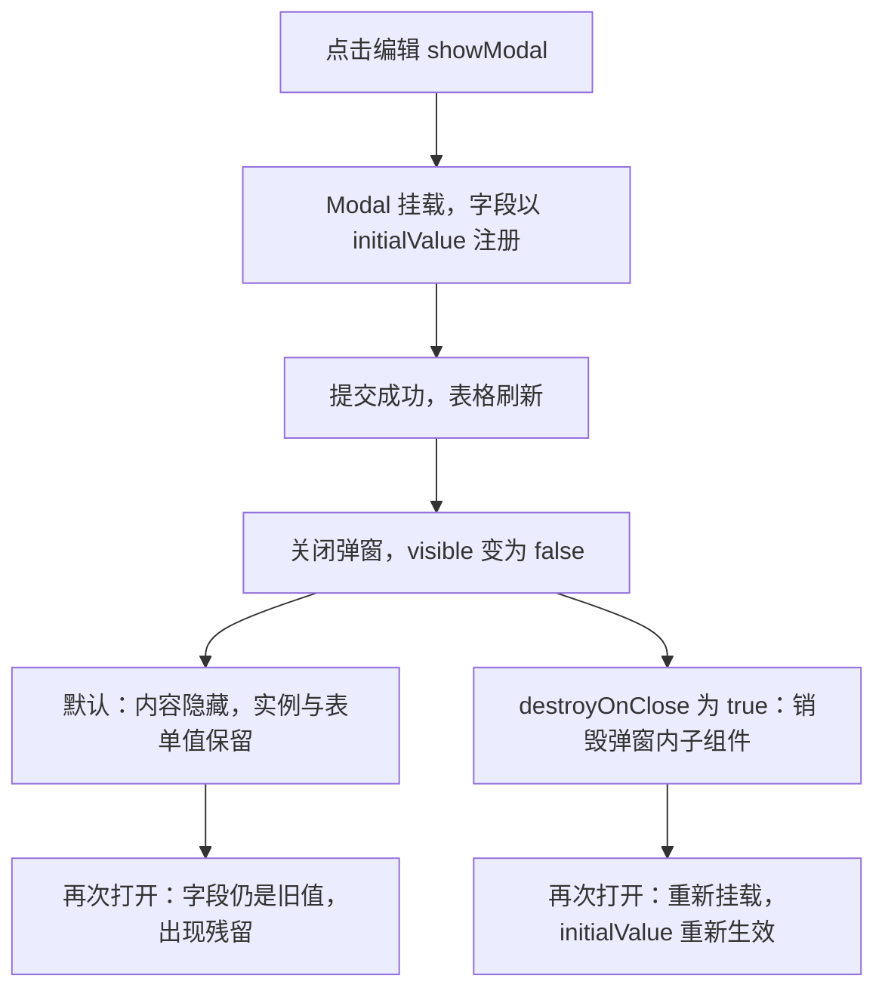

# 编辑弹窗第二次打开显示旧数据：Modal 的销毁机制与两种修复方式

列表页每一行都有一个「编辑」按钮，点开的看起来是同一个弹窗，很容易忽略一个细节：这个弹窗组件从第一次挂载起，只要页面不刷新，就一直活着。于是会出现这样的怪事：把第二条房源的标题从 44 改成 4，提交成功、表格也刷新了，再点开这一行的「编辑」，弹窗里躺着的却是改动前的 44。

数据早就写进数据库了，这不是保存失败，也不是后端返回错了，而是弹窗从来没有被销毁。这个问题在做功能时很容易踩到，网上也有不少人掉进同一个坑，值得把现象、原因和修复方式完整过一遍。

## 先给结论

- Modal 默认关闭只是「隐藏」，组件实例和表单状态全部保留，`initialValue` 在字段首次注册之后就不再生效。
- 坑的规律：第一次点开某行的弹窗一定是准的，因为那是它第一次挂载；残留出现在第二次及以后的打开。
- 修复方式一：给 Modal 加 `destroyOnClose={true}`，关闭时销毁弹窗内容，下次打开重新挂载、重新取值。
- 修复方式二：弹窗不销毁，在每次打开时用 `setFieldsValue` 手动重置表单值（文末给示例代码）。
- 判断依据不在数据层而在组件层：表格由后端重新查询渲染，弹窗表单的值还停留在第一次挂载时的快照。

## 一、把现象完整复现一遍

用房源管理列表页按下面的顺序操作：

1. 把最新一条房源的标题改成 44，提交成功。点开它的「编辑」，弹窗显示 44，一切正常。
2. 再以第二行（id 为 8，标题也是 44）为例，点开「编辑」，把 44 改成 4，点确定，提交成功，表格重新刷新，第二行已经是最新的 4。
3. 此时再点第二行的「编辑」按钮，弹窗里显示的仍然是 44。

表格是对的，弹窗是错的，两边的数据源其实早就分道扬镳：表格每次都由后端重新查询、重新渲染；弹窗里的表单值却是它第一次挂载时记录下来的那份。第二次打开弹窗时，React 并没有重新创建组件，`record` 换成了当前行的最新数据，表单字段却无动于衷。

弹窗的表单项是用 `getFieldDecorator` 包裹的，初始值取自当前行的 `record`：

```jsx
<FormItem {...formItemLayout} label="房源标题">
  {getFieldDecorator('title', {
    initialValue: record.title,
    rules: [{ required: true, message: '请输入房源标题' }]
  })(<Input />)}
</FormItem>
```

问题就藏在 `initialValue` 的语义里：它只在字段第一次注册时作为初始值写入表单，之后表单以自己内部 store 里的值为准，`record` 再怎么变都不会自动同步回来。弹窗组件又只挂载一次，第二次打开时字段还抱着第一次注册的值，残留由此产生。

## 二、为什么关闭弹窗不等于销毁弹窗

Ant Design 的 Modal 走的是「常驻组件、条件显示」的实现思路：`visible` 为 false 时弹窗只是不显示，React 组件实例并没有卸载，内部状态原封不动。两种关闭方式在生命周期上的差别可以用一张图看清：



关键分叉在最后一步。默认路径里组件实例一直活着，表单 store 里的旧值自然被带进下一次打开；销毁路径里子组件被整体卸载，下次打开等于全新挂载，`initialValue` 重新注册一遍，取到的就是当前行的最新值。

## 三、修复方式一：destroyOnClose

课程工程 `EditResource.js` 里最终采用的就是这个方案，在 Modal 上显式声明销毁行为：

```jsx
<Modal
  title={'编辑'}
  width={640}
  visible={this.state.visible}
  onOk={() => { this.handleSave() }}
  onCancel={() => { this.handleCancel() }}
  destroyOnClose={true}
>
  <Form hideRequiredMark style={{ marginTop: 8 }}>
    {/* 房源标题、租金、建筑面积、上传室内图等 FormItem */}
  </Form>
</Modal>
```

加上这一行之后按第一节的方式重测：把第二行数据改成 4、提交、重新点开第二行的「编辑」，弹窗显示的就是最新的 4。因为每次关闭都把弹窗内容连根拔掉，打开时的 `record.title`、`record.rent` 都会作为新的初始值注册进去。

**代价也要心里有数。** 每次打开都会重新挂载整个表单，图片墙这类需要初始化的子组件会重新走一遍挂载流程。对编辑弹窗这种低频操作，这点开销可以忽略，换来的是状态永远干净，划算。

## 四、修复方式二：不销毁，打开时手动重置

如果弹窗内容很重、带了异步加载的数据，不想每次反复挂载，可以保留组件实例，在每次打开时把当前行的值刷进去（示例代码，按本课的表单写法补全）：

```jsx
showModal = () => {
  const { record } = this.props;
  this.setState({ visible: true }, () => {
    // 等弹窗内容挂载完成后再赋值，覆盖上一次遗留的表单状态
    this.props.form.setFieldsValue({
      title: record.title,
      rent: record.rent,
      coveredArea: record.coveredArea,
    });
  });
};
```

重置动作必须等弹窗内容挂载完成之后执行，所以放在 `setState` 的回调里；写在 `render` 里反而会引发连续重渲染。两种方式怎么选：字段少、结构简单的弹窗直接 `destroyOnClose`，一行配置解决；字段多、依赖异步初始化的弹窗用手动重置更可控。

## 常见误区

- **以为提交失败才有残留**：残留与提交无关，数据早已保存成功，问题出在组件实例未销毁、表单值未重置。
- **以为换了 record 表单就会自动刷新**：`initialValue` 只在字段首次注册时生效，后续 `record` 变化不会同步进表单。
- **把重置逻辑写在 render 里**：render 阶段调用 `setFieldsValue` 会触发新一轮渲染，形成循环，重置要放在打开弹窗的事件回调里。
- **只重置输入框、忘了图片墙**：已上传图片列表这类非受控状态同样残留，销毁或重置时要一并处理。

## 面试可能被问到的问题

1. 面试官追问：「Ant Design 的 Modal 关闭后组件被销毁了吗？」
   答：默认没有。`visible` 为 false 时弹窗只是不显示，组件实例和内部状态都保留；`destroyOnClose` 设为 true 才会在关闭时销毁弹窗内的子组件。

2. 面试官追问：「为什么第二次打开弹窗时 initialValue 不生效？」
   答：`initialValue` 只在字段通过 `getFieldDecorator` 首次注册时写入表单，之后表单以内部 store 的值为准，外部初始值的变化不会自动同步，复用组件实例时就会看到旧数据。

3. 面试官追问：「除了 destroyOnClose 还有哪些修复思路？」
   答：可以在每次打开弹窗时用 `setFieldsValue` 手动重置，也可以给 Modal 加一个随记录变化的 `key`，强制 React 销毁重建组件，思路都是让下一次打开拿到干净状态。

4. 面试官追问：「destroyOnClose 有什么代价？」
   答：每次打开都重新挂载子组件，表单、上传组件要重新初始化，有额外渲染开销；但换来状态隔离，适合编辑这类低频弹窗，高频场景可以用手动重置替代。

5. 面试官追问：「这类问题的通病是什么？」
   答：把「显示与隐藏」当成了「销毁与重建」。React 中组件不卸载，状态就一直存在，任何复用组件实例的场景（弹窗、抽屉、Tab 页）都要显式处理状态重置。

## 配套资料

- 弹窗组件源码：`materials/code/03/day07-完善前端功能以及WebSocket入门/day07-完善前端功能以及WebSocket入门/资料/EditResource.js`
  （含 `destroyOnClose={true}`、`showModal`、`handleSave` 的完整实现，文中第四节重置写法为按本课表单写法补全的示例）
