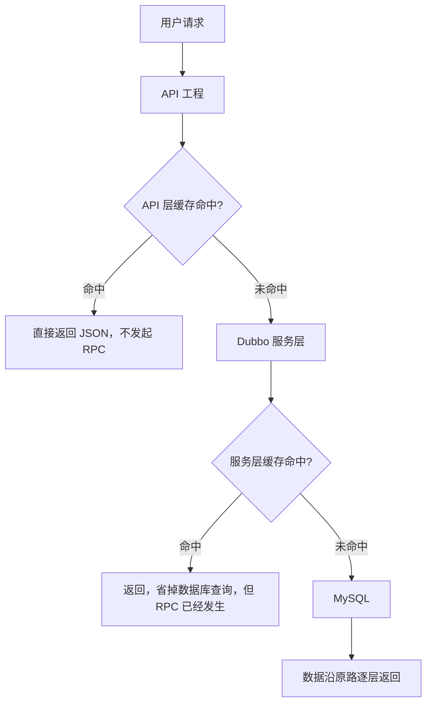

# 给接口服务加缓存：该加在 API 层还是 Dubbo 服务层

房源列表这类查询接口，每一次请求都会穿透到 MySQL。数据量小的时候没有感觉，一旦列表页、GraphQL 查询、图片信息全压过来，数据库的连接数和响应时间会先出问题。而列表数据对实时性的要求其实不高：改一条房源标题，晚几秒在列表里看到完全可以接受。这类读多写少、容忍短暂旧值的请求，就是缓存最合适的落点。

在动手写代码之前，有一个更值得想清楚的问题：缓存逻辑到底加在哪一层。这一篇把选型思路和课程里真实的缓存实现一起讲清楚。

## 先给结论

- 缓存技术选 Redis 集群，API 工程这一端用 Spring Data Redis 作为客户端。
- 缓存加在 API 工程比加在 Dubbo 服务层更划算：命中时连一次跨进程 RPC 都省掉。
- 服务层也可以加缓存，两者不冲突，属于不同团队视角下的分层防护。
- 缓存键设计为「固定前缀 + md5(请求 URI + 请求参数)」，天然区分同一接口的不同查询条件。
- 只有 GET 请求和 GraphQL 查询进入缓存逻辑，命中后直接写回 JSON 并拦截请求，未命中才放行到 Controller。

## 一、哪些数据值得缓存

判断标准就两条：读得频繁，且允许读到稍旧的值。房源列表、广告位、推荐内容都符合；反过来，下单、支付这类写路径绝不进缓存，它们既要保证落库成功，又要立刻返回最新结果。

加缓存不是目的，省掉的是「无意义的重复查询」。同一条列表数据在 10 秒内被 1000 个用户请求，数据库只需要算一次，剩下的 999 次从 Redis 直接拿，这是缓存真正的收益来源。

## 二、加在前面还是加在后面

项目里 API 工程通过 Dubbo 调用服务层，缓存逻辑摆两层都可以，但效果不同：



关键路径在第一道缓存：命中 API 层缓存时，请求连 Dubbo 都不用调；而缓存加在服务层时，哪怕命中，一次 RPC 的开销也已经花掉了。

**第一，从全局流量看，加在 API 层更合适。** 用户请求的第一站就是 API 工程，在这里拦截命中率最高、路径最短。假设缓存加在服务层，用户请求还是要先到 API 工程、再转发到服务层才能拿到缓存数据，白白多走一程。

**第二，从团队边界看，服务层加缓存也有它的道理。** 如果这套 Dubbo 服务是由专门的小组维护的，服务组对自己这层的性能负责，完全可以在服务层内部再加一层缓存，并且不去假设调用方有没有做缓存。两层缓存互不影响，任何一层命中都能少做一截工作，属于不同视角下的合理选择。

所以这不是一道有标准答案的题，而是要结合项目需求和团队分工来定：能管住全局就加在前面，只能管住自己这一段就加在后面。本课程的选择是加在 API 工程这一侧。

## 三、课程里的真实实现：一个缓存拦截器

API 工程是 Spring MVC 结构，用 `HandlerInterceptor` 在 Controller 之前做缓存判断最合适。课程资料里的 `RedisCacheInterceptor` 完整实现了这套逻辑（包名已改为中性写法）：

```java
package com.example.haoke.dubbo.api.interceptor;

@Component
public class RedisCacheInterceptor implements HandlerInterceptor {

    private static ObjectMapper mapper = new ObjectMapper();

    @Autowired
    private RedisTemplate<String, String> redisTemplate;

    @Override
    public boolean preHandle(HttpServletRequest request,
            HttpServletResponse response, Object handler) throws Exception {

        // 浏览器的预检请求直接放行
        if (StringUtils.equalsIgnoreCase(request.getMethod(), "OPTIONS")) {
            return true;
        }

        // 只处理 GET 与 /graphql，其余请求放行
        if (!StringUtils.equalsIgnoreCase(request.getMethod(), "GET")) {
            if (!StringUtils.equalsIgnoreCase(request.getRequestURI(), "/graphql")) {
                return true;
            }
        }

        // 生成缓存键，查询 Redis
        String redisKey = createRedisKey(request);
        String data = this.redisTemplate.opsForValue().get(redisKey);
        if (StringUtils.isEmpty(data)) {
            return true; // 未命中，放行到 Controller
        }

        // 命中：把缓存里的 JSON 直接写回响应
        response.setCharacterEncoding("UTF-8");
        response.setContentType("application/json; charset=utf-8");
        response.setHeader("Access-Control-Allow-Origin", "*");
        response.setHeader("Access-Control-Allow-Methods", "GET,POST,PUT,DELETE,OPTIONS");
        response.getWriter().write(data);

        return false; // 拦截后续流程，Controller 不会再执行
    }
}
```

有几个细节值得展开：

**第一，`return false` 是短路，不是报错。** `preHandle` 返回 true 表示放行，请求继续走 Controller；返回 false 表示请求到此为止。命中缓存后手动把 JSON 写进 `response`，再返回 false，Controller 和服务层整体被跳过。

**第二，缓存键的生成规则是整套方案的核心。** 键由「URI + 全部请求参数」做 md5 得到，再加固定前缀：

```java
public static String createRedisKey(HttpServletRequest request) throws Exception {
    String paramStr = request.getRequestURI();
    Map<String, String[]> parameterMap = request.getParameterMap();
    if (parameterMap.isEmpty()) {
        paramStr += IOUtils.toString(request.getInputStream(), "UTF-8");
    } else {
        paramStr += mapper.writeValueAsString(request.getParameterMap());
    }
    String redisKey = "WEB_DATA_" + DigestUtils.md5Hex(paramStr);
    return redisKey;
}
```

直接拿 URI 加参数拼字符串做键有两个毛病：太长，而且带着各种特殊字符。md5 之后定长 32 位，Redis 里干净整齐。参数全集参与散列，意味着同一个接口的不同页码、不同筛选条件各自对应一个键，互不污染。前缀 `WEB_DATA_` 则给这一批键打了统一标记，方便识别和批量清理。

**第三，GraphQL 的 POST 请求为什么也能进缓存。** GraphQL 查询走的是 POST，请求参数在请求体里。`createRedisKey` 在没有 URL 参数时会去读 `request.getInputStream()`，也就是请求体。但 Servlet 规范里请求体只能读一次，读完 Controller 就拿不到了，所以资料里还配了 `RequestReplaceFilter` 与 `MyServletRequestWrapper`：过滤器在请求进来时先用包装类把请求体缓存成字节数组，之后无论读多少次都是从这份副本里取，拦截器和 Controller 互不影响。

## 四、另一半：缓存怎么失效

真实的拦截器只负责读缓存，失效策略需要配合写路径来做，常见两条思路（示例代码，按本课写法补全）：

```java
// 写入缓存时设置过期时间，容忍短暂不一致
this.redisTemplate.opsForValue().set(redisKey, json, 30, TimeUnit.SECONDS);

// 或者：更新成功后按前缀清理本批缓存
public boolean update(HouseResources record) {
    boolean ok = super.update(record);
    if (ok) {
        Set<String> keys = redisTemplate.keys("WEB_DATA_*");
        if (keys != null && !keys.isEmpty()) {
            redisTemplate.delete(keys);
        }
    }
    return ok;
}
```

列表场景一般两者结合：给键设 TTL 兜底，更新数据时再主动清理，把不一致的窗口压到最短。生产环境建议用 `SCAN` 替代 `keys` 命令，避免阻塞 Redis；在集群模式下还要注意键分布在多个节点，清理要按节点执行。

## 常见误区

- **所有接口都套上缓存**：写路径和实时性强的接口不该进缓存，只缓存读多写少、容忍旧值的查询。
- **把 `preHandle` 返回 false 当成异常**：false 的含义是请求已被当前拦截器处理完毕，不再向后走，属于正常短路。
- **缓存键只用了 URI 没带参数**：不同页码、不同筛选条件会共用一个键，互相覆盖，用户翻页永远看到第一页。
- **只写缓存不处理失效**：更新数据后旧键还在，用户会长时间读到改动前的列表。

## 面试可能被问到的问题

1. 面试官追问：「缓存为什么加在 API 层而不是 Dubbo 服务层？」
   答：用户请求先经过 API 工程，在这里拦截，命中时连 RPC 都不用发起，路径最短；加在服务层哪怕命中也已经花了一次 RPC 的开销。从全局看 API 层更划算，但服务层由独立团队维护时也可以在服务层再加一层，两层并不冲突。

2. 面试官追问：「HandlerInterceptor 的 preHandle 返回 false 意味着什么？」
   答：表示请求被拦截器处理完毕，不再进入 Controller。典型用法就是缓存命中后直接把数据写进 response 并返回 false，实现请求短路。

3. 面试官追问：「缓存键为什么先做 md5？」
   答：URI 加参数直接拼字符串又长又带特殊字符，md5 后定长且统一；同时参数全集参与散列，保证同一接口的不同查询条件映射到不同键，避免互相覆盖。

4. 面试官追问：「POST 的 GraphQL 请求是怎么被缓存的？」
   答：GraphQL 查询的参数在请求体里，拦截器在无 URL 参数时读取请求体参与键计算。由于请求体只能读一次，需要先用包装类把请求体缓存为字节数组，让后续组件仍能重复读取。

5. 面试官追问：「缓存与数据库的一致性怎么保证？」
   答：常用做法是 TTL 兜底加更新时主动删除。写入缓存时设过期时间控制最大不一致窗口，数据更新成功后按前缀清理相关键；对一致性要求更高的场景再考虑延迟双删等策略。

6. 面试官追问：「这个方案有什么局限？」
   答：它按 URL 加参数整页缓存，适合 GET 列表和 GraphQL 查询这类幂等读；无法感知数据粒度，任何一条数据更新都可能需要清理整批键。做精细缓存要下沉到服务层按业务对象设计。

## 配套资料

- 缓存拦截器：`materials/code/03/day07-完善前端功能以及WebSocket入门/day07-完善前端功能以及WebSocket入门/资料/RedisCacheInterceptor.java`
- 请求体包装配套：同目录 `RequestReplaceFilter.java`、`MyServletRequestWrapper.java`（让请求体可重复读，配合 graphql 键生成）
- 统一响应处理：同目录 `MyResponseBodyAdvice.java`
- 文中「缓存失效」一节的清理与 TTL 写法为按本课写法补全的示例，课程源码包未包含该部分
