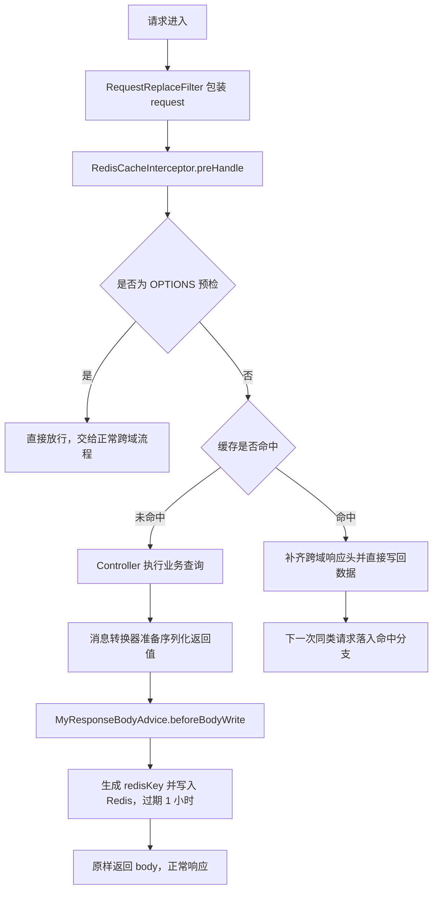

# 响应还没出门就进了 Redis：用 ResponseBodyAdvice 实现写缓存

缓存方案的命中逻辑已经就位：`RedisCacheInterceptor` 在请求进 Controller 之前查 Redis，查到就直接写回响应。可缓存里从来没有数据，命中永远是空转，因为整条链路还缺最后一块，把 Controller 的响应结果写进 Redis。这个环节有个反直觉的结论：拦截器做不了，必须请出 Spring MVC 的另一个扩展点 `ResponseBodyAdvice`。本节把它的实现、两个线上才暴露的坑一起讲完。

## 先给结论

- 拦截器的 `postHandle` 拿不到响应 JSON，`@ResponseBody` 的数据不经过 `ModelAndView`，这条路在方案设计阶段就该排除。
- `ResponseBodyAdvice` 由 `@ControllerAdvice` 标注的类实现，在 `HttpMessageConverter` 把返回值写进响应体之前回调，此时数据完整在手。
- `supports` 方法决定拦谁：方法带 `@GetMapping` 一律处理；带 `@PostMapping` 且声明类是 `GraphQLController` 的做特例处理；其余全部放行。
- `beforeBodyWrite` 里复用拦截器的 `createRedisKey` 静态方法生成 key，字符串结果直接入库，对象先序列化成 JSON，统一设 1 小时过期。
- 缓存逻辑必须整体套 try-catch 并原样 `return body`，同时补两处细节：命中分支手动写跨域响应头，`preHandle` 最前面放行 OPTIONS 预检请求。

## 一、为什么拦截器写不了缓存

拦截器能介入响应阶段的位置是 `postHandle`，但它是围绕「视图渲染」设计的。翻它的方法签名，能拿到的只有 `HttpServletRequest`、`HttpServletResponse` 和 `ModelAndView`。Controller 返回的对象被 `@RestController` 标注后，根本不进 `ModelAndView`，直接交给消息转换器序列化；`HttpServletResponse` 里的响应体此刻也还没生成。三个参数里没有一个能拿到要写进缓存的 JSON，用拦截器做写缓存从一开始就是死路。

`ResponseBodyAdvice` 补的正是这个空档：它是 Spring MVC 提供的响应体级拦截，触发点在消息转换器把返回值写出之前。这个时机拿得到完整的返回对象，也拿得到请求上下文，写缓存需要的原料全齐。



这张图把三种请求各自的去向画清楚了：预检请求在第一个判断点就被放行，命中缓存的请求由拦截器短路返回，未命中的请求走完 Controller 后由 Advice 顺手把结果写进缓存，下一次同类请求就落进命中分支。

## 二、supports：决定哪些响应要进缓存

```java
package com.example.haoke.dubbo.api.interceptor;

import com.example.haoke.dubbo.api.controller.GraphQLController;
import com.fasterxml.jackson.databind.ObjectMapper;
import org.apache.commons.lang3.StringUtils;
import org.springframework.beans.factory.annotation.Autowired;
import org.springframework.core.MethodParameter;
import org.springframework.data.redis.core.RedisTemplate;
import org.springframework.http.server.ServerHttpRequest;
import org.springframework.http.server.ServerHttpResponse;
import org.springframework.web.bind.annotation.ControllerAdvice;
import org.springframework.web.bind.annotation.GetMapping;
import org.springframework.web.bind.annotation.PostMapping;
import org.springframework.web.servlet.mvc.method.annotation.ResponseBodyAdvice;

@ControllerAdvice
public class MyResponseBodyAdvice implements ResponseBodyAdvice {

    @Autowired
    private RedisTemplate<String, String> redisTemplate;

    private ObjectMapper mapper = new ObjectMapper();

    @Override
    public boolean supports(MethodParameter returnType, Class converterType) {
        // 查询接口：GET 请求一律缓存
        if (returnType.hasMethodAnnotation(GetMapping.class)) {
            return true;
        }
        // GraphQL 查询是 POST，属于特例，仅针对 GraphQLController 生效
        if (returnType.hasMethodAnnotation(PostMapping.class) &&
                StringUtils.equals(GraphQLController.class.getName(),
                        returnType.getExecutable().getDeclaringClass().getName())) {
            return true;
        }
        return false;
    }
}
```

`supports` 返回 true 才会触发下面的写缓存方法。判定规则刻意收得很窄：GET 方法天然是查询，直接放行进缓存；POST 默认是写操作不能缓存，唯独 GraphQL 查询走的是 POST，所以追加「类名必须是 `GraphQLController`」这个双重条件，把特例圈死，其余 POST 一律不碰。

## 三、beforeBodyWrite：序列化、入库、设过期

```java
@Override
public Object beforeBodyWrite(Object body, MethodParameter returnType, MediaType selectedContentType,
                              Class selectedConverterType, ServerHttpRequest request,
                              ServerHttpResponse response) {
    try {
        // 复用拦截器的静态方法，保证读写两侧 key 完全一致
        String redisKey = RedisCacheInterceptor.createRedisKey(
                ((ServletServerHttpRequest) request).getServletRequest());
        String redisValue;
        if (body instanceof String) {
            // 已经是字符串就不再序列化，省一次开销
            redisValue = (String) body;
        } else {
            redisValue = mapper.writeValueAsString(body);
        }
        this.redisTemplate.opsForValue().set(redisKey, redisValue, Duration.ofHours(1));
    } catch (Exception e) {
        e.printStackTrace();
    }
    return body;
}
```

三个要点值得展开。**第一，key 必须与拦截器侧完全一致。** 命中判断用的是拦截器的 `createRedisKey`，写缓存用的必须是同一个方法，这也是它被声明成 static 的原因：两个类共享一份 key 生成逻辑，杜绝两边拼法漂移导致永远命不中。`ServerHttpRequest` 需要强转成 `ServletServerHttpRequest` 才能取出原生的 `HttpServletRequest`。**第二，缓存写失败不能影响正常响应。** 整段逻辑套在 try-catch 里，Redis 不可用时打日志后照常返回，缓存只是加速手段，不允许它变成故障点。**第三，方法以 `return body` 收尾。** 这个方法的职责只是「旁路写一份」，body 一个字节都不改，响应该怎么走还怎么走。

## 四、调试验证与两个暴露出来的坑

重启服务后打断点走一遍全流程：请求先进拦截器，key 未命中放行；Controller 查询完成，进入 `beforeBodyWrite`，`supports` 判定命中 `@PostMapping` 加 `GraphQLController` 的组合，拿到 JSON 字符串写入 Redis；再次请求，拦截器直接命中返回，Controller 没有执行，`redis-cli` 里也能 `get` 到这条 1 小时过期的数据。逻辑闭环，但整合进前端后暴露了两个问题。

**第一，命中分支丢了跨域响应头。** 未命中时 Controller 执行，Controller 或 mock 接口上配置的跨域注解会正常生效；命中时拦截器直接写响应，Controller 压根没跑，那些注解自然全部失效，前端控制台立刻报 `Access-Control-Allow-Origin` 缺失。解法是在拦截器写数据之前手动补齐响应头：

```java
// 将缓存数据响应给前端
response.setCharacterEncoding("UTF-8");
response.setContentType("application/json; charset=utf-8");

// 缓存短路时 Controller 不执行，跨域配置要手动补
response.setHeader("Access-Control-Allow-Origin", "*");
response.setHeader("Access-Control-Allow-Methods", "GET,POST,PUT,DELETE,OPTIONS");
response.setHeader("Access-Control-Allow-Credentials", "true");
response.setHeader("Access-Control-Allow-Headers", "Content-Type,X-Token");

response.getWriter().write(data);
return false;
```

**第二，OPTIONS 预检请求被缓存逻辑误伤。** 浏览器跨域请求前会先发一个 OPTIONS 预检，它不是 GET、URI 也不是 `/graphql`，但同样会流进拦截器，一旦被当成正式请求处理，预检阶段就返回了业务数据而不是预检确认，前端表现依旧异常。修复是在 `preHandle` 的最前面加一条短路判断：

```java
if (StringUtils.equalsIgnoreCase(request.getMethod(), "OPTIONS")) {
    return true;
}
```

预检请求直接放行，交给正常的跨域处理流程。这两个坑都是第一次刷新正常、第二次刷新异常才浮出水面的，验证缓存方案时务必把「第二次请求」也纳入测试。

## 常见误区

- **去 `postHandle` 里找响应 JSON。** `@ResponseBody` 的返回值不进 `ModelAndView`，在那个时机拿不到数据，写缓存必须换 `ResponseBodyAdvice`。
- **`beforeBodyWrite` 忘记返回 body。** 该方法的返回值会成为最终响应体，返回 null 前端收到的就是空；本方案要原样返回，只做旁路写缓存。
- **`supports` 条件放得太宽。** 把所有 POST 都纳入缓存会缓存写操作的响应，GraphQL 特例必须绑定具体 Controller 类名，范围越窄越安全。
- **Redis 挂了拖垮主接口。** 写缓存逻辑不加 try-catch，Redis 异常会顺着 Advice 冒泡导致接口 500，缓存组件必须遵循「失败只降级、不影响主流程」。

## 面试可能被问到的问题

1. 面试官追问：「`ResponseBodyAdvice` 的执行时机是什么？」
   答：Controller 返回后、`HttpMessageConverter` 把返回值写进响应体之前。它通过 `RequestResponseBodyAdviceChain` 被消息转换器回调，此时可以拿到完整返回对象，也能修改或替换它，适合做统一包装、加密、旁路缓存这类横切逻辑。

2. 面试官追问：「`supports` 的两个参数分别是什么？」
   答：`MethodParameter` 描述将要被写的返回值所在的方法，可以取注解、返回类型、声明类；`converterType` 是即将执行序列化的消息转换器类型。前者用来按注解筛选方法，后者可用来只对 JSON 转换器生效。

3. 面试官追问：「为什么拦截器的 `postHandle` 拿不到 JSON 数据？」
   答：`postHandle` 面向视图渲染流程，`@ResponseBody` 的返回值在进入拦截器这一步之前已经被规划为消息转换器直写响应体，不经过 `ModelAndView`，`response` 对象里此刻也没有响应体内容，所以拿不到。

4. 面试官追问：「缓存 key 由请求 URI 加参数做 MD5，写和读两侧如何保证一致？」
   答：把 key 生成方法写成 `public static` 放在拦截器类里，Advice 直接以类名调用同一个方法，两边共用一份实现。任何拼法变化只改一处，杜绝读写不一致导致的永久未命中。

5. 面试官追问：「缓存设了 1 小时过期，期间数据被更新怎么办？」
   答：本方案用短 TTL 做兜底，容忍一个过期窗口内的旧数据。要求更强一致时，可在写接口成功后按业务维度删除或更新相关 key，或引入版本号、延迟双删等策略，避免脏读跨过 TTL。

6. 面试官追问：「OPTIONS 预检请求是什么，为什么要在拦截器里放行？」
   答：跨域的非简单请求会先发一个 OPTIONS 探测请求，询问服务端允许的方法与请求头。它不属于业务请求，若被缓存拦截器当成正式请求处理，会返回错误形态的响应导致预检失败，所以要在拦截器入口处按请求方法短路放行。

## 配套资料

- 写缓存实现：`materials/code/03/day07-完善前端功能以及WebSocket入门/day07-完善前端功能以及WebSocket入门/资料/MyResponseBodyAdvice.java`
- 拦截器命中与跨域修复（含 OPTIONS 放行、响应头补齐）：同目录 `RedisCacheInterceptor.java`
- `GraphQLController` 与前端页面工程源码未收录，相关片段取自课程画面并按课程写法补全
