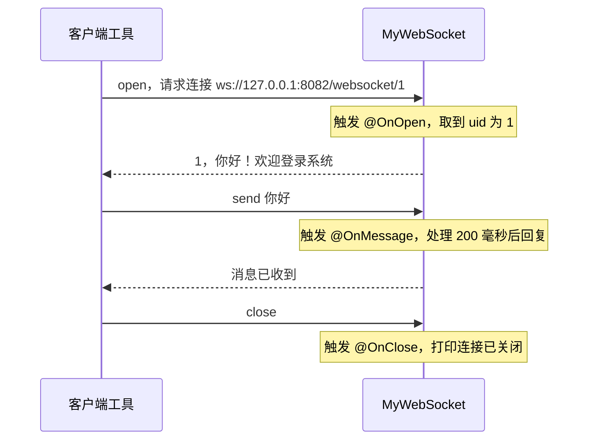

# 第一个 WebSocket 服务端：一个类四个注解跑通握手与收发

协议概念清楚了，接下来把服务端写出来跑通。Java 侧的 WebSocket 服务端可以用 `javax.websocket` 包提供的注解式 API：一个类、四个注解，配一个 Tomcat 插件就能对外提供 WebSocket 服务，连 web.xml 都不需要写。

## 先给结论

- 依赖只需要 `javaee-api:7.0`，它提供 `javax.websocket` 的 API 声明，运行实现由 Tomcat 内置提供，所以 scope 用 `provided`。
- 服务端四件套：类上 `@ServerEndpoint("/websocket/{uid}")` 声明服务与路径，`@OnOpen` 建连回调，`@OnMessage` 收消息回调，`@OnClose` 关闭回调，另有 `@OnError` 处理异常。
- 向客户端发消息靠 `Session` 对象：`session.getBasicRemote().sendText("...")`。
- 路径里的 `{uid}` 是占位符，方法参数加 `@PathParam("uid")` 就能取到连接地址里传的值。
- 测试地址的协议是 `ws://` 不是 `http://`，例如 `ws://127.0.0.1:8082/websocket/1`。

## 一、工程与依赖：war 工程加 Tomcat 插件

新建一个 Maven war 工程（示例工程名 `websocket-demo`，包名用中性的 `com.example`），关键配置集中在 pom 的三段：打包方式、API 依赖、编译与运行插件。

```xml
<packaging>war</packaging>

<dependencies>
    <!-- WebSocket 的 API 声明，运行时实现由 Tomcat 提供 -->
    <dependency>
        <groupId>javax</groupId>
        <artifactId>javaee-api</artifactId>
        <version>7.0</version>
        <scope>provided</scope>
    </dependency>
</dependencies>

<build>
    <plugins>
        <plugin>
            <groupId>org.apache.maven.plugins</groupId>
            <artifactId>maven-compiler-plugin</artifactId>
            <configuration>
                <source>1.8</source>
                <target>1.8</target>
                <encoding>UTF-8</encoding>
            </configuration>
        </plugin>
        <!-- 开发期用插件内嵌启动 Tomcat，监听 8082 -->
        <plugin>
            <groupId>org.apache.tomcat.maven</groupId>
            <artifactId>tomcat7-maven-plugin</artifactId>
            <version>2.2</version>
            <configuration>
                <port>8082</port>
                <path>/</path>
            </configuration>
        </plugin>
    </plugins>
</build>
```

`javaee-api` 的 scope 写 `provided` 是有讲究的：它只是 API 的声明，真正的实现来自 Tomcat 内置的 WebSocket 运行时，不该把它打进 war 里。`tomcat7-maven-plugin` 负责开发期的启动，端口定为 8082，上下文路径用根路径。

三段配置各有分工：`<packaging>war</packaging>` 决定打包形式，插件按 war 结构启动工程；compiler 插件把 source 与 target 都钉在 1.8，`encoding` 指成 UTF-8，避免中文消息在控制台打出乱码；tomcat 插件的 `<port>` 与 `<path>` 分别控制监听端口与上下文路径，写成 `/` 表示应用直接挂在根路径下，测试地址里就不用再带工程名。

## 二、四个注解与一个 Session

写代码前先把注解的分工摆清楚：

| 注解 | 位置 | 触发时机 |
|---|---|---|
| `@ServerEndpoint` | 类上 | 声明这是一个 WebSocket 服务，值为访问路径，支持 `{uid}` 占位符 |
| `@OnOpen` | 方法 | 客户端与服务端建立连接时执行 |
| `@OnClose` | 方法 | 连接关闭时执行 |
| `@OnMessage` | 方法 | 客户端向服务端发送消息或数据时执行 |
| `@OnError` | 方法 | 通信过程出现异常时执行 |

服务端类完整写法如下（示例按课程画面与讲解整理，包名已改为 `com.example`）：

```java
package com.example.websocket;

import java.io.IOException;

import javax.websocket.OnClose;
import javax.websocket.OnError;
import javax.websocket.OnMessage;
import javax.websocket.OnOpen;
import javax.websocket.Session;
import javax.websocket.server.PathParam;
import javax.websocket.server.ServerEndpoint;

@ServerEndpoint("/websocket/{uid}")
public class MyWebSocket {

    /** 建立连接时执行，uid 从连接地址的占位符里取 */
    @OnOpen
    public void onOpen(Session session, @PathParam(value = "uid") String uid) throws IOException {
        System.out.println("websocket已经连接" + session);
        session.getBasicRemote().sendText(uid + "，你好！欢迎登录系统");
    }

    /** 连接关闭时执行 */
    @OnClose
    public void onClose(Session session) {
        System.out.println("websocket已经关闭" + session);
    }

    /** 收到客户端消息时执行，处理完给一个回执 */
    @OnMessage
    public void onMessage(String message, Session session) throws IOException {
        System.out.println("收到客户端发来的消息 --> " + message);
        try {
            // 模拟一段 200 毫秒的业务处理
            Thread.sleep(200);
        } catch (InterruptedException e) {
            e.printStackTrace();
        }
        session.getBasicRemote().sendText("消息已收到");
    }

    /** 出错时执行 */
    @OnError
    public void onError(Session session, Throwable error) {
        error.printStackTrace();
    }
}
```

类上打一个 `@ServerEndpoint` 就完成了全部注册工作：容器启动时扫描到这个注解，自动把路径与回调方法挂到 WebSocket 运行时上，不需要 web.xml 也不需要额外配置，前提正是前面说过的 Tomcat 7.0.47+。`Session` 代表这一次连接，既是从中拿到对端发送能力的地方，也是后续做会话管理的抓手。

回调方法的参数有约定：`@OnMessage` 的第一个参数是消息内容，类型可以声明为 String，收二进制数据时也可以换成字节流类型；`Session` 在每个回调里都可以按需声明，容器会自动传入；`@PathParam` 的注入只看 value 与路径占位符名字是否一致，参数声明的先后顺序不影响取值。

## 三、启动、连接与验证

启动用插件命令，IDEA 里也可以直接双击 `tomcat7:run`：

```bash
mvn tomcat7:run
```

跑起来后监听 8082。这里有个必踩的坑：pom 里如果漏了 `<packaging>war</packaging>`，插件启动时直接报工程不是 war 形式，补上打包方式即可正常启动。

测试客户端可以用 Chrome 的 Simple WebSocket Client 插件，也可以用在线 WebSocket 测试工具，两者效果一样。连接地址填 `ws://127.0.0.1:8082/websocket/1`，注意协议是 ws 不是 http。如果启动时提示端口被占用，可以在 pom 里改 `<port>`，也可以用 `mvn tomcat7:run -Dmaven.tomcat.port=8083` 这类带参数的命令临时换端口。整段交互的时序如下：



工具面板状态从 CLOSED 变为 OPENED 时，服务端控制台同步打印连接信息并推送欢迎语；发一条「你好」，橙色字体是客户端发出的消息，黑色字体是服务端回的「消息已收到」；点 close 则触发关闭回调。占位符参数可以顺带验证：地址不带 `/1` 时路径匹配不上端点，握手直接失败；把地址写成 `/websocket/张三` 再连一次，收到的欢迎语就变成「张三，你好！欢迎登录系统」。

## 常见误区

- **漏掉 `<packaging>war</packaging>`。** tomcat7 插件按 war 工程启动，jar 打包方式直接报错，补上打包方式就能跑。
- **把测试地址写成 `http://`。** WebSocket 客户端只认 `ws://`，加密场景用 `wss://`，协议写错连不上服务端。
- **`javaee-api` 忘记写 `provided`。** 它只是 API 声明，打进 war 会与容器实现冲突；声明为 provided，运行时用 Tomcat 内置实现。
- **占位符与注解参数名对不上。** 路径写 `{uid}`，`@PathParam` 的 value 也必须是 `uid`，名字不一致注入为空，欢迎语里的参数就成了 null。

## 面试可能被问到的问题

1. 面试官追问：「@ServerEndpoint 注解的作用是什么？」
   答：标在类上声明该类是一个 WebSocket 服务端点，value 是客户端连接路径，支持 `{uid}` 这样的路径参数占位符，配合方法参数上的 @PathParam 取值。容器启动时扫描该注解完成端点注册，无需 web.xml。

2. 面试官追问：「@OnOpen、@OnMessage、@OnClose 分别什么时候触发？」
   答：@OnOpen 在握手建立连接后触发，可以拿到 Session 与路径参数；@OnMessage 在收到客户端发来的消息时触发，参数是消息内容与 Session；@OnClose 在连接关闭时触发。另有 @OnError 处理通信异常。

3. 面试官追问：「服务端如何向客户端发送消息？」
   答：通过 Session 拿 RemoteEndpoint 发送。`session.getBasicRemote().sendText()` 是同步发送，写完才返回；`getAsyncRemote().sendText()` 是异步发送，立刻返回不阻塞当前线程，高频或大消息推送时更适合。

4. 面试官追问：「为什么只引 API 不引实现也能跑？」
   答：javaee-api 只提供 javax.websocket 的接口与注解声明，scope 设为 provided 不打进 war；运行时由 Tomcat 内置的 WebSocket 实现（7.0.47+ 支持 JSR 356）完成实际工作，API 与实现分离。

5. 面试官追问：「这种注解式写法有什么局限？」
   答：端点对象由容器反射创建，注入 Spring 管理的业务 Bean 要额外处理；跨域、拦截、会话管理都缺乏内建支持，需要自己搭。与 Spring 技术栈深度整合时，用 Spring 提供的 Handler 方式更顺手，下一篇展开。

## 配套资料

- 本课无配套源码包，文中工程配置与服务端代码为按本课画面与写法补全的可运行示例（包名已改为 `com.example`）
- 本阶段课程资料目录：`materials/code/03/day07-完善前端功能以及WebSocket入门/`（资料包内为响应缓存方案源码，与 WebSocket 无直接代码关联）
