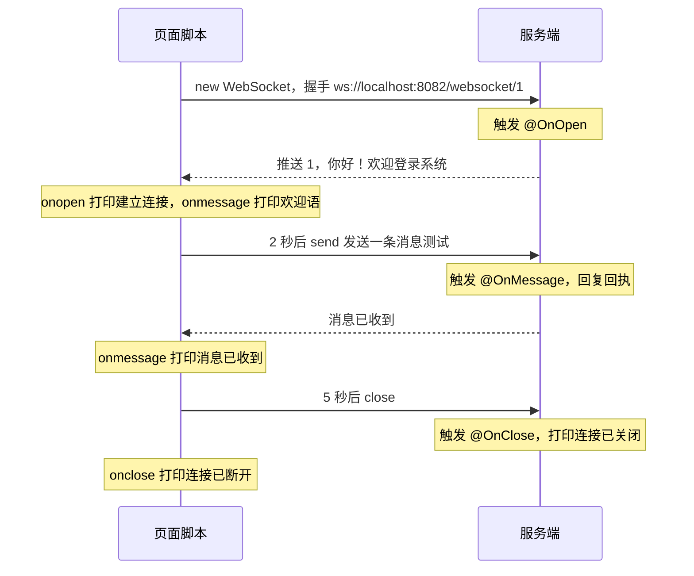

# 浏览器端的 WebSocket 客户端：一个内置对象加四个回调

服务端能收能发了，客户端总不能一直靠浏览器插件代劳。自己写一个 JS 客户端，代码量比服务端还小：浏览器内置了 `WebSocket` 对象，不需要引入任何额外的 js 库或组件，new 一个实例、挂上回调就能连。这一篇把页面建起来，把连接、收发、断开完整跑一遍。

## 先给结论

- 客户端核心就是浏览器内置的 `WebSocket` 构造函数：`const socket = new WebSocket("ws://...")`，无需任何第三方库。
- 四个回调对应连接的四个时刻：`onopen` 建立连接、`onmessage` 收到消息、`onclose` 断开、`onerror` 出错，命名全小写。
- 消息内容在回调参数的事件对象里，取 `event.data` 才是正文；发送用 `socket.send()`，主动断开用 `socket.close()`。
- 客户端回调与服务端注解一一对应：`onopen` 对 `@OnOpen`、`onmessage` 对 `@OnMessage`、`onclose` 对 `@OnClose`，两端代码长得非常像。
- 页面本身用 HTTP 由 Tomcat 托管，页面里的连接用 ws 协议建立，两套协议各管一段。

## 一、页面就位：放在 webapp 下由 Tomcat 托管

在工程的 `src/main/webapp` 下新建 `index.html`（示例按课程画面整理）。页面通过 `http://127.0.0.1:8082/index.html` 访问，页面里的脚本再用 ws 协议去连同一个 Tomcat 上的 WebSocket 服务：

```html
<!DOCTYPE html>
<html lang="en">
<head>
<meta charset="UTF-8">
<title>WebSocket 客户端</title>
</head>
<body>
<script>
// 连接地址带上了 uid 占位符参数
const socket = new WebSocket("ws://localhost:8082/websocket/1");

// 建立连接成功后触发
socket.onopen = (ws) => {
    console.log("建立连接！", ws);
}
// 收到服务端消息后触发，内容在事件对象的 data 属性里
socket.onmessage = (ws) => {
    console.log("接收到消息 >> ", ws.data);
}
</script>
</body>
</html>
```

**脚本语法要切到 ES6。** 代码里用了 `const` 和箭头函数，IDE 的语法级别停在 ES5 会把 `const` 标红，把脚本切到 ES6 即可。 WebSocket 是 ES6 之前浏览器就内置的原生对象，跟框架无关。

**新加的静态页面不生效就重启服务。** 往 webapp 里新加文件后 Tomcat 可能暂时不识别，浏览器访问 404，把服务端重启一次就好。

连接地址里的 `1` 就是上一篇路径占位符 `{uid}` 的值，实际项目里通常换成登录用户的 id，服务端借它区分不同连接，换个数字再连一次，欢迎语的开头就会跟着变化。同一台 Tomcat 上，HTTP 页面与 ws 连接共用 8082 端口互不冲突，因为 WebSocket 握手请求本身先走 HTTP，完成后才升级为 WebSocket 连接，两套协议各管一段。

## 二、补全四个回调，加上定时发送与断开

四个回调各司其职，再配两个定时器，就能完整模拟「连接、收发、断开」的整个生命周期：

```html
<!DOCTYPE html>
<html lang="en">
<head>
<meta charset="UTF-8">
<title>WebSocket 客户端</title>
</head>
<body>
<script>
const socket = new WebSocket("ws://localhost:8082/websocket/1");

socket.onopen = (ws) => {
    console.log("建立连接！", ws);
}
socket.onmessage = (ws) => {
    console.log("接收到消息 >> ", ws.data);
}
socket.onclose = (ws) => {
    console.log("连接已断开！", ws);
}
socket.onerror = (ws) => {
    console.log("发送错误！", ws);
}

// 2 秒后向服务端发送一条消息
setTimeout(() => {
    socket.send("发送一条消息测试");
}, 2000);

// 5 秒后主动断开连接
setTimeout(() => {
    socket.close();
}, 5000);
</script>
</body>
</html>
```

回调与服务端的对应关系一目了然：`onopen` 里的打印对应服务端 `@OnOpen` 方法里的 println，`socket.send` 触发服务端的 `@OnMessage`，`socket.close` 触发服务端的 `@OnClose`。服务端的 `@OnError` 对应客户端的 `onerror`，两端互为镜像，记住一端的写法另一端照搬即可。

连接的状态机也值得留意：`readyState` 有三个取值，0 是 CONNECTING 还在握手，1 是 OPEN 可以正常收发，2 与 3 表示关闭中和已关闭。`onopen` 触发的时刻正是状态从 0 跳到 1 的时刻，判断连接是否可用、能不能 send，依据就是它。

## 三、跑一遍：控制台时间线

刷新页面后，浏览器控制台与服务端控制台按固定顺序输出，整条时间线如下：



控制台里依次出现「建立连接」「接收到消息 1，你好！欢迎登录系统」「接收到消息 消息已收到」「连接已断开」，服务端则先后打印连接建立与关闭。5 秒后的断开是客户端主动发起的 `close()`，服务端能同步感知到，这正是后续做用户上线、下线状态维护的基础。

两个定时器只是为了让演示自动走完整个生命周期。真实项目里发送时机由用户动作或业务事件驱动，断开则交给页面关闭或专门的断线逻辑处理，不必照搬这里的固定延迟；服务端回复回执前故意 sleep 了 200 毫秒，从控制台能看出回执比欢迎语晚到，这恰好说明 onmessage 是被动等推送的：消息什么时候到不确定，回调就什么时候触发。

## 常见误区

- **把 `onmessage` 的参数直接当消息内容用。** 参数是事件对象，文本消息要取 `event.data`；收到二进制帧时 `data` 是 Blob 或 ArrayBuffer。
- **回调名写成驼峰。** `onOpen`、`onMessage` 浏览器不认识，属性挂不上等于没写，必须是全小写的 `onopen`、`onmessage`、`onclose`、`onerror`。
- **连接还没就绪就 `send`。** 只有 `readyState` 为 `WebSocket.OPEN` 时才能发送，脚本一加载立刻 send 会抛错；把发送动作放进 `onopen` 回调里最稳妥。
- **页面协议与连接协议混为一谈。** 页面地址用 `http://`，WebSocket 连接用 `ws://`，两者指向同一个 8082 端口但角色不同，写混了直接连不上。

## 面试可能被问到的问题

1. 面试官追问：「浏览器端 WebSocket 编程的核心对象和回调有哪些？」
   答：核心是内置的 WebSocket 构造函数，new 时传入 ws 或 wss 地址。回调有 onopen、onmessage、onclose、onerror 四个，方法有 send 发送与 close 关闭，属性 readyState 表示连接状态。

2. 面试官追问：「onmessage 回调怎么拿到消息内容？」
   答：回调参数是 MessageEvent 事件对象，文本消息在 event.data 里是字符串；服务端发二进制帧时 data 是 Blob，也可以把 socket 的 binaryType 设为 arraybuffer，按 ArrayBuffer 处理。

3. 面试官追问：「前端如何保证连接可用再发消息？」
   答：发送前判断 readyState 是否等于 WebSocket.OPEN，或者把首次发送放进 onopen 回调。连接建立是异步过程，构造函数返回时握手还没完成，不能假设立刻能发。

4. 面试官追问：「断线之后前端要做什么？」
   答：在 onclose 里安排重连，常用指数退避控制重试间隔，重连成功后重新初始化状态；同时配合心跳消息检测半开连接，连续若干次心跳无响应就主动 close 并触发重连。

5. 面试官追问：「WebSocket 客户端和轮询在页面代码上的区别是什么？」
   答：轮询要维护定时器反复发请求，回调里处理的是 HTTP 响应；WebSocket 只在开始时连一次，之后 onmessage 被动接收服务端推送，没有为拿数据而发的空请求，代码更少、延迟更低。

## 配套资料

- 本课无配套源码包，文中页面代码为按本课画面与写法补全的可运行示例，配套服务端是上一篇的 `MyWebSocket`
- 本阶段课程资料目录：`materials/code/03/day07-完善前端功能以及WebSocket入门/`（资料包内为响应缓存方案源码，与本节无直接代码关联）
