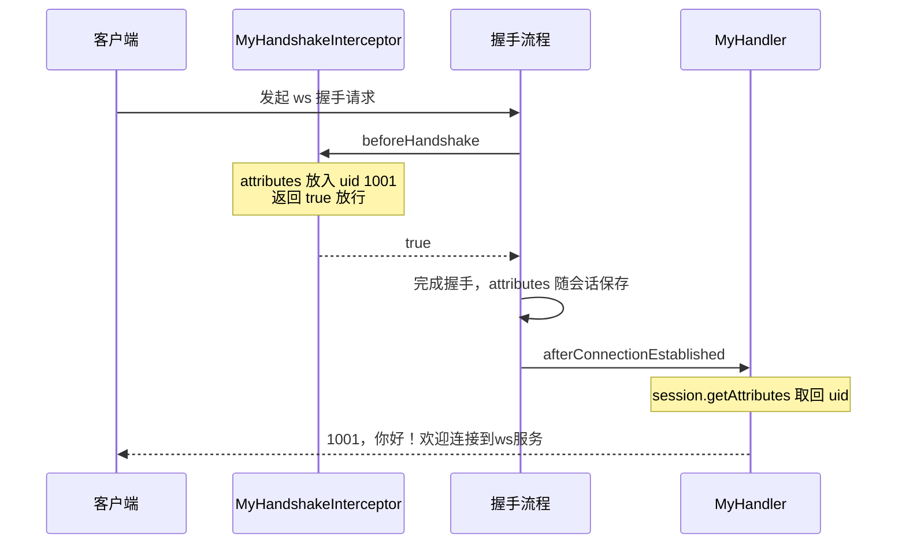

# WebSocket 握手拦截器：连接建立之前先校验身份，再把用户信息带进会话

Spring Boot 整合 WebSocket 之后有个别扭的地方：连接一建立就直接进 Handler，`afterConnectionEstablished` 拿到的只是一个匿名会话，对面是谁、有没有登录，Handler 一概不知。放在 HTTP 世界里，这类「进门前先拦一道」的需求由 Spring MVC 拦截器解决；WebSocket 世界里同样有对应物，Spring 提供了握手拦截器 `HandshakeInterceptor`，可以在建立连接之前执行一段业务逻辑，做登录校验、给会话塞用户数据，全在这一步完成。

## 先给结论

- `HandshakeInterceptor` 的定位与 Spring MVC 的 `HandlerInterceptor` 一致，区别只在拦截的时机：一个拦请求，一个拦握手。
- 接口就两个方法：`beforeHandshake` 在握手之前执行，返回 `true` 放行建立连接，返回 `false` 拒绝连接；`afterHandshake` 在握手完成之后执行。
- `beforeHandshake` 的 `attributes` 参数是个 Map，写进去的数据会跟随 `WebSocketSession`，Handler 里用 `session.getAttributes()` 取回，这是拦截器向 Handler 传值的标准通道。
- 注册位置在 `WebSocketConfig`，链到 `addHandler` 后面调 `addInterceptors`，拦截器自身要交给 Spring 容器管理。
- 类型要记牢：`attributes` 里放的是什么类型，取出来就按什么类型接，`Integer` 强转 `String` 会当场抛 `ClassCastException`。

## 一、和 Spring MVC 拦截器同一个思路

Spring MVC 的拦截器拦在「请求进入 Controller 之前」，鉴权、日志、参数预处理都在这一层做；WebSocket 的握手本质上是一次 HTTP 请求，在这道请求上再加一层拦截，就是握手拦截器。两件事道理完全相通：都是入口处的统一关卡，都不碰业务主体。

落到 WebSocket 上，握手拦截器最典型的用途就是登录校验。客户端发起 ws 连接时把 token 带上，`beforeHandshake` 里验一下：合法就放行，非法就返回 `false`，连接根本建立不起来。比「先连上、Handler 里再踢人」干净得多，无效连接在握手阶段就被挡住了。

## 二、实现 HandshakeInterceptor：两个方法各管一头

写一个类实现 `HandshakeInterceptor`，实现两个方法，类上打 `@Component` 交给容器（代码按课程画面整理，包名沿用本系列成稿的 `com.example`）：

```java
package com.example.websocket.spring;

import java.util.Map;

import org.springframework.http.server.ServerHttpRequest;
import org.springframework.http.server.ServerHttpResponse;
import org.springframework.stereotype.Component;
import org.springframework.web.socket.WebSocketHandler;
import org.springframework.web.socket.server.HandshakeInterceptor;

@Component
public class MyHandshakeInterceptor implements HandshakeInterceptor {

    /** 握手之前执行：返回 true 建立连接，返回 false 拒绝连接 */
    @Override
    public boolean beforeHandshake(ServerHttpRequest request, ServerHttpResponse response,
            WebSocketHandler wsHandler, Map<String, Object> attributes) throws Exception {
        // 将用户id放入socket处理器的会话(WebSocketSession)中
        attributes.put("uid", 1001);
        System.out.println("开始握手。。。。。。");
        return true;
    }

    /** 握手成功之后执行 */
    @Override
    public void afterHandshake(ServerHttpRequest request, ServerHttpResponse response,
            WebSocketHandler wsHandler, Exception exception) {
        System.out.println("握手成功啦。。。。。。");
    }
}
```

两个方法的分工很清楚。`beforeHandshake` 是主角：它执行完返回 `true`，握手才继续；返回 `false`，连接直接建立失败。`afterHandshake` 收尾，握手成功与否都会走到这里，适合做资源清理或统计。

真正值得注意的是 `beforeHandshake` 的最后一个参数 `attributes`，类型是 `Map<String, Object>`。它就是 WebSocket 会话属性表：往这个 Map 里 `put` 的数据，会随这次连接一起进入 `WebSocketSession`。示例里写死的 `1001` 只是为了跑通演示，真实项目里这一行应当换成从握手请求中解析出的用户 id，比如从请求头或请求参数里取 token、校验通过后把用户标识放进来。

## 三、注册进 WebSocketConfig：一行链式调用生效

拦截器写好了不会自动生效，要在配置类里挂到处理器链上：

```java
package com.example.websocket.spring;

import org.springframework.beans.factory.annotation.Autowired;
import org.springframework.context.annotation.Configuration;
import org.springframework.web.socket.config.annotation.EnableWebSocket;
import org.springframework.web.socket.config.annotation.WebSocketConfigurer;
import org.springframework.web.socket.config.annotation.WebSocketHandlerRegistry;

@Configuration
@EnableWebSocket
public class WebSocketConfig implements WebSocketConfigurer {

    @Autowired
    private MyHandler myHandler;

    @Autowired
    private MyHandshakeInterceptor myHandshakeInterceptor;

    @Override
    public void registerWebSocketHandlers(WebSocketHandlerRegistry registry) {
        registry.addHandler(this.myHandler, "/ws")
                .setAllowedOrigins("*")
                .addInterceptors(this.myHandshakeInterceptor);
    }
}
```

和上一篇相比只多了一步：`addHandler` 之后追加 `addInterceptors(this.myHandshakeInterceptor)`。拦截器通过 `@Autowired` 注入进来，说明它必须已经是容器里的 Bean，这就是第二步打 `@Component` 的原因。`addInterceptors` 接受可变参数，需要多个拦截器时可以继续往后传，执行顺序按注册顺序排列。

## 四、Handler 里取值：一条链路跑通

连接建立之后进入 `MyHandler`，从会话属性里把 uid 取出来，顺手推一条带用户标识的欢迎消息：

```java
@Override
public void afterConnectionEstablished(WebSocketSession session) throws Exception {
    // 从握手拦截器放入的属性中取回用户id
    Integer uid = (Integer) session.getAttributes().get("uid");
    session.sendMessage(new TextMessage(uid + ", 你好！欢迎连接到ws服务"));
}
```

从拦截器到 Handler 的完整数据通路如下：



图里最关键的一跳是「attributes 随会话保存」：拦截器写、Handler 读，两边靠同一个 Map 接力，中间不需要任何全局变量或静态 Map。

课程里这段代码是边调试边跑通的，中间踩了一个非常有代表性的坑。拦截器放进去的是 `int` 字面量，Handler 里却按 `String` 强转，客户端一连，控制台直接炸出：

```text
java.lang.ClassCastException: java.lang.Integer cannot be cast to java.lang.String
```

把接收类型改成 `Integer`，重启后再点「开启连接」，断点依次落在拦截器与 Handler，控制台打出「开始握手」与「握手成功啦」，客户端页面收到「1001，你好！欢迎连接到ws服务」，链路闭合。这个坑的教训一句话就能说完：`attributes` 是无类型的 Object Map，放与取两端的类型约定全靠代码自律，团队里最好把「会话属性放什么 key、什么类型」写成常量类统一管理。

## 常见误区

- **放取类型不一致。** `attributes.put("uid", 1001)` 放的是 `Integer`，取的时候写成 `(String) session.getAttributes().get("uid")`，握手看似成功，建连瞬间抛 `ClassCastException`。放什么类型就按什么类型接。
- **拦截器没进容器。** 只写了实现类、没加 `@Component` 也没有 `@Bean` 声明，配置类里 `@Autowired` 注入失败，应用启动直接报找不到 Bean。
- **以为拦截器能拦消息。** 它只工作在握手阶段，连接建立后的收发消息走 Handler 的回调方法，往拦截器里写消息处理逻辑是不会执行的。
- **校验失败只返回 false，不给任何交代。** 客户端只会看到连接失败，排查全靠猜。拒绝握手时应当往 response 里写状态或至少在服务端日志里留下原因。

## 面试可能被问到的问题

1. 面试官追问：「WebSocket 握手拦截器和 Spring MVC 拦截器有什么区别？」
   答：思路一致，都是入口处的统一拦截，但拦截对象不同。MVC 拦截器拦的是进入 Controller 之前的业务请求；握手拦截器拦的是 WebSocket 的握手请求，此时连接尚未建立。握手拦截器有两个方法，beforeHandshake 返回 false 可以直接拒绝建连，MVC 拦截器则是通过不放行请求来阻断。

2. 面试官追问：「握手阶段怎么拿到当前登录用户？」
   答：握手是一次 HTTP 请求，token 可以放在请求头、Cookie 或 ws 地址的查询参数里随握手带上。beforeHandshake 里取出 token 完成校验，解析出用户 id 放进 attributes；连接建立后 Handler 从 session.getAttributes() 里取回用户身份，后续该连接的所有消息处理都能直接用。

3. 面试官追问：「beforeHandshake 返回 false 之后会发生什么？」
   答：握手流程被中止，WebSocket 连接不会建立，客户端的 onerror 或 onclose 回调被触发。afterHandshake 仍会执行，可以在这里做记录。服务端应在拒绝前把原因写进响应或日志，否则客户端只知道连不上，不知道为什么。

4. 面试官追问：「attributes 和 HttpSession 是一回事吗？」
   答：不是。attributes 是 WebSocket 会话自己的属性表，生命周期与这条 WebSocket 连接绑定，握手时由拦截器写入；HttpSession 属于 Servlet 容器的 Web 会话。两者可以在握手阶段打通，比如把 HttpSession 里的登录态拷贝进 attributes，但存储位置和生命周期都不同。

5. 面试官追问：「多个握手拦截器的执行顺序是怎样的？」
   答：按注册顺序执行，addInterceptors 里先注册的先执行 beforeHandshake。任何一个返回 false 都会中断握手。做校验时通常把轻量的身份校验放前面，重的资源检查放后面，尽早失败省掉无效开销。

## 配套资料

- 本课 WebSocket 源码未随资料包提供，文中拦截器、配置类与 Handler 代码按课程画面与讲解整理为可运行示例（包名统一为 `com.example`）
- 同章节资料目录：`materials/code/03/day07-完善前端功能以及WebSocket入门/day07-完善前端功能以及WebSocket入门/资料/`（内为响应缓存方案源码，与本课主题无直接代码关联；WebSocket 系列成稿见同目录 0123 至 0127 各篇）
