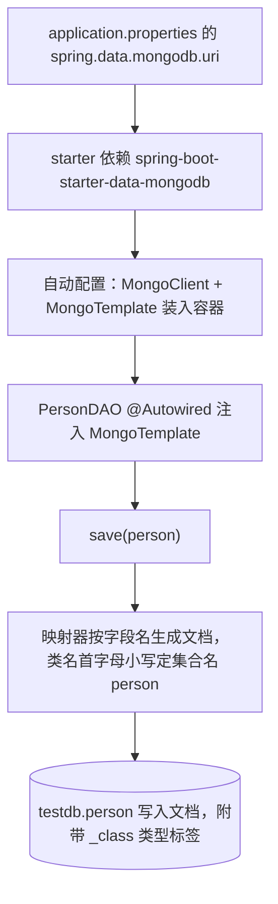

# Spring Boot 整合 MongoDB：一个 starter 加一个 MongoTemplate 就够了

上一节用驱动原生 API 完成了面向对象的增删改查，但它有两个成本绕不开：连接、编解码器全要自己初始化，实体映射靠 `CodecRegistry` 一段固定代码。真实项目里代码不会直接架在驱动上，而是架在 Spring Data 这一层。Spring Data 家族的设计目标只有一个：把「连存储、做 CRUD」这件事按 Spring 的习惯再简化一遍，`spring-data-mongodb` 就是家族里管 MongoDB 的那个成员，它对驱动 API 做了一层封装，让用法与 `spring-data-jpa`、`spring-data-redis` 保持同一种手感。

这一节把整合环境搭起来（starter 依赖、连接配置、`MongoTemplate` 注入），再用 `save` 方法把一条 `Person` 数据真正写进库里，顺手看一眼保存后的文档多了个什么字段。

## 先给结论

- 依赖只要一个 `spring-boot-starter-data-mongodb`，工程继承 `spring-boot-starter-parent` 让版本统一托管，测试另加 `spring-boot-starter-test`。
- 连接配置一行：`spring.data.mongodb.uri=mongodb://主机:27017/testdb`，库名直接写在连接串末尾，这一点与驱动 API 里 `getDatabase("testdb")` 分开选库的写法不同。
- 容器里已经有了配置好的 `MongoTemplate`，DAO 里 `@Autowired` 注入即可，不需要自己 new。
- `save` 有两个重载：`save(T)` 与 `save(T, collectionName)`；不指定集合名时，默认用实体类名首字母小写（`Person` 到 `person`）。
- 保存成功的文档里会多一个 `_class` 字段，记录这条数据由哪个类映射而来，供读取时反序列化定位类型。

## 一、依赖与配置：starter 接管一切

工程继承 Spring Boot 父工程，再引两个起步依赖（父工程版本号在画面上显示不全，按课程使用的 2.1.x 系列书写）：

```xml
<parent>
    <groupId>org.springframework.boot</groupId>
    <artifactId>spring-boot-starter-parent</artifactId>
    <version>2.1.8.RELEASE</version>
</parent>

<dependencies>
    <!-- Spring Data MongoDB 起步依赖，驱动 jar 由它传递引入 -->
    <dependency>
        <groupId>org.springframework.boot</groupId>
        <artifactId>spring-boot-starter-data-mongodb</artifactId>
    </dependency>
    <!-- 测试用 -->
    <dependency>
        <groupId>org.springframework.boot</groupId>
        <artifactId>spring-boot-starter-test</artifactId>
        <scope>test</scope>
    </dependency>
</dependencies>
```

`spring-boot-starter-data-mongodb` 里打包了 `spring-data-mongodb` 与 `mongodb-driver-sync` 两层：前者是 Spring Data 的封装层，后者才是真正连库的驱动。对比上一节手工引驱动、手工管理连接的写法，这里的依赖清单短了一半，而且版本不用写，全部交给父工程仲裁。

接着在 `src/main/resources` 下建 `application.properties`：

```properties
# Spring boot application
spring.application.name = study-mongodb
spring.data.mongodb.uri = mongodb://127.0.0.1:27017/testdb
```

真正干活的是第二行。连接串的格式是 `mongodb://主机:端口/库名`，`testdb` 写在末尾意味着「连上之后默认操作这个库」。回忆一下驱动版的写法：`MongoClients.create("mongodb://127.0.0.1:27017")` 连接串里没有库名，选库靠后面 `getDatabase("testdb")` 单独一步；Spring Data 把这两步合并进了 URI，配置里这一行同时承担了「连谁」和「用哪个库」。

## 二、DAO 与实体：注入 MongoTemplate 就能干活

实体沿用上一节的 `Person`（`ObjectId id`、`name`、`int age`、`Address address`），一个注解都不用加，Spring Data 靠字段名与文档键名默认对齐。新建 `PersonDAO`：

```java
package com.study.mongodb.spring;

import com.study.mongodb.pojo.Person;
import org.springframework.beans.factory.annotation.Autowired;
import org.springframework.data.mongodb.core.MongoTemplate;
import org.springframework.stereotype.Component;

@Component
public class PersonDAO {

    @Autowired
    private MongoTemplate mongoTemplate;

    public Person savePerson(Person person) {
        return this.mongoTemplate.save(person);
    }
}
```

按项目规范 DAO 本应面向接口编程（定义 `PersonDAO` 接口加实现类），这里是测试 API 用法，直接用 `@Component` 把类标成容器管理的组件。`MongoTemplate` 是 Spring Data MongoDB 提供的操作模板，Spring 家族一贯喜欢用模板类收敛样板代码，`JdbcTemplate`、`RedisTemplate`、`RestTemplate` 都是同一个思路：公共的连接管理、异常翻译、资源释放模板全包了，业务代码只写「做什么」。

`save` 方法有两个重载，IDEA 里点开提示能看到：

```java
// 重载一：不指定集合名，用实体类名首字母小写推导（Person → person）
<T> T save(T objectToSave);
// 重载二：显式指定集合名
<T> T save(T objectToSave, String collectionName);
```

课程选了第一个。返回值 `T` 就是保存后的那个对象，所以 `savePerson` 可以直接 `return this.mongoTemplate.save(person);`，一行完成保存加回传。

## 三、启动类与测试：把数据真正写进去

引导类是标准三件套，包名决定组件扫描范围，`PersonDAO` 要放在它的同级或子包下：

```java
package com.study.mongodb;

import org.springframework.boot.SpringApplication;
import org.springframework.boot.autoconfigure.SpringBootApplication;

@SpringBootApplication
public class MongoApplication {

    public static void main(String[] args) {
        SpringApplication.run(MongoApplication.class, args);
    }
}
```

测试类用 JUnit 4 跑 Spring 上下文，两个注解缺一不可：

```java
package com.study.mongodb.spring;

import com.study.mongodb.pojo.Address;
import com.study.mongodb.pojo.Person;
import org.bson.types.ObjectId;
import org.junit.Test;
import org.junit.runner.RunWith;
import org.springframework.beans.factory.annotation.Autowired;
import org.springframework.boot.test.context.SpringBootTest;
import org.springframework.test.context.junit4.SpringRunner;

@RunWith(SpringRunner.class)
@SpringBootTest
public class TestSpringPerson {

    @Autowired
    private PersonDAO personDAO;

    @Test
    public void testSave() {
        Person person = new Person(ObjectId.get(), "刘德华", 50,
                new Address("人民路", "北京", "666666"));
        this.personDAO.savePerson(person);
    }
}
```

`@RunWith(SpringRunner.class)` 让 JUnit 通过 Spring 的测试执行器运行，`@SpringBootTest` 负责把整个应用上下文拉起来，少了前者 `@Autowired` 注入进来的是 null。执行测试没有报错，到 shell 里验证：

```javascript
db.person.find()
{
    "_id" : ObjectId("5c0c8a19235e19494a6e6cc"),
    "name" : "刘德华",
    "age" : 50,
    "address" : { "street" : "人民路", "city" : "北京", "zip" : "666666" },
    "_class" : "com.study.mongodb.pojo.Person"
}
```

数据进去了，而且文档里多了一个没有在实体中声明过的 `_class` 字段，值是实体的全限定类名。这就是 Spring Data 保存时自动附上的类型标签，读取时靠它决定把文档反序列化成哪个类，一个集合映射多种实体时全靠这个字段区分。



图上从依赖到落库一共五步，全程没有手写一行连接代码：starter 引入自动配置类，自动配置读 URI 建 `MongoClient` 并装配 `MongoTemplate`，DAO 只做一次注入一次调用。上一节 `init` 方法里的编解码器、连接、选库，在这里全部被自动配置吸收了。

## 常见误区

- **连接串末尾忘了带库名。** `spring.data.mongodb.uri` 只写到端口时，容器拿不到默认库，`save` 这类操作会因数据库无法确定而报错。要么 URI 末尾写库，要么单独配 `spring.data.mongodb.database`。
- **把 `save` 当成纯新增。** `save` 的语义是「按 `_id` 找，存在则整条替换，不存在则插入」，与驱动 `insertOne` 的「只插入」不同。想强制新增、防止覆盖已有数据，应该用 `insert`。
- **测试类少了 `@RunWith(SpringRunner.class)`。** 只标 `@SpringBootTest` 而用 JUnit 4 默认执行器跑，Spring 上下文不会启动，`personDAO` 注入为 null，一调用就空指针。
- **纠结 `_class` 字段是脏数据。** 它是 Spring Data 有意写入的类型元数据，不是 bug；确定一个集合只存一种类型时，可以在映射配置里去掉，但默认保留是最稳的选择。
- **以为实体必须加 `@Document` 注解才能映射。** 不加注解时按「类名首字母小写」推导集合名，字段按名称对齐，`Person` 到 `person` 完全够用；注解的价值在自定义集合名、字段名映射，下一节微聊系统里会用到。

## 面试可能被问到的问题

1. 面试官追问：「引入 `spring-boot-starter-data-mongodb` 之后，容器里多了哪些东西？」
   答：自动配置会依据连接配置创建 `MongoClient`，并基于它装配 `MongoTemplate`（以及 `MongoDatabaseFactory`、映射转换器等基础设施）。业务代码注入 `MongoTemplate` 即可操作，连接建立、库选择、编解码都由模板内部完成。

2. 面试官追问：「`MongoTemplate.save` 和驱动的 `insertOne` 有什么区别？」
   答：`save` 是按 `_id` 的 upsert 语义，文档存在则整条替换、不存在则插入；`insertOne` 只插入，`_id` 冲突直接报错。所以 `save` 天然可以做「存在即更新」的写法，但要清楚它替换的是整条文档，未赋值的字段会丢失。

3. 面试官追问：「文档里多出来的 `_class` 字段是干什么的？能去掉吗？」
   答：Spring Data 保存实体时写入的类型标签，值为实体全限定类名，读取时由映射层用它决定实例化哪个类，支持一个集合映射多种类型的多态场景。可以通过 `MappingMongoConverter` 的 `TypeMapper` 配置去掉或改键名，去掉后无法自动支持多类型映射。

4. 面试官追问：「不指定集合名时，实体默认映射到哪个集合？」
   答：类名首字母小写，`Person` 对应 `person` 集合。需要自定义时在实体上加 `@Document(collection = "xxx")`，或调用 `save` 的带集合名重载、查询时显式传集合名。

5. 面试官追问：「驱动原生 API 和 `MongoTemplate` 怎么选？」
   答：项目已用 Spring Boot 时选 `MongoTemplate`，连接管理、异常翻译、对象映射都是现成的，代码量小且风格与整个 Spring 技术栈统一；驱动原生 API 更底层、更贴近 BSON 语义，适合框架封装、性能调优或脱离 Spring 的场景。两者可以共存，模板底层就是驱动。

## 配套资料

- day08 资料包未收录源码：`materials/code/03/day08-MongoDB入门以及实现微聊即时通讯功能/` 目录存在，其解压清单 `_extracted.json` 记录解压文件数为 0
- 文中 pom 依赖、`application.properties`、`PersonDAO`、`MongoApplication`、`TestSpringPerson` 及 shell 验证输出取自课程讲义画面（3 Spring Boot 整合 MongoDB 小节）；包名统一改为 `com.study.mongodb`，连接地址沿用系列文章的 `127.0.0.1`，父工程版本号画面显示不全按 2.1.x 系列补全；`save` 双重载、`_class` 说明为按本课写法补全的示例
