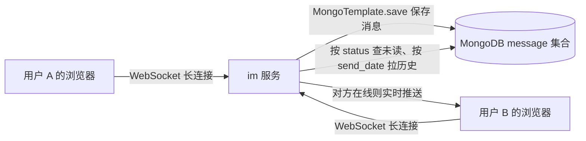

# 微聊系统开篇：用 Spring WebSocket 加 MongoDB 搭起即时通讯的地基

房屋详情页里的「微聊」入口是整个租房项目的即时通讯功能：买家看中一套房，直接跟房东在线聊。前一阶段学过的 WebSocket 负责长连接与消息收发，这三节练熟的 MongoDB 负责把每一条聊天记录落库。实现微聊的独立服务用 Maven 单模块工程搭起来，开篇一步到位完成三件事：建工程引依赖、设计消息的文档结构、把 `Message`、`User` 两个基础实体写出来。连接处理器、消息收发逻辑放在后续几节。

为什么聊天记录选 MongoDB 而不是 MySQL？消息是典型的写多读多、结构灵活的数据：一条消息里嵌着发送者与接收者两个用户对象，用文档模型一个集合装下，省去多表关联；消息量随业务线性膨胀，分片扩展也是 MongoDB 的主场。

## 先给结论

- 技术选型两条腿：Spring 封装的 WebSocket 做实时通道，`spring-data-mongodb` 做消息存储，工程骨架是一个继承 Spring Boot 父工程的独立模块。
- 消息文档的核心字段：`id` 主键、`msg` 内容、`status` 状态（1 未读、2 已读）、`send_date` 发送时间、`read_date` 已读时间、`from` 发送者、`to` 接收者，`from` 与 `to` 是嵌套的用户子文档。
- 实体上的四个关键注解：`@Id` 标主键，`@Indexed` 建索引，`@Field` 做驼峰属性到下划线字段的映射，`@Document` 自定义集合名。
- 索引跟着查询需求走：`status`、`sendDate`、`from`、`to` 要查就建，`readDate` 没有按它查的需求就不建。
- 实体写好即可，Spring Data 保存数据时会自动创建集合与索引，不需要手工建表。

## 一、工程骨架：一个纯粹的 im 模块

新建 Maven 工程，坐标定为 `haoke-im`（IM 即 Instant Messaging，即时通讯），包名 `com.study.haoke.im`，作为整个租房系统里独立的一个服务模块。pom 继承 Spring Boot 父工程，依赖按用途分四组：

```xml
<parent>
    <groupId>org.springframework.boot</groupId>
    <artifactId>spring-boot-starter-parent</artifactId>
    <version>2.1.8.RELEASE</version>
</parent>

<dependencies>
    <!-- Web 支持，消息收发的 HTTP 入口 -->
    <dependency>
        <groupId>org.springframework.boot</groupId>
        <artifactId>spring-boot-starter-web</artifactId>
    </dependency>
    <!-- 消息落库 -->
    <dependency>
        <groupId>org.springframework.boot</groupId>
        <artifactId>spring-boot-starter-data-mongodb</artifactId>
    </dependency>
    <!-- WebSocket 长连接 -->
    <dependency>
        <groupId>org.springframework.boot</groupId>
        <artifactId>spring-boot-starter-websocket</artifactId>
    </dependency>
    <!-- 测试 -->
    <dependency>
        <groupId>org.springframework.boot</groupId>
        <artifactId>spring-boot-starter-test</artifactId>
        <scope>test</scope>
    </dependency>
    <dependency>
        <groupId>org.mongodb</groupId>
        <artifactId>mongodb-driver-sync</artifactId>
        <version>3.9.1</version>
    </dependency>
    <dependency>
        <groupId>junit</groupId>
        <artifactId>junit</artifactId>
        <version>4.12</version>
        <scope>test</scope>
    </dependency>
    <dependency>
        <groupId>org.projectlombok</groupId>
        <artifactId>lombok</artifactId>
    </dependency>
    <dependency>
        <groupId>org.apache.commons</groupId>
        <artifactId>commons-lang3</artifactId>
    </dependency>
</dependencies>

<build>
    <plugins>
        <plugin>
            <groupId>org.springframework.boot</groupId>
            <artifactId>spring-boot-maven-plugin</artifactId>
        </plugin>
    </plugins>
</build>
```

`spring-boot-starter-websocket` 是本模块的新面孔，它把 WebSocket 握手、会话管理的基础设施接进 Spring Boot，本质还是 Java WebSocket 规范那套东西，Spring 做了封装让配置方式与整个技术栈统一。`mongodb-driver-sync` 显式声明 3.9.1 是为了版本透明，实际由 starter 传递引入。Lombok 与 commons-lang3 属于常规工具件，构建插件负责打可执行 jar。

整个微聊系统的数据通路在搭建阶段就定型了：



图里 im 服务是枢纽：两侧 WebSocket 连着收发双方，落库与推送在服务内部并行发生。存储侧对集合的两种访问方式，查未读走 `status`、拉历史按 `send_date`，正是下一节设计索引的依据。

## 二、消息文档结构设计：一条消息长什么样

动手写实体之前先把文档结构定下来。一条微聊消息在 MongoDB 里是这个形状：

```json
{
    "id": "10001",
    "msg": "你好，这套房子还在出租吗？",
    "status": 1,
    "send_date": 1543278937989,
    "read_date": null,
    "from": { "id": "1001", "username": "zhangsan" },
    "to": { "id": "1002", "username": "lisi" }
}
```

逐个字段过一遍设计考量：

**`id` 是主键。** 每条消息的唯一标识，值示例里写成字符串，实际由 Spring Data 的 `@Id` 注解指定映射关系，生成策略到实现阶段再定。

**`status` 是消息状态。** 聊天必备的已读未读机制就靠它：取值 1 代表未读，2 代表已读。对方收到消息后客户端回执，服务端把状态改成 2，同时把 `read_date` 从 null 更新为已读时间。

**`send_date` 与 `read_date` 是两个时间。** 一个记录什么时候发出，一个记录什么时候被读。数据库字段用下划线命名风格（`send_date`），而 Java 属性是驼峰（`sendDate`），两套命名风格的桥就是 `@Field` 注解。

**`from` 与 `to` 是嵌套对象。** 一条消息必然有「谁发的」和「发给谁」两个角色，各自用 `{id, username}` 表达。文档模型里直接嵌用户子文档，读一条消息连发送者头像昵称一起拿全，不需要再关联一次用户表。

## 三、Message 与 User 实体：注解逐个落地

把上面的结构翻译成实体。先写被嵌套的 `User`：

```java
package com.study.haoke.im.pojo;

import lombok.AllArgsConstructor;
import lombok.Builder;
import lombok.Data;
import lombok.NoArgsConstructor;

@Data
@Builder
@AllArgsConstructor
@NoArgsConstructor
public class User {
    private Long id;
    private String username;
}
```

再写主实体 `Message`，注解比较多，逐个说明：

```java
package com.study.haoke.im.pojo;

import lombok.AllArgsConstructor;
import lombok.Builder;
import lombok.Data;
import lombok.NoArgsConstructor;
import org.springframework.data.mongodb.core.index.Indexed;
import org.springframework.data.mongodb.core.mapping.Document;
import org.springframework.data.mongodb.core.mapping.Field;
import java.util.Date;

@Data
@Builder
@AllArgsConstructor
@NoArgsConstructor
@Document(collection = "message")
public class Message {

    @Id
    private String id;          // 主键

    @Indexed
    private String msg;         // 消息内容

    @Indexed
    private Integer status;     // 消息状态，1 未读 2 已读

    @Field("send_date")
    @Indexed
    private Date sendDate;      // 发送时间

    @Field("read_date")
    private Date readDate;      // 已读时间

    @Indexed
    private User from;          // 发送者

    @Indexed
    private User to;            // 接收者
}
```

**`@Document(collection = "message")`** 指定实体映射的集合名。对这个类而言写不写效果一样：不写注解时 Spring Data 默认取类名首字母小写，`Message` 正好映射到 `message`。显式写出是演示这个能力，将来集合名想叫别的（比如按业务拆分），改这一个参数就行。

**`@Id`** 标在 `id` 字段上，声明它是文档主键，映射层会把它对应到 `_id`。

**`@Indexed`** 声明该字段需要索引，索引跟着查询需求走：按 `status` 查未读消息，按 `from` 或 `to` 拉某个人的会话，按 `send_date` 排时间线，这几个字段都要建；`readDate` 没有任何「按已读时间查」的场景，就不建，索引不是越多越好，每个索引都有写入与存储成本。

**`@Field("send_date")`** 解决命名映射。默认情况下 Spring Data 按属性名找文档键，`sendDate` 属性会存成 `sendDate` 键，与设计里的下划线风格对不上，前端与查询脚本都按 `send_date` 取数就会扑空。`@Field` 把属性与文档键显式绑定，Java 侧保留驼峰，存储侧保留下划线，各守各的规范。

类上还有个 `@Builder`，给实体开链式构建：`Message.builder().msg("...").from(user).to(user).build()`，字段一多的实体用构造器传参极易错位，builder 写法可读性高得多。

一个值得记下的行为：`@Indexed` 声明的索引并不要求提前手工创建，Spring Data 往集合里保存数据时会自动创建缺失的索引。也就是说第一条消息落库时，`message` 集合与上面声明的几个索引会一起出现，库里可以事先什么都不建。

## 四、模拟用户数据：让聊天有两端可测

微聊的最小闭环是 A 发消息给 B，测试需要至少两个现成用户。项目暂时不做用户登录与管理，先用一个静态数据类顶上，后续实现登录功能后替换成真实用户：

```java
package com.study.haoke.im.pojo;

import java.util.HashMap;
import java.util.Map;

public class UserData {

    public static final Map<Long, User> USER_MAP = new HashMap<>();

    static {
        USER_MAP.put(1001L, User.builder().id(1001L).username("zhangsan").build());
        USER_MAP.put(1002L, User.builder().id(1002L).username("lisi").build());
        USER_MAP.put(1003L, User.builder().id(1003L).username("wangwu").build());
        USER_MAP.put(1004L, User.builder().id(1004L).username("zhaoliu").build());
        USER_MAP.put(1005L, User.builder().id(1005L).username("sunqi").build());
    }
}
```

静态块里放五个用户，`User.builder()` 链式构造一行一个。用 `static final Map` 承载是刻意的模拟手法：以 id 为键，业务代码里 `UserData.USER_MAP.get(1001L)` 一取就有，等真实的用户体系接进来，把这个类的引用替换成用户服务调用即可，上层消息代码不需要动。

至此工程骨架、依赖、实体、模拟数据全部就位。下一节开始写 WebSocket 连接处理器，把消息的接收与保存真正跑起来。

## 常见误区

- **给所有字段都加 `@Indexed`。** 索引是查询需求的投影，`readDate` 这类从不作为查询条件的字段加索引只会拖慢写入、多占空间。设计文档结构时先列清楚「会怎么查」，再决定给谁建索引。
- **`@Field` 忘写导致命名风格分家。** 实体是 `sendDate`，设计文档是 `send_date`，不加注解落库的键名就是 `sendDate`，前端按 `send_date` 读永远是 null。驼峰属性与下划线键名并存时必须逐字段映射。
- **以为 `@Document` 不写就映射不上。** 不写注解按「类名首字母小写」推导集合名，大多数情况够用；注解的价值在自定义集合名，不是没有它就不能用。
- **消息状态用魔法数字还不做约束。** `status` 取 1、2 是约定，散落在代码里容易写错，实现阶段应定义常量或枚举（如 `STATUS_UNREAD = 1`、`STATUS_READ = 2`），避免「1 是已读还是未读」这种历史谜题。
- **把模拟用户当成正式设计。** `UserData` 的静态 Map 只为让收发两端有据可查，真实场景用户数据来自登录态，接口设计时就要按「消息里存用户 id，展示时再补用户信息」或「冗余关键字段」想清楚。

## 面试可能被问到的问题

1. 面试官追问：「为什么聊天记录用 MongoDB 存而不是 MySQL？」
   答：消息是写密集、结构灵活的数据，一条消息里嵌着发送者与接收者对象，文档模型一次写入读出全量，省去多表关联；消息量随用户与活跃度快速增长，MongoDB 原生支持分片横向扩展；查询模式固定（按会话、按状态、按时间），不需要复杂的多表事务，这些特征与文档库高度契合。

2. 面试官追问：「`@Document`、`@Id`、`@Field`、`@Indexed` 四个注解分别做什么？」
   答：`@Document` 声明实体映射的集合名，缺省按类名首字母小写；`@Id` 标记主键属性，映射到文档的 `_id`；`@Field` 显式绑定 Java 属性名与文档键名，用于驼峰与下划线两种命名风格的转换；`@Indexed` 声明单字段索引，Spring Data 保存数据时自动创建。

3. 面试官追问：「消息已读未读怎么设计？」
   答：用 `status` 字段区分，1 未读 2 已读，配合 `send_date` 与 `read_date` 两个时间字段。发送时 status 写 1、read_date 置 null；接收方查看后服务端把 status 更新为 2 并记录 read_date。查未读消息走 status 上的索引，未读数就是按接收者加状态的一次计数查询。

4. 面试官追问：「索引是什么时候创建的？每次保存都会重建吗？」
   答：Spring Data 在应用写入阶段做索引保障，实体声明的 `@Indexed` 在首次保存时对不存在的索引自动创建，已存在的不会重复重建。也可通过注解属性声明唯一索引、过期索引等变体。要精确控制创建时机与后台构建方式，可以在部署阶段用脚本显式建。

5. 面试官追问：「`from` 和 `to` 为什么建成索引？」
   答：会话场景的查询几乎都围绕这两个字段：进入聊天页要拉「我与他之间的消息」，按 `from`、`to` 匹配；查询「发给我的未读消息」也以 `to` 加 `status` 组合。没有索引这些查询就是全集合扫描，消息量上来后延迟会不可接受。

6. 面试官追问：「Spring 对 WebSocket 做了什么封装？和原生 API 的区别？」
   答：`spring-boot-starter-websocket` 把 WebSocket 握手与会话管理接入 Spring 容器，可以用 `@ServerEndpoint` 风格或 Spring 的 `WebSocketHandler` 加配置类两种方式编写处理逻辑，配合拦截器做握手认证。底层仍是 Java WebSocket 规范与容器实现，Spring 的价值在依赖注入、配置统一和与生态（安全、消息代理）的打通。

## 配套资料

- day08 资料包未收录源码：`materials/code/03/day08-MongoDB入门以及实现微聊即时通讯功能/` 目录存在，其解压清单 `_extracted.json` 记录解压文件数为 0
- 文中工程坐标、pom 依赖、`Message`、`User`、`UserData` 代码取自课程讲义画面（4 搭建微聊系统小节）；工程与包名按中性命名重写为 `haoke-im` 与 `com.study.haoke.im`，`UserData` 五个模拟用户及消息文档结构示例为按本课写法补全
