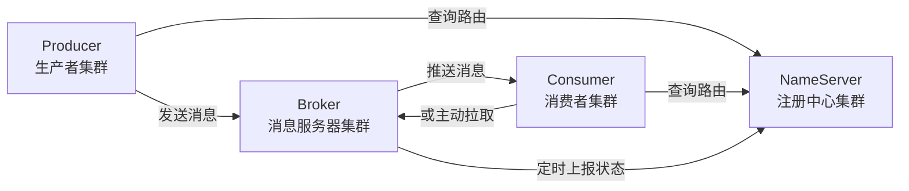
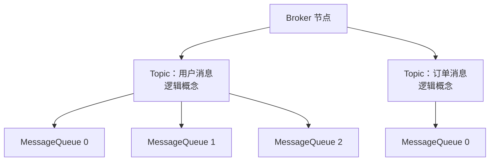

# RocketMQ 核心概念：一条消息背后的四大角色与两级分类

装 RocketMQ 之前，先把它的一套概念立起来。否则启动脚本里的 `mqnamesrv`、配置文件里的 `broker.conf`、日志里的路由信息，个个都是生词。这一篇按课程的手绘讲解顺序，把 Producer、Consumer、NameServer、Broker、Topic、MessageQueue、Tag 一次讲透，先建全景，再逐个角色拆开。

## 先给结论

- 消息系统逃不开生产者消费者模式：Producer 负责生产消息，Consumer 负责消费消息，Broker 负责接收与存储，NameServer 负责路由信息。
- Broker 是真正干活的组件，NameServer 是集群的组织协调员，只保存 Broker 的元数据，不处理任何消息。
- Broker 需要定时向 NameServer 上报自身状态，默认每 10 秒一次，超过 2 分钟没有上报就会被判定失效。
- Topic 是消息的逻辑分类，MessageQueue 才是物理存储单元，一个 Topic 由多个 MessageQueue 组成；Tag 是 Topic 之下的二级分类，用于消费过滤。
- Producer 与 Consumer 都有分组概念，同组发送或消费同类消息、逻辑一致；消费者分 Push 与 Pull 两种。

## 一、全景：四个角色，两条线

消息系统的骨架就是生产者消费者模式，再叠加一个注册中心。把四个角色和它们之间的关系画出来：



这张图上有两条主线。**一条是消息线**：生产者把消息发给 Broker，Broker 存下来，消费者从 Broker 拿走，消息永远只在生产者、Broker、消费者之间流动。**一条是元数据线**：Broker 把自己的地址和负载情况上报给 NameServer，生产者和消费者发送、消费之前先到 NameServer 查「该找哪个 Broker」。

**为什么要多一个 NameServer？** 因为 RocketMQ 天然是分布式的，Broker 会有很多台组成集群。生产者发消息时到底该连哪台？消费者订阅时去哪找数据？总不能把 Broker 的地址硬编码在配置里。NameServer 就是那本活地图：Broker 上报自己的位置，客户端来查路。类比一下，Broker 是各家店铺，NameServer 是商场导览台，买东西永远去店铺，问路才去导览台。

## 二、Producer 与 Consumer：两种角色与两种消费者

**Producer 负责消息的生产，一般由业务系统来承担。** 下单系统产生订单消息、支付系统产生支付结果消息，这些发出消息的应用就是生产者。生产者还有一层分组概念 Producer Group：同一组的生产者通常发送同一类消息，并且发送逻辑一致。比如订单集群里五台机器都在发订单消息，它们就属于同一个 Producer Group，分组的意义在事务消息等场景会体现出来。

**Consumer 负责消息的消费，一般由后台系统承担异步消费。** 消费者比生产者多一个重要分类，按取消息的方式分两种：

- **PushConsumer，推模式**：消费者与 Broker 建立订阅关系后，服务端主动把消息推送到消费者端，消息到了就触发处理逻辑。
- **PullConsumer，拉模式**：消费者定时主动到服务端拉取消息，什么时候取、一次取多少，由消费者自己控制。

推模式用起来省心，注册了监听器就等消息上门；拉模式控制力强，适合消费速率需要严格自管理的场景。两种模式后面会有专门课程展开，此处先建立认知即可。

**消费者同样有 Consumer Group 的概念**：同一组的消费者通常消费同一类消息，并且消费逻辑一致。分组还决定了一条消息在组内的投递方式：默认的集群模式下，同组消费者瓜分消息，一条消息组内只有一个消费者处理；广播模式下，一条消息组内每个消费者都处理一遍。同系列讲义对队列分配还有一条铁律：一个队列同一时刻只允许一个消费者消费，一个消费者可以同时消费多个队列，这是后面理解负载均衡的伏笔。

## 三、NameServer：只当协调员，不碰消息

NameServer 在集群架构里的角色是组织协调员，相当于注册中心，职责是收集 Broker 的工作情况。它手里保存的是 Broker 的元数据：哪台 Broker 活着、地址是什么、负载如何。

**NameServer 不负责消息的处理**，这一条必须刻进脑子。消息的收发、存储全在 Broker，NameServer 手里只有一本通讯录。理解了这一点，很多现象就能解释通：NameServer 挂一台，已建立连接的收发不受影响，只是新客户端查不到路由；NameServer 本身也不需要持久化太复杂的状态，因为它保存的路由信息随时可以由 Broker 重新上报重建，所以 NameServer 集群各节点彼此独立、互不通信，部署成本极低。

## 四、Broker：干活的组件与 10 秒、2 分钟两个数字

Broker 是 RocketMQ 的核心，负责消息的接收、存储、发送以及高可用，上一节的类比里它是真正开门做生意的店铺。集群里 Broker 会有多台，互相配合提供横向扩容能力，Broker 内部结构在下一节放大了看。

Broker 与 NameServer 之间有一套心跳机制，两个数字要记住：**Broker 默认每 10 秒向 NameServer 发送一次自身状态**，让路由表保持新鲜；**如果超过 2 分钟 NameServer 没有收到某个 Broker 的上报，就认为这个 Broker 失效了**，随后的路由更新会把这台 Broker 从可用列表里摘除，客户端再查路由就不会往它上面发消息。

这两个数字在排障时非常有用：Broker 明明进程还在，客户端却查不到路由，多半是心跳断了两分钟以上，网络分区或进程僵死都会造成这种「活着但被除名」的状态。

## 五、Topic、MessageQueue 与 Tag：逻辑分类与物理存储

消息到了 Broker，存在哪、怎么找？这里是一组最容易被混淆的概念，把单个 Broker 放大来看：



**Topic 是逻辑概念，代表消息的类型分类。** 不同类型的消息发到不同的 Topic，靠 Topic 名称区分，比如用户类消息发 `user`，订单类消息发 `order`，两个 Topic 各存各的，互不干扰。它在 Broker 里类似文件夹的存在，是为了分类而生的抽象。

**MessageQueue 是物理概念，真正存储消息数据的单元。** 一个 Topic 内部会有多个 MessageQueue，消息实际就落在这些队列里。多队列设计是性能与可用的双重需要：发送时在多个队列间分散，写压力就摊开了；消费时一个消费者可以同时盯多个队列，消费并发度也上去了。同系列讲义补充了一个默认值：Topic 自动创建时默认分配 4 个写队列、4 个读队列。

**Tag 是 Topic 之下的二级分类。** Topic 把消息分成大类，Tag 在大类里再分小类，消费端可以按 Tag 过滤，只处理自己关心的那部分消息，Tag 可以为空。打个比方：Topic 是「订单」，Tag 是「已支付」「已退款」，订阅订单消息但只关心退款事件的消费者，用 Tag 过滤就能少消费一大半无关消息。

## 六、概念落到代码：发一条，收一条

概念说得再多，落到代码就两段。生产端注入 `RocketMQTemplate`，指定主题发送；消费端实现 `RocketMQListener` 接口，注解标明监听的主题与消费组。以下代码取自同系列 RocketMQ 专题讲义的快速入门工程，包名已改写（day09 资料包无源码，示例按本课写法补全）：

```java
package com.example.rocketmq;

import org.apache.rocketmq.spring.core.RocketMQTemplate;
import org.springframework.stereotype.Component;

/**
 * 消息发送类
 */
@Component
public class ProducerSimple {

    @Autowired
    private RocketMQTemplate rocketMQTemplate;

    /**
     * 发送同步消息
     */
    public void sendSyncMsg(String topic, String msg) {
        rocketMQTemplate.syncSend(topic, msg);
    }
}
```

```java
package com.example.rocketmq;

import org.apache.rocketmq.spring.annotation.RocketMQMessageListener;
import org.apache.rocketmq.spring.core.RocketMQListener;
import org.springframework.stereotype.Component;

/**
 * 消费消息监听类
 */
@Component
@RocketMQMessageListener(topic = "my-topic", consumerGroup = "demo-consumer-group")
public class ConsumerSimple implements RocketMQListener<String> {

    @Override
    public void onMessage(String message) {
        System.out.println(message);
    }
}
```

客户端怎么知道 NameServer 在哪？配置文件里一行 `rocketmq.nameServer`；Broker 怎么找到注册中心？发行包的 `conf/broker.conf` 里一行 `namesrvAddr`。两边对着 NameServer 报到，路由就通了：

```yaml
server:
  port: 8181

rocketmq:
  nameServer: 127.0.0.1:9876
  producer:
    group: demo-producer-group
```

```properties
brokerClusterName = DefaultCluster
brokerName = broker-a
brokerId = 0
namesrvAddr=127.0.0.1:9876
```

把这几段代码与第一节的架构图对上号：`group` 对应 Producer Group 与 Consumer Group，`nameServer` 与 `namesrvAddr` 对应元数据线，`topic = "my-topic"` 对应逻辑分类，发送与监听对应消息线。概念与代码一一咬合，这一课就算学扎实了。

## 常见误区

- **以为 NameServer 存消息。** 它只保存 Broker 的元数据，是通讯录不是仓库。消息查询、堆积、投递全部发生在 Broker，把 NameServer 当消息存储去查消息，方向从一开始就错了。
- **以为 Topic 是物理文件。** Topic 是逻辑分类，真正存数据的是 Topic 下的 MessageQueue。说「Topic 里有多少条消息」其实说的是它名下所有队列的消息总和，两者是包含关系不是并列关系。
- **以为 Push 就完全没有拉。** 推与拉是消费 API 层面的两种形态，Push 模式封装后用起来像服务端硬塞，实际机制上客户端仍有订阅与请求的参与，理解成「注册监听器后消息自动到达」即可，不必神化它。
- **以为 Group 只是起个名字。** 同组消费逻辑必须一致，集群模式下同组消费者瓜分队列实现负载均衡；事务消息场景下 Broker 还要按生产组回查发送方。分组是语义与机制的一部分，不是注释。
- **以为 Broker 失效就是宕机。** 判定标准是心跳：进程活着但连续 2 分钟没上报状态，NameServer 照样把它摘除。反过来，被摘除的 Broker 恢复上报后会重新出现在路由里，不需要人工干预。

## 面试可能被问到的问题

1. 面试官追问：「NameServer 的作用是什么？为什么不用 ZooKeeper？」
   答：NameServer 是无状态的路由注册中心，Broker 定时上报元数据，生产者消费者查它拿到 Broker 地址。它设计上极简：节点间互不通信、不持久化复杂状态，挂一台不影响其余节点，部署维护成本远低于 ZooKeeper 这类强一致协调服务。路由信息允许短暂不一致，RocketMQ 的场景要的是高可用而非强一致，所以选了轻量方案。

2. 面试官追问：「Broker 挂了，NameServer 怎么知道？」
   答：靠心跳。Broker 默认每 10 秒向 NameServer 上报一次自身状态，NameServer 若超过 2 分钟没收到某 Broker 的上报，就判定它失效，更新路由把它从可用列表摘除。生产者消费者再查路由时就不会选到这台，待它恢复上报后重新加入。

3. 面试官追问：「Topic、MessageQueue、Tag 三者什么关系？」
   答：Topic 是逻辑分类，代表一类消息；MessageQueue 是 Topic 之下的物理存储单元，一个 Topic 由多个队列组成，读写并发都靠多队列摊开；Tag 是 Topic 内的二级分类，用于消费端过滤。类比文件系统：Topic 是文件夹，MessageQueue 是文件夹里真正放数据的文件，Tag 是文件名上的标签。

4. 面试官追问：「Push 消费者和 Pull 消费者怎么选？」
   答：Push 由服务端推送，消息到达即触发监听器，实时性好、用起来简单，绝大多数业务场景用它；Pull 由消费者定时拉取，速率与批量完全自控，适合消费能力需要严格管理或数据抽取类场景。实时性优先选 Push，可控性优先选 Pull。

5. 面试官追问：「Consumer Group 有什么实际作用？」
   答：一是负载均衡，集群模式下同组消费者瓜分 Topic 的队列，一个队列同时只给一个消费者，扩容消费者就能提高消费并行度；二是广播语义，同一组按广播模式消费时每台机器都能收到全量消息；三是容错，组内一台消费者下线，它负责的队列会重新分配给幸存者。

6. 面试官追问：「描述一条消息从发送到消费的完整旅程。」
   答：业务系统作为 Producer 启动时连接 NameServer 拿到路由表，选定目标 Topic 下的某个 MessageQueue，把消息发送到该队列所在的 Broker；Broker 存储成功后等待消费；Consumer 同样先从 NameServer 查路由，再订阅 Broker，推模式下 Broker 将消息推送过来，消费者回调监听器处理并向 Broker 返回消费状态，失败则进入重试流程。

## 配套资料

- 同系列 RocketMQ 专题讲义：`materials/docs/10/RocketMQ研究v1.0.md`（组成结构、核心概念定义、生产者与消费者示例代码、Push 与 Pull 两种消费模式均出自此讲义）
- RocketMQ 官方发行包及其真实配置文件：`materials/code/10/rocketmq-all-4.5.0-bin-release/rocketmq-all-4.5.0-bin-release/conf/broker.conf`（文末 `broker.conf` 片段为该文件原文节选）
- 本课（day09）资料包未提供源码：`materials/code/03/day09-分布式消息系统RocketMQ的入门/` 目录下仅有解压清单 `_extracted.json`，记录解压文件数为 0，Java 示例取自上述讲义并按本课写法改写包名补全
- 架构关系与 Broker 内部结构图，依据课程视频手绘图与「1.3、核心概念说明」画面内容整理
