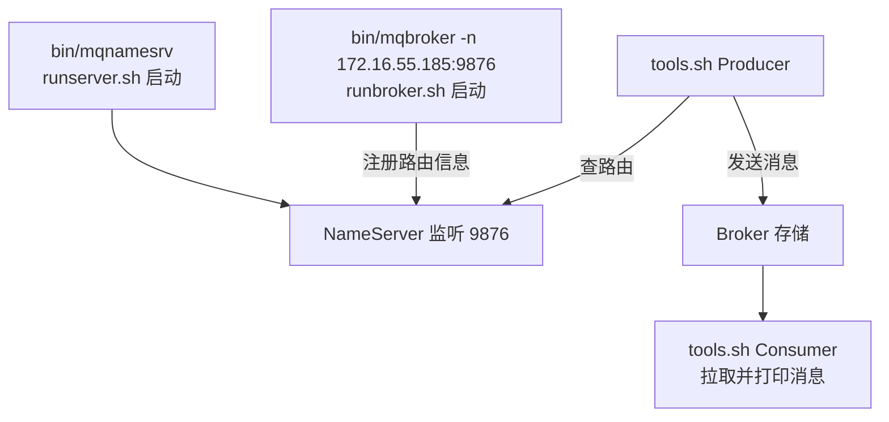

# 解压就能跑的 RocketMQ：非 Docker 安装、内存调参装到自测通过

发行包拿到手，解压、进 `bin`、敲 `mqnamesrv`，看起来三步完事。真上手就会发现，NameServer 秒起，Broker 一敲就甩出 `Cannot allocate memory`，申请 8G 内存失败。问题不在安装步骤，而在默认 JVM 参数是按生产环境的机器给的，测试机根本吃不下。这一篇把非 Docker 方式的完整安装走一遍：解压、按顺序启动、调内存参数、再用发行包自带的工具类发一条消息自测。

## 先给结论

- RocketMQ 的安装是「绿色软件」式：发行包解压即用，目录里真正要认识的只有 `bin`（启动与运维脚本）、`conf`（配置模板）、`lib`（依赖 jar）。
- 启动顺序固定：先 NameServer，后 Broker，顺序不能反；Broker 启动时用 `-n` 参数指定 NameServer 地址，`9876` 是 NameServer 的默认端口。
- 发行包默认 JVM 参数面向生产环境，`runbroker.sh` 里堆是 `-Xms8g -Xmx8g -Xmn4g`，测试机直接启动必然分配失败，要手动调小。
- 装完不用写代码就能自测：发行包自带 `tools.sh`，配一个 `NAMESRV_ADDR` 环境变量，跑官方 quickstart 的 Producer 和 Consumer 即可。
- Broker 启动日志里打印的注册 IP 值得盯一眼，那行日志埋着下一篇「Java 客户端超时」的伏笔。

## 一、发行包解压即用

环境要求按讲义来：64 位 JDK 1.8 以上、64 位操作系统。资料包里提供的是 `rocketmq-all-4.5.0-bin-release.zip` 发行包（课程录制时用的是 4.3.2，目录结构与操作流程完全一致），传到服务器上解压即可：

```bash
cd /home
unzip rocketmq-all-4.5.0-bin-release.zip
cd rocketmq-all-4.5.0-bin-release
ll
```

解压出来的目录不长：`benchmark/`、`bin/`、`conf/`、`lib/` 四个目录加 LICENSE、NOTICE、README。各自的分工很清楚：

| 目录 | 内容 | 什么时候碰 |
|---|---|---|
| `bin` | `mqnamesrv`、`mqbroker`、`tools.sh` 等脚本 | 每次启动、自测 |
| `conf` | `broker.conf` 与 2m-2s-sync 等集群配置模板 | 调 Broker 参数、搭集群 |
| `lib` | 全部依赖 jar | 基本不碰 |
| `benchmark` | 官方压测脚本 | 性能测试时 |

讲义里特意强调一句：解压路径不要带空格和中文，启动脚本解析路径时会出问题。

## 二、启动顺序：先 NameServer，后 Broker

RocketMQ 的两个核心进程就是上一章讲过的两个角色，启动时谁先谁后有讲究：Broker 起来后要立刻向 NameServer 上报自己的路由信息，生产者发消息前也要先查 NameServer 拿 Broker 地址，所以 NameServer 必须先就位。

```bash
# 第一步：启动 NameServer，默认监听 9876 端口
bin/mqnamesrv
# 日志出现：The Name Server boot success. serializeType=JSON

# 第二步：新开一个窗口启动 Broker，-n 指定 NameServer 地址
bin/mqbroker -n 172.16.55.185:9876
# 日志出现：The broker[mq-server, 172.20.0.1:10911] boot success.
# serializeType=JSON and name server is 172.16.55.185:9876
```

NameServer 的启动日志好认，一句 boot success 就完事。Broker 的日志信息量更大，值得逐段读：方括号里是主机名和它注册用的 IP 加端口，`10911` 是 Broker 对外服务的主端口；结尾的 `name server is 172.16.55.185:9876` 回显了 `-n` 参数传入的注册中心地址。这里注册 IP 显示的是 `172.20.0.1`，不是服务器的业务网卡地址，暂时记下这个细节，下一篇它就是主角。

## 三、Cannot allocate memory：默认参数是给生产环境的

在没有调整参数的机器上，`mqbroker` 多半起不来，报错核心是 `Cannot allocate memory`，申请若干 GB 内存失败。这不是安装坏了，而是发行包默认配置的定位问题：**默认 JVM 参数按生产环境给的，学习机内存不够用。**

打开资料包里的 `bin/runbroker.sh`，JVM 参数段写得很直白：

```bash
# runbroker.sh（Broker）：堆三件套按生产规格给足
JAVA_OPT="${JAVA_OPT} -server -Xms8g -Xmx8g -Xmn4g"
JAVA_OPT="${JAVA_OPT} -XX:+AlwaysPreTouch"
JAVA_OPT="${JAVA_OPT} -XX:MaxDirectMemorySize=15g"
```

`-Xms` 是初始堆大小，`-Xmx` 是最大堆，`-Xmn` 是年轻代。8G 的堆加 15G 的堆外上限，再加 `-XX:+AlwaysPreTouch`（启动时就把内存页摸一遍，相当于一次性占用），小内存机器直接判死刑。NameServer 用的 `bin/runserver.sh` 同样不含糊，默认 `-Xms4g -Xmx4g -Xmn2g`。

测试环境的改法就是把数字砍到机器能吃下的量级，两个脚本都要改：

```bash
# bin/runserver.sh：NameServer 参数，原值 -Xms4g -Xmx4g -Xmn2g
JAVA_OPT="${JAVA_OPT} -server -Xms128m -Xmx128m -Xmn64m -XX:MetaspaceSize=128m -XX:MaxMetaspaceSize=320m"

# bin/runbroker.sh：Broker 参数，原值 -Xms8g -Xmx8g -Xmn4g
JAVA_OPT="${JAVA_OPT} -server -Xms128m -Xmx128m -Xmn64m"
# 堆外内存上限也要一起调，默认 15g
JAVA_OPT="${JAVA_OPT} -XX:MaxDirectMemorySize=1g"
```

改完保存，把 NameServer 和 Broker 依序重启，这次两行 boot success 都能见到。**反过来提醒一句，别把 128m 当成推荐值带进生产**，生产环境不但要恢复默认，往往还要按流量再往上加。

讲义里还有两个开发环境友好项：Windows 下的对应脚本是 `runserver.cmd` 和 `runbroker.cmd`，改法一样；Broker 默认磁盘使用率达到 85% 就拒绝接收新消息，开发机磁盘紧张时可以用 `-Drocketmq.broker.diskSpaceWarningLevelRatio=0.98` 把告警阈值提到 98%。

## 四、用发行包自带的 tools.sh 自测

服务起没起好，不用急着写 Java 代码，发行包里已经备好现成的测试类。`lib` 里有官方示例 jar，`bin/tools.sh` 负责把它跑起来，quickstart 包下的 Producer 和 Consumer 就是一对现成的收发工具：

```bash
# 指定 NameServer 地址
export NAMESRV_ADDR=172.16.55.185:9876

# 发送消息（官方示例类，发往 TopicTest）
bin/tools.sh org.apache.rocketmq.example.quickstart.Producer
# 输出 SendResult [sendStatus=SEND_OK, ...]，连续发若干条

# 新开窗口消费消息
export NAMESRV_ADDR=172.16.55.185:9876
bin/tools.sh org.apache.rocketmq.example.quickstart.Consumer
# 输出 ConsumeMessageThread_ Receive New Messages: Hello RocketMQ ...
```

Producer 一口气往 `TopicTest` 发一批消息，每条都回显 `SendStatus=SEND_OK`；Consumer 启动后立刻把消息拉下来打印。两边都通，说明 NameServer、Broker、路由、存储整条链路都是好的。

整条链路画出来是这样：



图上有一条容易忽略的线：Broker 到 NameServer 的注册箭头。`-n` 给的地址错了，Broker 会拿着错误地址去注册，NameServer 的路由表里就没有它的位置，生产者一查就报 `No route info of this topic`。安装现场就真实踩过这一脚：把 NameServer 地址误写成 192.168 网段的 IP，实际服务器在 172.16 网段，`tools.sh` 发送立刻报这个错，把 Broker 的 `-n` 改成正确 IP 重启后一次通过。见到 No route info，先查注册这一环，而不是急着去建 Topic。

## 常见误区

- **先启 Broker 后启 NameServer，或 `-n` 地址写错。** Broker 注册不进路由表，客户端发送时报 `No route info of this topic`。修复方式是先起 NameServer，并核对 Broker 启动日志末尾回显的 name server 地址。
- **只改 `runbroker.sh` 不改 `runserver.sh`。** NameServer 默认也要 4G 堆，小机器上同样起不来；两个脚本都要按机器实际内存调整，`MaxDirectMemorySize` 也别漏。
- **把测试环境的 128m 带进生产。** 128m 只为让学习机跑起来，生产按默认甚至更大配置，内存给不足会频繁 Full GC 甚至 OOM。
- **解压到带空格或中文的路径。** 启动脚本对路径做字符串拼接，特殊字符会导致找不到类或配置，讲义明确要求解压到无空格无中文目录。

## 面试可能被问到的问题

1. 面试官追问：「为什么 Broker 要先等 NameServer 启动？」
   答：Broker 启动后要向 NameServer 上报自己的路由信息（地址、端口、负载），生产者与消费者也要先查 NameServer 才能找到 Broker。顺序反了或地址写错，路由表里没有可用 Broker，客户端就会报 No route info of this topic。

2. 面试官追问：「9876 和 10911 分别是什么端口？」
   答：9876 是 NameServer 的默认监听端口，负责 Broker 注册与客户端路由查询；10911 是 Broker 接收生产者、消费者请求的主端口，旁边还有 10909 作为 VIP 通道端口。客户端实际收发消息连的是 10911，不直连 9876。

3. 面试官追问：「发行包默认 JVM 参数为什么那么大？怎么改？」
   答：默认参数面向生产高吞吐，runbroker.sh 给了 8G 堆加 15G 堆外，保证大消息量下的稳定性。测试机按机器内存调小即可，通常改 `-Xms`、`-Xmx`、`-Xmn` 三项到 128m 量级；生产环境不仅不能照抄测试值，还要按流量评估是否加大。

4. 面试官追问：「报 Cannot allocate memory，一定是物理内存不足吗？」
   答：多数情况是 `-Xms` 设得比机器可用内存大，加上 `-XX:+AlwaysPreTouch` 会启动时预触碰全部内存页，一次性申请失败。先用 free 确认机器真实可用内存，再对照脚本里的堆与堆外上限逐项调小，不必重装。

5. 面试官追问：「No route info of this topic 一般怎么排查？」
   答：按链路倒着查：客户端连的 NameServer 地址对不对；Broker 是否起来了、`-n` 指向的 NameServer 是否正确；Broker 启动日志里注册的 IP 端口是否外部可达。前三步都正常再考虑 Topic 未创建或自动建 Topic 被关闭的情况。

## 配套资料

- RocketMQ 发行包及真实脚本：`materials/code/10/rocketmq-all-4.5.0-bin-release/rocketmq-all-4.5.0-bin-release/bin/runbroker.sh`、`bin/runserver.sh`（文中的默认 JVM 参数为这两个文件原文）、`bin/tools.sh`（自测命令）、`conf/broker.conf`（Broker 配置模板）
- RocketMQ 专题讲义：`materials/docs/10/RocketMQ研究v1.0.md`（环境要求、Windows 下 runserver.cmd 与 runbroker.cmd 调参、磁盘告警阈值 0.98 的写法均出自讲义安装章节）
- 本课（day09）资料包未提供源码：`materials/code/03/day09-分布式消息系统RocketMQ的入门/` 下仅有解压清单 `_extracted.json`，记录解压文件数为 0
