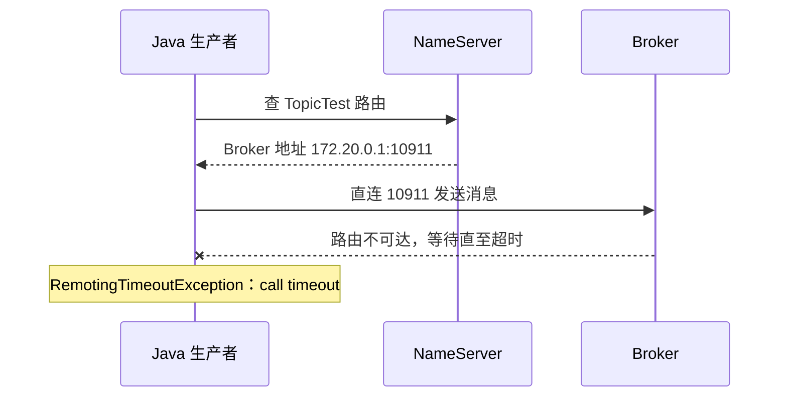

# Java 客户端连 RocketMQ：一次 send timeout 扯出的 Broker 注册 IP 问题

用发行包自带的工具收发消息一切正常，自己写个 Java 客户端却处处超时，这是装完 RocketMQ 后最打击人的一环。难点在于代码没写错、依赖没引错，问题藏在 Broker 向 NameServer 注册的那个 IP 里。这一篇从建工程开始，把生产者三种发送方式、消费者监听写全，再顺着超时现场把注册 IP 问题连根拔掉。

## 先给结论

- 客户端只需要一个依赖 `rocketmq-client`，版本与服务端保持一致（课程录制时服务端为 4.3.2，资料包发行版为 4.5.0，写哪个数字取决于你启动的是哪个）。
- 生产者的固定三步：创建 `DefaultMQProducer` 并设生产组、`setNamesrvAddr` 指向 NameServer、`start()` 之后发送。
- 三种发送方式：同步等 Broker 回执、异步走回调、单向只发不等，选型看业务对可靠性与吞吐的取舍。
- 只配 NameServer 地址是「问路」用的，真正发消息连的是 Broker 注册的地址；注册地址客户端不可达，就表现为 send timeout。
- 解法是 `brokerIP1`：写进 `broker.conf`，用 `mqbroker -c` 指定配置文件重启 Broker。

## 一、工程与依赖

建一个普通 Maven 工程就够了，不需要 Spring。坐标与依赖如下（包名已改为中性的 `com.example`）：

```xml
<?xml version="1.0" encoding="UTF-8"?>
<project xmlns="http://maven.apache.org/POM/4.0.0"
         xmlns:xsi="http://www.w3.org/2001/XMLSchema-instance"
         xsi:schemaLocation="http://maven.apache.org/POM/4.0.0 http://maven.apache.org/xsd/maven-4.0.0.xsd">
    <modelVersion>4.0.0</modelVersion>

    <groupId>com.example</groupId>
    <artifactId>rocketmq-test</artifactId>
    <version>1.0-SNAPSHOT</version>

    <dependencies>
        <!-- RocketMQ 原生客户端，版本与服务端保持一致 -->
        <dependency>
            <groupId>org.apache.rocketmq</groupId>
            <artifactId>rocketmq-client</artifactId>
            <version>4.5.0</version>
        </dependency>
    </dependencies>
</project>
```

客户端版本对齐服务端是一条实用军规：两者之间靠私有协议通信，版本差太多容易出现默认行为对不上的怪问题。

## 二、生产者代码：同步、异步、单向

同步发送是官方 quickstart 的原版写法，指定 NameServer 地址，循环创建消息并发送，每条消息由 Topic、Tag、消息体构成：

```java
package com.example.rocketmq;

import org.apache.rocketmq.client.producer.DefaultMQProducer;
import org.apache.rocketmq.client.producer.SendResult;
import org.apache.rocketmq.common.message.Message;

/**
 * 同步发送：发一条，等 Broker 确认一条
 */
public class SyncProducer {

    public static void main(String[] args) throws Exception {
        // 创建生产者，指定生产组
        DefaultMQProducer producer = new DefaultMQProducer("test-group");
        // 指定 NameServer 地址
        producer.setNamesrvAddr("172.16.55.185:9876");
        producer.start();

        for (int i = 0; i < 100; i++) {
            // 消息三要素：Topic、Tag、消息体
            Message msg = new Message("TopicTest", "TagA",
                    ("Hello RocketMQ " + i).getBytes());
            // 同步发送，阻塞直到返回结果
            SendResult sendResult = producer.send(msg);
            System.out.println(sendResult);
        }
        producer.shutdown();
    }
}
```

跑通之后每条消息打印一个 `SendResult`，里面的 `sendStatus=SEND_OK` 就是发送成功的凭证，还带着 `msgId` 和落在哪个队列上的信息。

在这个骨架上换一个发送方法，就是另外两种模式。三者的定义出自 RocketMQ 专题讲义：同步消息执行 API 时同步等待 Broker 返回结果；异步消息指定成功与异常的回调，调用后立即返回，不阻塞发送线程；单向消息直接返回，不关心 Broker 的结果（以下两段为按官方 quickstart 写法补全的示例，day09 资料包无源码）：

```java
// 异步发送：回调在独立线程里执行，主线程继续跑
producer.send(msg, new SendCallback() {
    @Override
    public void onSuccess(SendResult sendResult) {
        System.out.println("发送成功：" + sendResult.getMsgId());
    }
    @Override
    public void onException(Throwable e) {
        System.out.println("发送失败，可记录后补偿重发：" + e.getMessage());
    }
});

// 单向发送：只管发出去，不等待也不回调，适合允许丢的日志类场景
producer.sendOneway(msg);
```

三种方式的取舍很朴素：要确认结果用同步，量大发得快又想要结果用异步，丢了也无所谓用单向。

## 三、官方工具能通，自己写的却超时

把上面的 `SyncProducer` 跑起来，大概率等来的不是 `SEND_OK`，而是超时异常，日志核心一句 `call timeout`。奇怪的地方在于：同一个服务器，`tools.sh` 收发如常，Java 客户端却连不上去。

问题出在对「NameServer 地址」这个配置的理解上。`setNamesrvAddr` 只解决了**问路**这一步：生产者启动后连 NameServer 拿路由表，得知 `TopicTest` 的队列在哪台 Broker 上。真正**送货**的时候，生产者会按路由表里 Broker 上报的地址直连 Broker 的 10911 端口。回头看 Broker 的启动日志：

```bash
The broker[mq-server, 172.20.0.1:10911] boot success.
serializeType=JSON and name server is 172.16.55.185:9876
```

NameServer 地址确实对，但 Broker 注册出去的地址是 `172.20.0.1:10911`。`172.20.0.1` 不是服务器的业务网卡地址，而是服务器上 docker0 网桥的地址，只有服务器本机自己能通。开发机拿到这个地址去连，自然超时。修复前的链路长这样：



关键认知只有一句：**NameServer 只转述 Broker 上报的地址，不会帮客户端换算成可达地址。** Broker 自己「以为」自己是 172.20.0.1，就把这个地址挂在了路由表上，客户端照单全收然后一头撞墙。这不是客户端的 Bug，是 Broker 的自我介绍出了问题。

## 四、broker.conf：把注册 IP 掰正

解决思路是明确告诉 Broker「你应该用哪个 IP 注册」。在服务器上建一个 Broker 配置文件：

```bash
mkdir -p /haoke/rmq/rmqbroker/conf
vim /haoke/rmq/rmqbroker/conf/broker.conf
```

```properties
# Broker 对外注册的 IP，必须填客户端可达的业务网卡地址
brokerIP1=172.16.55.185
# NameServer 地址写进配置文件，启动时可以不再跟 -n 参数
namesrvAddr=172.16.55.185:9876
# Broker 名称，方便在集群与控制台里辨认
brokerName=broker_haoke_im
```

三个键各管一件事：`brokerIP1` 是注册 IP，它还有个兄弟 `brokerIP2`，留给主从同步场景，集群篇会用到；`namesrvAddr` 与命令行的 `-n` 等价；`brokerName` 给这台 Broker 起名字。

停掉旧的 Broker 进程，这次用 `-c` 指定配置文件启动：

```bash
bin/mqbroker -c /haoke/rmq/rmqbroker/conf/broker.conf
# 日志：The broker[broker_haoke_im, 172.16.55.185:10911] boot success.
# serializeType=JSON and name server is 172.16.55.185:9876
```

启动日志变了两个地方：Broker 名字换成了 `broker_haoke_im`，注册 IP 换成了 `172.16.55.185`。这时回开发机重跑 `SyncProducer`，`SendResult` 一条条打出 `SEND_OK`。官方工具通、Java API 也通，RocketMQ 的服务端到这一刻才算真正搭建完成。

## 五、消费者：DefaultMQPushConsumer 十行

收发链路要两边都验过才算闭环。推模式的消费者用 `DefaultMQPushConsumer`，订阅 Topic 并注册并发监听器，消息到达即回调（day09 资料包无源码，此为按官方 quickstart 写法补全的示例）：

```java
package com.example.rocketmq;

import org.apache.rocketmq.client.consumer.DefaultMQPushConsumer;
import org.apache.rocketmq.client.consumer.listener.ConsumeConcurrentlyContext;
import org.apache.rocketmq.client.consumer.listener.ConsumeConcurrentlyStatus;
import org.apache.rocketmq.client.consumer.listener.MessageListenerConcurrently;
import org.apache.rocketmq.common.message.MessageExt;

import java.util.List;

/**
 * 推模式消费者：注册监听器，等消息上门
 */
public class PushConsumer {

    public static void main(String[] args) throws Exception {
        DefaultMQPushConsumer consumer = new DefaultMQPushConsumer("test-consumer-group");
        consumer.setNamesrvAddr("172.16.55.185:9876");
        // 订阅 TopicTest 下的 TagA，* 表示不过滤
        consumer.subscribe("TopicTest", "TagA");
        consumer.registerMessageListener(new MessageListenerConcurrently() {
            @Override
            public ConsumeConcurrentlyStatus consumeMessage(
                    List<MessageExt> msgs, ConsumeConcurrentlyContext context) {
                for (MessageExt msg : msgs) {
                    System.out.println("收到：" + new String(msg.getBody()));
                }
                // 返回成功，Broker 才会推进消费位点
                return ConsumeConcurrentlyStatus.CONSUME_SUCCESS;
            }
        });
        consumer.start();
    }
}
```

监听器返回 `CONSUME_SUCCESS` 表示消费成功，Broker 收到应答后推进消费位点；返回失败或超时，消息会进入重试队列反复投递。生产端发一条、消费端收一条，两个方向都验过，这套环境就可以放心往下用了。

## 常见误区

- **以为 `namesrvAddr` 配对就万事大吉。** 它只保证问路成功，送货直连的是 Broker 注册地址。注册 IP 不可达时，现象是超时而不是问路失败，排查方向要落到 Broker 的注册 IP 上。
- **拿到超时就调大 `sendMsgTimeout`。** 地址不可达属于「路不通」，超时调到 30 秒也连不上，只是把失败等得更久。正解是修 `brokerIP1`，让 Broker 注册真实可达的 IP。
- **客户端与服务端版本随意搭。** 协议与默认值随版本演进，跨大版本混用会冒出难解释的问题，`rocketmq-client` 版本跟服务端对齐最省事。
- **忽略生产组名。** 组名不是占位符，同组生产者被视为一类发送方，事务消息回查等机制要按组找到发送方，命名要能看出业务归属。

## 面试可能被问到的问题

1. 面试官追问：「Producer 只配了 NameServer 地址，消息是怎么到 Broker 的？」
   答：启动时连 NameServer 拉取路由表，得知目标 Topic 的队列分布在哪些 Broker；发送时按队列选中 Broker，直连该 Broker 的 10911 端口投递。NameServer 只提供路由，不参与消息传输。

2. 面试官追问：「Broker 注册了一个客户端不可达的 IP，会出现什么现象？」
   答：路由查询正常返回，发送阶段直连该 IP 时连接不上，同步发送抛出超时异常，日志出现 call timeout。修复靠 brokerIP1 指定真实业务 IP，重启 Broker 使路由表更新。

3. 面试官追问：「同步、异步、单向三种发送怎么选？」
   答：同步最可靠，拿得到 SendResult，适合金额、订单等关键链路；异步不阻塞发送线程，靠回调拿结果，适合高吞吐又要结果的场景；单向不保证送达，适合日志采集等允许丢失的场景。可靠性与吞吐之间的取舍决定选型。

4. 面试官追问：「`brokerIP1` 和 `brokerIP2` 有什么区别？」
   答：`brokerIP1` 是对外服务与注册的地址，生产者消费者连的是它；`brokerIP2` 用于主从架构下的 HA 地址， slave 向 master 同步数据时使用，单机场景用不到，搭集群时才需要关心。

5. 面试官追问：「`DefaultMQPushConsumer` 的监听器返回值有什么讲究？」
   答：返回 CONSUME_SUCCESS 表示消费成功，Broker 推进消费位点；返回 RECONSUME_LATER 或抛异常表示失败，消息进入重试队列按延迟级别重投，超过最大重试次数后进入死信队列等待人工处理。

## 配套资料

- RocketMQ 发行包：`materials/code/10/rocketmq-all-4.5.0-bin-release/rocketmq-all-4.5.0-bin-release/`（`bin/tools.sh` 调用的 `org.apache.rocketmq.example.quickstart` 生产者消费者测试类随发行包附带；`conf/broker.conf` 为配置文件模板）
- RocketMQ 专题讲义：`materials/docs/10/RocketMQ研究v1.0.md`（同步、异步、单向三种发送方式的定义出自讲义「三种消息发送方式」小节）
- 本课（day09）资料包未提供源码：`materials/code/03/day09-分布式消息系统RocketMQ的入门/` 下仅有解压清单 `_extracted.json`，记录解压文件数为 0；同步发送主体为官方 quickstart 示例（课程视频屏幕原样），异步、单向与消费者两段为按官方写法补全的示例，包名统一改为 `com.example`
