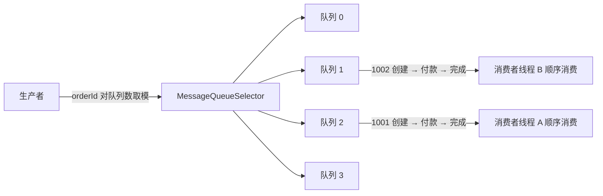

# RocketMQ 顺序消息：同一订单的消息为什么必须落进同一个队列

电商场景里一个订单会先后发出三条消息：订单创建、订单付款、订单完成。消费端如果先收到「订单完成」再收到「订单创建」，后面的处理全部失去意义。消息发出去了、一条没丢，业务却错了，这种问题排查起来比丢消息还隐蔽，因为它不报任何异常。

RocketMQ 用「顺序消息」解决这个问题。它的思路不是把整个 Topic 排队，而是让生产者和消费者打一场配合：同一业务键的消息落进同一个队列，队列内天然先进先出，消费端按队列顺序取。

## 先给结论

- RocketMQ 的顺序消息是**分区有序**：同一业务键（如订单 ID）的消息落到同一个队列，不是全 Topic 全局有序。
- 顺序被打散的根源在发送端：默认发送会在 Topic 的多个队列间轮询，同一个订单的三条消息可能落到不同队列。
- 生产端用 `send(Message, MessageQueueSelector, arg)` 三参重载，在选择器里按订单 ID 对队列数取模，保证同一订单永远命中同一个队列。
- 消费端要把监听器从 `MessageListenerConcurrently` 换成 `MessageListenerOrderly`，同一队列同一时刻只由一个线程按序消费。
- 队列内消息本来就是 FIFO，所以「同键同队列 + 队列内顺序消费」两条凑齐，顺序自然就有了。

## 一、顺序是从哪里丢的

Topic 不是一条管道，而是一组队列。按讲义的说法，如果发送时 Topic 还没有队列会自动创建，默认一个 Topic 下自动创建 4 个写队列、4 个读队列。多队列有两个目的：某个队列不可用时其它队列顶上，保证高可用；发送和消费都按队列并行，提高并发能力。

默认的发送方式在这组队列间轮询。同一个订单的创建、付款、完成三条消息先后发出，很可能分别落进队列 0、队列 1、队列 2。消费端再以多线程并发消费，出队的顺序和入队的顺序毫无关系，业务顺序就此被打乱。讲义里还有一句关键约束：一个队列同时只允许一个消费者消费，一个消费者可以消费多个队列中的消息。这句话决定了顺序消息的所有设计。

## 二、原理：生产者和消费者的打配合

队列本身是 FIFO 的，所以只需要保证两件事：同一订单的消息进同一个队列，以及消费端在同一个队列里按序取。两条缺一不可，生产者丢前者，消费者丢后者，顺序都保不住。



图里最关键的路径是订单 ID 到队列的那一步：1001 的三条消息全部取模命中队列 2，1002 全部落入队列 1，队列内先进先出，消费线程在同一队列上串行取消息，顺序就不会变。换不同订单 ID 的消息落在不同队列，彼此并行、互不阻塞，这就是分区有序：每个订单自己有序，不同订单之间不承诺顺序。

## 三、生产端：send 的三参重载与队列选择器

课程工程把编译级别调到 Java 8 才用得上 Lambda（IDEA 的 Project Structure 里把 Language level 设为 8）。生产者完整代码如下，发送 100 条消息，用 `i % 10` 模拟 10 个订单：

```java
package com.example.rocketmq.order;

import org.apache.rocketmq.client.producer.DefaultMQProducer;
import org.apache.rocketmq.client.producer.SendResult;
import org.apache.rocketmq.common.message.Message;
import org.apache.rocketmq.remoting.common.RemotingHelper;

public class OrderProducer {

    public static void main(String[] args) throws Exception {
        DefaultMQProducer producer =
                new DefaultMQProducer("HAOKE_ORDER_PRODUCER");
        producer.setNamesrvAddr("172.16.55.185:9876");
        producer.start();
        for (int i = 0; i < 100; i++) {
            int orderId = i % 10; // 模拟生成订单 id：0 到 9 共 10 个订单
            String msgStr = "Order --> " + i + ", id=" + orderId;
            Message message = new Message("haoke_order_topic", "ORDER_MSG",
                    msgStr.getBytes(RemotingHelper.DEFAULT_CHARSET));
            // 三参 send：第二个参数是队列选择器，第三个参数会原样传给选择器
            SendResult sendResult = producer.send(message, (mqs, msg, arg) -> {
                Integer id = (Integer) arg;
                int index = id % mqs.size();
                return mqs.get(index);
            }, orderId);
            System.out.println(sendResult);
        }
        producer.shutdown();
    }
}
```

选择器实现的其实是一个客户端接口 `MessageQueueSelector`，源码只有一行方法：

```java
public interface MessageQueueSelector {
    MessageQueue select(final List<MessageQueue> mqs,
                        final Message msg, final Object arg);
}
```

三个参数对应关系很直接：`mqs` 是该 Topic 下的全部队列（课程环境 4 个），`arg` 就是 `send` 的第三个参数，课程里传的是订单 ID。`id % mqs.size()` 得到 0 到 3 的下标，`mqs.get(index)` 返回选中的队列，客户端就把这条消息发进这个队列。订单 ID 不变，取模结果不变，落点就不会变。

## 四、消费端与运行验证：MessageListenerOrderly

消费端代码骨架和普通消费一样，唯一的差别在注册监听器这一行：不用之前的并发监听 `MessageListenerConcurrently`，换成 `MessageListenerOrderly`：

```java
package com.example.rocketmq.order;

import org.apache.rocketmq.client.consumer.DefaultMQPushConsumer;
import org.apache.rocketmq.client.consumer.listener.ConsumeOrderlyContext;
import org.apache.rocketmq.client.consumer.listener.ConsumeOrderlyStatus;
import org.apache.rocketmq.client.consumer.listener.MessageListenerOrderly;
import org.apache.rocketmq.common.message.MessageExt;

import java.io.UnsupportedEncodingException;
import java.util.List;

public class OrderConsumer {

    public static void main(String[] args) throws Exception {
        DefaultMQPushConsumer consumer =
                new DefaultMQPushConsumer("HAOKE_ORDER_CONSUMER");
        consumer.setNamesrvAddr("172.16.55.185:9876");
        consumer.subscribe("haoke_order_topic", "*");
        // 有序监听：同一队列由同一线程按顺序消费
        consumer.registerMessageListener(new MessageListenerOrderly() {
            @Override
            public ConsumeOrderlyStatus consumeMessage(
                    List<MessageExt> msgs, ConsumeOrderlyContext context) {
                try {
                    for (MessageExt msg : msgs) {
                        System.out.println(Thread.currentThread().getName()
                                + " queueId=" + msg.getQueueId()
                                + " 消息：" + new String(msg.getBody(), "UTF-8"));
                    }
                } catch (UnsupportedEncodingException e) {
                    e.printStackTrace();
                }
                return ConsumeOrderlyStatus.SUCCESS;
            }
        });
        consumer.start();
    }
}
```

为了看得清楚，日志里把线程名、队列 ID、消息体一起打出来。运行后先启动消费者再启动生产者，100 条消息、10 个订单、4 个队列，消费日志呈现出两个稳定规律：

```text
ConsumeMessageThread_1 queueId=2 消息：Order --> 2, id=2
ConsumeMessageThread_1 queueId=2 消息：Order --> 12, id=2
ConsumeMessageThread_1 queueId=2 消息：Order --> 22, id=2
ConsumeMessageThread_3 queueId=1 消息：Order --> 9, id=9
ConsumeMessageThread_3 queueId=1 消息：Order --> 19, id=9
```

规律一：同一个消费线程拿到的 queueId 恒定，线程 1 一直在队列 2 上，线程 3 一直在队列 1 上，这是有序监听在起作用。规律二：按订单 ID 过滤日志，id=2 的消息从头到尾都落在 queueId=2，id=9 的全部落在 queueId=1（9 对 4 取模正好是 1），生产端选择器没有让任何一条消息串队列。两边规律对上，同一订单的创建、付款、完成就严格按发送顺序被消费。

## 常见误区

- **把分区有序当成全局有序。** 顺序消息只保证同一选择器命中同一队列的那批消息有序，不同订单之间可以并行乱序。要全局有序只能把队列压到 1 个，吞吐会掉一个数量级，业务上通常没必要。
- **只改了生产端，消费端还挂着 `MessageListenerConcurrently`。** 消息虽然进了同一个队列，并发监听仍会用多线程抢着消费，顺序照样乱。必须换 `MessageListenerOrderly`。
- **选择器里用了不稳定的取模因子。** 比如对时间戳、随机数取模，同一订单两次发送命中不同队列。选择器的输入必须是稳定的业务键，`arg` 传什么、`select` 里就用什么。
- **Topic 扩队列后想当然。** 队列数从 4 变 8，取模结果整体变化，新老消息会落到不同队列，切换窗口期内的顺序无法保证，扩容要挑业务低峰并评估在途消息。

## 面试可能被问到的问题

1. 面试官追问：「RocketMQ 怎么实现顺序消息？」
   答：靠生产者和消费者配合。生产端用 `send(Message, MessageQueueSelector, arg)`，按业务键如订单 ID 对队列数取模，让同一业务键的消息固定落进同一个队列；消费端注册 `MessageListenerOrderly`，同一队列同一时刻只由一个线程按序消费。队列本身是 FIFO，两条凑齐顺序就成立。

2. 面试官追问：「分区有序和全局有序有什么区别？」
   答：分区有序只要求同一业务键的消息有序，不同键之间并行，吞吐不受影响，是 RocketMQ 顺序消息的实际语义；全局有序要求整个 Topic 严格排队，只能把读写队列压到 1，牺牲全部并发能力，仅在极少数场景使用。

3. 面试官追问：「为什么默认发送会打乱顺序？」
   答：一个 Topic 默认有 4 个写队列，默认发送在队列间轮询以均衡负载和提高并发，同一订单的几条消息会被分到不同队列。消费端又是并发消费，入队与出队顺序不一致，业务顺序就丢了。

4. 面试官追问：「`MessageListenerOrderly` 和 `MessageListenerConcurrently` 的区别是什么？」
   答：Concurrently 用线程池并发消费，各线程互不等待，吞吐高但不保证顺序；Orderly 对队列加锁，同一队列同一时刻只由一个线程消费，消费失败可以本地重试或挂起队列，保证顺序但吞吐低，还要小心单条消息卡住会阻塞整条队列。

5. 面试官追问：「队列扩容对顺序消息有什么影响？」
   答：选择器通常按 `orderId % 队列数` 路由，队列数变化后取模结果变化，同一订单的新消息会落到新队列，与旧队列里的在途消息之间没有顺序保证。扩容要评估在途消息消费完的时间点，或者改用一致性哈希这类平滑路由。

## 配套资料

- RocketMQ 发行包：`materials/code/10/rocketmq-all-4.5.0-bin-release/rocketmq-all-4.5.0-bin-release/`（课程运行消息收发用的服务端程序，`bin/` 下为 `runserver.sh`、`runbroker.sh` 等启动脚本，`conf/` 下为 Broker 配置模板）
- RocketMQ 专题讲义：`materials/docs/10/RocketMQ研究v1.0.md`（「消息发送过程」小节给出默认 4 写 4 读队列、多队列的高可用与并发动机，以及「一个队列同时只允许一个消费者消费」的约束，正是顺序消息设计的立足点）
- 本课（day09）资料包未提供源码：`materials/code/03/day09-分布式消息系统RocketMQ的入门/` 下仅有解压清单 `_extracted.json`，记录解压文件数为 0；文中 `OrderProducer`、`OrderConsumer` 与 `MessageQueueSelector` 接口按课程视频屏幕代码整理，包名统一改为 `com.example`
